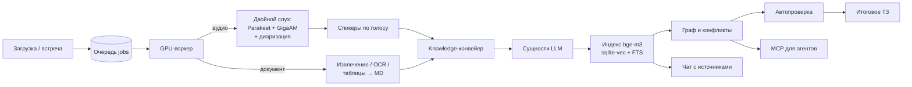

# PrimaryAnalitics — живая память проекта

**PrimaryAnalitics** (внутреннее имя портала — *Primary Analytics*) — локальный веб-портал для команды, который превращает поток проектных материалов — записи созвонов, живые встречи, документы, таблицы, скриншоты, заметки — в **проверяемую базу знаний проекта**: стенограммы с подписанными спикерами, решения и задачи, противоречия, актуальное ТЗ и чат со ссылками на источники.

Это не «расшифровщик». Файловый портал — входная дверь, а смысл системы — **не терять договорённости** и за секунды отвечать на вопрос «где и кто это сказал».

- Работает **полностью на своей машине**: Windows 11, одна GPU 24 ГБ (RTX 3090), команда до ~20 человек.
- Данные не уходят в сторонние сервисы (кроме опционального Cursor API как LLM-провайдера).
- Каждое утверждение в выжимке, ТЗ и чате сводится к источнику: файл, фрагмент, момент записи.

---

## Что умеет

| Функция | Как это работает |
|---|---|
| **Приём материалов** | Возобновляемая загрузка в проект. Оригинал хранится неизменным. Аудио/видео, PDF, DOCX/DOC/ODT/RTF, XLSX/XLS/CSV, PPTX, HTML (в т.ч. выгрузки Google Sheets), картинки. |
| **Расшифровка созвонов («двойной слух»)** | Parakeet‑TDT 0.6B v3 даёт слова и таймлайн (канон), GigaAM‑v3 — второй независимый слух для сверки, диаризация Nemotron (до 8 спикеров; Sortformer — откат), Silero VAD. LLM вычитывает только спорные места. Защита от галлюцинаций на тишине и от перепутанных дорожек. |
| **Спикеры по голосу** | Реестр голосов (WeSpeaker): система узнаёт знакомых людей, новых предлагает назвать. «Мягкий шлагбаум»: знания строятся сразу, имена можно дать позже — всё пересчитается само. |
| **Встречи внутри портала** | Видеокомната на LiveKit с гостевым входом по токену. Серверная чистка живого звука, запись **раздельных дорожек** каждого участника и экрана (1 fps) → расшифровка по дорожкам, описание кадров экрана через vision-LLM. |
| **Документы и таблицы** | Извлечение текста, OCR (Tesseract) или vision-LLM для картинок. Таблицы любого формата приводятся к единому Markdown и попадают в базу дословно. |
| **Сущности и граф знаний** | LLM выделяет решения, задачи, факты, участников; связи между ними образуют граф проекта. |
| **Противоречия** | Система находит конфликтующие утверждения и закрывает их правилами (новее/явная отмена/шум графа); человеку остаётся спорное. |
| **Автопроверка** | Локальная модель подтверждает/отклоняет извлечённые требования и конфликты (режимы `off` / `shadow` / `live`), каждое N‑е решение уходит человеку на контроль. |
| **Итоговое ТЗ проекта** | Map → merge → reduce по уже готовым стенограммам, чанкам, решениям/задачам, заметкам и конфликтам. Версии и changelog хранятся. |
| **Чат по проекту** | Гибридный поиск (вектор + FTS) по чанкам и сущностям + текущее ТЗ; ответ со ссылками на источники. |
| **Дедлайны, заметки, доступ** | Дедлайны проекта, ручные заметки и связи, выдача доступа к проекту по логину. |
| **MCP для внешних агентов** | Проектный MCP-сервер по ключу (Streamable HTTP): внешний ИИ-агент читает контракт проекта, задаёт вопросы, присылает вердикты. Всё присланное — данные, решения шлюза детерминированы, финальное слово — у человека. |
| **Индекс кода для ИИ** | Отдельный поисковый индекс по самому репозиторию (код, шаблоны, роуты, таблицы, решения, история) для агентов-разработчиков и страницы `/admin/map`. |

---

## Как течёт информация



**Статусы артефакта:** `uploaded → preprocessing → asr_running → speakers_pending → speakers_confirmed → transcript_ready → entities_extracted → indexed → graph_seeded → done` (для документов вместо ASR-статусов — `text_extracted`).

---

## Архитектура и процессы

| Процесс | Роль |
|---|---|
| **API + UI** (`python -m app.app.main`) | FastAPI + Jinja2. Preflight, затем поднимает edge (Caddy, LiveKit, запись голоса, запись экрана), GPU-воркер и портал на `127.0.0.1:1777`. |
| **GPU-воркер** (`main worker`) | Единственный исполнитель очереди `jobs`: один тяжёлый job за раз, защита от второго экземпляра. |
| **Caddy** | Внешний HTTPS (Let's Encrypt, в т.ч. на IP) → портал на loopback. |
| **LiveKit** | Медиасервер встреч (native, не Docker). |
| **voice_cleaner / screen_recorder** | Скрытые боты комнаты: пишут сырые дорожки голоса и экран. Шумодав голоса — DFN3 в браузере говорящего. |
| **Docker `primaryanalitics-gigaam`** | Второй слух GigaAM + голосовые эмбеддинги (`:18102`). |
| **Ollama** | Эмбеддинги `bge-m3` на CPU (`:11434`). |
| **LLM** | Единый адаптер: LM Studio (локально, Qwen/Gemma) **или** Cursor API — переключается при старте. |
| **Хранилища** | SQLite `data/app.db` (WAL, FK), векторы в sqlite-vec, файлы проектов в `data/projects/{id}/`. |

---

## Структура репозитория

```
app/app/                 Веб-приложение (FastAPI)
  main.py                Точка входа: all | api | worker | check
  config.py, db.py       Настройки из .env, подключение к SQLite
  routers/               HTTP-слой: страницы, auth, проекты, загрузка, знания/чат,
                         встречи, спикеры, участники, MCP, ревью требований, карта
  services/              Бизнес-логика (≈100 модулей), главные группы ниже
  models/                SQLAlchemy-модели: проекты, артефакты, jobs, сущности,
                         чанки, встречи, профили голосов, контракт, обмен с агентом
  workers/               GPU-воркер, конвейеры, фоновое автоматическое ревью
  mcp/                   Протокол проектного MCP
  templates/, static/    Интерфейс (Jinja2, Bootstrap, единая дизайн-система design.css)
  tests/                 pytest для портала
asr/                     Распознавание речи
  lab/                   Канонический конвейер расшифровки (изолированные прогоны runs/)
  lab_*.py               Стадии: sense, giga, reconcile, proof, voice
  docker/                Образ GigaAM (Whisper/T-one — только для отката)
  summarize_call.py      Выжимка одного созвона
  tests/                 Unit-тесты ASR
tools/
  livekit/               Боты встречи: чистка звука, запись экрана
  caddy/                 Конфиг HTTPS
  lightrag/              Граф знаний по документации (Docker)
  projindex_mcp.py       MCP-сервер индекса кода для ИИ-агентов
  tesseract/tessdata/    Языковые данные OCR
scripts/                 Запуск/остановка, установка окружения и служб, бэкап,
                         индекс проекта, QA-прогоны (в т.ч. мобильные), оценки качества
docs/                    План, карта, решения, этапы, промпты — см. ниже
experiments/             Исследования (диаризация, TTS, промо-видео) — вне прод-пути
_archive/                Выведенные из работы скрипты
```

### Главные группы сервисов (`app/app/services/`)

| Группа | Модули (примеры) | За что отвечает |
|---|---|---|
| Конвейеры | `pipeline_lab`, `pipeline_knowledge`, `pipeline_documents`, `pipeline_meeting` | Оркестрация обработки артефакта от загрузки до `done` |
| Встречи | `meetings`, `meeting_recordings`, `meeting_merge`, `meeting_frames`, `meeting_checks`, `meeting_track_repair` | Комнаты, токены, запись дорожек, склейка, кадры экрана, контроль целостности |
| Спикеры | `speaker_profiles`, `artifact_audio`, `user_identity` | Реестр голосов, подтверждение имён, применение к стенограмме |
| Документы | `docx_extract`, `xlsx_extract`, `pptx_extract`, `html_extract`, `image_extract`, `office_convert` | Извлечение текста и таблиц |
| Знания | `entities`, `chunking`, `indexing`, `chunk_fts`, `graph`, `conflict_rules`, `auto_review` | Сущности, индекс, граф, противоречия, автопроверка |
| Выходы | `tz`, `chat`, `summarize_document`, `artifact_reports` | ТЗ проекта, чат, выжимки, HTML-отчёты |
| Внешний агент | `agent_gateway`, `agent_inbox`, `agent_verdicts`, `contract`, `project_mcp_*` | Шлюз, вопросы, вердикты, контракт обмена |
| Инфраструктура | `llm`, `gpu_phase`, `docker_runtime`, `edge_runtime`, `single_instance`, `rate_limit`, `auth` | LLM-адаптер, распределение GPU, автозапуск сервисов, безопасность |
| Индекс кода | `project_index/` | Нарезка, анализаторы, гибридный поиск по репозиторию |

---

## Роли и доступ

Вход по логину из белого списка `Login_up.txt`; пароль определяет роль. Сессия — JWT в cookie.

| Роль | Может |
|---|---|
| **admin** | Всё: любые проекты, лаборатория расшифровки, пересборка ТЗ, решения по конфликтам, требованиям и вердиктам агента |
| **manager** | Создавать проекты, работать в своих: загрузка, подтверждение спикеров, пересчёт выжимок, выдача доступа, MCP-ключи |
| **user** | Загрузка и просмотр в своих проектах, заметки, чат |

Чужой проект отдаёт **404**, нехватка роли на своём — **403**. Проверка всегда на сервере, потом кнопка.

---

## Запуск

Требуется: Python 3.10, Docker Desktop, FFmpeg, Ollama (`bge-m3`), LM Studio или ключ Cursor API, NVIDIA GPU с CUDA 12.8.

**`git clone` сам по себе стенд не поднимает** — в репозитории нет весов моделей, `venv` и секретов. Полная установка: [INSTALL.md](INSTALL.md).

Перед порталом при локальной LLM нужен **сервер LM Studio** (`run_server.ps1` или автозапуск `scripts\install_lmstudio_autostart.ps1`). Сам `main` сервер не стартует (только проверяет `:1234` и потом грузит модель). Ollama и Docker желательны заранее; контейнер GigaAM портал может поднять при обработке аудио.

```powershell
INSTALL.bat                                   # первичная установка (см. INSTALL.md)
# после переноса папки / битого venv:
# powershell -ExecutionPolicy Bypass -File scripts\setup_env.ps1 -Force
copy .env.example .env                        # настройки и секреты
copy Login_up.example.txt Login_up.txt        # допущенные логины
.\run_server.ps1 -SkipLoad                    # только если LLM_PROVIDER=lmstudio
scripts\PrimaryAnalitics-3-Запуск-LM-Studio.bat   # или …-2-Запуск-Cursor.bat
# либо:
.\venv\Scripts\python.exe -m app.app.main check   # проверить стенд без запуска
.\venv\Scripts\python.exe -m app.app.main         # портал + воркер + edge
```

В IDE указывайте интерпретатор `venv\Scripts\python.exe`; удобнее запускать через bat / `scripts\restart.ps1`, чем «голый» `main.py`.

Тесты: `.\venv\Scripts\python.exe -m pytest` (подробно — `docs/TESTING.md`).

---

## Документация

| Файл | О чём |
|---|---|
| [docs/PLAN.md](docs/PLAN.md) | Единый пошаговый план и этапы |
| [docs/PROJECT-MAP.md](docs/PROJECT-MAP.md) | Подробная карта: каталоги, конвейеры, кнопка → API → функция → таблица |
| [docs/DECISIONS.md](docs/DECISIONS.md) | Зафиксированные решения, которые нельзя менять молча |
| [docs/stages/](docs/stages/) | Этапы 0–10 с критериями готовности |
| [docs/OPERATIONS.md](docs/OPERATIONS.md) | Эксплуатация: запуск, остановка, типичные проблемы |
| [docs/TESTING.md](docs/TESTING.md) | Как и что тестируем |
| [docs/HOWTO-MANAGER.md](docs/HOWTO-MANAGER.md) | Короткая инструкция для менеджера |
| [docs/prompts/](docs/prompts/) | Все промпты LLM |
| [docs/plans/](docs/plans/) | Планы отдельных направлений (встречи, автопроверка, индекс, диаризация…) |
| [AGENTS.md](AGENTS.md) | Инструкции для ИИ-агентов, работающих с репозиторием |

---

## Что не хранится в git

Секреты (`.env`, `Login_up.txt`), виртуальные окружения, веса моделей, бинарники (Caddy, LiveKit, FFmpeg, LibreOffice), рабочие данные проектов, **записи встреч**, бэкапы БД и результаты оценок. Всё это создаётся установкой или живёт только на рабочей машине.
