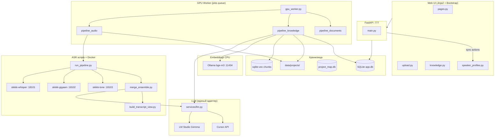

# Карта проекта SKKKK

> **Назначение:** единый ориентир «где что лежит, как связано, за что отвечает».  
> **Обновлять вместе с кодом** при добавлении модулей, пайплайнов, API, скриптов.  
> **Семантический поиск:** `py scripts/search_project_map.py "как работает merge"`  
> **Переиндексация:** `py scripts/index_project_map.py`

Связанные документы: [PLAN.md](PLAN.md) · [DECISIONS.md](DECISIONS.md) · [TESTING.md](TESTING.md) · [manifest.yaml](project-map/manifest.yaml)

---

## 1. Архитектура (одним взглядом)



---

## 2. Корень и каталоги

| Путь | Назначение |
|------|------------|
| `C:\1C_NEW_SKKKK\` | Единственный корень проекта |
| `app/app/` | FastAPI: роутеры, сервисы, модели, воркер, шаблоны |
| `asr/` | ASR-конвейер, merge, view, speaker match (subprocess из API/worker) |
| `asr/docker/` | Образы/REST для T-one и вспомогательное |
| `asr/tests/` | Unit-тесты ASR-модулей |
| `data/app.db` | SQLite: users, projects, artifacts, jobs, entities, links, chunks |
| `data/logs/` | api.log, worker.log, monitor_loop.log |
| `data/projects/{id}/` | Файлы проекта (см. §6) |
| `data/project_map.db` | Векторный индекс карты проекта (sqlite-vec, для агентов) |
| `docs/` | План, решения, промпты, этапы, **эта карта** |
| `docs/prompts/` | Промпты LLM (merge, entities, summary, TZ, chat, vision) |
| `docs/stages/` | STAGE-NN: критерии готовности этапов |
| `scripts/` | Утилиты, мониторинг, rerun, индекс карты |
| `.cursor/rules/` | Правила агента Cursor |
| `.cursor/skills/` | Скилы (gpu-orchestrator, knowledge-pipeline, …) |
| `venv/` | Python 3.10+ окружение |
| `.env` | Секреты (не в git), шаблон `.env.example` |

---

## 3. Процессы runtime

| Процесс | Команда | Порт / роль |
|---------|---------|-------------|
| **API + UI** | `python -m app.app.main all` | `:777` — HTTP, JWT, страницы, **синхронные** действия (спикеры, выжимка) |
| **GPU Worker** | `python -m app.app.main worker` | Очередь `jobs` — ASR, knowledge, один job за раз |
| **Whisper** | Docker `skkkk-whisper` | `:18101` |
| **GigaAM** | Docker `skkkk-gigaam` | `:18102` — ASR + diar + **embed_voice** |
| **T-one** | Docker `skkkk-tone` | `:18103` |
| **Ollama** | вне проекта | `:11434` — `bge-m3`, CPU |
| **LM Studio** | вне проекта | `:1234` — Gemma (если `LLM_PROVIDER=lmstudio`) |
| **Cursor API** | облако/local SDK | если `LLM_PROVIDER=cursor` |

**Важно:** кнопки «Пересчитать» / «Пересобрать выжимку» / «Переиндексировать» идут через **API-процесс**, не через GPU-воркер.

---

## 4. Конвейеры данных

### 4.1. Аудио (основной)

```
upload → job queued
  → preprocessing (FFmpeg 16kHz WAV)
  → asr_running: run_pipeline.py
      ├── ensure Docker Desktop + ASR-контейнеры (автозапуск)
      ├── parallel: Whisper + T-one + GigaAM (3 Docker)
      ├── sortformer diarization
      ├── merge_ensemble.py (окна 120–180с, LLM склейка)
      ├── transcript_integrity (global audit/repair)
  → asr_completed
  → build_transcript_view.py (таймкоды + спикеры)
  → match_sortformer_speakers.py (эмбеддинги голосов)
  → build_transcript_view.py (имена спикеров)
  → voice_turn_audit.py (опционально правит текст)
  → transcript_ready → finalize → parsed/*_final.txt
  → knowledge pipeline (worker):
      entities (LLM) → index (Ollama, автозапуск) → call_summary (LLM) → graph → done
```

### 4.2. Документы / изображения

```
upload → normalize (PDF/DOCX/OCR/vision) → text_extracted
  → knowledge pipeline (entities → index → graph → TZ trigger → done)
```

### 4.3. Статусы артефакта

`uploaded` → `preprocessing` → `asr_running` → `asr_completed` → `transcript_ready`  
→ `entities_extracted` → `indexed` → `graph_seeded` → `done` | `error`

(Документы: `text_extracted` вместо ASR-статусов.)

---

## 5. UI: страницы, кнопки, кто выполняет

> **Правило:** кнопки с `POST /api/artifacts/…` и `POST /projects/…/rebuild-tz` идут **синхронно через FastAPI** (`:777`).  
> **Блокировка повторного нажатия:** `SKKKK.guardButton` / `SKKKK.guardSubmit` (портал) и `guardActionButton` (стенограмма) — спиннер, фиксированная ширина, как у «Скачать».  
> **Долгие операции:** таблица `project_tasks`, `GET …/tasks/active` — после F5 видно «идёт пересборка», повторный POST → **409**.  
> Загрузка файлов → **job в GPU-воркер**. Авто-опрос статусов на странице проекта — каждые **3 с**.

### 5.1. Роутеры (backend)

| Файл | Prefix | Назначение |
|------|--------|------------|
| `routers/pages.py` | `/` | HTML-страницы, отчёты арtefact, audio stream |
| `routers/auth.py` | `/auth` | POST login → JWT |
| `routers/projects.py` | `/projects` | CRUD проектов |
| `routers/upload.py` | `/projects` | Resumable upload, list artifacts |
| `routers/knowledge.py` | `/projects/{id}/…`, `/chat` | search, graph, TZ, chat, conflicts, notes |
| `routers/speaker_profiles.py` | `/api` | enroll, merge, recalculate, rebuild-summary, reindex |

### 5.2. Общая навигация

| Элемент | URL | Шаблон | Действие |
|---------|-----|--------|----------|
| Логотип **SKKKK** | `/` | `base.html` | Список проектов |
| **к проектам** | `/` | `project.html` nav | То же |
| `/login` | `/login` | `login.html` | Вход (JWT в localStorage) |
| `/admin/conflicts` | `/admin/conflicts` | `conflicts.html` | Очередь конфликтов (**admin**, только просмотр JSON) |
| `/projects/{id}/graph` | graph | `graph.html` | Cytoscape-граф (GET graph/data) |
| `/projects/{id}/tz` | tz | `tz.html` | Отдельная страница ТЗ (дублирует rebuild-tz) |
| `/projects/{id}/chat` | chat | `chat.html` | Отдельный чат (дублирует чат на project) |

### 5.3. Список проектов — `/` (`index.html`)

| Кнопка / элемент | API | Кто | Роль | Результат |
|------------------|-----|-----|------|-----------|
| **Новый проект** | — | UI | admin, manager | Открывает модалку |
| **Создать** | `POST /projects` | FastAPI | admin, manager | Проект + `data/projects/{id}/` tree |
| **Отмена** | — | UI | — | Закрыть модалку |
| Клик по проекту | — | navigate | любая | `/projects/{id}` |
| **Описание** (стрелка справа от названия) | — | UI | auth | Сворачиваемый текст `description` под названием (если задан при создании) |
| Авто-загрузка | `GET /projects` | FastAPI | auth | Список активных проектов |

### 5.4. Страница проекта — `/projects/{id}` (`project.html`)

#### Макет: выжимка и чат (строка `project-insights-row`)

На **lg+** (≥992px) левая колонка «Итоговая выжимка по проекту» и правая «Чат с ИИ» — **одинаковая высота**: `min(70vh, 720px)`, `position: sticky; top: 0.75rem`. Карточки — flex-колонки (`insights-card`, `chat-card`); контент (**`#tz-content`**, **`#chat-log`**) скроллится **внутри** панели, поле ввода чата прижато к низу (`chat-composer`, `margin-top: auto`). Страница при длинной переписке не растягивается.

На **мобильном** (<768px): `#tz-content` до `50vh`, `#chat-log` до `40vh`, отдельный внутренний скролл.

#### Загрузка материалов

| Кнопка | API | Кто | Результат |
|--------|-----|-----|-----------|
| **Загрузить** | `POST …/uploads/init` → `PUT …/chunks/{n}` → `POST …/complete` | FastAPI + **GPU worker** (job) | Файл в `raw_inputs/`, job `queued`, воркер гонит ASR/knowledge |

Тип (`source_type`): `call` | `document` | `note` | `screenshot` — влияет на пайплайн воркера.

#### Таблица артефактов (авто-обновление 3 с)

| Элемент | API | Поведение |
|---------|-----|-----------|
| Badge статуса | `GET /projects/{id}/artifacts` | `reconcile_artifact_status` подтягивает `done`, если knowledge уже есть |
| Ссылка на имя файла | — | При `status=done` → `/artifacts/{id}/report` (стенogramма или отчёт документа) |
| **Pipeline live** (раскрывашка) | тот же GET | Пока статус не terminal — шаги ASR/knowledge из `pipeline_progress.py` |
| **Скачать** | `GET /artifacts/{id}/download` | Созвон/видео → **MP3** (`download.mp3`, 64 kbps); документ → оригинал из `raw_inputs/` |
| Toast «обработан» | — | Когда статус сменился на `done` |

Статусы в UI: В очереди → Подготовка → ASR → … → **Готово** / **Ошибка**.

#### Итоговая выжимка по проекту (левая колонка)

| Кнопка | API | Кто | На чём | Время | Роль |
|--------|-----|-----|--------|-------|------|
| *(авто load)* | `GET /projects/{id}/tz/content` | FastAPI | `project_state/current_tz.md` | — | все |
| **Пересобрать** | `POST /projects/{id}/rebuild-tz` | FastAPI → `tz.rebuild_tz()` → **LLM map/reduce** | **Индекс проекта:** все `chunks` из БД (sqlite-vec) по каждому `done` арtefactу + сущности + выжимки созвонов + заметки + конфликты; промпт `rebuild_tz.md`; фрагменты ~6000 симв. | 2–10 мин | **admin** |

Источник — **не** обрезанный excerpt сырого текста (старый лимит 2500 симв. убран). Если индекса нет — fallback на полный `transcription_text`.

Результат: `data/projects/{id}/project_state/current_tz.md`, архив в `versions/`, запись `changelog`.

Авто-пересборка: каждые **N** готовых аудио (`TZ_REBUILD_EVERY_N`, по умолчанию 3) — при job done.

#### Чат с ИИ по проекту (правая колонка)

| Кнопка | API | Кто | На чём |
|--------|-----|-----|--------|
| **Спросить** | `POST /chat` `{project_id, question}` | FastAPI → `chat.answer_chat()` | RAG: sqlite-vec + **priority_weight** rerank + документы + **chat_guidance** + LLM; при неоднозначности — **уточняющий вопрос** в чат (`meta.kind=clarification`) |
| **История чата** | `GET /projects/{id}/chat/history` | FastAPI → `chat.list_chat_messages()` | Лента + `waiting`, `meta` (уточнения) |
| **Статус чата** | `GET /projects/{id}/chat/status` | FastAPI → `chat.chat_is_pending()` | `{pending, label}` |

Enter в textarea — тоже отправка. Отдельная страница `/projects/{id}/chat` — тот же endpoint. Повторный `POST /chat` при активном ответе — **409**.

#### Удалённый доступ MCP (низ страницы проекта)

Read-only MCP (Streamable HTTP) к знаниям **только этого проекта**. Авторизация — ключ `skkkk_mcp_…`, не JWT портала.

**UI:** блок **сворачиваемый** (Bootstrap `collapse`, `#mcp-access-panel`). По умолчанию **сложен**; клик по заголовку «Удалённый доступ (MCP)» — развернуть/свернуть, подсказка `(развернуть)` / `(свернуть)` в `#mcp-toggle-hint`. Badge «только чтение» в шапке всегда виден.

| Элемент UI | API | Кто |
|------------|-----|-----|
| **Создать ключ** | `POST /projects/{id}/mcp/tokens` | admin, manager |
| **Отозвать ключ** | `DELETE /projects/{id}/mcp/tokens/{token_id}` | admin, manager |
| **URL / JSON для Cursor** | `GET /projects/{id}/mcp/info` | любой авторизованный |
| **MCP endpoint** | `POST /mcp/projects/{id}` + `Authorization: Bearer <ключ>` | держатель ключа |

Инструменты MCP: `project_overview`, `list_artifacts`, `get_project_summary`, `search_project`, `list_entities`, `get_knowledge_graph`, `list_notes`, `list_conflicts`, `get_artifact_content`.

Публичный URL для MCP задаётся в `.env`: `WEB_PUBLIC_URL=http://203.0.113.10:777` (если портал доступен из интернета). Без него в UI подставляется адрес из текущего запроса.

### 5.5. Стенogramма созвона — `/artifacts/{id}/report` (`transcript.html` / `transcript_view.py`)

Открывается из таблицы проекта (status=done). Встроенный HTML с плеером.

#### Блок «Итоговая выжимка созвона» (верх)

Read-only markdown из `call_summary.md` (собран при knowledge или кнопкой ниже).

#### Скачать материалы (под плеером)

| Кнопка | API | Файл |
|--------|-----|------|
| **Выжимка Word** | `GET /artifacts/{id}/download/summary.docx` | `.docx` через **python-docx** из `call_summary.md` |
| **Стенограмма .txt** | `GET /artifacts/{id}/download/transcript.txt` | `[таймкод] имя: текст` из `docker_gigaam_speakers.json` |

#### Панель «Спикеры и инструменты» (registry)

| Кнопка | API | Кто | На чём | Время |
|--------|-----|-----|--------|-------|
| **▶** (у спикера) | — | browser | seek audio | мгновенно |
| **Запомнить** / **Сохранить** | `POST /api/artifacts/{id}/speaker-enroll` | FastAPI → GigaAM embed + DB | match JSON, `speaker_profiles` | ~5–20 с |
| **Слить** (два ID) | `POST /api/artifacts/{id}/speaker-merge` | FastAPI | merge_map + rebuild HTML | ~1 с |
| **Пересчитать** | `POST /api/artifacts/{id}/speaker-recalculate` | FastAPI → `match_sortformer_speakers` | Sortformer + **Docker GigaAM** embed + profiles | ~20 с |
| **Пересобрать выжимку** | `POST /api/artifacts/{id}/rebuild-summary` | FastAPI → `summarize_call.py` → **LLM** | `docker_gigaam_speakers.json`, промпт `call_summary.md` | ~1–5 мин |
| **Обновить и переиндексировать** | `POST /api/artifacts/{id}/reindex` | FastAPI | rebuild view → `*_final.txt` → **Ollama** index chunks | ~30 с |

После POST-кнопок — `location.reload()`.

#### Legacy-режим (без registry, старые отчёты)

| Кнопка | Куда | Примечание |
|--------|------|------------|
| **Применить имена** | `localStorage` | Только клиент, **не** сервер |
| **Слить** (select) | `localStorage` | Только клиент |

#### Интерактив без API

| Элемент | Действие |
|---------|----------|
| Chip фильтр спикера | Фильтр реплик |
| Поле поиска `#q` | Фильтр по тексту |
| Клик по времени / реплике | Seek аудио |
| `GET /artifacts/{id}/audio` | Поток WAV/M4A |

### 5.6. Match спикеров — `/artifacts/{id}/report-speaker-match` (`speaker_match_test.html`)

| Кнопка / ссылка | API | Кто | Примечание |
|-----------------|-----|-----|------------|
| **Обновить и пересчитать** | `POST …/speaker-recalculate` | FastAPI | = «Пересчитать» в стенogramме |
| **Запомнить** / **Обновить** | `POST …/speaker-enroll` | FastAPI | На карточке спикера |
| **Объединить** | `POST …/speaker-merge` | FastAPI | На карточке |
| **Прослушать** | — | audio seek | клип спикера |
| Сегмент / таймлайн | — | seek | |
| Sortformer / Сырая диар. / Стенogramma | GET report-* | pages | sibling reports |

### 5.7. Прочие отчёты аудио (только просмотр + seek)

| URL | Файл-генератор | Содержимое |
|-----|----------------|------------|
| `/artifacts/{id}/report-sortformer` | `build_sortformer_transcript_view.py` | Sortformer timeline |
| `/artifacts/{id}/report-diar-raw` | `build_raw_diar_view.py` | Whisper/Tone/GigaAM tracks |
| `/artifacts/{id}/report-diar-two-voice` | two-voice diar | 2-speaker view |

Кнопок POST нет — только навигация и плеер.

### 5.8. Отдельные страницы

| Страница | Кнопки | API |
|----------|--------|-----|
| `/projects/{id}/tz` | **Пересобрать ТЗ** | = `rebuild-tz` (admin) |
| `/projects/{id}/chat` | **Спросить** | `POST /chat` |
| `/projects/{id}/chat` | *(авто при открытии)* | `GET /projects/{id}/chat/history` |
| `/projects/{id}/chat` | *(авто при pending)* | `GET /projects/{id}/chat/status` + poll history |
| `/projects/{id}/graph` | — | `GET …/graph/data` (Cytoscape) |
| `/admin/conflicts` | — | `GET …/conflicts` (admin, read-only cards) |
| `/login` | **Войти** | `POST /auth/login` |

API без кнопок в UI (для будущего / интеграций):  
`GET …/search`, `POST …/notes`, `POST /links`, `POST /entities/{id}/review`, `POST /conflicts/{id}/resolve`.

### 5.9. Сводка: кто выполняет действие

| Исполнитель | Что |
|-------------|-----|
| **GPU worker** | ASR, merge, knowledge (entities, index, summary, graph) после upload |
| **FastAPI sync** | recalculate, enroll, merge, rebuild-summary, reindex, rebuild-tz, chat |
| **Docker GigaAM** | voice embed (recalculate, enroll) |
| **LLM** (Cursor/Gemma) | merge (worker), summary, entities, TZ, chat |
| **Ollama bge-m3** | index/reindex chunks, semantic search |
| **Browser only** | фильтры, seek, legacy rename localStorage |

### 5.10. Два разных «Пересобрать» — не путать

| UI | Кнопка | Scope | Output |
|----|--------|-------|--------|
| `/projects/{id}` | **Пересобрать** (выжимка проекта) | весь проект | `current_tz.md` из **всех chunks БД** + entities + notes |
| `/artifacts/…/report` | **Пересобрать выжимку** | один созвон | `call_summary.md` из полной стенограммы |

### 5.11. Ограничения выжимок (контекст LLM)

| Выжимка | Вход | Ограничение |
|---------|------|-------------|
| **Созвон** (`call_summary.md`) | Вся стенограмма | map ~6000 симв. × N + reduce **1500 tokens** — сжатие by design |
| **Проект** (`current_tz.md`) | **Все chunks** проекта из `chunks` + entities + notes + conflicts + call_summary | map ~6000 симв. × N + reduce **8192 tokens** |
| **Чат** | top‑8 релевантных chunks (semantic search) | только к вопросу, не полная выжимка |

---

## 6. Layout артефакта на диске

```
data/projects/{project_id}/
├── raw_inputs/{calls|documents|notes}/   # оригинал загрузки
│   # видео (.mp4/.mkv/.webm/…) удаляется после проверенного извлечения WAV
├── artifacts/{artifact_id}/
│   ├── audio/input_16k.wav               # рабочий звук (16 kHz mono)
│   ├── audio/playback.m4a              # AAC для плеера в UI
│   ├── asr/                              # рабочая зона ASR
│   │   ├── docker_whisper.json|.txt
│   │   ├── docker_tone.json|.txt
│   │   ├── docker_gigaam.txt
│   │   ├── sortformer_segments.json
│   │   ├── docker_merged_windows.json    # окна LLM-merge
│   │   ├── docker_merged_plain.txt       # plain после integrity
│   │   ├── docker_gigaam_speakers.json   # реплики для UI/summary
│   │   ├── transcript_integrity.json
│   │   ├── call_summary.md
│   │   └── transcript.html
│   └── reports/                          # копии для UI
│       ├── transcript.html
│       ├── call_summary.md
│       └── sortformer_speaker_match.json
├── parsed/calls/
│   ├── {id}_final.txt
│   ├── {id}_transcript.html
│   └── {id}_call_summary.md
└── structured/{id}_entities.json
```

---

## 7. Сервисы (`app/app/services/`)

| Модуль | Ответственность |
|--------|-----------------|
| `llm.py` | Единый адаптер: lmstudio / cursor |
| `gpu_phase.py` | Load/unload Gemma, VRAM-фазы |
| `queue.py` | jobs: claim, finish, requeue |
| `pipeline_audio.py` | ASR subprocess, view, match, voice audit, call summary |
| `pipeline_knowledge.py` | entities → index → summary → graph → done |
| `pipeline_documents.py` | PDF/DOCX/OCR pipeline |
| `pipeline_resume.py` | Resume ASR без повторного merge |
| `pipeline_progress.py` | UI progress по checklist |
| `transcript_export.py` | export transcript.txt + summary.doc для страницы созвона |
| `artifact_audio.py` | finalize, sync reports, rebuild transcript HTML, extract WAV |
| `media_cleanup.py` | удаление видео-оригинала после проверки `input_16k.wav` |
| `speaker_profiles.py` | enroll/merge/recalculate, rebuild summary/reindex |
| `entities.py` | LLM extract + persist entities JSON |
| `indexing.py` | chunk → Ollama embed → chunks + chunk_vectors |
| `vector_index.py` | sqlite-vec CRUD для artifact chunks |
| `graph.py` | seed entities/links, conflicts |
| `tz.py` | rebuild TZ (map/reduce по всем chunks проекта + entities + notes) |
| `chat.py` | RAG chat over project; history in `chat_messages` |
| `models/chat_message.py` | Per-user chat log (`project_id` + `user_id`) |
| `chunking.py` | split transcript / plain text |
| `storage.py` | paths: artifact_root, parsed, structured |
| `status.py` | artifact status transitions |
| `auth.py` | JWT, role passwords |
| `upload.py` / `resumable_upload.py` | file registration |
| `normalize.py` / `image_extract.py` / `tesseract_tools.py` | document text |
| `ffmpeg_tools.py` | audio prep |
| `ollama_client.py` | bge-m3 embeddings |
| `ollama_runtime.py` | автозапуск Ollama перед embed/index |
| `notify.py` | Telegram stub |
| `plain_text.py` | clean LLM outputs |

### Модели (`app/app/models/`)

`user`, `project`, `artifact`, `job`, `entity` (+ chunks, links, speaker_profile, …)

### Workers (`app/app/workers/`)

| Файл | Роль |
|------|------|
| `gpu_worker.py` | Loop: claim job → processor |
| `processor.py` | dry_run stubs; real routing в pipeline_* |

---

## 8. ASR-модули (`asr/`)

### 8.1. Оркестрация

| Скрипт | Роль |
|--------|------|
| `run_pipeline.py` | Главный ASR: prepare → 3 engines → sortformer → merge |
| `run_all.py` | Legacy/local all-in-one |
| `prepare_audio.py` | FFmpeg → input_16k.wav |
| `pipeline_checklist.json` | Статусы шагов для resume/progress |

### 8.2. ASR движки

| Скрипт | Docker | Выход |
|--------|--------|-------|
| `run_whisper.py` | skkkk-whisper | docker_whisper.json |
| `run_tone.py` | skkkk-tone | docker_tone.json |
| `run_gigaam.py` | skkkk-gigaam | docker_gigaam.txt |
| `client.py` | HTTP к контейнерам | — |

### 8.3. Merge + качество

| Модуль | Роль |
|--------|------|
| `merge_ensemble.py` | Окна тишины → 3 ASR → **LLM merge** → integrity → plain |
| `merge_guard.py` | Audit окна: recall, anti-Whisper-loop, Cursor vs Gemma пороги |
| `transcript_integrity.py` | Global audit/repair plain, view audit, seams |
| `hallucination_guard.py` | Петли, scrub текста |
| `llm_client.py` | LLM для merge/summary из subprocess |
| `silence_energy.py` | Границы окон |

### 8.4. View + спикеры

| Модуль | Роль |
|--------|------|
| `build_transcript_view.py` | **Канон UI**: align timing + match labels → speakers.json, HTML |
| `timing_align.py` | Whisper/Tone/GigaAM clocks |
| `clock_guard.py` | Выбор clock source |
| `match_sortformer_speakers.py` | WeSpeaker embed (GigaAM docker) → match JSON |
| `voice_turn_audit.py` | Проверка голос/текст, auto-fix |
| `transcript_view.py` | HTML renderer + JS (recalc, summary, reindex) |
| `build_speaker_match_view.py` | HTML страница match |
| `speaker_registry.py` | enroll/merge в UI |
| `summarize_call.py` | Map/reduce выжимка → call_summary.md |

### 8.5. Граф зависимостей ASR (упрощённо)

```
run_pipeline
  → prepare_audio
  → run_whisper | run_tone | run_gigaam
  → dump_sortformer
  → merge_ensemble
       → merge_guard, llm_client, transcript_integrity, hallucination_guard
  → build_transcript_view
       → timing_align, clock_guard, speaker_labels
  → match_sortformer_speakers
  → build_transcript_view
  → voice_turn_audit
  → summarize_call (в knowledge phase)
```

Полный граф: [project-map/manifest.yaml](project-map/manifest.yaml)

---

## 9. Промпты LLM

| Файл | Используется в |
|------|----------------|
| `merge_transcript.md` | merge_ensemble.py |
| `call_summary.md` | summarize_call.py |
| `extract_entities.md` | entities.py |
| `normalize_document.md` | pipeline_documents |
| `extract_image_vision.md` | image_extract |
| `rebuild_tz.md` | tz.py |
| `rag_chat.md` | chat.py |

---

## 10. Scripts (`scripts/`)

| Скрипт | Назначение |
|--------|------------|
| `index_project_map.py` | Векторный индекс карты → `data/project_map.db` |
| `search_project_map.py` | Семантический поиск по карте |
| `rerun_cursor_merge.py` | Merge+view без ASR (Cursor tuning) |
| `rerun_transcript_integrity.py` | Только integrity + plain + view |
| `resume_knowledge.py` | Догнать knowledge phase |
| `rebuild_artifact_report.py` | Пересборка отчёта артефакта |
| `monitor_status.py` / `monitor_skkkk_loop.ps1` | Мониторинг сервера |
| `scripts/start.ps1` | Запуск API+воркер: `-Llm cursor|gemma` или из `.env` |
| `scripts/start-cursor.ps1` / `start-gemma.ps1` | Быстрый старт с выбранным LLM |
| `scripts/stop.ps1` | Остановить сервер и снять lock воркера |
| `run_all.ps1` / `run_api.ps1` / `run_worker.ps1` | Запуск служб |
| `smoke_cycle.py` | Smoke test |

---

## 11. Тесты

| Путь | Что покрывает |
|------|---------------|
| `app/app/tests/` | API routes, auth, TZ counting, artifact actions |
| `asr/tests/` | merge_guard, transcript_integrity, timing, speakers, hallucination |
| `docs/TESTING.md` | Стратегия, команды pytest |

```powershell
py -m pytest app/app/tests asr/tests -q
```

---

## 12. Внешние зависимости

| Система | Переменные .env | Когда нужна |
|---------|-----------------|-------------|
| LM Studio | `LMSTUDIO_*`, `LLM_PROVIDER=lmstudio` | Merge, entities, summary, TZ, chat |
| Cursor API | `CURSOR_*`, `LLM_PROVIDER=cursor` | То же, без VRAM Gemma |
| Ollama bge-m3 | `OLLAMA_*` | Индекс артефактов, search |
| Docker ASR | `WHISPER_URL`, `GIGAAM_URL`, `TONE_URL` | Только ASR phase |
| Telegram | `TELEGRAM_*` | Уведомления (stub) |

---

## 13. Инварианты (не ломать)

См. `.cursor/rules/01-nonnegotiables.mdc` и `docs/DECISIONS.md`:

- Три ASR параллельно (процессы/контейнеры), merge через LLM по окнам 120–180с
- Очередь `jobs` + один GPU worker
- sqlite-vec + entities/links (не Qdrant/Neo4j до этапа 10)
- Секреты только в `.env`

---

## 14. Как поддерживать карту

1. **Меняешь модуль** → обнови §7/§8 и `docs/project-map/manifest.yaml` (node + edges).
2. **Новая кнопка / страница UI** → §5 (соответствующий подраздел); для нетривиального layout — node `ui_pattern` в `manifest.yaml`.
3. **Новый API** → §5.1 + §5.9.
4. **Новый файл в data/** → §6.
5. После архитектурных изменений → `py scripts/index_project_map.py`
6. Агенты: правило `.cursor/rules/07-project-map.mdc`.

---

*Последнее обновление карты: 2026-08-22 — чат priority_weight/chat_guidance; макет TZ+чат; сворачиваемый MCP; индекс `data/project_map.db`.*
