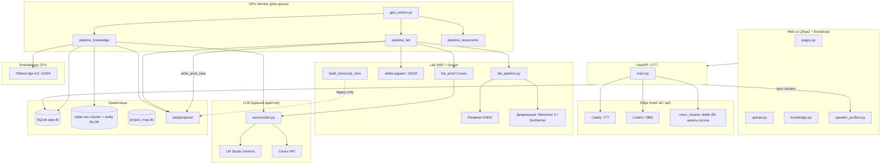

# Карта проекта SKKKK

> **Назначение:** единый ориентир «где что лежит, как связано, за что отвечает».  
> **Обновлять вместе с кодом** при добавлении модулей, пайплайнов, API, скриптов.  
> **Семантический поиск:** `py scripts/search_project_map.py "как работает merge"`  
> **Переиндексация:** `py scripts/index_project_map.py`  
> **LightRAG (граф):** `py scripts/lightrag_query.py "…"` — см. `tools/lightrag/README.md`

Связанные документы: [PLAN.md](PLAN.md) · [DECISIONS.md](DECISIONS.md) · [TESTING.md](TESTING.md) · [HOWTO-MANAGER.md](HOWTO-MANAGER.md) · [manifest.yaml](project-map/manifest.yaml)

**Снимок стека/кодеков/версий:** [§1.1](#11-снимок-стека-актуально-2026-08-27). **Кнопки прод-созвона:** [§5.13](#513-прод-созвон-кнопка--api--функция-актуально-2026-08-27). Полный перечень UI: [§5](#5-ui-страницы-кнопки-кто-выполняет).

---

## 1. Архитектура (одним взглядом)



Снимок стека, кодеков и версий — **§1.1**. Кнопки прод-созвона — [§5.13](#513-прод-созвон-кнопка--api--функция-актуально-2026-08-27).

### 1.1. Снимок стека (актуально 2026-08-27)

Зафиксировано по коду и живой машине. Менять версии моделей/кодеков только вместе с этой таблицей и `docs/DECISIONS.md`.

#### Платформа

| Что | Как сейчас |
|-----|------------|
| ОС | Windows 11 (`10.0.26200`), одна GPU **RTX 3090 24 ГБ**, драйвер **577.00** |
| CUDA (хост, lab ONNX) | Toolkit **12.8** (nvcc 12.8.61) + cuDNN **9.16.0.29** |
| Корень | только `C:\1C_NEW_SKKKK` |
| Python (портал `venv/`) | **3.10.9** |
| Python (лаборатория `venvs\lab`) | **3.10.9** (отдельный venv: `onnxruntime-gpu` vs `onnxruntime` в app) |
| Web | FastAPI **0.141.1**, Starlette **1.6.0**, Uvicorn **0.52.3**, Jinja2 **3.1.6**, Bootstrap 5 (vendored) |
| ORM | SQLAlchemy **2.0.52**, Alembic **1.19.1**, Pydantic **2.13.4** |
| Порт UI | Снаружи **Caddy `:777` HTTPS**. Портал — `WEB_HOST=127.0.0.1` `WEB_PORT=1777`. Порт **8000** занят MCP 1С |
| БД | SQLite `data/app.db`, `PRAGMA foreign_keys=ON`, WAL. Хеши личных паролей — отдельно: `DATA_DIR/credentials.db` (`CREDENTIALS_DB_PATH`, Argon2id). Карточки: `user_profiles` (1:1 с `users`), `companies` (из `Companies.txt`); реестр людей проекта (платформа памяти решений, флаг `MEMORY_PLATFORM`): `people` (человек, в т. ч. без учётки), `person_aliases` (написания), `project_parties` (сторона компании в проекте), `unknown_actors` (очередь «Кто это?»), `people_log` (журнал правок); `speaker_profiles.person_id`, `meeting_participants.person_id`, `artifacts.recorded_at_precision`; фото — файлы `data/people/<user_id>/avatar-<ключ>-512|96.webp` |
| Векторы | sqlite-vec **0.1.9** (`chunks` + `entity_vectors` BLOB) |
| Auth | JWT + cookie `skkkk_session` на **30 дней**; вход только если логин есть в `Login_up.txt` (без учёта регистра); Bearer из localStorage ещё принимается. `PERSONAL_PASSWORD=required` (по умолчанию; `off` — тесты и аварийный откат): шаг 2 — личный пароль, шаг 3 — карточка. В токене `pv` — версия пароля, `pp` — пароль пройден, `pf` — карточка заполнена; сессия проверяет ещё и саму карточку (сброс админом закрывает сессии) |
| Очередь | таблица `jobs`, **один** GPU-воркер |
| LLM | `LLM_PROVIDER=cursor` **или** `lmstudio` (переключатель при старте) |

#### Модели слуха и голоса (двойной слух)

| Роль | Модель / артефакт | Версия / ревизия | Как запускается |
|------|-------------------|------------------|-----------------|
| Слова + таймлайн (канон) | Parakeet-TDT | **0.6B v3**, HF `istupakov/parakeet-tdt-0.6b-v3-onnx` rev `8f23f0c` | `venvs\lab`, onnx-asr **0.12.0**, ONNX Runtime GPU **1.23.2** |
| Кто говорит | Nemotron 3 Diarization | **до 8 спикеров**, отдельный процесс в `venvs\nemo-diar` (NeMo + torch) | `DIAR_MODEL`: `nemotron3` (по умолчанию); `sortformer4` — откат на Sortformer 4spk v2.1 ONNX `Scrybl/diar_streaming_sortformer_4spk-v2.1` rev `3be92087` в `venvs\lab` |
| VAD | Silero | `istupakov/silero-vad-onnx` | onnx-asr load_vad |
| Второй слух / вычитка | GigaAM-v3 e2e RNNT | HF `ai-sage/GigaAM-v3` rev **`e2e_rnnt`** | Docker `skkkk-gigaam` `:18102` |
| Голос (enroll/match) | WeSpeaker | `pipeline._embedding` внутри GigaAMGUI | lab_voice / docker exec |
| Эмбеддинги текста | bge-m3 | Ollama, **CPU** (`OLLAMA_NUM_GPU=0`) | `:11434` |
| LLM текст | Cursor SDK **1.0.28** или LM Studio `qwen/qwen3.8-27b` | `CURSOR_MODEL` (напр. composer-2.5) / `LMSTUDIO_MODEL` `:1234` | sense, proof, сущности, ТЗ, чат, vision |

Whisper `large-v3` и T-one в compose с `profiles: [legacy]` — на диске для отката, **воркер не вызывает**.

GigaAM-контейнер (`skkkk-gigaam`): образ из `vendor/GigaAMGUI`, CUDA **12.4**, torch **2.6+cu124**, `ASR_MODEL=v3_e2e_rnnt`, `MODEL_REVISION=e2e_rnnt`. Lab ONNX: onnxruntime-gpu **1.23.2**, onnx-asr **0.12.0**, cuDNN **9.16.0.29**. SHA256 весов и эталонный прогон — `asr/lab/FREEZE.md` / `asr/lab/freeze.json`.

#### Кодеки и звук (FFmpeg)

Мастер для ASR всегда один: **WAV PCM s16le, 16 кГц, моно** → `artifacts/{id}/audio/input_16k.wav`. Бинарь: PATH / WinGet **Gyan.FFmpeg 9.0-full_build** (код помечает muxer ffmpeg 9+). DeepFilterNet на прод-пути **выключен** (`01_audio` = `copy_16k`).

| Назначение | Файл | Кодек | Параметры |
|------------|------|-------|-----------|
| ASR / диаризация / WeSpeaker | `input_16k.wav` | PCM s16le | 16 kHz mono (`-vn -ac 1 -ar 16000 -c:a pcm_s16le`) |
| Плеер в HTML (`GET /artifacts/{id}/audio`) | `playback.m4a` | **AAC** | 48 kbps, mono, `+faststart`; если encode падает — отдача WAV |
| Скачать созвон | `download.mp3` | **MP3** libmp3lame | 64 kbps, mono |
| Загрузка | `.wav .mp3 .m4a .ogg .flac .webm .mp4 .mkv` | как пришло | видео: звук вынимается, оригинал может быть снесён после проверки WAV |

Документы: PDF (PyMuPDF **1.28.2**, таблицы — `find_tables`), DOCX (python-docx **1.2.0**, `docx_extract.py`; .doc/.odt/.rtf — через LibreOffice), Excel/CSV (openpyxl **3.1.5**, `xlsx_extract.py`; .xls/.ods — через LibreOffice), PPTX (python-pptx **1.0.2**, `pptx_extract.py`), HTML (`html_extract.py`: таблицы и выгрузки Google Sheets), картинки OCR Tesseract / vision через LLM. Таблицы всех форматов — один markdown-формат `table_md.py` (подпись `Таблица N: …` + GFM). Неподдерживаемый формат отклоняется при загрузке (415).

#### Как устроена итоговая выжимка проекта

Не «перечитать сырые файлы». `tz.rebuild_tz()` собирает **уже готовое**:

1. Артефакты `status=done`, порядок: вес ↓, дата ↓.
2. **Созвон:** канон `parsed/calls/{id}_final.txt` (proof + имена). Нет файла — чанки БД. Плюс `*_call_summary.md` (протокол **этого** созвона).
3. **Документ:** чанки `chunks`; нет индекса — `transcription_text`.
4. Плюс активные сущности только `decision`/`task` (mention / participant / fact / summary в дамп не кладутся), `user_notes`, конфликты `POTENTIAL_CONFLICT` ± `resolutions`.
5. Нарезка ~6000 симв. → если кусков >1, **последовательный** map (LLM, 1200 tok) → при переполнении контекста — **иерархическое слияние черновиков** (`tz._collapse_drafts`, промежуточный merge-проход по группам ~9000 tok, пока всё не уложится в ~12000 tok) → reduce (8192 tok). Предыдущая `current_tz.md` в промпт **не** подставляется (убрана по промпту). Промпт `docs/prompts/rebuild_tz.md` (6 блоков: map → merge → reduce).
6. Результат: `project_state/current_tz.md` + архив `versions/` + `changelog`.

Кнопка **Пересобрать** — только **admin**, синхронно в FastAPI (минуты из‑за N+1 LLM). Авто (с 2026-09-29, решение владельца): с автопроверкой — задачей очереди `auto_review` scope `summary` за проверками нового материала, одна на партию (документы и созвоны); без автопроверки (режим off) — сразу: документ — в конце партии, созвоны — каждые `TZ_REBUILD_EVERY_N` (по умолчанию 3). Подробно — «Итоговая выжимка по проекту» ниже. Чат — другое: top‑12 чанков + до 12 ближайших `decision`/`task`/`fact` + хвост `current_tz.md`.

#### Удаление

| Что | Кто | Что стирается | Что остаётся |
|-----|-----|---------------|--------------|
| Проект | admin, manager | `data/projects/{id}/` + строки БД этого проекта | другие проекты, global `speaker_profiles`, пользователи |
| Артефакт | любой залогиненный | workspace, оригинал, parsed/structured `{id}_*`, jobs, chunks, entities **и их links/resolutions**, project-scoped голоса с этого файла | проект, чат, ТЗ, чужие файлы, global голоса |

Перед `DELETE FROM entities` — `graph.delete_entities_with_deps` (иначе SQLite FK). UI артефакта: иконка корзины, серый контур, модалка + чекбокс.

---

## 2. Корень и каталоги

> Ниже — главное; **полный инвентарь стенда** (округления движков, портативные бинарники, модели, кэши, конфиги агентов, машинные факты) — [§17](#17-инвентарь-стенда-генерируется). Полноту проверяет `scripts/check_stand_inventory.py` и тест `app/app/tests/test_stand_inventory.py`.

| Путь | Назначение |
|------|------------|
| `C:\1C_NEW_SKKKK\` | Единственный корень проекта |
| `app/app/` | FastAPI: роутеры, сервисы, модели, воркер, шаблоны |
| `asr/` | Lab ASR (Parakeet + диаризация Nemotron/Sortformer + GigaAM-сверка), view, speaker match |
| `asr/lab/` | Канонический конвейер расшифровки (изоляция прогонов) |
| `asr/docker/` | Образ GigaAM; Whisper/T-one на диске для отката |
| `asr/tests/` | Unit-тесты ASR-модулей |
| `data/app.db` | SQLite: users, projects, artifacts, jobs, entities, links, chunks |
| `data/logs/` | api.log, worker.log, monitor_loop.log |
| `data/projects/{id}/` | Файлы проекта (см. §6) |
| `data/project_map.db` | Векторный индекс карты проекта (sqlite-vec, для агентов) |
| `docs/` | План, решения, промпты, этапы, **эта карта** |
| `docs/prompts/` | Промпты LLM (merge, entities, summary, TZ, chat, vision) |
| `docs/stages/` | STAGE-NN: критерии готовности этапов |
| `scripts/` | Утилиты, мониторинг, rerun, индекс карты |
| `tools/lightrag/` | **LightRAG** Docker (:9621) — граф знаний по docs (кнопки, API, БД) |
| `tools/projectmap/` | **projectmap** — переносимый инструмент карты проекта (ядро, адаптеры стека, CLI, просмотрщик на G6 с заранее посчитанной раскладкой; план `docs/plans/PROJECTMAP-PLAN.md`) |
| `.projectmap/` | конфиг инструмента projectmap для этого проекта (`config.yaml`: граф, осознанные исключения, цели охвата); внутри `out/` — выгрузки, не в git |
| `tools/android/` | Эмулятор Android (sdk, jdk, avd, platform-tools) — мобильные проверки комнаты; в git не хранится |
| `docs/project-map/` | Манифест карты, атлас зависимостей `DEPENDENCIES.md` и свод `graph-modules.json` (§16) |
| `data/project_map_graph.json` | Полный граф зависимостей проекта (рабочий артефакт, в git не хранится) |
| `.cursor/rules/` | Правила агента Cursor |
| `.cursor/skills/` | Скилы (gpu-orchestrator, knowledge-pipeline, …) |
| `venv/` | Python **3.10.9** (портал); `venvs/lab` — тот же 3.10.9 под ONNX |
| `.env` | Секреты (не в git), шаблон `.env.example` |

### Кто что видит

Правило: **сначала сервер, потом кнопка.** Чужой проект — **404** (как неактивный), не 403. Лаб / match / «Пересобрать» на своём проекте — **403**, если роли не хватает. Охранник: `services/project_access.py` (`require_project`, `require_artifact_project`).

| | admin | manager | user |
|---|---|---|---|
| Список `GET /projects` | все активные | свои: создал / загрузил / писал в чат / **выдали доступ** | те же свои, даже если сейчас пароль `user` |
| Карточка / чат / отчёт `/report` / загрузка | любой проект | те же свои | те же свои |
| **лаб**, `report-lab`, **лаб встречи**, `report-meeting-lab`, lab enroll/merge | да | нет (кнопка скрыта, URL 403) | нет |
| **match**, «Подтвердить спикеров», enroll/merge | да | на своих, если пароль manager | нет (кнопка скрыта, URL 403). Пароль `user` — нет, даже у создателя |
| «Пересобрать» ТЗ | да | нет (уже admin) | нет |
| «Пересобрать выжимку» / reindex / «Пересчитать» | да | на своих | нет (403) |
| Удалить проект | любой | только свой | 403 (роль) |
| MCP-ключи портала | любой проект | только свой | 403 (роль). Сырой `/mcp/projects/{id}` — по ключу, не JWT |

Роль меняется паролем, список проектов — нет: «свои» считаются по логину (создал, загрузил файл, писал в чат или строка в `project_members`), не по текущей роли. Чужой проект без следа этого логина — 404. Удалить проект может admin или тот, кто его создал. Блок **Выдать доступ** — admin или менеджер проекта; роль в проекте только `manager` / `user`, не `admin`.

---

## 3. Процессы runtime

| Процесс | Команда | Порт / роль |
|---------|---------|-------------|
| **API + UI** | `python -m app.app.main` / `main all` | Preflight → `edge_runtime` (Caddy + LiveKit + `voice_cleaner`) → GPU-воркер → портал `WEB_PORT` (**1777**). Повторный `main` при живом `/health` — no-op |
| **Только портал** | `python -m app.app.main api` | То же без воркера. Воркер (`main worker`) edge **не** поднимает |
| **Caddy** | поднимает `main` (`ensure_tls_cert` → `ensure_caddy`); опц. служба `SKKKK-CADDY` | `:777` HTTPS (готовый файл, Chrome к IP часто без SNI) + `:8088` HTTP-01 + `:8443` выпуск/продление Let's Encrypt **на IP** (`shortlived`). При старте `main` проверяет файл сертификата и перевыпускает, если его нет или он недействителен. Конфиг — `tools/caddy/Caddyfile` |
| **LiveKit** | поднимает `main` (`ensure_livekit`) | Native `tools/livekit/livekit-server.exe` `:7880`. Не Docker (STUN ломается) |
| **Voice recorder** | поднимает `main` после `:7880` | `venvs/voice` + `tools/livekit/voice_cleaner.py` (имя историческое), участник `skkkk-dfn`, hidden, ничего не публикует. Пишет голос каждого человека в `data/meetings/{room}/` (`MEETING_RECORD=1`): сырую дорожку `skkkk-raw` (браузер с DFN3), без неё — основную (`voice_pub_to_record`); пришла сырая после основной — та же WAV продолжается с сырой, пропала сырая — обратно на основную. Сам поднимает себе приоритет (above normal); раз в 10 с сверяет с сервером, что он в комнате (`MemberWatch`). Шумодава на сервере нет (он в браузере, см. «Гостевая страница»). Ставит `scripts/install_meeting_voice.py` (только livekit SDK). Нет venv — созвон без записи |
| **Screen recorder** | поднимает `main` после `voice_cleaner` | `venvs/voice` + `tools/livekit/screen_recorder.py`, участник `skkkk-rec` (hidden, без publish; `MemberWatch` — перезаход, если сервер его потерял). Пишет `tracks/{identity}-screen_video-{sid}.mp4` в ту же кучу, 1 fps, холст 1920×1080, 5 Мбит/с. Камеру не пишет. `MEETING_SCREEN_RECORD=0` — без файлов |
| **GPU Worker** | `python -m app.app.main worker` | Очередь `jobs` — lab ASR, knowledge, один job за раз |
| **GigaAM** | Docker `skkkk-gigaam` | `:18102` — второй слух + **embed_voice** |
| **Whisper / T-one** | Docker (не стартуют) | `:18101` / `:18103` — откат, воркер не вызывает |
| **Ollama** | вне проекта | `:11434` — `bge-m3`, CPU |
| **LightRAG** | `docker compose up` в `tools/lightrag/` | `:9621` — граф карты проекта (agents) |
| **LM Studio** | сервер — `run_server.ps1`; модель загружает и выгружает портал (`services/llm_keeper.py`) | `:1234` — Local LLM (если `LLM_PROVIDER=lmstudio`): одна модель, два потока — воркер и чат (§3.2) |
| **Cursor API** | облако/local SDK | если `LLM_PROVIDER=cursor` |

**Важно:** кнопки «Пересчитать» / «Пересобрать выжимку» / «Переиндексировать» идут через **API-процесс**, не через GPU-воркер.

### 3.0. Как поднять сервер: установка, запуск, перезапуск, HTTPS

**Порядок старта `python -m app.app.main all`** (его вызывает `scripts/start.ps1`): preflight (проверки `.env`, моделей, портов; `--skip-checks` пропускает) → `edge_runtime`: сертификат (`tls_cert.ensure_tls_cert`) → Caddy → LiveKit → `voice_cleaner` → `screen_recorder` → GPU-воркер (`data/locks/gpu_worker.pid`) → портал Uvicorn `127.0.0.1:WEB_PORT` (1777). Падение LiveKit портал не валит.

| Задача | Команда | Что делает |
|--------|---------|------------|
| Установка на новом ПК | `INSTALL.bat` (корень) → `scripts/bootstrap.ps1` | полная установка одной командой; окружение после переноса папки — `scripts/setup_env.ps1`; проверка окружения — `scripts/check_env.ps1` (отчёт `data/logs/env-check.txt`) |
| Локальная LLM | `run_server.ps1` (корень) | выключает автозагрузку LM Studio, поднимает сервер `:1234` и грузит модель по профилю `tools/lmstudio/qwen-profile.json` через `scripts/llm_model.py load` (`-SkipLoad` — только сервер). Сервер SKKKK не поднимает |
| **Перезапуск (основной способ)** | `scripts/restart.ps1` [`-Llm saved\|gemma\|cursor`] [`-Force`] [`-SkipChecks`] | 1) **отказ, если идёт встреча** (`scripts/live_meetings.py`, код 3) — иначе оборвётся запись голоса; `-Force` перезапускает всё равно; 2) встреч нет — гасит все копии `voice_cleaner` / `screen_recorder` и их pid-файлы; 3) проверки: Ollama `:11434`, при `lmstudio` — LM Studio `:1234` и загружена ли `LMSTUDIO_MODEL`; 4) `start.ps1 -SkipChecks` в фоне, лог `data/logs/restart.log` (+ `.err`); 5) ждёт `/health` **и новый PID воркера** (старый сервер может ещё отвечать); 6) в фоне обновляет индекс проекта |
| Запуск | `scripts/start.ps1` [`-Llm cursor\|gemma`] [`-NoStop`]; обёртки `start-saved.ps1` (LLM из `.env`), `start-gemma.ps1`, `start-cursor.ps1`, `run_all.ps1` | сначала останавливает старое (PID воркера + процесс на `WEB_PORT`, снимает `gpu_worker.lock/.pid`), затем `main all` |
| Остановка | `scripts/stop.ps1` | гасит API и GPU-воркер |
| Проверка без запуска | `scripts/check_systems.ps1` | только проверки всех систем |
| Службы Windows | `scripts/install_services.ps1` (от администратора, NSSM) | службы `SKKKK-API` (`main api --use-saved-llm --llm-provider cursor`) и `SKKKK-GPU` (`main worker`); Caddy отдельной службой — `scripts/install_caddy.ps1` (`SKKKK-CADDY`) |
| Бэкап БД | `scripts/backup_db.ps1` [`-Keep 7`] | копия SQLite через `VACUUM INTO`: `app-*.db` и `credentials-*.db` (личные пароли), фото — `people-*.zip`; проверка — `scripts/verify_backup.py` |
| Автоподъём | `scripts/monitor_skkkk_loop.ps1` | раз в 5 мин `GET /health`, при сбое убивает все `app.app.main` и поднимает `main all --llm-provider cursor`. **Устарел:** проверяет `http://127.0.0.1:777/health`, а на `:777` теперь HTTPS (Caddy) — проверка не пройдёт; встречи не учитывает. Не запускать, пока не исправлен |

Зависимости, которые портал поднимает сам: Docker Desktop и контейнер GigaAM перед аудио (`docker_runtime.py`), Ollama перед индексом (`ollama_runtime.py`), модель в LM Studio — по требованию и строго по профилю, выгрузка после простоя (`llm_keeper.py`, §3.2). Сервер LM Studio — вручную или `run_server.ps1`.

**HTTPS (Caddy, `tools/caddy/Caddyfile`).**

| Порт | Что | Куда |
|------|-----|------|
| `:777` (`SKKKK_HTTPS_PORT`) | вход для пользователей, TLS готовым файлом (`SKKKK_TLS_CERT` / `SKKKK_TLS_KEY`) | `/livekit/*` → LiveKit `127.0.0.1:7880`; всё остальное → портал `127.0.0.1:1777` (ожидание ответа до 15 мин) |
| `:8088` (`SKKKK_ACME_HTTP_PORT`) | HTTP-01 проверка Let's Encrypt | `/.well-known/acme-challenge/*` отвечает Caddy; остальное — редирект на `https://SKKKK_PUBLIC_HOST:777` |
| `:8443` (`SKKKK_ACME_TLS_PORT`) | выпуск и продление сертификата на IP (профиль `shortlived`) | отвечает `ok` |

Сертификат: Caddy хранит его в `data/caddy/certificates/<CA>/<host>/<host>.crt|.key` (`SKKKK_CADDY_STORAGE`). При старте `tls_cert.py` проверяет файл для `:777`: есть ли, не staging ли, не истекает ли раньше `SKKKK_TLS_RENEW_HOURS`; иначе перевыпускает через `:8443` и перезагружает Caddy. Если явный `SKKKK_TLS_CERT` отсутствует или staging, а CA боевой — берётся файл из хранилища Caddy. Логи: `data/logs/caddy.log` (запросы `:777`), `data/logs/caddy-proc.log` (сам Caddy). Почта для ACME — `SKKKK_ACME_EMAIL`, CA — `SKKKK_ACME_CA`.

### 3.1. Изоляция арtefactов (не смешивать файлы)

| Зона | Путь | Изоляция |
|------|------|----------|
| **Канон арtefactа** | `data/projects/{id}/artifacts/{art_id}/` | audio, asr, reports — только этот job |
| **Parsed / structured** | `data/projects/{id}/parsed/`, `structured/` | имена с `{artifact_id}_*` |
| **Docker bridge** | `asr/work/` | общий mount GigaAM; прод-изоляция — `lab/runs/{run_id}/`, не чужой файл |
| **Dev fallback** | `asr/work`, `asr/out` | только если `SKKKK_ASR_*` не заданы (локальный прогон) |
| **GigaAM embed job** | `data/gigaam/embed_job.json` | общий файл; один GPU-воркер — OK; параллель без staging — нет |
| **Tone sidecar txt** | `asr/out/input_raw_tone.txt` | dev-арtefact; prod пишет в `SKKKK_ASR_OUT/docker_tone.*` |

Инварианты: lab-прогон в `lab/runs/{run_id}/`; GigaAM embed — stage + hash-check; prod-код **не** читает `asr/out` как fallback. Whisper/T-one воркер не вызывает. `tone_for_align` — lex/duration guard; `finalize_audio_outputs` — всегда перезаписывает parsed raw-копии; prod-код **не** читает `asr/out` как fallback для арtefact-отчётов.


### 3.2. Локальная модель: два потока, загрузка по профилю (актуально 2026-10-05)

План и замеры — `docs/plans/LLM-LANES-PLAN.md`; решения Р1–Р3 — `docs/DECISIONS.md` (2026-10-05).

| Что | Как |
|-----|-----|
| Профиль | `tools/lmstudio/qwen-profile.json` — единственный источник настроек: ключ модели (= `LMSTUDIO_MODEL`), окно 56000, 2 потока, flash-attn, KV q8_0, MTP, выборка |
| Загрузка | `llm_keeper.ensure_loaded`: под замком `data/locks/llm_model.lock` пишет профиль в конфиг модели LM Studio (`user-concrete-model-default-config`), `lms load --context-length --parallel --ttl`, сверяет `lms ps --json`; не по профилю — выгрузка и ошибка. Загружено ли — список `GET /api/v0/models` (`state`; при выключенной автозагрузке — только загруженные), не `/v1/models` |
| Выгрузка | воркер при пустой очереди: простой ≥ `LMSTUDIO_IDLE_UNLOAD_SEC` (300 с) и обе полосы свободны → `lms unload` (`llm_keeper.maybe_unload_idle`); `LMSTUDIO_LOAD_TTL_SEC` — страховка LM Studio, если процессы SKKKK упали |
| Фоновая полоса | только воркер и его процессы ASR (`asr/lab_proof.py`, `lab_sense.py`): расшифровки, документы, автопроверки, выжимки, кадры, кнопки-задачи `project_task`. Замок `data/locks/llm_lane_background.lock` |
| Полоса чата | только процесс API: ответы чата и черновики MCP, строго по очереди прихода (`llm_lanes.chat_queue`, талоны), по одному; замок `llm_lane_chat.lock`. Позиция — `GET /projects/{id}/chat/status` |
| Бюджет окна | окно общее (`kv_unified`): чату `LMSTUDIO_CHAT_TOKEN_BUDGET` (22000), фону остаток; фоновый запрос сверх доли (финальная сборка ТЗ) берёт и полосу чата — ждёт текущий ответ, следующий ответ ждёт его (`llm.lane.exclusive`) |
| ASR | на время GPU-шагов ASR (`lab_onnx`, `lab_giga`, `lab_voice`) модель выгружена: `llm_keeper.asr_gpu_hold` в `pipeline_lab._run_cmd` ждёт текущие ответы (обе полосы), выгружает модель, пишет метку `data/locks/asr_gpu.hold` и не даёт загрузить модель до конца шага; чат в это время видит «Идёт распознавание речи…». Между шагами (вычитка, ответы) модель загружается снова. Замер 2026-10-05: модель 22,4 ГБ + ASR до 6,5 ГБ на карте 24 ГБ не помещаются (вынос в общую память, GigaAM стоял 12 мин). `LMSTUDIO_KEEP_DURING_ASR=true` — держать рядом (только если карта вмещает). GigaAM останавливается сразу после дорожек, до кадров экрана |
| Страж | фоновый вызов модели из процесса API (`SKKKK_PROCESS_ROLE=api`) — предупреждение `llm.lane.violation`, в тестах ошибка (`SKKKK_STRICT_LLM_LANE`) |
| Вручную | `scripts/llm_model.py` (`status`, `load`, `unload`, `jit-off`); замер — `scripts/bench_llm_lanes.py` |

---

## 4. Конвейеры данных

### 4.1. Аудио (основной)

```
upload → job queued
  → preprocessing: FFmpeg 16 kHz WAV (атомарная запись + lock; опрос списка **не** извлекает)
  → asr_running: pipeline_lab.py
      ├── lab_pipeline.py --no-voice (venvs\lab: Parakeet + диаризация;
      │     `--run-id` только если sha256 в run.json совпадает с текущим WAV)
      ├── lab_sense.py (Cursor)
      ├── lab_giga.py (Docker GigaAM)
      ├── lab_reconcile.py + lab_proof.py
      ├── lab_voice.py (WeSpeaker)
      ├── публикация turns/match/parsed + HTML /report
  → speakers_pending (стенограмма уже есть, speaker_0…)
  → в таблице: **match** (есть метки) → Запомнить имена → **Подтвердить** (все named) → job knowledge
  → speakers_confirmed → apply_confirmed_speaker_names → transcript_ready
  → knowledge pipeline (worker):
      entities (LLM) → index (Ollama, автозапуск) → call_summary / doc_summary → graph → done
```

### 4.2. Документы / изображения

```
upload → extract (PDF/DOCX/XLSX/CSV/PPTX/OCR/vision; таблицы → markdown на своих местах)
  → normalize (LLM только проза, таблицы дословно; Excel без LLM) → text_extracted
  → knowledge pipeline (entities → index → doc_summary → graph → TZ trigger → done)
```

Переписка (выгрузка Telegram, копия чата Битрикс24): разметка сообщений `parsed/<тип>/<artifact_id>_messages.json` (`chat_export`). Индекс режет её по сообщениям (`chunking.chunk_messages`, с 2026-10-14): соседние сообщения одного дня, шапка «Переписка «название» · день», строки «**ЧЧ:ММ Автор:** текст», ответ — «(в ответ на M105, Автор: «начало…»)»; у фрагмента `chunks.unit_first`/`unit_last` = `M…`, ссылка из чата открывает сообщение (`?m=`). Сообщения, источник которых — более ранняя выгрузка той же переписки (Я1, `owned_elsewhere`), в индекс поздней выгрузки не идут; при удалении ранней выгрузки поздние переиндексируются фоном (`indexing.chat_export_siblings` → `reindex_artifacts`). Пересчёт уже загруженных: `scripts/reindex_messages.py`.

### 4.3. Статусы артефакта

`uploaded` → `preprocessing` → `asr_running` → `speakers_pending` → `speakers_confirmed` → `transcript_ready`  
→ `entities_extracted` → `indexed` → `graph_seeded` → `done` | `error`

(Документы: `text_extracted` вместо ASR-статусов.)

### 4.4. Итоговая выжимка проекта vs выжимка созвона

См. **§1.1**. Кратко: проектная выжимка = map/reduce по **готовым** стенограммам/чанкам + сущности `decision`/`task` + заметки + конфликты + `*_call_summary.md`. Выжимка созвона = `summarize_call.py` по подписанному `docker_gigaam_speakers.json` → `call_summary.md` одного файла.

Сборка по умолчанию (`tz.build_tz_fast_body`, с 2026-10-15, PORTAL-ACCURACY-MANAGER-PLAN Д2). **Проект с памятью решений в режиме live** собирается **по разделам** (`services/tz_sections.py`, промпт `docs/prompts/tz_sections.md`): один вызов модели пишет «Суть проекта», «Ключевые решения» (группы по смыслу) и «Что сделано» из компактного входа — карточка проекта, до 8 фрагментов поиска про цель и периметр, предметы памяти «согласовано / сделано / в документе» одной строкой `#id [состояние, дата] название — итог` (бюджет `ITEMS_MAX_CHARS` = 32 тыс. знаков: согласованное и сделанное — всегда, «в документе» — до бюджета, сначала с итогом судьи, затем свежие; не вошедшие — строкой «Не вошло в резюме: ещё N положений…»; проект 40: 717 → 214 предметов) (~10 тыс. токенов на проекте 18 вместо ~51 тыс. у прежней попытки «всё в один запрос»). Модель ставит у пунктов номера `[#id]`; согласованные и сделанные предметы без номера код дописывает строкой «Также согласовано и сделано: …», номера из текста убирает. «Актуальные задачи» (до 15 открытых из `task_board`, сначала просроченные, дата срока) и «Открытые вопросы и риски» (вопросы к заказчику без источников + нерешённые противоречия) собирает код без модели. **Остальные проекты** — как раньше: top-K поиск по 7 общим запросам и до 10 запросам из названий тем (`_topic_queries`) + карточка проекта + сущности, заметки, конфликты → одно сжатие. Замер: `scripts/eval_tz.py --trace` (у пропущенного факта — «не подобран» / «выпал при сжатии», текст выжимки — в отчёте).

---

## 5. UI: страницы, кнопки, кто выполняет

> **Правило:** кнопки, которым нужна модель (`POST /projects/…/rebuild-tz`, `…/reextract-entities`, `…/card/rebuild`, `POST /api/artifacts/{id}/rebuild-summary`), с 2026-10-05 **ставят задачу очереди** `project_task` и сразу отвечают `{queued, job_id, ahead}`; выполняет воркер по очереди (§3.2). Остальные `POST /api/artifacts/…` — **синхронно через FastAPI** (`:777`).  
> **Блокировка повторного нажатия:** `SKKKK.guardButton` / `SKKKK.guardSubmit` (портал) и `guardActionButton` (стенограмма) — спиннер, фиксированная ширина, как у «Скачать».  
> **Долгие операции:** таблица `project_tasks`, `GET …/tasks/active`. Кнопка «Пересобрать» на `/projects/{id}` и `/projects/{id}/tz` опрашивает задачу каждые **3 с** (в том числе автосбор после документа) и блокируется так же, как при клике: `disabled` + spinner + `aria-busy`. Повторный POST → **409**.  
> Загрузка файлов → **job в GPU-воркер**. Авто-опрос статусов на странице проекта — каждые **3 с**.

### 5.1. Роутеры (backend)

| Файл | Prefix | Назначение |
|------|--------|------------|
| `routers/pages.py` | `/` | HTML-страницы, отчёты арtefact, audio stream |
| `routers/auth.py` | `/auth` | POST login: логин из `Login_up.txt` (без регистра); пароль = роль (`admin`/`manager`/`user`); Telegram ID необязателен (поле на форме скрыто с 2026-09-28, `hide_telegram` в `pages.login_page`): указан — пишется, нет — прежний или заглушка `placeholder_telegram_id`; JWT **и** cookie. При `PERSONAL_PASSWORD=required` login отдаёт `{step: setup|personal, ticket}` (пропуск 5 мин, одноразовый, годится только для своего шага) → `POST /auth/login/setup` (новый + повтор) или `/auth/login/personal`; карточка не заполнена → `{step: profile, ticket}` (15 мин) → `POST /auth/login/profile/options` (компании без стороны, текст уведомления о голосе) и `POST /auth/login/profile` (multipart: ФИО, компания, должность, фото) → сессия. `GET /auth/password/state`, `POST /auth/password/change` (меню в шапке) |
| `routers/people.py` | `/people`, `/me` | `GET /people/{id}/avatar?size=96|512&v=` (вошедшим; с текущей версией — кеш навсегда, без — 5 мин); `GET|PUT /me/profile` (ФИО, должность; компанию и согласие не меняет — 422), `PUT /me/avatar` |
| `routers/projects.py` | `/projects` | список, создание, **полное удаление** (`DELETE /{id}`) |
| `routers/upload.py` | `/projects` | Resumable upload, list artifacts (`speakers_match_available` / `speakers_confirm_ready`), **DELETE** одного артефакта |
| `routers/knowledge.py` | `/projects/{id}/…`, `/chat` | search, graph, TZ, chat, deadlines, задачи (`tasks`, `tasks/{entity_id}`, `manual-tasks/{task_id}`), «Что нового» (`digest`, `digest/dismiss`), reextract-entities, conflicts, notes |
| `routers/project_members.py` | `/projects/{id}/members` | выдача доступа: GET список, POST роль manager/user, DELETE участника |
| `routers/project_mcp.py` | `/projects/{id}/mcp`, `/mcp` | ключи MCP портала + Streamable HTTP |
| `routers/project_mcp.py` (обмен) | `/projects/{id}/agent-*` | обмен с внешним агентом: `agent-exchange` (экран), `agent-exchange/summary`, `agent-settings` GET/PUT, `agent-verdicts` + `/{entity_id}/{action}`, `agent-inbox` + `/{qid}/draft`, `/{qid}/answer` (ответы и вердикты — только admin) |
| `routers/project_people.py` | `/projects/{id}/people`, `/parties`, `/people-platform` | реестр людей и стороны проекта, очередь «Кто это?», согласие на голос — полный перечень в §5.14; admin и manager проекта |
| `routers/requirement_review.py` | `/projects/{id}/requirements`, `/projects/{id}/spot-check/{entity_id}` | подтверждение требований человеком: `review`, `confirm`, `/{rid}/{action}`; читают admin и manager, решают только admin; выборочная проверка «Верно / Неверно» — admin и manager (`spot-check` объявлен до `/{rid}/{action}`) |
| `routers/admin_map.py` | `/admin/map`, `/admin/map/search` | страница «Карта проекта» (только admin): поиск по индексу кода и связей; читает `data/project_map.db`, боевую БД не трогает |
| `routers/admin_map_graph.py` | `/admin/map/graph`, `/admin/map/graph/summary`, `/admin/map/graph/data`, `/admin/map/overview`, `/admin/map/overview/frame`, `/admin/map/overview/state`, `/admin/map/overview/rebuild` | страница «Граф зависимостей» (только admin): окрестность сущности, подсистема или модульный свод из графа (§16); читает выгрузку `data/project_map_graph.json`, при её отсутствии собирает граф из индекса. «Обзор карты» — просмотрщик инструмента projectmap во фрейме (`services/projectmap_view.py`) |
| `routers/acme.py` | `/.well-known/acme-challenge` | HTTP-01 → Caddy (Let's Encrypt на IP) |
| `routers/meetings.py` | `/projects/{id}/meetings`, `/api/meetings/public` | встречи проекта (+ идущие сейчас `GET …/meetings/live` для полоски «Идёт созвон») + гостевой join/leave/heartbeat по токену + сотрудник: `/projects/{id}/meetings/{mid}/heartbeat` и `/leave` (identity только `member:{user.id}`); `GET /api/meetings/public/{token}/avatars/{user_id}` — фото сотрудника гостю, только участника этой встречи. Сотрудник входит под «Имя Фамилия» из карточки |
| `routers/speaker_profiles.py` | `/api` | enroll, merge, lab enroll/merge, recalculate, speakers-confirm, rebuild-summary, reindex |

### 5.2. Общая навигация

| Элемент | URL | Шаблон | Действие |
|---------|-----|--------|----------|
| Логотип **Primary Analytics** | `/` | `base.html` | Список проектов |
| **Выйти** (иконка у ника) | `/auth/logout` | `base.html` `#nav-logout` | `POST /auth/logout`, сброс cookie и localStorage |
| **к проектам** | `/` | `project.html` nav | То же |
| `/login` | `/login` | `login.html` | Вход только для логинов из `Login_up.txt` (регистр не важен); JWT + cookie `skkkk_session` |
| Гостевая встреча | `/m/{token}` | `meeting_public.html` | Без JWT. Нет навигации по проектам. Сырой токен не хранится — только sha256 |
| `routers/project_mcp.py` (посылки файлов) | `/mcp/projects/{id}/files/…`, `/projects/{id}/exchange-files` | посылки файлов от агента (карты конфигурации, дипмапы; сервис `services/exchange_files.py`, политика — `docs/agent-exchange/POLICY.md` §10). Каталог для любого ключа проекта: `GET /mcp/projects/{project_id}/files/catalog` (принятые посылки, файлы с sha256, README, текущие версии; то же — инструмент `files_catalog`, а при подключении строка «ФАЙЛЫ ПРОЕКТА» в `instructions` и поле `files` в `project_overview`). По Bearer-ключу MCP с правом `files_access`: `POST /mcp/projects/{project_id}/files/bundles` (открыть по манифесту путь/размер/sha256; повтор того же манифеста — докачка), `GET /mcp/projects/{project_id}/files/bundles` (список), `GET /mcp/projects/{project_id}/files/bundles/{bundle_id}` (`?files=missing` — что ещё не принято), `PUT /mcp/projects/{project_id}/files/bundles/{bundle_id}/data/{path:path}` (`?offset=`, тело до 64 МБ, `X-Chunk-Sha256`), `GET /mcp/projects/{project_id}/files/bundles/{bundle_id}/data/{path:path}` (скачать, Range, `X-Sha256`). Владелец/админ проекта: `GET /projects/{project_id}/exchange-files`, `DELETE /projects/{project_id}/exchange-files/{bundle_id}` (удалить с диска). Только портальный admin: `GET /projects/{project_id}/extra-files` — все посылки с файлами и отправителем (`source_label`: агент по имени ключа или пользователь) для карточки «Дополнительные файлы»; `GET /projects/{project_id}/extra-files/{bundle_id}/data/{path:path}` — скачать файл посылки (Range, `X-Sha256`; только admin). В те же посылки ложатся `.cf` и `.dt` из формы материалов (виды `config_cf`, `infobase_dt`, отправитель `user:<id>`; см. §5 «Загрузить») |
| HTML-оболочки (`/`, проект, граф, ТЗ, чат, `/report*`) | те же URL | Jinja | Без сессии — **302** на `/login` (`require_html_user`) |
| `/audio`, `/download`, speaker API | те же URL | — | Без сессии — **401** |
| `/health` | `/health` | — | Публично только `{"status":"ok"}` |
| `/health/ready` | `/health/ready` | бейдж LLM в nav (`#nav-llm`: «Local LLM» при LM Studio, «Cursor») + значок «Нужен перезапуск» (админ) | Очередь/VRAM/LLM + `build` (код на диске новее API/воркера, `services/build_info.py`) — только с сессией |
| `/admin/conflicts` | `/admin/conflicts` | `conflicts.html` | Очередь конфликтов (**admin**, HTML 302→login / 403 не-admin) |
| `/projects/{id}/graph` | graph | `graph.html` | Cytoscape-граф (GET graph/data) |
| `/projects/{id}/tz` | tz | `tz.html` | Отдельная страница ТЗ (дублирует rebuild-tz) |
| `/projects/{id}/chat` | chat | `chat.html` | Отдельный чат (дублирует чат на project) |

### 5.3. Список проектов — `/` (`index.html`)

| Кнопка / элемент | API | Кто | Роль | Результат |
|------------------|-----|-----|------|-----------|
| **Новый проект** | — | UI | admin, manager | Открывает модалку |
| **Создать** | `POST /projects` | FastAPI | admin, manager | Проект + `data/projects/{id}/` tree |
| **Отмена** | — | UI | — | Закрыть модалку |
| **Исправлено** (шапка, слева от бейджа LLM, `nav-changelog`) | — | UI | auth | Модалка `#changelogModal`: список изменений для пользователя, новые сверху. Данные — `app/app/changelog.json`, читает `load_changelog()` в `routers/pages.py` при рендере `/`. Дополнять после каждой правки функционала/качества (правило в `AGENTS.md`) |
| Клик по проекту | — | navigate | свои или admin | `/projects/{id}`; чужой URL — **404** |
| **Описание** (стрелка справа от названия) | — | UI | auth | Сворачиваемый блок: текст описания слева, **Удалить проект** справа (admin/manager). Без описания стрелка всё равно есть, чтобы открыть удаление |
| **Удалить проект** | `GET /projects/{id}/delete-preview` → `DELETE /projects/{id}` | FastAPI | admin любой; manager только свой | Сначала модалка «Подтверждение удаления»: счётчики из `delete-preview` (`#delete-project-counts`: документы, созвоны, встречи, заметки) + чекбокс «Подтверждаю полное удаление» (`#delete-project-ack`); без галочки кнопка «Удалить» неактивна. Затем полное удаление дерева и записей БД |
| Авто-загрузка | `GET /projects` | FastAPI | auth | admin — все активные; иначе создал / загрузил / чат / `project_members`. Пустой список: «Нет своих проектов.» Кнопка **Новый проект** только admin/manager. Админу у каждого проекта справа в скобках — кто его завёл (`creator_name` в ответе: «Фамилия Имя» из карточки `user_profiles`, без карточки — логин; остальным ролям поле пустое) |

### 5.4. Страница проекта — `/projects/{id}` (`project.html`)

#### Макет: выжимка и чат (строка `project-insights-row`)

На **lg+** (≥992px) левая колонка «Итоговая выжимка по проекту» и правая «Чат с ИИ» — **одинаковая высота**: `min(70vh, 720px)`, `position: sticky; top: 0.75rem`. Карточки — flex-колонки (`insights-card`, `chat-card`); контент (**`#tz-content`**, **`#chat-log`**) скроллится **внутри** панели, поле ввода чата прижато к низу (`chat-composer`, `margin-top: auto`). Страница при длинной переписке не растягивается.

На **мобильном** (<768px): `#tz-content` до `50vh`, `#chat-log` до `40vh`, отдельный внутренний скролл.

#### Загрузка материалов

| Кнопка | API | Кто | Результат |
|--------|-----|-----|-----------|
| **Загрузить** | `POST …/uploads/init` → `PUT …/chunks/{n}` → `POST …/complete` | FastAPI + **GPU worker** (job) | Файл в `raw_inputs/`, job `queued`, воркер гонит ASR/knowledge |

Тип (`source_type`): `call` | `document` | `note` | `screenshot` — влияет на пайплайн воркера.

#### Полоска «Что нового с прошлого захода» (над «Добавить материалы», с 2026-10-14)

`#project-digest`, рисует сервер (`pages.project_page` → `project_digest.digest_for_page`), переходы и «Скрыть» — `static/px_digest.js`. Первый заход в проект — полоски нет; нечего сказать — тоже нет. Строка ведёт к карточке (панель раскрывается, у задач — нужная вкладка).

| Элемент | API | Кто |
|---------|-----|-----|
| Строки: обработано новых материалов (и что из них извлечено), решения по новым материалам (память live), вопросы от агентов, задачи (просрочено / на неделе), нерешённые конфликты | первая отрисовка — с сервера; после тоста «файл обработан» — `GET /projects/{id}/digest` | материалы и задачи — все; решения и вопросы агентов — admin, manager; конфликты (ссылка на `/admin/conflicts`) — admin |
| «Ждут вашего решения требований: N» | `GET …/agent-exchange/summary` (счёт по контракту тяжёлый — подгружается после открытия страницы, только если полоска уже видна) | admin, manager |
| **Скрыть** (`#project-digest-hide`) | `POST /projects/{id}/digest/dismiss` | все; полоска вернётся, когда обработается новый материал |

#### Полоска «Идёт созвон» (между загрузкой и материалами)

`#live-meetings` — по строке на идущую встречу: «Идёт созвон · в комнате: имена» (уже 576 px — имена второй строкой) и **Присоединиться** (`/projects/{id}/meetings/{mid}/room`); несколько встреч сразу — с номером «#id». Только **admin/manager** (кто может войти в комнату); у `user` не рендерится. Идущая = статус `live` **и** в комнате есть участник на связи: не вышел, вход или пульс за 10 мин (`services/meetings.ongoing_meetings`, то же правило у `scripts/live_meetings.py` для `restart.ps1`). Забытая `live` без людей полоску не держит.

| Элемент | API | Поведение |
|---------|-----|-----------|
| Первая отрисовка | — (`project_page` передаёт `live_meetings`) | с сервера, чтобы страница не «прыгала» после загрузки; без встреч блок `hidden` |
| Обновление | `GET /projects/{id}/meetings/live` | тик опроса страницы (3 с, не в скрытой вкладке) и сразу после действий во «Встречах»; DOM перестраивается только при смене разметки. Встречу завершили или все вышли — полоска пропадает |

#### Таблица артефактов (авто-обновление 3 с)

| Элемент | API | Поведение |
|---------|-----|-----------|
| Badge статуса | `GET /projects/{id}/artifacts` | `reconcile_artifact_status` подтягивает `done`, если knowledge уже есть. Для аудио те же флаги кнопок: `speakers_match_available`, `speakers_match_ready`, `speakers_confirm_ready` (`speaker_action_flags`) |
| Ссылка на имя файла | — | При `status=done` → `/artifacts/{id}/report` (стенogramма или отчёт документа) |
| **match** | — | `/artifacts/{id}/report-speaker-match`. Видна **admin/manager**, когда в `sortformer_speaker_match.json` уже есть метки `speaker_N`. У `user` кнопки нет; URL — 403. Во время ASR / подготовки не показывается. |
| **лаб** | — | `/artifacts/{id}/report-lab`. Только **admin** (кнопка и URL). Менеджеру `lab_runs` в JSON = 0. |
| **лаб встречи** | — | `/artifacts/{id}/report-meeting-lab`. Только **admin**. У созвона (`source_type=call`, `kind=meeting`) вместо обычной лаб. Дорожка за дорожкой: вход/выход стадий до итоговой расшифровки. |
| **Подтвердить спикеров** | `POST /api/artifacts/{id}/speakers-confirm` | Видна **admin/manager** при `speakers_pending`, когда все `speaker_N` уже названы (enroll на match). Тогда `speakers_confirmed` + job **knowledge**. У `user` нет. |
| **Pipeline live** (раскрывашка) | тот же GET | lab checklist / knowledge из `pipeline_progress.py` |
| **Скачать** | `GET /artifacts/{id}/download` | Созвон/видео → **MP3** (`download.mp3`, 64 kbps); документ → оригинал из `raw_inputs/` |
| **Удалить** | `DELETE /projects/{id}/artifacts/{art_id}` | Узкая колонка после «Ошибка», **иконка корзины** (`aria-label` + подсказка). Модалка «Подтверждение удаления» + чекбокс; без галочки кнопка неактивна. Стирает файл, workspace, parsed, джобы, чанки, сущности этого артефакта. Проект и остальные файлы остаются. Если это выгрузка переписки, другие выгрузки той же переписки переиндексируются фоном после ответа (их сообщения больше не принадлежат удалённой, Я1). Только владелец проекта или admin. |
| Toast «обработан» | — | Когда статус сменился на `done` |

Статусы в UI: В очереди → Подготовка → ASR → … → **Готово** / **Ошибка**.

#### Итоговая выжимка по проекту (левая колонка)

| Кнопка | API | Кто | На чём | Время | Роль |
|--------|-----|-----|--------|-------|------|
| *(авто load)* | `GET /projects/{id}/tz/content` | FastAPI | `project_state/current_tz.md` | — | все |
| **Пересобрать** | `POST /projects/{id}/rebuild-tz` | FastAPI → задача очереди `project_task` (`tz_rebuild`) → воркер `workers/project_jobs.py` → `tz.rebuild_tz_fast()` (с 2026-09-18: было `tz.rebuild_tz()`, см. §5.10/§5.11) → top-K векторный поиск (chunks + `decision`/`task` сущности, MMR на разнообразие) + **один** LLM reduce-вызов | Не читает весь проект — top-36 чанков + top-36 сущностей по 7 обобщённым поисковым запросам (не завязаны на тематику конкретного заказчика) + заметки + справочный блок предыдущей версии (фильтр противоречий, не источник фактов). Пока `tz_rebuild` в очереди или running — кнопка disabled/spinner («— в очереди»), POST 409. | ~30-35 с после очереди | **admin** |

Источник — **не** обрезанный excerpt сырого текста. Если у аудио нет `_final.txt` — fallback на чанки / `transcription_text`. Роут в `knowledge.py`.

Результат: `data/projects/{id}/project_state/current_tz.md`, архив в `versions/`, запись `changelog`.

Авто-пересборка (решение владельца 2026-09-29): материал в конце знаний (`pipeline_knowledge._enqueue_auto_review`) ставит за своими проверками artifact → topics → relevance → conflicts задачу `auto_review` scope `summary` → `requirements_reextract.summary_for_review` → `rebuild_project_summary` (`prepare_for_llm` + `rebuild_tz_fast`). Воркер один, задачи идут по порядку постановки, поэтому выжимка собирается, когда актуальность и конфликты уже выключили заменённое. Одна на партию: задача пропускается без вызова модели, если в очереди ждёт ещё одна выжимка проекта (`tz.summary_jobs_queued`); `maybe_auto_rebuild_tz` при такой задаче не собирает сразу (`reason=after_checks`), в том числе после упавшего последнего файла партии. Раньше собиралась сразу после знаний, до проверок: новый документ, заменивший требование, оставлял старое в выжимке и в ответах чата. Без автопроверки (режим off) — как раньше: документ — в конце партии (`_other_pending_jobs`), созвоны — каждые **N** готовых материалов (`TZ_REBUILD_EVERY_N`, по умолчанию 3).

#### Чат с ИИ по проекту (правая колонка)

| Кнопка | API | Кто | На чём |
|--------|-----|-----|--------|
| **Спросить** | `POST /chat` `{project_id, question}` | FastAPI → `chat.answer_chat()` | RAG: sqlite-vec **чанки** + `search_entities` (`decision`/`task`/`fact` по `entity_vectors`) + документы + выжимки + хвост `current_tz.md` (если файл есть) + **chat_guidance** + **вся лента `chat_messages` этого логина в проекте** (та же, что на экране; лимит ~32k символов с хвоста) + LLM. «Не найдено» только если нет чанков, сущностей, документов, выжимки и своей ленты. |
| **История чата** | `GET /projects/{id}/chat/history` | FastAPI → `chat.list_chat_messages()` | Лента UI + `waiting`, `meta` (уточнения) |
| **Журнал действий** | `GET /projects/{id}/activity` | FastAPI → `user_activity.list_activity()` | API для аудита и памяти чата; **в UI чата не показывается** |
| **Статус чата** | `GET /projects/{id}/chat/status` | FastAPI → `chat.chat_is_pending()` + `llm_lanes.chat_status()` | `{pending, label, position}`: «В очереди к ИИ: перед вами N», «Загружаю модель…», «ИИ готовит ответ…» |

Enter в textarea — тоже отправка. Отдельная страница `/projects/{id}/chat` — тот же endpoint. Повторный `POST /chat` при активном ответе — **409** (проверка и запись вопроса под одним замком). Обработка созвонов чат **не** блокирует (Р2, 2026-10-05): ответы идут полосой чата строго по очереди (§3.2).

#### Задачи (сворачиваемый блок `deadlines-card`, над MCP; до 2026-10-14 — «Дедлайны»)

Все задачи проекта (PORTAL-ACCURACY-MANAGER-PLAN Ш4): извлечённые из материалов (`entity_type=task`) с правками менеджера поверх и ручные (`manual_tasks`). Заменённые и склеенные пункты (вердикт актуальности, `task_board.hidden`) не показываются ни в списке, ни в календаре. Правка извлечённой задачи — `value_json.human_edit` `{status, assignee, deadline_at, before, fields, by, at, reason}`: извлечённое остаётся («было» в подсказке), это **не** подтверждение требования (`human_review`, `needs_review` и «Ждут вас» не меняются); при переизвлечении правка переносится на пункт с той же мыслью (`entities._human_snapshot` / `_transfer_human`). Статусы: открыта / в работе / сделано / отменена (`task_board.normalize_status`: `unknown` и прочее — «открыта»).

| Элемент | API | Поведение |
|---------|-----|-----------|
| **Список** (`#tasks-board`, `static/px_tasks.js`, стили `static/px_tasks.css`) | `GET /projects/{id}/tasks?view=&assignee=&offset=&limit=` (`knowledge.py` → `task_board.list_project_tasks`) | вкладки **Открытые / Просрочено / На неделе / Без срока / ТЗ и план / Сделано / Все** со счётчиками (задачи из документов вида ТЗ, описание, договор и план — по паспорту документа — это положения и этапы, а не поручения: только на вкладке «ТЗ и план», с меткой «из ТЗ» / «из плана», не просрочены, не в «Что нового» и не в таблице задач выжимки; в календаре без красной просрочки), фильтр по ответственному, «Показать ещё» (по 50); у строки — статус, ответственный, срок, «изменено вручную: кто, когда», источник; `can_edit` — admin и manager проекта. Видна всем ролям |
| Правка в строке: **статус** (select), **ответственный** (поле с подсказками), **срок** (дата) | `PATCH /projects/{id}/tasks/{entity_id}` `{status?, assignee?, deadline_at?, reason?}` | admin, manager проекта (`require_project_staff`); 422 — неверный статус или дата; журнал `user_activity_log` (`task_edit`) |
| **+ Задача** (ручная) | `POST /projects/{id}/tasks` `{description, assignee?, deadline_at?, status?}`; правка `PATCH /projects/{id}/manual-tasks/{task_id}`; **убрать** `DELETE /projects/{id}/manual-tasks/{task_id}` (мягко, `is_active=0`) | admin, manager проекта; в контракт агента не уходят |
| Счётчик в шапке (`#deadlines-count-badge`) и строка статуса | тот же `GET …/tasks` | «N открытых · просрочено M» (красный при просрочке); «Открытых · просрочено · на неделе · без срока · сделано» |
| **Обновить из материалов** | `POST /projects/{id}/reextract-entities` → задача очереди `project_task` (`entities_reextract`) → воркер → `reextract_project_entities` | admin/manager — LLM по lab `_final.txt` / `transcription_text`; пишет `entities` (правки задач переносятся), **не** переиндексирует; 409 если уже ждёт или идёт; в проекте без материалов — `{queued: false}` |
| **Календарь** | `GET /projects/{id}/deadlines` (`list_project_deadlines`: задачи со сроком с учётом правок + ручные со сроком; оценки длительности этапа не срок) | **FullCalendar** — только задачи с распознанной датой; после правки в списке (`px:tasks-changed`) календарь берёт свежие данные |
| Загрузка | — | При развороте блока; после `done` артефакта, если панель открыта |

**UI:** Bootstrap `collapse`, `#deadlines-panel`, по умолчанию **сложен**; переключатель «Список» / «Календарь».

#### Встречи (сворачиваемый блок, над MCP)

Онлайн-встреча проекта + **отдельный гостевой портал** `/m/{token}`. Карточка **не рендерится при пароле `user`**. Создание, старт, отзыв ссылки — **admin/manager** проекта. Гость не видит `project_id` и не может открыть `/projects/{id}` (чужой — 404). Токен показывается **один раз**; в БД только `public_token_hash`. Отзыв делает `/m/{old}` 404; «Новая ссылка» выдаёт другой токен.

**UI:** тот же fold, что MCP — `#meetings-panel`, по умолчанию сложен; `#meetings-toggle-hint` `(развернуть)` / `(свернуть)`.

| Элемент UI | API | Кто |
|------------|-----|-----|
| **Создать встречу** | `POST /projects/{id}/meetings` | admin, manager |
| Список | `GET /projects/{id}/meetings` | admin, manager; `public_token` всегда `null` |
| Идущие сейчас (полоска «Идёт созвон») | `GET /projects/{id}/meetings/live` | admin, manager; `[{id, started_at, people, room_url}]` — только встречи с людьми на связи (`ongoing_meetings`). Маршрут объявлен до `/meetings/{mid}` |
| **Начать** | `POST /projects/{id}/meetings/{mid}/start` | admin, manager |
| **Завершить** | `POST /projects/{id}/meetings/{mid}/end` | admin, manager |
| **Отозвать** | `POST /projects/{id}/meetings/{mid}/revoke-link` | admin, manager |
| **Новая ссылка** | `POST /projects/{id}/meetings/{mid}/regenerate-link` | admin, manager; сырой токен один раз |
| **Проанализировать** | `POST /projects/{id}/meetings/{mid}/analyze` | admin, manager. Один артефакт + job. Повтор `done`/`error` — **Повторить**, тот же артефакт. Воркер для встречи всегда гонит `process_meeting_artifact`, не `asr.resume` со старой стенограммы. queued/running — 409 |
| **лаб встречи** | `GET /artifacts/{id}/report-meeting-lab` | только admin. В колонке анализа, если уже есть `analyze_jobs[0].artifact_id`; и в таблице файлов у артефакта встречи |
| **Удалить созвон** | `DELETE /projects/{id}/meetings/{mid}` | admin, manager. Иконка корзины в строке (как у файлов). Стирает `meetings` / `meeting_participants`, `data/meetings/{room}/`, артефакт `встреча-{id}.wav` + дочерние lab-папки и jobs очереди |
| Гостевая страница | `GET /m/{token}` | без входа; лобби (`guest_id` в `localStorage`), затем `#meeting-stage` / `#meeting-dock`. Флаги `SKKKK_MEETING_VOICE` из `pages.meeting_voice_flags`. Шумодав — **в браузере говорящего** (`MEETING_VOICE_DFN3=1`): DFN3 (`DeepFilterNoiseFilterProcessor`) — процессор livekit-client на моём микрофоне (`_startDfn3`/`_applyVoice`), захват без шумоподавления браузера; `#meeting-denoise` включает/выключает фильтр (`setEnabled`), серверу ничего не шлёт. Рядом — сырая дорожка `skkkk-raw` (клон исходника `_mediaStreamTrack`, `_syncRawTrack`: смена устройства, мьют, раз в 2 с) только для рекордера: слушатели от неё отписываются (`isRawPub`). Нет DFN3 (телефон, нет WASM, не загрузился) — шумоподавление браузера, кнопка перезахватывает микрофон, сырой дорожки нет. Что играть решает один `_routeAudio` (`voicePlan`): всё звуковое от людей, кроме `skkkk-raw`; «осиротевшие» `<audio>` снимаются; сверка по событиям LiveKit и раз в 2 с (`_startAudioRoute`). Чужой звук — `<audio>`, не `AudioContext.destination` (иначе Chrome AEC молчит и начинается петля). `#meeting-sound` — отписка чужого аудио (`setSubscribed(false)`), не `muted`. Флаги мик/кам — `flagState` (`none`/`off`/`silent`/`on`) + rAF `redraw` на `TrackPublished`/`Unpublished`/`Subscribed`/`StreamStateChanged`/`ParticipantNameChanged`/`ParticipantAttributesChanged`/`ConnectionQualityChanged`; не `isMicrophoneEnabled`. Тост «Микрофон молчит» + `setAttributes({mic_silent:"1"})` (не metadata). Чип качества (`poor`/`lost`); пресеты `VideoPresets.h360`/`h540`, simulcast h180+h360. PWA: `<link rel="manifest">` → `GET /meeting.webmanifest`. На узком экране (`max-width: 767.98px`) в доке мик/звук/кам/экран/`#meeting-more`/выход; сетка, участники, ссылка, динамик, fullscreen, denoise — в `#meeting-more-tray`. Динамик — иконка `#meeting-speaker-btn` + меню устройств, не текст в доке. Флаги плитки — иконки мик/кам. Список — bottom sheet + `#meeting-roster-backdrop`. На телефоне старт в сетке: все плитки в один экран (`phoneGridCols` / `--meeting-cols`); шаринг — верхняя плитка, остальные рядом. Режим спикера по кнопке. На десктопе плитки 16:9 одинакового размера, шаринг не растягивает сетку. «На весь экран» = сцена + док. Экран на телефоне — `getDisplayMedia` |
| Статус для гостя | `GET /api/meetings/public/{token}` | `project_id: null` |
| **Войти во встречу** | `POST /api/meetings/public/{token}/join` `{display_name, guest_id}` | `guest_id` из `localStorage` `skkkk-guest-{token}`; identity = `guest:` + sha256(hash токена + guest_id)[:32]; перезаход — та же identity и одна строка `meeting_participants`. Без `guest_id` — как раньше (`token_hex`). Невалидный id → 400. До start → 409; после → LiveKit JWT (`canPublish`, без `canPublishSources`) |
| **Войти в комнату** (сотрудник) | `POST /projects/{id}/meetings/{mid}/join` и страница `/projects/{id}/meetings/{mid}/room` | admin, manager; тот же LiveKit room. `#meeting-end` → `POST .../end` для всех. «Скопировать ссылку»: сырой токен не хранится (вариант A) — тост «ссылка во вкладке, где встречу создали, или через «Новая ссылка»»; `sessionStorage` `skkkk-meeting-invite-{id}` если ещё открыта вкладка создания |
| Сигналинг LiveKit | `wss://<хост>:777/livekit` → Caddy → `:7880` | Поднимает `main` (`edge_runtime`). Native exe, не Docker. ICE = `node_ip` `SKKKK_PUBLIC_HOST` + LAN + 127.0.0.1, без STUN (иначе рекламируется чужой исходящий IP). TURN = тот же хост. Медиа: TCP 7881, UDP mux 50000, TURN 3478. Смена `livekit.yaml` перезапускает exe. Чистильщик ждёт `:7880`, затем `LIVEKIT_RTC_INTERNAL` |
| Запись дорожек | `data/meetings/{room_name}/manifest.json` | `voice_cleaner` пишет сырой звук каждого `member:`/`guest:` (дорожка `skkkk-raw`, без неё — основная); `skkkk-rec` — видео шаринга (`source: screen_video`, identity = кто включил экран). Связь созвона = `meetings.room_name`. Повторный `track_subscribed` той же личности переключает запись на новый трек, не оставляет первую тихую. `MEETING_RECORD=0` выкл. Камера не пишется |
| Анализ дорожек | `data/meetings/{room_name}/analyze.json` + `events.jsonl` | `meeting_analyze.py`: очередь GPU на каждую WAV с речью; lab `03_diar` пишет одного `speaker_0` без Sortformer |

**Пульт встречи (`#meeting-dock`, `static/meeting_room.js`)** — одинаков на гостевой странице и в комнате сотрудника; работает в браузере через LiveKit, без API портала (кроме выхода, завершения и пульса).

| Кнопка | Действие |
|--------|----------|
| **Микрофон** (`#meeting-mic`) / **Звук** (`#meeting-sound`) / **Камера** (`#meeting-cam`) / **Экран** (`#meeting-screen`) | вкл/выкл своего микрофона, звука собеседников, камеры, показа экрана |
| **Выбрать микрофон** (`#meeting-mic-pick-btn`, создаётся скриптом) | список микрофонов; смена на ходу `switchActiveDevice(audioinput)` без перезахода |
| **Динамик** (`#meeting-speaker-btn`) | выбор устройства вывода (`setSinkId`); если браузер не умеет — в меню подсказка |
| **Сменить камеру** (`#meeting-cam-switch`) | следующая камера `switchActiveDevice(videoinput)`; видна, когда камера включена и камер 2+ |
| **Ещё** (`#meeting-more`) → **Экран сверху** (`#meeting-screen-lead`), **Спикер** (`#meeting-layout`, раскладка), **Участники** (`#meeting-roster`; закрыть — `#meeting-roster-close`), **Скопировать ссылку** (`#meeting-copy`), **На весь экран** (`#meeting-fs`), **Шумодав** (`#meeting-denoise`) | вид и сервис, без сервера |
| **Развернуть окно** (у плитки) | плитка на весь экран |
| **Выйти** (`#meeting-leave`) | гость: `POST /api/meetings/public/{token}/leave`; сотрудник: `POST /projects/{id}/meetings/{mid}/leave` |
| **Завершить для всех** (`#meeting-end`, только сотрудник) | `POST /projects/{id}/meetings/{mid}/end` |
| *(фон)* пульс присутствия | гость `POST /api/meetings/public/{token}/heartbeat`, сотрудник `…/meetings/{mid}/heartbeat` |

Лобби гостя: имя (`#guest-name`), свёрнутый блок **Проверить камеру и микрофон (по желанию)** (`#guest-devices-check`, выбор `#guest-mic` / `#guest-cam`), **Войти во встречу** (`#guest-join`).

**Плитки экрана.** Каждая screen-публикация — плитка `meeting-tile-screen-{sid}` (`tileOrder` в `static/meeting_layout.js`). Последняя по `publishedAt` — `lead` (`.meeting-tiles .meeting-tile-screen.is-lead` на всю ширину, правило **вне** phone-media). Новый экран снимает ручной pin; «Экран сверху» в `#meeting-more-tray` возвращает lead. Камера — отдельная плитка (`chosenVideoPub` только `Source.Camera`). Публикация экрана: `contentHint: "detail"`, `ScreenSharePresets.h720fps5`, **одним слоем** (`simulcast: false`): с двумя слоями (540p/1080p) зритель переключался между ними при каждой смене размера плитки и видел скачки резкости («мерцание»).

**Телефон горизонтально** (`@media (max-width: 896px) and (orientation: landscape)` в `app.css`): в фокусе (экран или выбранный участник, `.has-focus`) главное окно слева во всю высоту, остальные — лентой справа по строке на участника (`--meeting-film` из `applyPhoneGrid`); в сетке с экраном строка экрана вдвое выше. Раньше в фокусе действовали правила ПК (одна колонка), и миниатюры 16:9 наезжали друг на друга.

**Устойчивость комнаты (2026-09-29, `meeting_room.js`):**
- камера: намерение человека `_camWanted` (кнопка, вход, возврат); погашенную системой камеру (телефон: наушники, звонок, фон — livekit-client 2.15 глушит трек, который не смог перезапустить) `_scheduleCamRevive` возвращает через 1,5 / 4 / 10 с — по `devicechange`, `visibilitychange`, `TrackMuted` своей камеры; выключенную человеком не трогает;
- метка «микрофон молчит» (атрибут `mic_silent`) уходит на сервер только при смене состояния (`_micSilentSent`; раньше — каждый кадр речи, ~12 запросов/с), `unmute` трека её снимает;
- перерисовка (`_renderTiles`) переставляет плитку в DOM, только если она не на своём месте: перенос живого `<video>` мигает, а `adaptiveStream` на миг считал его скрытым;
- качество связи участника (`_quality`) забывается при его входе и выходе; после возврата циклом `_rejoinLoop` сбрасываются своё качество и `mic_silent`, камера включается по `_camWanted`, а не по последнему видимому состоянию.

**Закрытие комнаты и рекордеры:** `close_livekit_room` — по внутреннему `livekit_rtc_internal`, в своём потоке (работает и из асинхронного кода). Рекордеры (`voice_cleaner`, `screen_recorder`) заходят только в комнаты встреч со статусом `live` (`meeting_recordings.live_room_names`, база только на чтение; нет базы — пишут все, как раньше): комнату завершённой встречи мог заново создать клиент со старым токеном в момент завершения, и боты держали её открытой, записывая удалённую встречу.

**Путь звука (с 2026-10-05, `scripts/qa_media_path.py`):** браузер: эхоподавление и AGC браузера → DFN3 (процессор livekit-client) → Opus/RED → LiveKit → слушатели (одна дорожка на человека); тот же захват до DFN3 уходит сырой дорожкой `skkkk-raw` → рекордер `skkkk-dfn` пишет WAV (96 000 Б/с). Замер стенда (Chromium, локальный LiveKit): фон в паузах у слушателя на ~52 дБ ниже сырой записи, речь −2 дБ, DFN3 добавляет ~22 мс; «Шумодав» выкл — фон как в сырой. Прежняя серверная схема (`clean-*` от бота) отставала на 0,25–0,56 с и давала эхо/задвоение (находки 80–89). Камера: simulcast 180/360/540, VP8; экран — один слой, 5 к/с.

Камера у гостя выключена. Join до `start` — 409. Удаление созвона или проекта стирает `meetings`, `meeting_participants`, очередь GPU и `data/meetings/{room_name}/`.

#### Удалённый доступ MCP (низ страницы проекта)

MCP (Streamable HTTP) к знаниям **только этого проекта**: чтение — любому ключу, вопросы, вердикты и приём файлов — по правам ключа. Авторизация — ключ `skkkk_mcp_…`, не JWT портала. Карточка MCP **не рендерится при пароле `user`** (и нет «Выдать доступ»); `GET /projects/{id}/mcp/info` и выпуск ключей — **admin/manager**.

**UI:** блок **сворачиваемый** (Bootstrap `collapse`, `#mcp-access-panel`). По умолчанию **сложен**; клик по заголовку «Удалённый доступ (MCP)» — развернуть/свернуть, подсказка `(развернуть)` / `(свернуть)` в `#mcp-toggle-hint`. Badge «права по ключу» в шапке всегда виден (до 2026-10-08 — «только чтение», хотя запись по правам ключа уже была).

| Элемент UI | API | Кто |
|------------|-----|-----|
| **Копировать** (URL сервера `#mcp-url`) / **Копировать JSON** (`#mcp-copy-config`, пример `.cursor/mcp.json`) | — (буфер обмена) | admin, manager |
| Права нового ключа (`#mcp-rights`): **Только чтение** / **Чтение + вопросы** / **Чтение + вопросы и вердикты**; **Имя агента** (`#mcp-agent-name`, для журнала); **Лимит за 10 мин** (`#mcp-rate-limit`) | уходят в `POST …/mcp/tokens` | admin, manager |
| **Создать ключ** | `POST /projects/{id}/mcp/tokens` | admin, manager; ключ показывается один раз (`#mcp-new-token`) |
| **Права ключа** (select в строке ключа) | `POST /projects/{id}/mcp/tokens/{token_id}/scope` `{scope, agent_name, rate_limit}` | admin, manager |
| Разрешить ключу класть вопросы/вердикты | `POST /projects/{id}/mcp/tokens/{token_id}/submit` `{enabled}` (флаг `can_submit`, по умолчанию выкл) | admin, manager |
| **Отозвать ключ** | `DELETE /projects/{id}/mcp/tokens/{token_id}` | admin, manager |
| **URL / JSON для Cursor** | `GET /projects/{id}/mcp/info` (`tools_count` — по списку инструментов, `access` — права по ключу) | admin, manager (свой проект) |
| Список ключей, под правами — «за 7 дней: N обращ., КБ, ошибок» (подсказка — частые инструменты) | `GET /projects/{id}/mcp/tokens` (`usage_7d`: calls, bytes, errors, top_tools из `mcp_call_stats`) | admin, manager |
| **MCP endpoint** | `POST /mcp/projects/{id}` + `Authorization: Bearer <ключ>` | держатель ключа |

Инструменты MCP (`app/app/mcp/project_protocol.py`, `MCP_TOOLS`):
- чтение: `get_guide` (инструкция агенту), `project_overview`, `list_artifacts`, `get_project_summary`, `search_project`, `list_entities`, `get_knowledge_graph`, `list_notes`, `list_conflicts`, `get_artifact_content`, `get_artifact_meta`, `get_requirements`, `get_tz`, `get_changes`, `get_conflicts`, `get_quote` (дословная цитата), `get_code_anchors`, `get_decisions` (память решений: предметы, лента реплик с цитатами и источником, итог на дату; только проект в режиме live, иначе ошибка `memory_not_live`; логика общая с экраном памяти — `services/decision_memory_view.py`);
- обмен (только ключ с правами «вопросы» / «вопросы и вердикты»): `submit_question`, `submit_verdicts`, `wait_reply`, `exchange_status`.

Порции и полнота (`docs/plans/MCP-KB-PLAN.md`, с 2026-10-08): ответ любого инструмента — компактный JSON не больше порции `MCP_PAGE_BYTES` (60 КБ ≈ 20 тыс. токенов), агент может попросить до 200 КБ параметром `page_bytes` (`services/mcp_page.py`: бюджет на вызов в контекстной переменной, его берёт и `contract.paginate`; по HTTP файлы контракта — по-прежнему до 200 КБ). Списки `list_entities`, `list_conflicts`, `list_notes`, `get_changes`, `get_code_anchors`, `get_conflicts`, `get_requirements` — `{total, cursor, items}`; граф — порциями по узлам с исходящими рёбрами. `get_artifact_content` отдаёт материал по виду (`project_mcp_data.MATERIAL_SOURCES`): созвон — `summary`, `brief`, `outline`, `text` (стенограмма); документ — `summary`, `text`; переписка — `summary`, `text`, `messages`; файл обмена агента — как прислан; плюс `entities`. Текст — порциями по строкам: `offset`, `total_chars`, `cursor`, `truncated`, `available_kinds`; отклонённый материал — пустое содержимое и `reason`. Страж в `call_tool`: непредусмотренный длинный список — первая порция с курсором, иное — ошибка `too_large`. Проверка на живых данных — `scripts/mcp_audit.py`. Инструкция при подключении (`initialize`) называет права именно этого ключа («ТВОЙ КЛЮЧ: …», файлы) и правило порций; руководство `get_guide` — версия 1.3. Каждый вызов — строка `mcp.call` в api.log и счётчик `mcp_call_stats` (`services/mcp_journal.py`).

Публичный URL для MCP задаётся в `.env`: `WEB_PUBLIC_URL=https://<публичный-адрес>:777`. Без него в UI подставляется адрес из текущего запроса.

#### Обмен с агентами — три карточки (`partials/px_agent_cards.html` + `static/px_agent.js`)

Сворачиваемые карточки (`#px-card-review`, `#px-card-exchange`, `#px-card-settings`), по умолчанию сложены; открытость помнит `localStorage` (`px_open_*`). Все вызовы — `/projects/{id}/…` (`routers/requirement_review.py`, `routers/project_mcp.py`). Читают admin и manager, решения — только admin.

| Карточка / элемент | API | Кто |
|--------------------|-----|-----|
| **Подтверждение требований**: фильтры проверки / статуса / стороны (`#px-rv-verification`, `#px-rv-status`, `#px-rv-side`), **Поиск по тексту** (`#px-rv-q`), **Показать ещё** (`#px-rv-more`) | `GET …/requirements/review` | admin, manager |
| Строка точности над списком (`#px-rv-quality`): «Модель права в N из M пунктов, проверенных людьми» или «Мало данных…» (меньше 20 пунктов) | тот же GET, поле `quality` (`requirement_review.quality` → `contract_quality`) | admin, manager |
| Фильтр **Выборочная проверка недели** (`verification=spot`): 10 пунктов недели (порядок — хеш проекта, недели и пункта; отмеченные выходят), кнопки **Верно** / **Неверно** (причина необязательна) | `GET …/requirements/review?verification=spot` (поле `spot`: неделя, отмечено, размер), `POST /projects/{id}/spot-check/{entity_id}` `{verdict: ok\|wrong, reason}` | admin, manager. Отметка пишется в `value_json.spot_check` и не подтверждает пункт: `needs_review`, `is_active`, `human_review` не меняются (PORTAL-ACCURACY-MANAGER-PLAN Ш1) |
| **Файлы** (select в строке ключа): чтение (по умолчанию) / приём и чтение / закрыты | `POST /projects/{id}/mcp/tokens/{token_id}/files` `{files_access: read|write|blocked}` (по умолчанию `read`: файлы проекта видит любой ключ; `none` — прежнее имя `blocked`; не зависит от прав на вопросы) | admin, manager |
| **Подтвердить** / **Отклонить** / **Изменить статус** (с причиной) у требования | `POST …/requirements/{rid}/{action}` | admin |
| **Вернуть решение модели** | `POST …/requirements/entity/{entity_id}/undo-model` | admin |
| Галочки + **Подтвердить выбранные** (`#px-rv-confirm-selected`) | `POST …/requirements/confirm` | admin |
| **Проверить моделью всё накопленное** (`#px-rv-backlog`) | `POST …/auto-review/backlog` `{scope: "all"}` | admin |
| **Обмен с агентами**: вкладки **Вопросы** / **Вердикты** / **Журнал** (фильтр решения шлюза `#px-j-decision`, источник `#px-j-source`) | `GET …/agent-inbox`, `GET …/agent-verdicts`, `GET …/agent-exchange`, `GET …/agent-exchange/summary` | admin, manager |
| Вопрос: **Черновик локальной модели** | `POST …/agent-inbox/{qid}/draft` | admin |
| Вопрос: **Одобрить черновик** / **Ответить** (поле «Ваш ответ агенту») | `POST …/agent-inbox/{qid}/answer` | admin |
| Вердикт: **Подтвердить** / **Отклонить** | `POST …/agent-verdicts/{entity_id}/{action}` | admin |
| **Настройки для агентов**: часовой пояс (`#px-s-tz`), пакет якорей кода (`#px-s-pack`), стороны участников (`#px-s-participants`, «Имя = заказчик/исполнитель»), подсказки заказчика/исполнителя (`#px-s-hint-customer`, `#px-s-hint-vendor`), права ключа по умолчанию (`#px-s-key-scope`), обмен вкл/выкл (`#px-s-enabled`), **Сохранить** | `GET` / `PUT …/agent-settings` | чтение admin, manager; сохранение admin |

#### Дополнительные файлы (после MCP, только admin)

Карточка `.extra-files-card` рендерится только при `current_role == 'admin'`; тот же fold, что MCP (`#extra-files-panel`, подсказка `#extra-files-toggle-hint`). Список грузится при раскрытии: посылки агентов (карта конфигурации, дипмапы) и `.cf` / `.dt`, загруженные пользователями через «Добавить материалы». Столбцы: когда принято, вид, файлы (больше одного — раскрывающийся список), размер, откуда (агент / пользователь).

| Элемент UI | API | Кто |
|------------|-----|-----|
| Таблица `#extra-files-body` | `GET /projects/{id}/extra-files` | только портальный admin (иначе 403) |
| Имя файла — ссылка на скачивание (недопринятый — без ссылки) | `GET /projects/{id}/extra-files/{bundle_id}/data/{path}` (cookie сессии, Range) | только портальный admin |
| **Удалить** (подтверждение) | `DELETE /projects/{id}/exchange-files/{bundle_id}` | admin |

Форма «Добавить материалы» принимает `.cf` и `.dt` (`accept`); при их выборе подсказка `#upload-type-hint`: в материалы не попадут, сохранятся в файлы проекта.

#### Выдать доступ (после MCP)

Таблица `project_members`: кого добавили — видит проект и работает по **роли в этом проекте** (`manager` или `user`). Портального `admin` назначить нельзя. Выпадающий список — **все логины из `Login_up.txt`** (даже если человек ещё не входил); создатель и уже добавленные скрыты. Выдавать могут portal admin, создатель и менеджер проекта (`can_grant_access`). Участник с ролью `user` блок не видит. Если учётки ещё нет — она создаётся при выдаче, вход потом подхватит тот же логин.

**UI:** тот же fold, что MCP — Bootstrap `collapse`, `#grant-access-panel`, по умолчанию **сложен**; подсказка `#grant-toggle-hint` `(развернуть)` / `(свернуть)`.

| Элемент UI | API | Кто |
|------------|-----|-----|
| Список + кандидаты | `GET /projects/{id}/members` | admin / менеджер проекта |
| **Добавить** | `POST /projects/{id}/members` `{login, role}` (или `user_id`) | те же; `role` только `manager`\|`user`; логин должен быть в `Login_up.txt` |
| **Убрать** | `DELETE /projects/{id}/members/{user_id}` | те же |

Эффективная роль: portal admin → `admin`; создатель → `manager`; иначе строка `project_members`; иначе (загрузка/чат без выдачи) — роль от пароля.

### 5.5. Стенogramма созвона — `/artifacts/{id}/report` (`transcript.html` / `transcript_view.py`)

Открывается из таблицы проекта (status=done). Встроенный HTML с плеером.

#### Блок резюме созвона (верх)

Две вкладки на одной карточке (переключение без перезагрузки; после reload — `sessionStorage`):

- **Итоговое резюме созвона** — `call_summary.md`, промпт `docs/prompts/call_summary.md` (протокол, таблица «Кто / Что / Срок»).
- **Краткое резюме созвона** — `call_brief.md`, промпт `docs/prompts/call_brief.md` (пока заготовка: «Отрази просто суть созвона»).

Кнопка **Пересобрать выжимку** пишет **оба** файла (если brief падает — итоговый всё равно сохраняется). ТЗ/чат берут только полный протокол. Word: полная выжимка и краткое резюме — отдельные кнопки.

#### Скачать материалы (под плеером)

| Кнопка | API | Файл |
|--------|-----|------|
| **Выжимка Word** | `GET /artifacts/{id}/download/summary.docx` (старый адрес `…/summary.doc` отдаёт то же) | `.docx` из `call_summary.md` |
| **Краткое резюме созвона** | `GET /artifacts/{id}/download/brief.docx` | `.docx` из `call_brief.md` |
| **Стенограмма .txt** | `GET /artifacts/{id}/download/transcript.txt` | `[таймкод] имя: текст` из `docker_gigaam_speakers.json` |

#### Панель «Спикеры и инструменты» (registry)

| Кнопка | API | Кто | На чём | Время |
|--------|-----|-----|--------|-------|
| **▶** (у спикера) | — | browser | seek audio | мгновенно |
| **Запомнить** / **Сохранить** | `POST /api/artifacts/{id}/speaker-enroll` | FastAPI → DB + `write_prod_view` | match JSON, `speaker_profiles`; lab: proof + имена → speakers.json/HTML, **не** `build_transcript_view`, **не** `voice_turn_audit` / GigaAM по всем репликам | ~1–5 с |
| **Слить** (два ID) | `POST /api/artifacts/{id}/speaker-merge` | FastAPI | merge_map + lab `write_prod_view` | ~1 с |
| **Пересчитать** (`#recalc`) | `POST /api/artifacts/{id}/speaker-recalculate` | FastAPI, **admin/manager** | Тот же API, что «Пересчитать подсказки» на match. Lab: cosine `speaker_N` ↔ база. Legacy: Sortformer JSON **этого** артефакта. У `user` кнопка скрыта, POST 403 | ~1–20 с |
| **Пересобрать выжимку** | `POST /api/artifacts/{id}/rebuild-summary` | задача очереди `project_task` (`call_summary_rebuild`) → воркер, **admin/manager** | имена в speakers.json → `summarize_call.py` → **LLM**. Lab: proof turns с именами, затем HTML из `write_prod_view`. Промпты `call_summary.md` **и** `call_brief.md` → `call_summary.md` + `call_brief.md`. У `user` скрыто, POST 403 | ~1–5 мин |
| **Обновить и переиндексировать** | `POST /api/artifacts/{id}/reindex` | FastAPI, **admin/manager** | rebuild view → `*_final.txt` → **Ollama** index chunks. У `user` скрыто, POST 403 | ~30 с |

После POST-кнопок — `location.reload()`.

#### Legacy-режим (без registry, старые отчёты)

| Кнопка | Куда | Примечание |
|--------|------|------------|
| **Применить имена** | `localStorage` | Только клиент, **не** сервер |
| **Слить** (select) | `localStorage` | Только клиент |

#### Интерактив без API

| Элемент | Действие |
|---------|----------|
| Chip фильтр спикера | Фильтр реплик; `unknown` (бесхозные слова lab) на пилюлях нет |
| Поле поиска `#q` | Фильтр по тексту |
| Клик по времени / реплике | Seek аудио |
| `GET /artifacts/{id}/audio` | Поток WAV/M4A **этого** артефакта; query `clip` игнорируется (не общий `asr/work`) |

#### Отчёт документа — тот же `/artifacts/{id}/report` (`artifact_reports.py`)

Открывается из таблицы проекта по клику на документ / заметку / скриншот (`status=done`). Полный нормализованный текст (`*_clean.txt`) остаётся каноном индекса, чата и ТЗ. На странице человеку показывается протокол.

- **Итоговое резюме** — `{id}_doc_summary.md`, промпт `docs/prompts/doc_summary.md` (map/reduce, ~6000 символов). Карточка как у созвона (Segoe UI, `#f8fafc`, `--accent #5b7fa6`).
- Полный текст — свёрнутый блок «Полный текст», не основной экран. На странице нет `artifact_id` и внутренних терминов.
- Пока файла выжимки нет — «Итоговое резюме ещё не собрано»; открытие страницы пересобирает HTML (`doc-summary-v2`) без вызова LLM.

| Кнопка | API | Кто | На чём | Время |
|--------|-----|-----|--------|-------|
| **Пересобрать выжимку** | `POST /api/artifacts/{id}/rebuild-summary` | задача очереди `project_task` → воркер → `summarize_document.run_document_summary` | только `*_clean.txt` / `transcription_text`; HTML переписывается; **без** reindex | ~1–5 мин |
| **Выжимка Word** | `GET /artifacts/{id}/download/summary.docx` | FastAPI | `{id}_doc_summary.md` | мгновенно |
| **Полный текст** | `GET /artifacts/{id}/download/transcript.txt` | FastAPI | `*_clean.txt` | мгновенно |

Падение выжимки в knowledge **не** откатывает index/entities: артефакт всё равно `done`. Тот же POST `rebuild-summary`, что у созвона: audio → call summary, иначе → document summary.

#### Экранная выжимка (screen vision) в стенограмме

Для встреч с записью экрана (`MEETING_SCREEN_RECORD=1`) в стенограмме появляются **подсвеченные блоки слов**, привязанные к кадрам экрана. В начале каждого блока слов (в момент кадра) и в конце каждой реплики — кнопка **▣**; клик открывает **модальное окно** со скриншотом кадра (jpg), подписью «на экране — {кто показывал}» и сворачиваемым блоком `<details class="sm-fold">` с читаемым markdown-описанием содержимого кадра (vision-модель через LLM), а не сырой OCR.

**Как работает:**

1. `meeting_frames.py` собирает кадры по ярусам (речь издателя / сцена 0.15 / чужая речь / пол 15 с), пишет `frames.json` + `speech_screen_links.json` на merge. Определение смен сцены — `scene_times()`: ffmpeg `select='gt(scene,0.15)',showinfo` с **`-fps_mode vfr`** (в ffmpeg 9.0 опция `-vsync vfr` удалена; со старым ключом команда молча падает → `[]` → кадры ложились «полом» 15 с мимо реальных смен картинки).
1a. Повтор кадра (dHash 16×16 отличается от уже описанного в треке не больше чем на 2,95 %) не описывается заново: копирует `text` предыдущего и получает `repeat_of`.
2. Если `MEETING_SCREEN_VISION=1` — `redescribe_existing_frames()` отправляет каждый кадр vision-модели (`LMSTUDIO_MODEL`) и получает читаемое описание (~2000+ символов). Результат в `video_transcript.json` (`text_source: "vision"`).
3. `pipeline_lab.py` → `write_prod_view()` → `transcript_view.py` строит HTML со словами, привязанными к таймкодам кадров.
4. Слова в пределах одного кадра группируются в блок `<span class="wgrp" data-seg="i">` с подсказкой времени (`title="01:01–01:11"`).
5. В начале каждого блока слов — кнопка `<button class="screen-dot" data-seg="i">▣</button>` (в начале реплики — `<span class="screen-badge">` в конце). Кнопка ставится **перед** словами блока — на границе момента кадра, чтобы не разрывать фразу: слово приклеивается к сегменту, если его `start` попадает в окно `[seg.start, seg.end)` (`_word_seg_index`). Если в окне кадра нет ни одного слова, кнопка ставится отдельно — перед первым словом, начавшимся не раньше момента кадра (`turn_hits` ограничивает висящие кадры сегментами, пересекающими реплику). Клик по `▣` открывает `renderScreenModal([сегмент])`; клик по бейджу реплики — все сегменты, пересекающиеся с репликой (`screenSegmentsFor`).
6. Модалка (`#screen-modal-wrap`, `renderScreenModal`/`closeScreenModal`) показывает кадр `` + подпись «на экране — {identity}» + текст описания в сворачиваемом `<details class="sm-fold">` (по умолчанию свёрнут, стрелка `▸`/`▾`). Закрытие — крестик, клик по фону, Escape. Клик по `▣`/бейджу не перематывает аудио (guard в seek-обработчике `#turns`). Кадр отдаётся браузерным эндпоинтом `GET /artifacts/{id}/lab/{run_id}/frame/{relative}` (только `.jpg` внутри `frames/`, права как у отчёта — не admin-only); URL кладётся в сегмент как `frame_url` (`pipeline_lab._frame_url_map()` в `load_run_screen_segments`).
7. **Индексация в векторную БД:** `pipeline_lab._append_screen_context()` дописывает vision-описания в `docker_merged*.txt` перед `finalize_audio_outputs` блоками `[MM:SS - MM:SS] Экран (показывал {спикер}): {текст кадра одной строкой}` (без переносов строк — чтобы `chunk_transcript` не нарезал на фейковых спикеров по двоеточиям) и `[MM:SS - MM:SS] Речь на экране: {слова реплик, пересекающихся с кадром по времени}`. Так ИИ-чат отвечает на вопрос «что показывалось на экране» по релевантным чанкам. **Источник vision-прогона авто-выбирается:** `artifact_lab.vision_run_id()` ищет среди лабораторных прогонов самый свежий с сегментами `text_source: "vision"` (кадры на всех прогонах идентичны), иначе берёт `latest_run_id` — так в прод не попадает сырой OCR из более свежего прогона. `_append_screen_context` вызывается в `republish_named_transcript` и `publish_lab_to_prod` (покрывает и «Пересобрать выжимку»), которые затем делают `finalize_audio_outputs`.

**Файлы на диске (meeting recording):**

```
data/meetings/{room_name}/
  ├── manifest.json              # merged tracks + timeline
  ├── tracks/                    # raw WAV + screen_video mp4
  ├── events.jsonl               # meeting events (join/leave/publish)
  ├── frames.json                # screen frames by tier
  ├── speech_screen_links.json   # frame→speech alignment (merge)
  ├── video_transcript.json      # vision descriptions (MEETING_SCREEN_VISION=1)
  └── analyze.json               # meeting_analyze.py output
```

**CLI скрипт для пересборки vision-описаний:**

```powershell
python scripts/redescribe_screen_frames.py {artifact_id} --run {run_id} [--rebuild-only]
```

Пересобирает vision-описания кадров и/или HTML стенограммы (`--rebuild-only` — только пересборка HTML без повторного vision).

---

### 5.6. Match спикеров — `/artifacts/{id}/report-speaker-match` (`speaker_match_test.html`)

Страница для подписи голосов: карточки встречи + прокручиваемая **база голосов**. Таймлайна и списка сегментов нет (они в `/report`). Ссылка **match** в таблице проекта ведёт сюда и видна только после публикации меток; **Подтвердить** на проекте появляется, когда все карточки названы.

| Кнопка / ссылка | API | Кто | Примечание |
|-----------------|-----|-----|------------|
| **← Проект** / **Стенограмма** | GET | pages | соседние экраны |
| **Пересчитать подсказки** | `POST …/speaker-recalculate` | FastAPI, admin/manager | Lab: cosine `speaker_N` ↔ база, confirmed не сбрасываются. Страница match — не для `user` |
| **Запомнить** / **Обновить** | `POST …/speaker-enroll` | FastAPI | На карточке; leftover project-копия после подъёма в global удаляется |
| **Объединить** | `POST …/speaker-merge` | FastAPI | На карточке |
| **Прослушать** | — | audio seek | эталонный клип спикера |

Пул в сайдбаре: `list_profiles` — одно имя на свёрнутый ключ (`Игорь (Пилот)` = `Игорь Пилот`), prefer global. Уборка БД: `cleanup_voice_profile_pool()` / `scripts/dedupe_speaker_profiles.py` — точные имена, варианты написания, cosine ≥ 0.95, сироты project.

### 5.7. Прочие отчёты аудио (только просмотр + seek)

| URL | Файл-генератор | Содержимое |
|-----|----------------|------------|
| `/artifacts/{id}/report-sortformer` | `build_sortformer_transcript_view.py` | Sortformer timeline |
| `/artifacts/{id}/report-diar-raw` | `build_raw_diar_view.py` | Whisper/Tone/GigaAM tracks |
| `/artifacts/{id}/report-diar-two-voice` | two-voice diar | 2-speaker view |
| `/artifacts/{id}/report-lab?run={run_id}` | `build_lab_view.py` | **Только admin.** Лаборатория: снимок 01–07, оверлей Cursor, сверка GigaAM, карточки голосов; итоговая стенограмма как на проде (пилюли MM:SS, цветные имена). Менеджер/user — 403 |
| `/artifacts/{id}/report-meeting-lab` | `meeting_lab.py` + `meeting_lab.html` | **Только admin.** Проверки шкалы (`PASS`/`WARN`/`FAIL`/`NO_DATA`; «нет данных ≠ пройдено»), таблица протечек, бейджи `silent`/`screen`, ссылка `events.jsonl`, итог на шкале: время / кто / текст (`CONFLICT` подсвечен). Пока нет ленты — reload 4 с. Менеджер/user — 403 |
| `/artifacts/{id}/meeting-lab/{child}/lab/{run}/file/{путь}` | — | **Только admin.** Файлы дочернего прогона `{parent}__{identity}`. Чужой child — 404 |
| `/artifacts/{id}/lab/{run_id}/file/{путь}` | — | **Только admin.** Файлы прогона (WAV, json, npy, логи) без выхода за каталог |

Кнопка **лаб** в списке артефактов — **только admin**, и только когда у аудио есть хотя бы один
лабораторный прогон (`lab_runs`). На report-lab после `asr/lab_voice.py` —
карточки **Запомнить** / **Слить** (`POST /api/artifacts/{id}/lab/{run_id}/speaker-enroll`
и `POST /api/artifacts/{id}/lab/{run_id}/speaker-merge`, тоже только admin; кнопка **Слить** рисуется в сгенерированной странице лаборатории, `asr/build_lab_view.py`). Они пишут в ту же `speaker_profiles`, файл —
`voice/match.json` прогона, не боевой match.

#### 5.7.1. Лаборатория расшифровки

Изолированный конвейер (`asr/lab/`) — **он же боевой** ASR. CLI ниже — отладка той же линии, что гоняет воркер (`process_lab_artifact`). UI: `/report-lab` диагностика, `/report` прод.

```powershell
venvs\lab\Scripts\python.exe asr\lab_pipeline.py --project-id 1 --artifact-id art_... --report
```

Стадии: `01_audio` копия 16 кГц без денойза → `02_asr` Parakeet-TDT v3 (окна ≤80 с) →
`03_diar` диаризация: Nemotron 3 (до 8 спикеров, `venvs\nemo-diar`), откат — Sortformer 4spk v2.1 (ONNX), сырые вероятности → `04_paint` покраска
слов → `05_voice` WeSpeaker в `skkkk-gigaam` → `06_transcript` реплики без LLM →
`07_verify` второй проход через Silero VAD. Провал (`fail`) — только если слов
на тишине больше 2%; слова на громком звуке, который VAD не принял за речь, дают
`warn` с участками времени.

Каждая стадия пишет `stage.json` с sha256 входов и выходов; повтор пропускается
по отпечатку (хеши входов + параметры). Отсутствие входа — падение, подстановки
файла из другого прогона нет.

Принятый снимок (`asr/lab/FREEZE.md`), контрольный прогон `20260826T174104Z_48a796`:

1. этап 1 — конвейер 01–07 без DeepFilterNet;
2. этап 2 — прогон Cursor (`asr/lab_sense.py`), только каталог `sense/`;
3. этап 3 — свой прогон GigaAM и сверка: `giga/`, `reconcile/`, `proof/`;
4. этап 4 — слепки WeSpeaker в `voice/` (`asr/lab_voice.py`); «Запомнить» /
   «Слить» на report-lab пишут в `speaker_profiles` с меткой `speaker_N`.
   В FREEZE не входит, пока нет явного «принимаем».

Нарезка и таймкоды GigaAM в итог не идут — только его мнение о спикере в спорных
местах и его вариант слова. Боевой `docker_gigaam_speakers.json` пишет
`write_prod_view` из **proof**, не из сырого GigaAM timeline.

```powershell
venv\Scripts\python.exe asr\lab_sense.py --project-id 1 --artifact-id art_... --run-id 20260826T174104Z_48a796
venv\Scripts\python.exe asr\lab_giga.py --project-id 1 --artifact-id art_... --run-id 20260826T174104Z_48a796
venv\Scripts\python.exe asr\lab_reconcile.py --project-id 1 --artifact-id art_... --run-id 20260826T174104Z_48a796
venv\Scripts\python.exe asr\lab_proof.py --project-id 1 --artifact-id art_... --run-id 20260826T174104Z_48a796
venv\Scripts\python.exe asr\lab_voice.py --project-id 1 --artifact-id art_... --run-id 20260826T174104Z_48a796
```

### 5.8. Отдельные страницы

| Страница | Кнопки | API |
|----------|--------|-----|
| `/projects/{id}/tz` | **Пересобрать ТЗ** | = `rebuild-tz` (admin) |
| `/projects/{id}/chat` | **Спросить** | `POST /chat` |
| `/projects/{id}/chat` | *(авто при открытии)* | `GET /projects/{id}/chat/history` |
| `/projects/{id}/chat` | *(авто при pending)* | `GET /projects/{id}/chat/status` + poll history |
| `/projects/{id}/graph` | — | `GET …/graph/data` (Cytoscape) |
| `/admin/map/graph` | поиск узла, вид **Модули** / **Сущности**, фильтры видов узлов и связей, глубина, панель узла со ссылкой «открыть в PyCharm» | `GET /admin/map/graph/summary`, `GET /admin/map/graph/data?focus=…&depth=…` (только admin, §16) |
| `/admin/map/overview` | **Обзор карты**: подсистемы и группы связности, цвет по подсистеме / группе / тепловой карте правок, размер по fan-in, fan-out или правкам, легенда-фильтр, поиск, карточка файла (метрики, роуты, таблицы, тесты, «открыть в PyCharm»), «Сводка», шкала времени; кнопка **Перестроить карту** | `GET /admin/map/overview/frame` (страница просмотрщика), `GET /admin/map/overview/state`, `POST /admin/map/overview/rebuild` (только admin; граф `.projectmap/out/graph.json`, §10 `projectmap`) |
| `/admin/conflicts` | вид **Ждут вас** / **Важное**; у конфликта поле «Причина (обязательна)» + **В силе первое** / **В силе второе**; **Вернуть решение модели** | `GET /projects/{id}/conflicts?view=…`, `POST /conflicts/{id}/resolve`, `POST /conflicts/{id}/undo-model` (admin) |
| `/m/{token}` | лобби + `#meeting-dock` / `#meeting-more`; шумодав DFN3 в браузере, сырая `skkkk-raw` — рекордеру | `GET /m/{token}`, `POST /api/meetings/public/{token}/join` |
| `/projects/{id}/meetings/{mid}/room` | тот же док + `#meeting-end`; тот же cleaner | `POST /projects/{id}/meetings/{mid}/join` |
| `/login` | **Войти** | `POST /auth/login` (JSON token + Set-Cookie `skkkk_session`) |
| все HTML-оболочки | **Выйти** (иконка у ника в шапке) | `POST /auth/logout` — сброс cookie + localStorage |
| `/auth/logout` | *(JS `clearSession` / `#nav-logout`)* | `POST /auth/logout` — сброс cookie |

API без кнопок в UI (для будущего / интеграций):  
`GET /projects/{id}/search`, `GET …/activity`, `POST /projects/{id}/notes`, `POST /links`, `POST /entities/{id}/review`, `GET /projects/{id}/artifacts/{aid}/entities` (сущности одного артефакта), `GET /projects/{id}/tz/versions` (журнал `changelog` + файлы `versions/current_tz_*.md`), `GET /api/projects/{id}/speaker-profiles` (база голосов проекта), `POST /projects/{id}/upload` (простая загрузка multipart без докачки, `source_type`; UI использует `uploads/init`).

Служебные опросы из JS (без отдельной кнопки):  
`GET /projects/{id}/tasks/active` (блокировка «Пересобрать» на проекте и ТЗ), `GET /api/artifacts/{id}/tasks/active` (стенограмма: идёт ли задача по артефакту), `GET /api/artifacts/{id}/speakers-status` (страница проекта: можно ли «Подтвердить спикеров»), `GET /.well-known/acme-challenge/{token}` (выпуск сертификата).

### 5.9. Сводка: кто выполняет действие

| Исполнитель | Что |
|-------------|-----|
| **GPU worker** | lab ASR, knowledge (entities, index, summary, graph) после upload и после confirm; кнопки-задачи `project_task`: rebuild-tz, reextract-entities, card/rebuild, rebuild-summary |
| **`main` edge** | Caddy, LiveKit, рекордер голоса `voice_cleaner` (`skkkk-dfn`) — только `all`/`api`, не worker |
| **FastAPI sync** | recalculate, enroll, merge, reindex, chat (полоса чата), черновик MCP (полоса чата) |
| **Docker GigaAM** | второй слух + voice embed |
| **LLM** (Cursor / Local LLM) | sense, proof, summary, entities, TZ, chat |
| **Ollama bge-m3** | index/reindex chunks, semantic search |
| **Browser only** | фильтры, seek, legacy rename localStorage |

### 5.10. Два разных «Пересобрать» — не путать

| UI | Кнопка | Scope | Output |
|----|--------|-------|--------|
| `/projects/{id}` | **Пересобрать** (выжимка проекта) | top-K по проекту (не весь) | `current_tz.md` через `rebuild_tz_fast()` — векторный поиск + один reduce-вызов, см. §5.11 |
| `/artifacts/…/report` (созвон) | **Пересобрать выжимку** | один созвон | `call_summary.md` из полной стенограммы |
| `/artifacts/…/report` (документ) | **Пересобрать выжимку** | один документ | `{id}_doc_summary.md` из `*_clean.txt`; чанки не трогает |

Есть и третий, ручной путь — полный `tz.rebuild_tz()` (map/reduce по **всем** чанкам проекта, а не top-K): больше не вызывается ни из UI, ни из авто-пересборки, только из кода/скриптов напрямую. Для проектов с большим объёмом низкоизбыточного контента (проверено: 578 чанков) **не сходится** — упирается в контекст модели (32K) уже на 2-м уровне слияния черновиков и падает с `RuntimeError`, даже после исправления связанных багов (reasoning-налог, упаковка групп слияния). Держать про запас для небольших/средних проектов, не как основной путь.

### 5.11. Ограничения выжимок (контекст LLM)

| Выжимка | Вход | Ограничение |
|---------|------|-------------|
| **Созвон** (`call_summary.md` + `call_brief.md`) | Вся стенограмма | итог: map ~6000 × N + reduce **4096**; кратко: тот же map + reduce **1024** |
| **Документ** (`{id}_doc_summary.md`) | Нормализованный `*_clean.txt` | map ~6000 × N **последовательно** + reduce **4096**; индекс по-прежнему из полного текста |
| **Проект** (`current_tz.md`, дефолт: `rebuild_tz_fast`) | top-36 чанков + top-36 `decision`/`task` сущностей по 7 обобщённым запросам (MMR-отбор на разнообразие) + заметки | **один** reduce-вызов, ~20-35 tokens/с генерации на используемой модели; ~30-35 с итого |
| **Проект — полный путь** (`rebuild_tz()`, только вручную из кода, см. §5.10) | Аудио: lab `_final.txt` (нет файла → чанки); документы: `chunks`; плюс `decision`/`task` / notes / conflicts / `_call_summary.md` | map ~6000 симв. × N **последовательно** + иерархический merge (группы ~12000 оцен. токенов) + reduce; минуты, и не гарантированно сходится для больших проектов (см. §5.10) |
| **Чат** | top‑12 чанков (каждый с шапкой «источник · дата записи · таймкод») + до 12 `decision`/`task`/`fact` по `entity_vectors` (строкой «кто сказал / кто утвердил / когда») + хвост `current_tz.md` (~2500) | только к вопросу; выжимка — обзор, не замена фрагментов |

### 5.12. BPMN: кнопки → API → сервисы → БД/файлы

Схема зависимостей UI-кнопок (страница проекта, стенogramma, match). Исполнитель: **W** = GPU worker, **S** = FastAPI sync, **B** = browser.

```mermaid
flowchart TB
  subgraph project_ui["/projects/{id} — project.html"]
    UPL[Загрузить] -->|POST …/uploads/…/complete| UP_S[S: upload + jobs]
    CONF[Подтвердить спикеров] -->|POST /api/artifacts/{id}/speakers-confirm| CF_S[S: speakers-confirm]
    TZ[Пересобрать ТЗ] -->|POST /projects/{id}/rebuild-tz| TZ_S[S: tz rebuild LLM]
    CHAT[Спросить] -->|POST /chat| CH_S[S: RAG + LLM]
    DED[Обновить дедлайны] -->|POST /projects/{id}/reextract-entities| DE_S[S: entities LLM]
  end

  subgraph report_ui["/artifacts/{id}/report — transcript.html"]
    ENR[Запомнить / Сохранить] -->|POST …/speaker-enroll| EN_S[S: enroll + write_prod_view]
    MRG[Слить] -->|POST …/speaker-merge| MG_S[S: merge_map + write_prod_view]
    REC[Пересчитать] -->|POST …/speaker-recalculate| RC_S[S: lab cosine speaker_N]
    SUM[Пересобрать выжимку] -->|POST …/rebuild-summary| RS_S[S: summarize LLM]
    RIX[Обновить и переиндексировать] -->|POST …/reindex| RI_S[S: Ollama index]
  end

  UP_S --> J[(jobs)]
  UP_S --> A[(artifacts)]
  J --> W_ASR[W: pipeline_lab + knowledge]

  CF_S --> J2[(jobs phase=knowledge)]
  CF_S --> ASL[(artifact_speaker_links)]
  CF_S --> MJ[sortformer_speaker_match.json]
  J2 --> W_NAMES[W: apply_confirmed_speaker_names]
  W_NAMES --> W_KNOW[W: entities index summary graph]

  RC_S --> SP[(speaker_profiles pool)]
  RC_S --> MJ
  RC_S --> TH[transcript.html + docker_gigaam_speakers.json]

  EN_S --> SP
  EN_S --> MJ
  EN_S --> ASL
  EN_S --> TH
  MG_S --> MJ
  MG_S --> TH

  W_ASR --> ASR_FILES[lab proof + asr/docker_gigaam_speakers.json]
  W_KNOW --> ENT[(entities links chunks)]
  W_ASR --> TH
  RS_S --> CS[call_summary.md]
  RS_S --> TH
  RI_S --> ENT
  TZ_S --> TZMD[current_tz.md]
  CH_S --> ENT

  TH --> PARSED[parsed/calls/*_final.txt]
  MJ --> MATCH_HTML[report-speaker-match]
```

**Цепочка «Пересчитать» (критично для спикеров):**

1. UI `#recalc` → `POST /api/artifacts/{id}/speaker-recalculate`
2. Если есть lab-прогон с `voice/match.json` — пересчёт cosine `speaker_N` по базе; confirmed/merge сохраняются. **Не** вызывать `match_sortformer_speakers` и не брать образец из `experiments/`.
3. Иначе legacy: `recalculate_speaker_match()` сохраняет **prev** `sortformer_speaker_match.json` и гоняет `match_sortformer_speakers.run()` только по JSON **этого** артефакта.
4. `_finalize_match_payload()` — `_restore_merge_map` + `_restore_confirmed_matches`
5. `sync_match_json_from_links` → `artifact_speaker_links`
6. `rebuild_match_report_html` + `rebuild_transcript_report_html` (lab: `write_prod_view` из proof + match JSON; **не** `build_transcript_view.py`)

**Таблицы БД по кнопкам:**

| Кнопка | artifacts | jobs | speaker_profiles | artifact_speaker_links | entities/chunks |
|--------|-----------|------|------------------|------------------------|-----------------|
| Загрузить | insert | insert | — | — | — |
| Подтвердить спикеров | status→phase2 | insert | read | read/write confirmed | entities: `rebind_call_entities` (имена, без LLM) |
| Пересчитать | — | — | read pool | rewrite | — |
| Запомнить | — | — | insert/update | write | — |
| Запомнить (лаб) | — | — | insert/update (`speaker_N`) | write lab match JSON | — |
| Слить | — | — | — | merge_map in JSON | entities: `rebind_call_entities` (имена, без LLM) |
| GPU pipeline done | status=done | done | backfill global | from match | insert index |

**Скрипт дедупликации голосов:** `scripts/dedupe_speaker_profiles.py` → `cleanup_voice_profile_pool()` (точные имена, `Игорь (Пилот)`/`Игорь Пилот`, cosine ≥ 0.95, сироты project).

### 5.13. Прод-созвон: кнопка → API → функция (актуально 2026-08-27)

Канон стенограммы — **lab proof** (`lab/runs/{run_id}/proof/transcript.json`), метки `speaker_N`. Имена — из `reports/sortformer_speaker_match.json`. HTML/JSON для `/report` пишет **`write_prod_view`**. Скрипт `asr/build_transcript_view.py` на lab-артефакте **запрещён**: он нарезает Sortformer `SPEAKER_00` поверх proof и сбрасывает имена.

#### Загрузка и воркер

| Шаг | Где | Функция | Что делает |
|-----|-----|---------|------------|
| **Загрузить** | `upload.py` complete | создаёт `jobs.kind=process_artifact` | файл в `raw_inputs/`, статус `uploaded`; джоба в **общую** очередь (FIFO), один GPU-воркер |
| job | `workers/pipeline.py` `process_artifact` | `process_lab_artifact` | если `uploaded` / `asr_running` / `error` |
| WAV | `artifact_audio.ensure_audio_wav` | ffmpeg + lock + `.partial` (`-f wav`, иначе muxer не угадывает расширение) | опрос списка **не** извлекает WAV |
| ONNX | `pipeline_lab._run_cmd` | `asr/lab_pipeline.py --no-voice` | `--run-id` только если sha256 WAV = `run.json` |
| sense/giga/proof/voice | `pipeline_lab` | `lab_sense.py` → `lab_giga.py` → `lab_reconcile.py` → `lab_proof.py` → `lab_voice.py` | Cursor + GigaAM + WeSpeaker |
| публикация | `publish_lab_to_prod` | proof + `voice/match.json` | `write_prod_view` → `_append_screen_context` (vision-прогон авто-выбирается) → match HTML, `speakers_pending` |
| стоп | `process_artifact` | `return` | пока статус `speakers_pending` |
| knowledge retry (`transcript_ready` / индекс) | `process_artifact` else | lab: `_final.txt` / `apply_confirmed_speaker_names`; **не** `process_audio_artifact` (Whisper/T-one) | иначе старый `pipeline_checklist.json` не находится и срабатывает тройной ASR |

#### Имена спикеров

| Кнопка / событие | API | Функция | Результат |
|------------------|-----|---------|-----------|
| **Запомнить** / **Сохранить** (`/report` и `/report-speaker-match`) | `POST /api/artifacts/{id}/speaker-enroll` | `speaker_profiles` enroll + `_safe_rebuild_artifact_views` | БД `speaker_profiles` + links; lab: `apply_confirmed_speaker_names` → `write_prod_view` (имена сразу в turns/HTML/`_final.txt`). Lab **не** вызывает `voice_turn_audit` (GigaAM по всем репликам) — иначе «Запомнить» висит и блокирует следующих спикеров |
| **Слить** / **Объединить** | `POST …/speaker-merge` | merge_map + тот же rebuild | два `speaker_N` → один человек |
| **Пересчитать подсказки** (lab) | `POST …/speaker-recalculate` | cosine `voice/match.json` ↔ `speaker_profiles` | **не** `match_sortformer_speakers`, **не** образец из `experiments/`; confirmed не сбрасываются |
| **Пересчитать** (legacy, нет lab-прогона) | тот же POST | `recalculate_speaker_match` → `match_sortformer_speakers.run` | только Sortformer JSON **этого** артефакта |
| **Подтвердить спикеров** (таблица проекта) | `POST …/speakers-confirm` | `confirm_speakers_and_enqueue` | кнопка только когда все `speaker_N` named; затем `speakers_confirmed` + job `phase=knowledge` (**не** Whisper/T-one) |
| воркер после confirm | `process_artifact` | `apply_confirmed_speaker_names` → `set_status(transcript_ready)` → `run_knowledge_pipeline` | имена ещё раз в файлы, затем сущности / индекс / выжимка / граф |
| GET `/report` | `pages.py` | `ensure_audio_report` → lab: `republish_named_transcript` | пересборка HTML из proof+match, без `build_transcript_view` |

Enroll **не** требует нажимать «Подтвердить», чтобы имена появились в стенограмме. Confirm — шлагбаум на **knowledge** (сущности, индекс, протокол, граф).

На `/report` кнопка `#recalc` подписана **«Пересчитать»**; на `/report-speaker-match` — **«Пересчитать подсказки»** (lab) или **«Обновить и пересчитать»** (legacy). Оба бьют в один POST.

#### Python: кнопка → функция

| UI | Роутер | Сервис |
|----|--------|--------|
| Загрузить complete | `upload.complete_resumable_upload` | создаёт `Job(kind=process_artifact)` |
| GPU job (аудио, до confirm) | `workers.pipeline.process_artifact` | `pipeline_lab.process_lab_artifact` |
| GPU job (`speakers_pending`) | тот же | **стоп**, ждёт **Подтвердить** (кнопка только после всех имён на match) |
| GPU job (`speakers_confirmed`) | тот же | `apply_confirmed_speaker_names` → `run_knowledge_pipeline` |
| Запомнить | `speaker_profiles.api_enroll_speaker` | `enroll_speaker` → `_safe_rebuild_artifact_views` → lab: `apply_confirmed_speaker_names` |
| Слить | `api_merge_speakers` | `merge_speakers` → тот же rebuild |
| Запомнить (лаб) | `api_lab_enroll_speaker` | enroll в `voice/match.json` прогона, не прод JSON |
| Пересчитать | `api_recalculate_speakers` | lab: `_recalculate_lab_speaker_match`; иначе `recalculate_speaker_match` |
| Подтвердить | `api_speakers_confirm` | `confirm_speakers_and_enqueue` (`phase=knowledge`) |
| Пересобрать выжимку | `api_rebuild_summary` | `rebuild_artifact_call_summary` |
| Переиндексировать | `api_reindex_artifact` | `refresh_artifact_project_index` → lab-rebuild + `finalize_audio_outputs` → `index_artifact` |
| Пересобрать ТЗ | `knowledge.rebuild_tz_endpoint` | `tz.rebuild_tz` — lab `_final.txt` |
| Список дедлайнов | `knowledge.project_deadlines` | `list_project_deadlines` |
| Обновить дедлайны | `knowledge.reextract_entities_endpoint` | `reextract_project_entities` (не reindex) |
| Чат | `knowledge.chat_endpoint` | `chat.answer_chat` — чанки + `entity_vectors` + хвост `current_tz.md` |
| GET `/report` | `pages.artifact_report_page` | `artifact_audio.ensure_audio_report` → lab: `republish_named_transcript` |
| Выжимка Word | `pages.artifact_summary_docx_download` | `transcript_export.build_summary_docx_bytes` |
| Краткое резюме Word | `pages.artifact_brief_docx_download` | `transcript_export.resolve_brief_docx` |
| Стенограмма .txt | `pages.artifact_transcript_txt_download` | `resolve_transcript_txt` |

#### Выжимка созвона и HTML

| Кнопка | API | Функция | Результат |
|--------|-----|---------|-----------|
| **Пересобрать выжимку** | `POST …/rebuild-summary` | `rebuild_artifact_call_summary` | **Аудио:** lab имена → `summarize_call.py` → `call_summary.md` + `call_brief.md` + `write_prod_view`. **Документ:** `run_document_summary` → `{id}_doc_summary.md` из `*_clean.txt` + `{id}_report.html`; без reindex. Падение LLM не откатывает чанки |
| **Выжимка Word** | `GET …/download/summary.docx` | `transcript_export.build_summary_docx_bytes` | Calibri (в т.ч. кириллица), поля A4, шапка таблицы `#5B7FA6`, zebra, списки с выступом, `**`/`*`/`` ` `` |
| **Краткое резюме созвона** | `GET …/download/brief.docx` | `transcript_export.resolve_brief_docx` | тот же рендер, заголовок «Краткое резюме созвона», файл `{имя}_краткое_резюме.docx` |
| **Стенограмма .txt** | `GET …/download/transcript.txt` | `resolve_transcript_txt` | таймкоды + имена из speakers.json |
| **Обновить и переиндексировать** | `POST …/reindex` | `refresh_artifact_project_index` | lab-rebuild HTML → `write_prod_view` → `finalize_audio_outputs` (экран дописывается в `republish_named_transcript`/`publish_lab_to_prod` с vision-прогоном) → Ollama chunks |

Промпт выжимки требует **GFM-таблицу** «Кто / Что / Срок» (шапка + `| --- | --- | --- |` + строки), не «набросать пайпы». Рендер: `transcript_view._summary_to_html` → `<table class="summary-table">`.

Фильтр-пилюли на `/report`: имена из turns; метка lab **`unknown`** (бесхозное слово) на чипах **не** показывается (`_color_map` / `displayName`).

#### Ключевые файлы на диске (lab-прод)

| Файл | Кто пишет | Кто читает |
|------|-----------|------------|
| `lab/runs/{id}/proof/transcript.json` | `lab_proof.py` | `write_prod_view` / `republish_named_transcript` — канон реплик |
| `lab/runs/{id}/voice/match.json` | `lab_voice.py` | enroll/recalc lab |
| `reports/sortformer_speaker_match.json` | publish + enroll | имена, registry UI |
| `asr/docker_gigaam_speakers.json` | `write_prod_view` | `/report`, `summarize_call`, скачать .txt |
| `asr/call_summary.md` | summarize_call.py | вкладка «Итоговое резюме», Word |
| `asr/call_brief.md` | summarize_call.py | вкладка «Краткое резюме» |
| `reports/transcript.html` | `write_prod_view` + `finalize_audio_outputs` | GET `/report` |
| `parsed/calls/{id}_final.txt` | `finalize_audio_outputs` | индекс, ТЗ; на lab-артефакте содержит и экранные блоки «Экран (показывал …)» + «Речь на экране» из `video_transcript.json` |

#### Что нельзя делать на lab-артефакте

- Вызывать `build_transcript_view.py` / `match_sortformer_speakers` с чужим JSON (`experiments/…`).
- Считать WAV готовым, пока ffmpeg пишет (опрос `GET …/artifacts` не должен вызывать extract).
- Резюмировать `--run-id`, если sha256 WAV ≠ `run.json`.
- Подставлять `SPEAKER_00` вместо `speaker_N`.

### 5.14. Люди и стороны проекта — карточка «Люди» (актуально 2026-10-05)

Реестр людей проекта (план: `docs/plans/PLATFORM-FOUNDATION-PLAN.md`, ПФ2–ПФ3). Зачем: одного человека модель видит под разными написаниями («Иван», «Иванов И.», спикер созвона), а сторона (заказчик / исполнитель) нужна анализу проекта и контракту для агентов. Реестр хранит человека один раз, его написания (алиасы), сторону и голос; решение человека всегда сильнее решения модели.

**UI:** сворачиваемая карточка `#pp-card` на странице проекта (`partials/people_card.html`, логика `static/people.js`, подключается в `project.html`). По умолчанию свёрнута; значок `#pp-badge` «Кто это? N» виден и у свёрнутой карточки, когда есть вопросы. Карточку видят и меняют **admin и manager проекта** (`require_project_staff`), `user` — нет (403). Исключения: удалить человека и переключить источник сторон может только admin, а краткий справочник `GET /projects/{id}/people/directory` читает любой участник проекта. Все вызовы идут в `routers/project_people.py` (prefix `/projects`), бизнес-логика — `services/people.py`; каждое изменение пишется в `people_log`.

| Элемент UI | API | Что делает |
|------------|-----|------------|
| Загрузка карточки | `GET /projects/{id}/people` | люди проекта, `unknown_open` (сколько вопросов «Кто это?»), стороны компаний, сотрудники проекта без карточки, флаг платформы; у человека — алиасы, число голосов, предложения привязки голоса |
| **Найти людей в материалах** (`#pp-seed`) | `POST /projects/{id}/people/seed` | `services/people_seed.py`: пополняет реестр черновиком **без модели** из карточек сотрудников, списка сторон проекта, участников и ролей из извлечения, авторов переписки и спикеров созвонов; решений человека не трогает |
| **Добавить человека** (`#pp-add-form`: имя, компания, сторона «Сторона не определена / Заказчик / Исполнитель») | `POST /projects/{id}/people` | новый человек (`display_name`, `company_name`, `side`, `job_title`, `authority`, `user_id`) |
| **Добавить сотрудника** (`#pp-member-add`, список `#pp-member-select`) | `POST /projects/{id}/people/from-user` `{user_id}` | сотрудник портала → человек проекта: имя, компания, должность из его карточки; сторона — от компании проекта или списка сторон |
| Селекты строки человека: сторона, полномочия, поле компании | `PUT /projects/{id}/people/{person_id}` | правка карточки (`side`, `authority` / `clear_authority`, `company_name`, `job_title`, `display_name`); сторона слабее прежнего источника не перебивает решение человека |
| **Добавить написание** | `POST /projects/{id}/people/{person_id}/aliases` `{alias}` | ещё одно написание человека; по нему его находят анализ и «Кто это?» |
| **Объединить с…** → **Это один человек** | `POST /projects/{id}/people/{person_id}/merge` `{drop_id}` | алиасы, голоса, участия и вопросы «Кто это?» переходят к оставляемому; второй остаётся строкой с `merged_into` (после подтверждения `confirm`) |
| Блок «Кто это?»: **Это он** / **Новый человек** / **Не участник** | `GET /projects/{id}/people/unknown`, `POST /projects/{id}/people/unknown/{actor_id}/resolve` `{person_id}` \| `{new_name, side}` \| `{ignore: true}` | очередь неопознанных написаний из материалов; решение превращает написание в алиас, чтобы больше не спрашивать |
| **Отметить согласие на голос** (у внешнего человека без учётки) | `PUT /projects/{id}/people/{person_id}/voice-consent` `{given: true}` | менеджер подтверждает, что человек согласен на запись и распознавание голоса; отзыв — только администратором в консоли (`withdraw_voice_consent`) |
| **Привязать голос** (предложение по точному имени сотрудника с согласием) | `POST /projects/{id}/people/{person_id}/voices/{profile_id}/link` | слепок `speaker_profiles` привязывается к учётке; привязывает только человек, не автоматика (`services/voice_link.py`) |
| **Удалить** человека (кнопка видна только админу) | `DELETE /projects/{id}/people/{person_id}` | необратимо: стираются написания (и объединённые записи), голосовые слепки проекта, ссылки из встреч и вопросов, имена в журнале правок; учётка и общие голоса сотрудника остаются; **только admin** (`people.forget_person`, ПФ8) |
| Справочник людей для любого участника проекта | `GET /projects/{id}/people/directory` | имя, компания, должность, сторона — без написаний, голосов, согласий и учёток (ПФ8); в карточке на странице не показывается |
| Блок «Стороны компаний»: название + Заказчик/Исполнитель, **Сохранить** | `PUT /projects/{id}/parties` `{company_name, side}` | сторона компании в этом проекте (`project_parties`) |
| Флажок «Брать стороны из этого списка в анализе проекта» (`#pp-platform`) | `PUT /projects/{id}/people-platform` `{enabled}` | **только admin** (403 иначе): включает реестр как источник сторон в контракте; выключено — прежняя логика по ролям из текста; настройка проекта `memory_platform` главнее `MEMORY_PLATFORM` из `.env` (`services/memory_platform.py`) |
| Раскрывающийся «Журнал» (`#pp-log-box`) | `GET /projects/{id}/people/log?limit=30` | последние правки реестра: кто, когда, что было и что стало (`people_log`, до 200 записей) |

**Откуда люди берутся сами (ПФ7):** кроме кнопки «Найти людей в материалах», участники комнаты связываются с реестром после встречи. Если платформа памяти включена для проекта, `meetings.end_meeting` и снова `meeting_analyze.analyze_meeting` (перед разбором записи) вызывают `people.link_meeting_participants`: сотрудник — человек по учётке (если человека нет, он создаётся по карточке), гость — по написанию имени, иначе вопрос «Кто это?» (вид `guest`, пример «Участник встречи №N»); повторный вызов безопасен. Ответ «Это он» проставляет человека во всех прошлых записях этого гостя (`people.attach_guest_rows`), а написание получает источник `room`. В разборе встречи сторона и компания участника берутся из реестра, если у человека сторона известна, иначе — как раньше. Ошибка реестра завершению встречи не мешает.

**Таблицы:** `people` (человек: имя, компания, сторона, должность, полномочия, `user_id`, согласие на голос, `merged_into`), `person_aliases`, `project_parties`, `unknown_actors`, `people_log`; связь с голосами — `speaker_profiles.person_id` / `user_id`. Модели — `models/person.py`.

**Не ломать:** слияние не удаляет человека — остаётся строка с `merged_into`, цепочка разрешается `people.canonical`; безвозвратно стирает только `DELETE …/people/{person_id}` (admin); сторона от модели не перебивает сторону от человека без `force`; голос не привязывается без согласия; `side_to_contract` / `side_from_contract` — единственное место соответствия «заказчик / исполнитель» ↔ `customer` / `vendor` контракта.

### 5.15. Остальные роуты, не вошедшие в таблицы выше (актуально 2026-10-05)

| Адрес | Кто | Для чего |
|-------|-----|----------|
| `GET /projects/{id}/open-questions` | любой участник проекта | карточка «Вопросы к заказчику» (`#px-oq-list` в `px_agent.js`): открытые вопросы и варианты без выбора из материалов, с темой и цитатой; берёт `open_questions` из контракта (`services/contract.get_contract`) и подписи тем (`services/topics`) |
| `GET /admin/users/data` | владелец панели (логин из `Panel_users.txt`, при этом администратор) | таблица учёток страницы «Пользователи» `/admin/users`: роль, карточка, компания, согласие на голос, проекты, последний вход, сводка и значения фильтров (`services/admin_panel.py`) |
| `GET /admin/users/activity` | тот же | общая лента действий по всем проектам; фильтры `user_id`, `project_id`, `block`, `action`, `date_from`, `date_to`, `q`, постраничность `before_id` |
| `GET /admin/memory` | владелец панели (логин из `Panel_users.txt`, при этом администратор) | страница «Табло памяти решений» (`admin_memory.html`): метрики M1–M3, M7, M8, чек-лист приёмки платформы, история прогонов; остальным 404 |
| `GET /admin/memory/data` `?project_id` | тот же | проекты для выбора и история прогонов (`services/memory_scorecard.history`); если с последнего прогона сменились промпт или модель и у проекта включена платформа, прогон записывается сам |
| `GET /admin/memory/live` `?project_id` | тот же | метрики и чек-лист «сейчас» без записи в историю (`memory_scorecard.compute`; модель не вызывается) |
| `POST /admin/memory/run` `{project_id}` | тот же | пересчитать и записать строку в `data/eval/memory_scorecard.csv` |
| `GET /projects/{id}/background` | админ и менеджер проекта (смотреть) | ход фоновой работы по проекту (`services/project_jobs.progress`) — все задачи очереди проекта: расшифровка и разбор (`process_artifact`), обновление индекса (`refresh_knowledge`), кнопки-пересборки (`project_task`), автопроверка (`auto_review`); этап не из списка показывается под своим ключом (с 2026-10-08, раньше — только `auto_review`): этапы со счётчиками, текущая задача, ошибки, оценка оставшегося времени, список готовых материалов, `can_run`, `worker_ready`; карточка «Фоновая работа» (`partials/background_card.html`, `static/background.js`) |
| `POST /projects/{id}/background/review` `{artifact_ids}` | только admin | «Перепроверить»: требования, темы, устаревшее и дубли, конфликты, выжимка без повторного извлечения; пустой список — весь проект (`project_jobs.queue_review`) |
| `POST /projects/{id}/background/reextract` `{artifact_ids}` | только admin | «Переизвлечь требования»: все или выбранные материалы; у выбранных общие темы проекта не стираются (`project_jobs.queue_reextract`) |
| `POST /projects/{id}/background/retry` | только admin | вернуть упавшие за сутки задачи проекта в очередь, попытки обнуляются; расшифровку (`process_artifact`) не повторяет — это полная переобработка (`project_jobs.retry_errors`) |
| `POST /projects/{id}/background/cancel` | только admin | убрать из очереди ждущие задачи проекта, кроме расшифровки; идущая сейчас доработает (`project_jobs.cancel_pending`) |
| `GET /projects/{project_id}/memory/subjects` | админ и менеджер проекта | память решений: предметы проекта с состоянием, числом реплик и последней датой; фильтры `state`, `q`, постранично (`routers/project_memory.py`) |
| `GET /projects/{project_id}/memory/subjects/{subject_id}` | админ и менеджер проекта | история решения: лента реплик с цитатами и ссылками на источник, события журнала, свёртка, позиции предмета (варианты и значения с состоянием); `as_of=ГГГГ-ММ-ДД` — состояние на дату |
| `GET /projects/{project_id}/memory/state-at` | админ и менеджер проекта | состояние всех предметов проекта на дату `date=ГГГГ-ММ-ДД` |
| `GET /projects/{project_id}/memory/summary` | админ и менеджер проекта (менеджеру — в режиме live) | сводка карточки «Память решений»: режим, счётчики по состояниям, «зависшие», `building` — задачи построения в очереди (`memory_pipeline.building`), готовность к включению (`services/memory_mode.readiness`) |
| `PUT /projects/{project_id}/memory/mode` `{mode}` | только admin | режим памяти проекта: `off` / `shadow` / `live` (`services/memory_mode`) |
| `POST /projects/{project_id}/memory/build` | только admin | поставить в очередь построение памяти по всем материалам проекта (`memory_pipeline.queue_project`); пока прежнее построение не закончено — 409; дальше память дописывается сама |
| `POST /projects/{project_id}/memory/subjects/{subject_id}/decide` `{kind, note}` | админ и менеджер проекта | решение человека событием журнала (`decided_by=human`): модель и правила после него состояние не меняют |
| `POST /projects/{project_id}/memory/subjects/{subject_id}/release` | админ и менеджер проекта | «Вернуть модели»: события человека отключаются, состояние снова считается по журналу |
| `GET /artifacts/{id}/download/summary.doc` | как у отчёта | старый URL выжимки: отдаёт тот же `.docx`, что `…/download/summary.docx` (`artifact_summary_doc_legacy`) |

### 5.16. Загрузка файла частями и дата записи материала (актуально 2026-10-05)

Страница проекта, список материалов. Загрузка идёт частями с докачкой (`services/resumable_upload.py`, `routers/upload.py`): обрыв связи не теряет уже принятые части; размер части — `UPLOAD_CHUNK_SIZE` (по умолчанию 4 МБ), предел файла — `MAX_UPLOAD_BYTES`. Чужую сессию загрузки трогать нельзя (403), у сессии свой пользователь.

| Шаг / элемент | API | Что делает |
|---------------|-----|------------|
| Начало загрузки (кнопка **Загрузить**) | `POST /projects/{id}/uploads/init` `{filename, size, source_type, client_key}` | открывает сессию или находит прежнюю по `client_key` (тогда в ответе уже есть принятые части — докачка); неподдерживаемое расширение — 415, слишком большой файл — 413; `.cf` и `.dt` — предел `EXCHANGE_BUNDLE_MAX_GB` вместо `MAX_UPLOAD_BYTES` и проверка запаса `EXCHANGE_FILES_RESERVE_GB` (мало места — 507) |
| Опрос состояния | `GET /projects/{id}/uploads/{upload_id}` | какие части приняты; нужно, чтобы продолжить после обрыва (404, если сессии нет) |
| Отправка части | `PUT /projects/{id}/uploads/{upload_id}/chunks/{index}` тело — байты части | пишет часть `index`; часть больше ожидаемого размера — 413 |
| Конец загрузки | `POST /projects/{id}/uploads/{upload_id}/complete` | не хватает частей — 409 со списком `missing`; иначе собирает файл, сверяет размер, считает sha256, кладёт в `raw_inputs/`, создаёт артефакт и задание воркеру (дальше §4). `.cf` / `.dt` — не артефакт: `exchange_files.store_user_upload` переносит файл в посылку проекта (`data/exchange_files/p<id>/b<n>/files/upload/<имя>`, принята сразу, журнал обмена), тот же sha256 повторно не хранится (`duplicate`); ответ `{exchange: true, bundle_id, kind, …}`; в рабочую копию `config/` не раскладывается — файл забирает агент анализа через каталог файлов |
| **изменить** / **поставить дату** рядом с датой материала (только admin; ввод `ДД.ММ.ГГГГ` или `ДД.ММ.ГГГГ ЧЧ:ММ`, пусто — вернуть автоматическую) | `PATCH /projects/{id}/artifacts/{artifact_id}/recorded-at` `{date, datetime_local}` | **только admin** (403 иначе): дата записи вручную — от неё зависит порядок «что сказано позже»; пустое тело возвращает автоматическую дату (имя файла → метаданные → дата загрузки); ответ содержит `material_date`, источник и точность `material_date_precision` (`day` — ввод без времени, `minute` — со временем; хранится в `artifacts.recorded_at_precision`, ПФ6); у материала с точностью «день» карточка показывает пометку «только день»: порядок с другими материалами того же дня не определён. Пишет запись в ленту действий «Изменил дату материала» и сбрасывает кеш контракта проекта |

### 5.17. Список компаний — `/admin/companies` (актуально 2026-10-05)

Общий справочник компаний портала (PLATFORM-FOUNDATION-PLAN, ПФ4): из него берутся компании в карточках сотрудников и стороны («заказчик / исполнитель» по умолчанию) в реестре людей (§5.14). **Источник истины — файл `Companies.txt`** (образец `Companies.example.txt`, путь `COMPANIES_PATH`; не в git): правка из портала сначала записывает файл, затем обновляет таблицу `companies`; каждый запрос сначала синхронизирует таблицу с файлом (`services/companies.sync_companies`). Код — `routers/companies_admin.py`, `services/companies.py`, шаблон `companies.html`.
| `GET /projects/{project_id}/memory/subjects` | админ и менеджер проекта | память решений: предметы проекта с состоянием, числом реплик и последней датой; фильтры `state`, `q`, постранично (`routers/project_memory.py`) |
| `GET /projects/{project_id}/memory/subjects/{subject_id}` | админ и менеджер проекта | история решения: лента реплик с цитатами и ссылками на источник, события журнала, свёртка, позиции предмета (варианты и значения с состоянием); `as_of=ГГГГ-ММ-ДД` — состояние на дату |
| `GET /projects/{project_id}/memory/state-at` | админ и менеджер проекта | состояние всех предметов проекта на дату `date=ГГГГ-ММ-ДД` |
| `POST /projects/{project_id}/memory/subjects/{subject_id}/decide` `{kind, note}` | админ и менеджер проекта | решение человека событием журнала (`decided_by=human`): модель и правила после него состояние не меняют |
| `POST /projects/{project_id}/memory/subjects/{subject_id}/release` | админ и менеджер проекта | «Вернуть модели»: события человека отключаются, состояние снова считается по журналу |

| Элемент UI | API | Кто |
|------------|-----|-----|
| Страница «Компании» | `GET /admin/companies` | только admin (HTML) |
| Таблица: компания, сторона по умолчанию, число человек в карточках | `GET /companies` | admin и manager (остальным 403) |
| **Добавить** (название + сторона), смена стороны, **Скрыть** / **Показать** | `PUT /companies` `{name, side, active}` | только admin; возвращает обновлённый список; ошибка правки — 400 с текстом |

Переименования нет: новое название — новая компания; название сравнивается без учёта регистра и лишних пробелов (`canonical_company`), поэтому «Компания» и «КОМПАНИЯ» — одна компания. Скрытая компания остаётся в справочнике, но не предлагается в выборе.

### 5.18. Карточка «Память решений» на странице проекта (актуально 2026-10-06)

Сворачиваемая карточка после «Фоновой работы» (`partials/memory_card.html`, логика `static/memory.js`); видна админу и менеджеру проекта (менеджеру — только в режиме `live`, иначе API отвечает 404 и карточка скрыта).

| Элемент | Что делает | Откуда данные |
|---|---|---|
| Строка режима и ссылки «В наблюдение» / «Включить сейчас» / «Выключить» (admin) | показывает, кому видна память и использует ли её чат | `GET …/memory/summary`, `PUT …/memory/mode` |
| Счётчики состояний, бейдж «Зависло» | предметы по состояниям; «предложено/обсуждается» дольше 14 дней | `summary` (`memory_mode.stale_count`) |
| Поиск, фильтр состояния, поле «Состояние на дату» | список предметов постранично или срез на дату | `GET …/memory/subjects`, `GET …/memory/state-at` |
| Предмет → «История решения» | варианты и значения с состоянием, лента реплик с цитатами и ссылками «открыть в материале», «Как менялось» (события журнала) | `GET …/memory/subjects/{id}` |
| «Поправить итог» (Согласовано / Отклонено / Выполнено / Снято / Заменено / Возобновить), «Вернуть модели» | единственное, что нужно человеку: поправить неверный итог; решение человека главнее модели | `POST …/subjects/{id}/decide`, `…/release` |
| «Построить сейчас» (пусто, admin) | ставит построение памяти в очередь по всем материалам проекта; пока идёт построение, кнопка скрыта, карточка раз в 15 с опрашивает сводку и сама показывает предметы по окончании | `POST …/memory/build` |
| «Готовность к показу менеджерам и чату» (admin) | автоматические проверки: построена, цитаты на месте, итоги судьи, сравнение с прежним контуром, согласие арбитра | `summary.readiness` |

Построение идёт само: новый материал (созвон, выгрузка переписки, документ) ставит в очередь области `memory` (акты) и `memory_judge` (итог проекта) — `pipeline_knowledge._enqueue_auto_review` → `memory_pipeline.enqueue_for_artifact`; воркер `workers/review.py`. После итога — сравнение с прежним контуром (`memory_compare`) и, если пройдены проверки готовности и включён `DECISION_MEMORY_AUTO_LIVE`, автопереход `shadow` → `live` (`memory_mode.maybe_promote`).

Документы в памяти (`docs/plans/DOCUMENT-MEMORY-PLAN.md`, `services/doc_memory.py`): документ размечается по единицам `P<n>` (абзац, пункт, строка таблицы; заголовок и шапка таблицы — контекст), автор — сам документ. Паспорт документа (вид, сторона-автор, утверждён ли и кем, дата; каждое поле — с цитатой, которую проверяет код) — `parsed/…/<artifact_id>_passport.json`, промпт `document_passport.md`; акты единиц — промпт `speech_acts_doc.md`, вид `documented` («зафиксировано в документе»). Состояние предмета `documented` — «в документе»: принимает согласие заказчика или другой стороны, утверждённый заказчиком документ — сразу «согласовано». Судья — только если документ встретился с репликой, документов несколько или документ себе противоречит (`subject_judge.needs_judge`). Файлы обмена с агентами — не документы. Дочитка уже загруженных — `scripts/memory_documents.py`.

---

## 6. Layout артефакта на диске

```
data/projects/{project_id}/
├── raw_inputs/{calls|documents|notes}/   # оригинал загрузки
│   # видео (.mp4/.mkv/.webm/…) удаляется после проверенного извлечения WAV
├── artifacts/{artifact_id}/
│   ├── audio/input_16k.wav               # рабочий звук (16 kHz mono)
│   ├── audio/playback.m4a              # AAC для плеера в UI
│   ├── asr/                              # рабочая зона ASR
│   │   ├── docker_whisper.json|.txt
│   │   ├── docker_tone.json|.txt
│   │   ├── docker_gigaam.txt
│   │   ├── sortformer_segments.json
│   │   ├── docker_merged_windows.json    # окна LLM-merge
│   │   ├── docker_merged_plain.txt       # plain после integrity
│   │   ├── docker_gigaam_speakers.json   # реплики для UI/summary
│   │   ├── transcript_integrity.json
│   │   ├── call_summary.md
│   │   ├── call_brief.md
│   │   └── transcript.html
│   ├── reports/                          # копии для UI
│   │   ├── transcript.html
│   │   ├── call_summary.md
│   │   ├── call_brief.md
│   │   └── sortformer_speaker_match.json
│   └── lab/                              # боевой ASR: изоляция прогонов
│       ├── latest.json                   # указатель на последний прогон
│       └── runs/{run_id}/                # run_id = 20260826T101500Z_ab12cd
│           ├── run.json                  # исходник с sha256, artifact/project
│           ├── report.html               # страница прогона
│           ├── logs/{stage}.log
│           ├── 01_audio/{stage.json,clean_16k.wav}
│           ├── 02_asr/{stage.json,words.json}
│           ├── 03_diar/{stage.json,diar.json,probs_clean.npy,heatmap.json,compare.json}
│           ├── 04_paint/{stage.json,paint.json}
│           ├── 05_voice/{stage.json,voice.json,embed_raw.json}
│           ├── 06_transcript/{stage.json,transcript.json,transcript.txt}
│           ├── 07_verify/{stage.json,verify.json}
│           ├── sense/                    # этап 2
│           ├── giga/ reconcile/ proof/   # этап 3
│           └── voice/{voice.json,match.json,embed_raw.json}  # этап 4
├── parsed/calls/
│   ├── {id}_final.txt
│   ├── {id}_transcript.html
│   ├── {id}_call_summary.md
│   └── {id}_call_brief.md
├── parsed/documents/  (и notes)
│   ├── {id}_raw.txt
│   ├── {id}_clean.txt              # канон индекса / чата / ТЗ
│   ├── {id}_doc_summary.md         # протокол для UI
│   └── {id}_report.html
└── structured/{id}_entities.json
├── meetings/{room_name}/               # встречи (не внутри projects/)
│   ├── manifest.json                   # merged tracks + timeline
│   ├── tracks/                         # raw WAV + screen_video mp4
│   ├── events.jsonl                    # meeting events (join/leave/publish)
│   ├── frames.json                     # screen frames by tier
│   ├── speech_screen_links.json        # frame→speech alignment (merge)
│   ├── video_transcript.json           # vision descriptions (MEETING_SCREEN_VISION=1)
│   └── analyze.json                    # meeting_analyze.py output
```

---

## 7. Сервисы (`app/app/services/`)

| Модуль | Ответственность |
|--------|-----------------|
| `llm.py` | Единый адаптер: lmstudio / cursor |
| `gpu_phase.py` | Load/unload Gemma, VRAM-фазы |
| `queue.py` | jobs: claim — сначала `kind=process_artifact`, затем фоновая `auto_review`; внутри вида FIFO (`created_at`, `id`); finish, requeue; `enqueue_auto_review` / `enqueue_knowledge_refresh` без дублей; очередь **глобальная**, не per-user |
| `workers/review.py` | задачи `auto_review` (scope `reextract` / `artifact` / `topics` / `relevance` / `conflicts` / `summary`, режим shadow/live): исполнители регистрируются по области; ошибка не трогает статус артефакта; неизвестный `kind` — ошибка задачи, не запуск расшифровки |
| `auto_review.py` | режим автопроверки (`AUTO_REVIEW_MODE` / настройка проекта), вердикт модели в `value_json.model_review`, «Вернуть», контрольная выборка (каждое N-е) |
| `review_requirements.py` | этап 2 автопроверки: decision/task → источник (окно ±4 реплик канона / абзац документа), дубли без LLM, пачки по `AUTO_REVIEW_BATCH` в `review_requirement.md`, пороги confirm ≥ 0.7 / reject ≥ 0.8, «кто утвердил» через `_validated_decided_by`; контракт: `verification` = human_confirmed / model_confirmed / extracted; очередь «Ждут вас» и «Вернуть» (`POST /projects/{id}/requirements/entity/{entity_id}/undo-model`); замер — `scripts/eval_auto_review.py` (копия БД) |
| `speaker_auto.py` | этап 3 автопроверки: автопринятие голоса в lab `voice/match.json` до публикации (cosine ≥ `VOICE_AUTO_ACCEPT_MIN`, отрыв ≥ `VOICE_AUTO_ACCEPT_MARGIN`, пометка `matches[label].auto`, без sync в global); шлагбаум `VOICE_GATE_MODE` strict/soft/off (по умолчанию soft — `transcript_ready` сразу, неназванные остаются `speaker_N`); подсказка имени моделью (`suggest_speaker_names.md` → `matches[label].llm_hint`, только подсказка) в конце knowledge; имя позже → `rebuild_transcript_report_html` → `rebind` + задача `refresh_knowledge` (индекс + выжимка) |
| `review_conflicts.py` | этап 4 автопроверки + CONFLICT-AUTONOMY-PLAN: `POTENTIAL_CONFLICT` без Resolution → пары не decision/task/fact закрываются правилом `not_conflict`; явная отмена в источнике нового пункта — правилом `explicit_cancel` без модели (`rule_before_model`); остальные — LLM (`review_conflict_v3.md`): модель называет **отношение** (replaces / contradicts / refines / same / different_objects / not_decision / misextracted), победителя даёт `interpret` по весу источника (`conflict_rules`, Р1). live: `*_wins` → `Resolution(status=model_resolved, resolved_by=NULL)` + проигравший выключен с `model_review.reject_kind` (superseded / not_decision / not_said); `not_conflict` → `model_dismissed`; победитель без опоры в источнике (`_source_supports`) и подтверждённая человеком сторона → unsure. Деньги/сроки и любое выключение более нового пункта в пользу более раннего (`older_wins`, решение владельца 2026-09-28) → `model_review.important` (вкладка «Важное», метка «выключено более новое»). Стороны пары — с `customer_answer` (ответ заказчика в переписке, `project_sides`). Автооткат: > 5 % «Вернуть» из ≥ 10 авторешений за 14 дней → `conflict_review_mode=shadow` в настройках проекта (`check_undo_rate`, `effective_mode`). Экран `/conflicts` (вкладки «Ждут вас» / «Важное» / «Решены моделью»), `GET /projects/{id}/conflicts?view=pending\|important\|model`, `POST /conflicts/{link_id}/undo-model` (ответ `rolled_back_to_shadow`); вердикт — `links.model_review` (rule, relation, reject_kind, important) |
| `conflict_rules.py` | правила Р1 без модели: `source_weight` (документ заказчика 3 > утверждённое решение / внутренний документ / ответ заказчика на вопрос исполнителя в переписке 2 > высказывание 1 > вопрос 0; стороны — `project_sides` → `contract._participant_sides`, `customer_answer` по `answer_to`/`asked_by` привязки), `cancel_allowed` (ответ в переписке не отменяет документ заказчика), `winner_by_weight`, `CANCEL_PATTERNS` (без «исправляем»), `is_material_topic` (деньги, сроки; «8.3» — не дата) |
| `conflict_context.py` | противоречия для LLM чата (`_supplement_context`, только по найденным материалам; в допконтексте первыми и без обрезки лимитом `CHAT_SUPPLEMENT_CHARS`) и ТЗ (`_collect_project_material`): «В силе / Раньше считалось / Основание», открытые — «Не решено: 1) … 2) …»; `model_dismissed` не выводится; сырой `value_json` не отдаётся (и в `_graph_snippet` тоже) |
| Образцовая разметка конфликтов | один постоянный `data/eval/conflicts_gold.csv` на все проекты: `scripts/eval_auto_review.py --export-gold --project N [--only-undone]` (дописать пары для разметки), `--gold` (контрольный прогон на копии БД: правила + модель; код 0 — можно live: 0 неверных победителей, ≥ 20 размеченных, «не уверена» ≤ 30 %); обязателен при смене модели, промпта или извлечения |
| `extraction_context.py` | REQUIREMENTS-PLAN этап 3: контекст извлечения — карточка проекта `project_state/project_card.md` (+ `project_card.json`: source model/human; черновик моделью `project_card.md` из выжимки проекта, выжимок созвонов, участников; правка admin главнее), оглавление созвона `parsed/calls/<aid>_outline.json` (`call_outline.md`, части по 20000 знаков), темы проекта; `build_extraction_context` вызывают `pipeline_knowledge` и `reextract_artifact_entities`. API: `GET/PUT /projects/{id}/card`, `POST …/card/rebuild` — задача очереди `project_task` (`card_rebuild`), 409, если правил человек и нет `discard_human`. `call_outline` закрывает транзакцию до вызовов модели и повторяет часть с кривым JSON один раз |
| `topics.py` | REQUIREMENTS-PLAN этап 5: таблица `topics`, `entities.topic_id`; раскладка по темам моделью (`assign_topics.md`, пачки по 60; тема — потребность или объект, не способ решения, А2); подсказка `value.topic`, совпавшая с темой, — без модели; новые пункты сбрасывают `Topic.reviewed_at`; очередь `auto_review` scope `topics`; `merge_topics` склеивает только группы с новой темой — просмотренные темы в настройке проекта `topics_merge_seen` (иначе темы сливались при каждом прогоне) |
| `review_relevance.py` | REQUIREMENTS-PLAN этапы 6–7: пункты темы по хронологии → `review_relevance.md` → current / superseded / duplicate / done / unclear в `value.relevance` (отдельно от `model_review`). Замена — позже по дате записи (А4: обе даты известны), опора в источнике, вес Р1, А6 (подтверждено человеком до появления заменяющего материала → `over_human`, «Важное»); оформляется `POTENTIAL_CONFLICT` + `apply_conflict_verdict(rule:topic_superseded)`. Дубль в live — `reject_kind=duplicate`, `merged_into`. Scope `relevance` ждёт, пока проект не разобран (`_project_busy`); «Это актуально» — `mark_current` |
| `requirements_reextract.py` | REQUIREMENTS-PLAN этап 9: `queue_project_reextract` — сброс тем, задача `auto_review` scope `reextract` на каждый готовый материал (без файлов обмена `analysis_*.json`); исполнитель: `reextract_artifact_entities` (v2, перенос ручных решений) → `seed_graph` → проверки artifact/topics/relevance/conflicts. Итоговую выжимку (`current_tz.md`) исполнитель не собирает: последнее переизвлечение проекта (`_reextract_left` = 0, в том числе упавшее) ставит за своими проверками задачу scope `summary` → `summary_for_review` → `rebuild_project_summary` (`prepare_for_llm` + `rebuild_tz_fast`). Воркер один, задачи идут по порядку постановки, поэтому выжимка собирается после конфликтов последнего материала, когда актуальность и конфликты уже выключили заменённое (раньше собиралась до них — 2026-09-28, проект 34). Ту же задачу с 2026-09-29 ставит за своими проверками каждый новый материал (`pipeline_knowledge._enqueue_auto_review`); `summary_for_review` пропускает её без вызова модели, если в очереди ждёт ещё одна выжимка проекта (`tz.summary_jobs_queued`) — одна сборка на партию. API `POST /projects/{id}/requirements/reextract` (admin, кнопка «Переизвлечь требования»), CLI `scripts/reextract_project.py --project N [--apply]` |
| `chat_export.py` | SOURCE-ANCHORS-PLAN этап 1: выгрузка Telegram Desktop (`messages.html`) разбирается `html.parser` по разметке — номер (`id="message106"`), время с поясом (`title="25.08.2026 15:58:22 UTC+03:00"`), автор (`joined` — автор предыдущего), ответ, вложения «[фото]» / «[файл: …]»; служебные пропускаются. `pipeline_documents` → `parsed/documents/<aid>_messages.json`, чистый текст «**день**» / «**ЧЧ:ММ Автор:** текст» без нормализации моделью, дата материала — `recorded_at_source=messages` (первое сообщение; период — `material_period_end`). Я1: `owned_elsewhere` — сообщения более ранней выгрузки той же переписки (по названию группы) не извлекаются. CLI `scripts/chat_exports.py --project N [--apply]` (копия прежнего текста `_clean.before_chat.txt`, переиндексация). Копия чата Битрикс24 (`.txt`: «[Имя Фамилия]» — начало сообщения, «{Цитата} Автор … {Конец цитаты}» — ответ): `looks_like_bitrix_copy` / `parse_bitrix_copy` / `ingest_bitrix_copy` — номера по порядку, `reply_to` по автору и началу цитаты, времени нет (`at` — полночь дня материала, `at_precision="day"`: время нигде не показывается и не сравнивается), текст для индекса без повтора цитат (`render_bitrix_text`) |
| Дата материала (автоматически) | `recorded_at.resolve_recorded_at` при загрузке: встреча (минута) → имя файла с временем `filename_time` (минута) → имя файла `filename` → метаданные записи `media` (аудио) → свойства документа `doc_meta` (docx/xlsx/pptx core.xml modified, PDF ModDate, EXIF снимка) → дата загрузки `upload` (решение владельца 2026-09-28: `material_date` отдаёт её как дату материала, правила «что позже» по ней работают; интерфейс подписывает «по дате загрузки», контракт — `date_basis=upload`). Имя файла: «22.09.26 14-00-34» (Телемост) — с временем, «14 мая» — дата словом. После разбора документа `refine_from_text`: дата из шапки («Дата: 14.08.2026», «Протокол от 19 августа 2026») → `doc_text` (главнее `doc_meta` и `upload`; ручную и из имени не трогает). Переписка — `messages`, ручная — `manual` / `manual_time`. Дозаполнить старые — `scripts/material_dates.py --project N|--all --apply` (плюс встреча площадки `встреча-N.wav` → начало встречи N, выгрузка переписки → первое сообщение, иначе дата загрузки). Карточка проекта-черновик сама пересобирается, когда выжимка новее (`extraction_context._tz_newer_than_card`); отпечаток кэша контракта учитывает темы, вердикты актуальности и даты материалов |
| `source_links.py` + `static/report-jump.js` | SOURCE-ANCHORS-PLAN этап 4: `source_url` — созвон `/artifacts/<aid>/report?t=754`, переписка `?m=106&q=…` (фрагмент поиска переписки — `?m=` первого сообщения, `unit_number`), документ `?q=<80 знаков>`; `pages._serve_report` подмешивает `report-jump.js` (реплика из `data.turns` подсвечивается и прокручивается, плеер перематывается без звука + «▶ Воспроизвести с …», Я4; сообщение по якорю `#m106` — отчёт переписки рисует сообщения `chat-msg`; цитата — поиск без учёта регистра и пробелов, `<mark>`). Ссылки: источники в очереди требований и «Вопросах к заказчику» (`url`), стороны конфликта (`conflict_rows`), источники ответа чата |
| Разбор проекта моделью целиком | `scripts/review_project.py --project N\|--all [--mode shadow\|live] [--reextract] [--skip N …] [--summary-only]` (очередь воркера должна быть пуста): даты материалов (`material_dates.fill_dates`) → с `--reextract` переизвлечение v2 с контекстом проекта без очереди (темы собираются заново, ручные решения переносятся, `seed_graph`; итоговая выжимка `requirements_reextract.rebuild_project_summary` — в самом конце, после конфликтов; воркер в очереди так же собирает её задачей scope `summary` после проверок последнего материала) → `entities.rebind_chat_entities` (пункты переписки → сообщения, без модели) → `review_requirements` (источник переписки — `_chat_source`, документа — абзац от 25 % совпадения; «источник не найден» не вердикт и проверяется заново) → `topics.assign_topics` + `merge_topics` (`merge_topics.md`: склейка тем одной потребности, разведённых по способу решения) → `review_relevance.review_topics` (промпт `review_relevance_v2.md`: к пунктам темы — до 12 похожих пунктов из других тем, косинус ≥ 0.55, как кандидаты в «заменивший» / «основной»; тема больше 40 пунктов — порциями по времени (`_batches`), соседи берутся и из других порций той же темы, каждый пункт оценивается один раз; тема из одного пункта тоже проверяется; в live сначала `promote_shadow_relevance` — теневые дубли и замены без повторного вызова модели) → `review_conflicts` → сводка «что осталось человеку» и в тени — прогноз для live (`if_live`). Экран конфликтов «Ждут вас» (`conflict_rows`, view `pending`) не показывает пары, где одна сторона уже выключена (дубль, устарело, отклонено) |
| Эталоны требований | `data/eval/extraction_gold.csv` (`eval_auto_review.py --export-extraction` / `--extraction-gold`: понятно ≥ 90 %, не требование ≤ 5 %, кто и когда ≥ 95 %), `data/eval/relevance_gold.csv` (`--export-relevance` / `--relevance-gold`: 0 ошибочно снятых на ≥ 30) |
| Автопроверка: накопленное | кнопка admin «Проверить моделью всё накопленное» (карточка «Подтверждение требований») → `POST /projects/{id}/auto-review/backlog` → `auto_review.queue_backlog`; CLI `scripts/auto_review_backlog.py --project N [--mode live] [--dry-list]`; ставит только если `queue.running_worker_kinds` видит `auto_review` в `worker.started kinds=`; live применяет теневые вердикты без модели (`promote_shadow_verdicts`, `_promote_shadow`) |
| `pipeline_lab.py` | Боевой ASR-оркестратор: `process_lab_artifact`, `publish_lab_to_prod`, `write_prod_view`, `_append_screen_context`, `republish_named_transcript`, `apply_confirmed_speaker_names`; экран автоматически берётся из vision-прогона (`artifact_lab.vision_run_id`); повтор джобы пропускает готовые оверлеи (sense/giga/reconcile), `lab_proof` — нет `proof/transcript.json` |
| `pipeline_audio.py` | Legacy ASR; `run_call_summary` (выжимка созвона) |
| `pipeline_voice_gate.py` | Legacy voice-gate до triple ASR (воркер lab-путь не вызывает) |
| `pipeline_knowledge.py` | entities → index → call_summary / doc_summary → graph → done → очередь `auto_review`: artifact → topics → relevance → conflicts → `summary` (выжимка проекта за проверками, одна на партию); без автопроверки — `maybe_auto_rebuild_tz` сразу |
| `pipeline_documents.py` | PDF (текст + таблицы `find_tables` на своих местах; в живом прогоне страницы-сканы и крупные картинки на страницах с текстом — схемы, скриншоты от 8% площади — читает vision-модель без лимита, текст «Рисунок на странице N:» после текста страницы; без настроек/сухой прогон — сканы OCR, картинки не читаются). Картинки всех форматов (`_extract_image`): в живом прогоне всегда vision-модель с черновиком Tesseract как подсказкой, при её сбое — OCR/DOCX/XLSX/PPTX/OCR pipeline; нормализация, не резюме. Переписка (выгрузка Telegram, копия чата Битрикс24 в `.txt`) — сообщения дословно, без нормализации моделью и без даты «из шапки» |
| `table_md.py` | общий формат таблиц: `Table`, `clean_cell`, `make_table`, `render_md` (подпись `Таблица N: …` + GFM), `split_blocks` (текст → проза/таблицы с путём заголовков), `render_record` |
| `docx_extract.py` | DOCX в порядке документа: заголовки (стиль или «3.2. Текст»), списки, таблицы на своих местах (merge, вложенные), надписи, колонтитулы, картинки (живой прогон: vision, «Рисунок N:» после абзаца/таблицы, повтор и иконки <200 px пропускаются, EMF/WMF → PNG через LibreOffice); .doc/.odt/.rtf через LibreOffice |
| `xlsx_extract.py` | Excel/CSV → `## Лист: имя` + таблицы по блокам листа: объединения, двухуровневая шапка, шапка, отбитая от данных пустыми строками, приклеивается к ним (пустая шкала дат Ганта убирается), примечания ячеек и ветки комментариев — в ячейке «[примечание: …]», форматы чисел/дат, скрытые листы пропускаются, лимит 5000 строк / 60 столбцов |
| `office_convert.py` | `find_soffice` / `convert_with_soffice` — LibreOffice headless для .doc/.xls/.ods/.ppt |
| `html_extract.py` | HTML → текст: блоки разметки дают переносы строк, `<table>` → сетка (`colspan`/`rowspan`), линейка выгрузки Google Sheets (A, B, C… и номера строк) убирается, дальше `xlsx_extract.grid_markdown`; вёрсточные таблицы остаются текстом |
| `pptx_extract.py` | .pptx (и старый .ppt — через LibreOffice headless, `SOFFICE_PATH`) → markdown по слайдам (`## Слайд N: заголовок`): текст, таблицы, диаграммы, SmartArt, заметки докладчика, картинки всех слайдов через vision (одна картинка — один раз, иконки <200 px пропускаются) |
| `summarize_document.py` | Map/reduce `{id}_doc_summary.md` из `*_clean.txt`; fail-open |
| `artifact_reports.py` | HTML отчёта документа: протокол сверху, полный текст в `<details>` |
| `pipeline_resume.py` | Resume ASR без повторного merge |
| `pipeline_progress.py` | UI progress: lab checklist + knowledge |
| `voice_gate_checklist.json` | в `asr/` артефакта — шаги gate до confirm спикеров |
| `transcript_export.py` | export transcript.txt / document `*_текст.txt` + summary.docx |
| `artifact_audio.py` | finalize, sync reports, rebuild HTML; атомарный extract `input_16k.wav` + lock |
| `artifact_lab.py` | Лаборатория: список прогонов, выбор прогона, отдача файлов; fallback запрещён; `vision_run_id()` — автовыбор прогона с vision-описаниями экрана |
| `media_cleanup.py` | удаление видео-оригинала после проверки `input_16k.wav` |
| `speaker_profiles.py` | enroll/merge/recalculate; lab enroll в `voice/match.json`; **global pool**; `speaker_action_flags` для кнопок match/confirm в таблице; `refresh_artifact_project_index` — lab-rebuild HTML + `finalize_audio_outputs` + `index_artifact` (экран дописывается на уровне `republish_named_transcript`) |
| `entities.py` | LLM extract + persist; созвон подаётся пронумерованными репликами `T<n>` (`_numbered_turn_parts`), `turns`/`decided_by` от LLM проверяются кодом. Комната: привязка к `source_span_id` (`speaker_source=track`), без источника → `needs_review`. Загруженный созвон: speaker/время по репликам `_final.txt` (`speaker_source=voice`), без совпадения → `source_status=unbound`. `rebind_call_entities` — имена после переименования спикеров, на месте. Leak-текст не пишется в БД и `*_entities.json`. Промпт `extract_entities_v2.md` (REQUIREMENTS-PLAN этап 4): контекст (карточка, оглавление, темы) + хвост предыдущей части (5 реплик); виды пунктов `kind` (decision: requirement/project, task: work/org), `object`, `topic`, `open_questions` → сущность `open_question`; пометка `unclear_wording`; при переизвлечении ручные решения (подтверждение, статус, отказ, проигрыш в конфликте человека) переносятся на новые пункты по основам слов и времени, отчёт — `project_state/reextract_human_transfer.json` (А10). Промпт `extract_entities_v3.md` (SOURCE-ANCHORS-PLAN этап 2): переписка — сообщения «M<n> [дата время] Автор (в ответ на M<n>): текст» (`_numbered_message_parts`, до 15 сообщений ранней выгрузки — контекст), `bind_chat_source`: `message_id`, `message_at`, `speaker`, `speaker_source=chat`; «утвердил» — другой участник ответом или в пределах 10 сообщений и 24 ч (Я2). `_chat_anchor`: лучшее совпадение — вопрос, а модель назвала ответ (в `messages` или `decided_by`) → источник — ответ; у ответа на вопрос другого участника — `answer_to` / `asked_by` (для Р1); без времени — `message_at_precision=day` |
| `indexing.py` | chunk → Ollama embed → chunks (+ `start_sec`/`end_sec`, у переписки `unit_first`/`unit_last`) + chunk_vectors; аудио из lab `_final.txt`; переписка — по разметке сообщений (`chunk_messages`, без сообщений ранних выгрузок); после записи — `rebind_call_entities`; `chat_export_siblings` / `reindex_artifacts` — переиндексация выгрузок той же переписки после удаления одной; `audit_project_index` (выравнивание по строкам окна, `timed_chunks`) |
| `vector_index.py` | sqlite-vec CRUD чанков (vec0 kNN) и кэш сущностей (`entity_vectors` BLOB по id); `delete_vectors_for_chunks` чистит и `chunk_fts`; `chunk_scores` — близость к заданным чанкам |
| `chunk_fts.py` | FTS5 `chunk_fts` (rowid = chunks.id, разряды чисел склеены): `init_chunk_fts` (создание + дозаполнение), `upsert_chunk_fts`, `search_chunk_fts` (основы слов + числа, bm25) |
| `retrieval.py` | rerank чанков по `priority_weight`; `fuse_chunk_hits` — вектор + FTS5 (RRF, первые 5 находок по словам проходят порог близости, первые 3 по смыслу — всегда в выдаче) для чата, `/search` и MCP; `search_entities` (cosine по `entity_vectors`, типы `decision`/`task`/`fact`); `chunk_header` (шапка фрагмента: источник · дата записи · таймкод) и `format_entity_line` (кто сказал / кто утвердил / когда) для чата и ТЗ |
| `graph.py` | seed/rebuild links, conflicts; `delete_entities_with_deps`; `purge_orphan_links` при старте; payload графа без рёбер к несуществующим узлам; читает `entity_vectors`; `POTENTIAL_CONFLICT` только для `decision`/`task`/`fact` (`CONFLICT_ENTITY_TYPES`); провенанс (`PROVENANCE_KEYS`) не входит в `entity_text`; связь без направления (A↔B — одна строка); пересборка сохраняет связи с решением человека; `_try_auto_resolve` — только конфликты своего артефакта, отмена в источнике нового пункта, новее — по дате материала; `repair_conflict_links` (обратные дубли, старые авторазрешения) — CLI `scripts/fix_conflict_links.py` (по умолчанию отчёт) |
| `tz.py` | rebuild TZ: `rebuild_tz_fast` (дефолт: top-K+MMR+квота «≥1 фрагмент на артефакт», текст строит `build_tz_fast_body` без записи, лог `tz.rebuild_fast.coverage`); полный `rebuild_tz` — с pre-flight (`TzTooLargeError` при >30 черновиков); блок «предыдущая версия» убран (детерминизм); автопересборка документов ждёт конца партии (`_other_pending_jobs`) |
| `tz_sections.py` | выжимка по разделам для проектов с памятью решений в live (Д2): `decision_subjects`, `item_line`, `cited_ids` / `strip_ids` / `missing_items` (проверка, что согласованное и сделанное упомянуто), `tasks_section` (из `task_board`), `questions_section` (вопросы к заказчику + противоречия), `build_sections_body` — один вызов модели |
| `prompts.py` | единая загрузка промптов из `docs/prompts/*.md` (`load_prompt_block`, ограждённые блоки; тест по всем файлам) |
| `build_info.py` | признак «код на диске новее API/воркера» → `/health/ready.build` |
| `chat.py` | RAG: чанки (гибридный поиск `fuse_chunk_hits`) + `search_entities` + хвост `current_tz.md`; блок документов — дата материала, начало файла + фрагменты этого документа по словам вопроса (фрагменты поиска, уже вошедшие в блок документа, не повторяются); допконтекст — сначала «Изменения решений / Нерешённые противоречия» без обрезки, затем карточка, пункты найденных материалов (ближайшие к вопросу, `CHAT_MATERIAL_ENTITIES`), заметки, выжимки созвонов; в каждом ответе — перечень созвонов проекта по датам (новые сверху, `CHAT_MEETING_CATALOG`); созвон, названный в вопросе временем или именем («последний/предыдущий созвон», «вчера», «09.10», «встреча-192»), идёт в контекст блоком «Созвон, о котором вопрос» — выжимка + ближайшие фрагменты (`search_vectors(artifact_id=…)`), даже если поиск по смыслу его не нашёл (урок 2026-10-09); промпт `rag_chat.md`: более позднее уточнение заказчика главнее раннего документа, обе версии с датами; лента и память — `chat_messages` этого логина |
| `user_activity.py` | Журнал действий логина (`user_activity_log`) для аудита; чат в промпт берёт `chat_messages`, не этот журнал |
| `models/chat_message.py` | Per-user chat UI log (`project_id` + `user_id`) |
| `models/user_activity_log.py` | Append-only журнал: auth, upload, chat, tz, speakers, knowledge |
| `chunking.py` | документы — `chunk_document`: проза абзацами с разделом, таблица — фрагментами целых строк с разделом, подписью и шапкой (широкая > 8 столбцов — записями «Столбец: значение»); стенограмма → окна подряд идущих реплик (строки `_final.txt` дословно, перекрытие 1 реплика, экран отдельно), `start_sec`/`end_sec` окна; `speaker` только у окна одного говорящего; переписка — `chunk_messages`: сообщения одного дня до 512 токенов (пауза > 30 мин режет наполовину полный фрагмент), шапка с днём, `unit_first`/`unit_last` = `M…`, при обрезке по размеру последнее сообщение повторяется; созвон: «Речь на экране» (дубль речи по отрезку кадра) в индекс не идёт, описания экрана — отдельными окнами |
| `storage.py` | paths: artifact_root, parsed, structured |
| `project_purge.py` | полное удаление проекта, артефакта или **созвона**: БД + файлы; `purge_meeting` снимает jobs, артефакт встречи, `meeting_participants` и `data/meetings/{room_name}/` (идущую — 409; каталог — с повторами 15/45/120 с: рекордер держит файлы после закрытия комнаты); `purge_project` закрывает комнаты идущих встреч проекта (`close_livekit_room`), каталоги записей удаляет с теми же повторами, занятый каталог проекта — предупреждение, а не 500 после записи в БД |
| `meetings.py` / `meeting_tokens.py` | статусы `created`/`live`/`ended`; heartbeat (гость и сотрудник) и stale TTL; best-effort DeleteRoom LiveKit — по внутреннему `livekit_rtc_internal` (`:7880`), не по публичному `livekit_url` (клиент livekit-api отбрасывает путь `/livekit`); успех — только `code=not_found`, голый 404 — ошибка в логе; публичный токен sha256; JWT LiveKit |
| `meeting_recordings.py` | сырые WAV + `screen_video` mp4 + `manifest.json` (merge, чтобы cleaner и rec не затирали друг друга) + `events.jsonl`; gap-pad; `MeetingEventLog`; `has_speech` / `window_rms`; `live_room_names` — комнаты идущих встреч для рекордеров (база только на чтение) |
| `meeting_analyze.py` | кнопка **Проанализировать**: полный `meeting.json` (epoch, frames, silent, screen); длительность = max(offset+duration) |
| `meeting_frames.py` | C2: кадры по ярусам (речь издателя / сцена 0.15 / чужая речь / пол 15 с), `frames.json` + `speech_screen_links.json` на merge, vision за `MEETING_SCREEN_VISION`; `scene_times()` — смены сцены через ffmpeg `select='gt(scene,0.15)',showinfo` + `-fps_mode vfr` (не `-vsync vfr`, удалён в ffmpeg 9.0); `_dotenv_value()` — fallback на `.env`, если ключа нет в `os.environ` (vision-флаг виден воркеру); `redescribe_existing_frames()` — переописание кадров vision-моделью (пропускает уже `text_source="vision"`); повторы кадров — `frame_fingerprint()` (dHash 16×16) + `find_repeat()`: кадр, отличающийся от уже описанного в том же треке не больше чем на 2,95 % (7 из 256 бит), берёт готовый `text`/`text_source` и пишет `repeat_of` (id исходного кадра), vision и OCR для него не вызываются, итог в журнале `meeting.video_frames.repeats`; `_write_video_transcript()` — запись `video_transcript.json` |
| `meeting_checks.py` | проверки шкалы: track_span/frames/gaps/leaks/giga_share/head_loss/speaker_sync/clock_integrity |
| `pipeline_meeting.py` | дорожка → Parakeet/GigaAM/proof → `refine_leaks` с RMS окон дорожек (rank → RMS → CONFLICT) → одна стенограмма |
| `meeting_lab.py` | снимок лаб встречи: проверки шкалы, протечки, silent/screen, events.jsonl, итог на шкале |
| `static/meeting_layout.js` | чистые функции комнаты: `flagState`, `soundPlan`, `tileOrder`, `qualityBadge`; selfcheck `meeting_layout.selfcheck.js` |
| `meeting_merge.py` | сдвиг слов, `word_text` (пустой `final` не оживает), реплики по общей шкале (смена спикера + пауза), `find_leaks`/`leaks.json`, `source_span_id` |
| `meeting_overlap.py` | same-room (rank→RMS→окно diar / CONFLICT), one-mic (`unknown`, не carry-forward) |
| `lab_errors.py` | вычищает ANSI/ONNX warning из ошибки в таблице файлов |
| `edge_runtime.py` | `main all`/`api`: сертификат → Caddy → LiveKit → `voice_cleaner` (рекордер голоса) → `screen_recorder`; LiveKit fail не валит портал; `voice_venv_ready` проверяет так же, как стартует рекордер (модуль + livekit SDK) |
| `tls_cert.py` | при старте: файл `:777` есть и живой (не staging, не истекает раньше `SKKKK_TLS_RENEW_HOURS`); иначе перевыпуск Caddy `:8443` |
| `livekit_env.py` | `livekit.yaml` + ключи; ICE LAN + `127.0.0.1`; TURN = `SKKKK_PUBLIC_HOST` |
| `acme_challenge.py` | HTTP-01 для Let's Encrypt на IP |
| `project_access.py` | `user_project_ids` (создал / загрузил / чат / `project_members`); `can_access_project` / `require_project` / `require_artifact_project`: admin — все; иначе свои; чужой/неактивный → 404. `project_role` / `can_grant_access` / `require_project_staff`. `require_admin` — лаб |
| `project_members.py` | выдача доступа: роли `manager`/`user`, без `admin`; кандидаты из `Login_up.txt`; upsert по login, revoke |
| `status.py` | artifact status transitions |
| `auth.py` | JWT, role passwords |
| `user_identity.py` | Логин по имени; склейка дублей; Telegram ID только хранится (без него — `placeholder_telegram_id`: `pending-<логин>`) |
| `login_allowlist.py` | Допуск: `Login_up.txt`, без учёта регистра, файл читается на каждый вход |
| `personal_password.py` | личный пароль логина: Argon2id, правила (10–128, не логин и не пароль роли), `set_initial` / `change` / `reset`, `current_version` (кеш 5 с) для проверки сессии в `dependencies._check_personal_password` |
| `personal_password_console.py` | список логинов и сброс личного пароля из консоли: пункт 7 меню запуска и `scripts/personal_password.py` |
| `companies.py` | `Companies.txt` → таблица `companies` (при старте и при открытии анкеты); сторона `executor`/`customer` пользователю не показывается; убранная из файла — `active=False` |
| `user_profile.py` | карточка: правила полей, `complete_onboarding` (всё разом + уведомление о голосе = согласие, `CONSENT_TEXT_VERSION`), `update_own`, `replace_avatar`; админ: `set_company`, `withdraw_voice_consent` (удаляет слепки), `restore_voice_consent`, `reset_profile`; `merge_profiles` при склейке дублей |
| `avatars.py` | фото: тип по содержимому, ≤ 10 МБ, ≤ 40 Мп, поворот по EXIF, **без метаданных**, центральный квадрат 512/96 WebP в `data/people/<user_id>/` |
| `user_profile_console.py` | карточки из консоли: пункт 8 меню запуска и `scripts/user_profile.py` (компания, согласие на голос, сброс) |
| `voice_link.py` | задел: `speaker_profiles.user_id` — привязка слепка к человеку только при согласии; предложения по точному совпадению имени |
| `upload.py` / `resumable_upload.py` | file registration |
| `normalize.py` / `image_extract.py` / `tesseract_tools.py` | document text |
| `ffmpeg_tools.py` | audio prep |
| `ollama_client.py` | bge-m3 embeddings |
| `ollama_runtime.py` | автозапуск Ollama перед embed/index |
| `notify.py` | Telegram stub |
| `plain_text.py` | clean LLM outputs |

### Обмен с внешним агентом и контракт (сентябрь 2026)

Внешний агент — недоверенный источник, всё присланное — данные. Решения шлюза детерминированы, без LLM. См. `docs/PLAN-AGENT-EXCHANGE-V2.md`, `docs/agent-exchange/`.

| Файл | Назначение |
|------|------------|
| `agent_gateway.py` | единая точка входа: белый список, журнал `agent_exchange_log`, идемпотентность по `client_request_id` |
| `agent_inbox.py` | ящик вопросов агента: очередь, найденные фрагменты, черновик локальной модели, ответ человека |
| `contract_quality.py` | точность разбора по решениям людей: извлечение верно / неверно (`human_review`, `spot_check`), согласие модели с человеком (`model_review`, «Вернуть»), конфликты, возвращённые скрытые пункты; размер выборки у каждого числа, `MIN_SAMPLE`=20; выборочная проверка недели (`spot_sample`, `record_spot`) |
| `agent_letters.py` | письма агенту в `docs/agent-exchange/letters/`; читаются через MCP `contract/letters/` |
| `agent_verdicts.py` | вердикты агента: список, подтверждение / отклонение человеком (только admin) |
| `agent_settings.py` | настройки проекта для обмена (`Project.settings_json → agent_exchange`): стороны участников, пояс, пакет якорей `data/anchor_packs/*.json`, вкл/выкл обмена |
| `agent_guide.py` | инструкции для клиента: что и как спрашивать, отдаются в `initialize` MCP |
| `contract.py`, `contract_text.py`, `project_mcp_contract.py` | контракт обмена: виртуальные файлы `contract/*.json`, разбор переписки, дословные цитаты, оценки часов, якоря кода |
| `requirement_review.py` | подтверждение требований (сущности decision/task): очередь по темам (вкладки «Ждут вас» / «Устарело» / «Склеено» / …; устаревшее и дубли прячутся из «Ждут вас» уже в тени — А3), у пункта: кто сказал и кто утвердил, где и когда по каждому источнику (`sources`, А9), ход обсуждения (`context`, до 5 реплик), вид пункта, «что заменило»; подтвердить (устаревшее — только с `force`, иначе 409, А6) / отклонить / сменить статус / «Это актуально» (`POST …/requirements/entity/{id}/mark-current`) |
| `project_mcp_data.py`, `project_mcp_tokens.py` | данные и ключи проектного MCP (`can_submit`); содержимое материалов по виду (`MATERIAL_SOURCES`) |
| `decision_memory_view.py` | память решений для чтения: список предметов, предмет с лентой (цитата, автор, сторона, `artifact_id`/`ref` источника) и журналом, состояние на дату — общее для экрана памяти (`routers/project_memory.py`) и MCP `get_decisions` |
| `mcp_journal.py` | журнал чтения MCP: строка `mcp.call` в api.log (ключ, агент, инструмент, имена параметров, байты, мс, ошибка — без содержимого) и счётчик `mcp_call_stats`; `key_stats` для списка ключей |
| `mcp_page.py` | порции ответов MCP: бюджет `MCP_PAGE_BYTES` / `page_bytes` на вызов, нарезка текста по строкам и списков по курсору |
| `task_board.py` | задачи проекта под управлением менеджера (Ш4): действующие значения с правкой `human_edit` (`effective`), скрытие заменённых и склеенных (`hidden`), список с вкладками и счётчиками (`list_project_tasks`, `all_tasks`), правка извлечённой (`edit_extracted`, первое «было» в `before`), ручные задачи (`create_manual`/`edit_manual`/`delete_manual`); `task_origin` — откуда задача (созвон / документ / положение ТЗ / этап плана, по паспорту документа), `REFERENCE_ORIGINS` — вкладка «ТЗ и план» |
| `project_digest.py` | полоска «Что нового с прошлого захода» (Ш5): отсчёт заходов `project_visits` (`touch_visit`: новый заход — пауза > 30 мин, перезагрузка не сбрасывает), строки от материалов, обработанных после отсчёта (`jobs.finished_at` первичной обработки): их пункты, решения памяти по ним (live), новые вопросы агентов, просроченные и недельные задачи, нерешённые конфликты (admin); «Скрыть» (`dismiss`) — до следующего обработанного материала |
| `project_deadlines.py`, `project_tasks.py` | дедлайны проекта (точный срок `deadline_at` от модели — приоритет над разбором текста, `resolve_due`; исполнитель-метка `speaker_N` → имя после переименования спикера через `assignee_start_sec`, а если меток в стенограмме уже нет (голоса названы) — по подтверждённым спикерам созвона, `entities.speaker_label_names`; `rebind_call_entities` заодно обновляет говорящего по реплике `start_sec`, промпт `extract_entities_v4.md`); фоновые задачи API (зависшие помечаются при старте) |

### Индекс проекта (`services/project_index/`, сентябрь 2026)

| `exchange_files.py` | посылки файлов агента: манифест, приём частями с докачкой и sha256, только добавление, выдача частями (HTTP и инструменты `files_*` MCP); `.cf`/`.dt` из формы материалов — `store_user_upload` (вид `config_cf` / `infobase_dt`); список для карточки администратора — `admin_list`, `source_label` |
| `exchange_unpack.py` | раскладка принятой посылки в рабочую копию `data/projects/<id>/config/`: `map/` (gzip распакован, sha256 исходников сверен с MANIFEST.json), `deepmaps/<путь zip в посылке без первой папки>/` (zip сущности или сценария кнопки, открывать `index.html`; длинные пути Windows), README к тому, что описывает (`map/README.md`, `deepmaps/README.md`), `layout.json`; посылки накопительные — каждая заменяет только свои части; запуск — сам после приёма посылки целиком (`schedule_unpack`, фоновый поток; ошибка — `files_unpack` rejected в журнале обмена) или вручную `scripts/unpack_exchange_bundle.py --project <id> --bundle <n>` |
Поиск для людей и ИИ-агентов по коду, шаблонам, JS, документам, решениям, связям и истории. План и статус — `docs/plans/PROJECT-INDEX-PLAN.md`, эксплуатация — `docs/OPERATIONS.md` («Индекс проекта»). Хранилище `data/project_map.db` (SQLite + sqlite-vec + FTS5), эмбеддинги — Ollama `bge-m3` на CPU, GPU не занимается. Следующий шаг развития — переносимый инструмент `projectmap` (карта любого проекта, многоязычный разбор, просмотрщик в одном файле): план `docs/plans/PROJECTMAP-PLAN.md`, статус — согласован, не начат.

| Файл | Назначение |
|------|------------|
| `config.py` | какие файлы индексируем (`scripts/index_config.yaml`), исключения, версия схемы и нарезчика, маскирование секретов |
| `store.py` | схема БД, версии, кэш эмбеддингов, блокировка индексатора |
| `chunkers.py` | нарезка: функции и методы Python (`ast`), JS, шаблоны (элементы с `id`, inline-скрипты), CSS, Markdown (разделы, строки находок), манифест, конфиги; символы, вызовы, импорты, алиасы (`symbol_aliases`: название функции словами из роутов, имён задач и тестов) |
| `analyzers.py` | производные знания: роуты, карта БД (модели, миграции, кто пишет/читает), окружение, связка элемент→JS→API, покрытие тестами, инварианты, тексты интерфейса, история git |
| `indexer.py` | инкрементальная индексация, векторы добираются отдельно (обрыв безопасен) |
| `search.py` | гибридный поиск (FTS5 + вектор + точный символ + алиасы + намерения «кто вызывает», роут, таблица), режимы `--callers`, `--route` и др., единый вывод для веба и MCP |
| `graph.py` | граф зависимостей проекта (§16): сборка всех сущностей и связей из индекса и манифеста, окрестность узла, сироты, циклы импортов, выгрузка в json/graphml/dot |
| `graph_atlas.py` | атлас зависимостей: markdown `docs/project-map/DEPENDENCIES.md` и текстовые виды графа для CLI и MCP |

Скрипты: `index_project_map.py`, `search_project_map.py`, `eval_index.py`, `index_doctor.py`, `check_map_drift.py`, `install_hooks.ps1`, `dev_changelog.py`; MCP-сервер `tools/projindex_mcp.py` (`.mcp.json`); словарь синонимов `scripts/index_glossary.yaml`.

### Прочие сервисы, появившиеся после 2026-08-27

| Файл | Назначение |
|------|------------|
| `single_instance.py` | защита от второго GPU-воркера (SQLite допускает одного писателя) |
| `docker_runtime.py` | автозапуск Docker Desktop и ASR-контейнеров перед аудио |
| `artifact_download.py` | доступность и подпись скачивания артефакта |
| `report_embed.py` | встраивание отчётов |
| `rate_limit.py` | ограничение попыток входа |
| `prompts.py`, `build_info.py` | реестр промптов; сведения о сборке |
| `meeting_frames.py` | кадры записи экрана и их описание; сбой vision — `meeting.video_frame.vision_failed`, кадр остаётся с OCR |
| `llm_keeper.py` | хранитель локальной модели: загрузка строго по профилю `tools/lmstudio/qwen-profile.json`, сверка `lms ps`, состояние из `/api/v0/models`, выгрузка после простоя (§3.2) |
| `projectmap_view.py` | мост к инструменту projectmap: граф `.projectmap/out/graph.json`, страница просмотрщика для «Обзора карты» (кэш по времени файла), пересборка под замком |
| `llm_lanes.py` | две полосы модели: фоновая (воркер) и чат (API, очередь по талонам), бюджет общего окна, исключительный режим (§3.2) |

### Модели (`app/app/models/`) — все таблицы БД

SQLite `data/app.db` (личные пароли — отдельная `data/credentials.db`, §7). Таблица → модель → зачем. Состав сверяет `scripts/check_map_drift.py`: таблица без упоминания здесь — расхождение.

| Таблица | Модель (файл) | Назначение |
|---------|---------------|------------|
| `users` | `user.py` | пользователь: имя, роль (`admin`/`manager`/`user`), Telegram, хеш пароля |
| `user_profiles` | `user_profile.py` | карточка человека при учётке: ФИО, компания, должность, фото, согласие на голос (`users` — как входит, карточка — кто он) |
| `companies` | `company.py` | справочник компаний; источник истины — `Companies.txt`, таблица — его отражение (§5.17) |
| `projects` | `project.py` | проект и его настройки (`settings_json`, в т. ч. `memory_platform`) |
| `project_members` | `project_member.py` | выданный доступ к проекту: роль `manager`/`user`, кто выдал |
| `project_mcp_tokens` | `project_mcp_token.py` | ключи проектного MCP: хеш, права (`scope`), право класть вопросы (`can_submit`), лимит, отзыв |
| `project_tasks` | `project_task.py` | фоновая задача проекта со статусом и ошибкой (блокирует повторное «Пересобрать») |
| `manual_tasks` | `manual_task.py` | задача, добавленная менеджером вручную (описание, ответственный, срок `deadline_at`, статус; мягкое удаление `is_active`) — карточка «Задачи», Ш4 |
| `project_visits` | `project_visit.py` | заход человека в проект: `seen_at`, отсчёт «нового» `prev_seen_at`, `dismissed_at` («Скрыть»); одна строка на человека и проект — полоска «Что нового», Ш5 |
| `artifacts` | `artifact.py` | загруженный файл проекта и статус обработки; дата записи (`recorded_at`, источник, точность), движки ASR, ссылка на отчёт |
| `jobs` | `job.py` | очередь обработки для единственного GPU-воркера: вид, фаза, попытки, ошибка |
| `asr_runs` | `entity.py` | прогон распознавания по артефакту: движок, статус, длительность, ошибка; пишет `pipeline_audio._record_asr_runs` |
| `chunks` | `entity.py` | фрагменты текста для поиска (вектор и FTS5); у созвона — отрезок записи `start_sec`/`end_sec`, говорящий; у переписки — номера сообщений `unit_first`/`unit_last` (`M101`…`M108`) |
| `entities` | `entity.py` | сущности, извлечённые из материалов (решения, задачи и др.): тип, значение, уверенность, `needs_review`, тема |
| `links` | `entity.py` | связи между сущностями, в том числе конфликты: сходство, автоматическая ли, оценка модели |
| `resolutions` | `entity.py` | решение человека по конфликту: какая сущность в силе, какая нет, причина |
| `topics` | `entity.py` | темы проекта (потребность или объект, а не способ решения): подпись, краткое содержание, версия промпта |
| `changelog` | `entity.py` | журнал версий ТЗ: метка версии, затронутые материалы, сводка изменений, путь файла |
| `user_notes` | `entity.py` | заметки пользователя к проекту (текст, файл) |
| `note_refs` | `entity.py` | на что ссылается заметка (`target_kind` / `target_id`); пишут `knowledge.create_note` и `graph.delete_entities_with_deps`, чистит `project_purge` |
| `chat_messages` | `chat_message.py` | сообщения чата проекта, в том числе ожидающие ответа |
| `chat_guidance` | `chat_guidance.py` | указания пользователя из чата: влияют на поиск, не меняют граф и сущности |
| `user_activity_log` | `user_activity_log.py` | журнал действий: кто, в каком блоке, что сделал (лента на `/admin/users`) |
| `meetings` | `meeting.py` | встречи проекта: комната, статус, хеш публичного токена, начало и конец |
| `meeting_participants` | `meeting.py` | присутствие участников встречи: сотрудник или гость, вход, выход, связь с человеком проекта |
| `speaker_profiles` | `speaker_profile.py` | отпечаток голоса: `global` — общая база подтверждённых, `project` — локальная копия; связь с учёткой и человеком |
| `artifact_speaker_links` | `speaker_profile.py` | привязка `SPEAKER_XX` артефакта к профилю: подсказка или подтверждение, оценка совпадения, отрезок клипа |
| `people` | `person.py` | реестр людей проекта (§5.14) |
| `person_aliases` | `person.py` | написания имени человека; ключ без регистра, `ё=е`, уникален в проекте |
| `project_parties` | `person.py` | сторона компании в проекте (заказчик / исполнитель) |
| `unknown_actors` | `person.py` | очередь «Кто это?»: автор чата, метка спикера, гость комнаты без человека в реестре |
| `people_log` | `person.py` | журнал правок реестра: кто, когда, до и после |
| `contract_items` | `contract.py` | реестр стабильных id контракта обмена с агентом (`req-` / `dec-` / `cft-`): id не меняется при переизвлечении; `content_hash` нужен дельте `get_changes`; пишет `contract._insert_item` / `_assign_ids` |
| `agent_exchange_log` | `agent_exchange.py` | журнал обмена с внешним агентом: каждый запрос и ответ проходят через шлюз и оставляют след (решение, риск, причины, контрольная сумма) |
| `agent_questions` | `agent_question.py` | ящик вопросов внешнего агента: `pending` → `drafted` (черновик локальной модели, наружу не виден) → `answered`; текст вопроса — недоверенные данные; пишет `agent_inbox.create_question`, читают `list_questions` / `get_question`, на экране — `GET /projects/{id}/agent-inbox` |
| `speech_acts` | `speech_act.py` | речевые акты реплик переписки и созвонов и единиц документа `P<n>` (предложил, согласился, отказал, сделано, зафиксировано в документе…) с дословной цитатой, автором, стороной и привязкой к предмету (Э2 памяти решений) |
| `subjects` | `decision_memory.py` | предметы памяти решений: название, состояние (обсуждается, предложено, в документе, согласовано, отклонено, заменено, выполнено, снято) и с какого момента, итог словами, центр-вектор, замена другим предметом |
| `decision_events` | `decision_memory.py` | журнал событий предмета (append-only): вид, кто, когда, точность даты, цитата, кто решил (модель или человек) |
| `subject_positions` | `decision_memory.py` | позиции внутри предмета (вариант или значение: «цена 144 000», «пометка “!”») со своим состоянием и «чем заменено»; пишет судья итога |
| `memory_shadow_review` | `decision_memory.py` | сравнение «память против прежнего контура» по пунктам: совпало (`agree`) или спор с вердиктом арбитра (`old` / `new` / `neither` / `unclear`); по доле «права память» считается готовность проекта к live |

### Точка входа (`app/app/`)

| Файл | Роль |
|------|------|
| `main.py` | `all` / `api` / `worker` / `check`; `_ensure_edge` только `all`/`api` |
| `preflight.py` | проверки до serve; в `all`/`api` — `meeting_voice` (WARN без `venvs/voice`); `personal_passwords` — argon2 и `credentials.db` при `PERSONAL_PASSWORD≠off` |
| `credentials_db.py` | отдельная база личных паролей `data/credentials.db`: свой движок и `CredentialsBase`, таблица `personal_passwords` (ключ — логин без регистра, хеш, `pwd_version`, `reset_pending`); в тестах `PATH_OVERRIDE` |
| `startup_llm.py` | выбор LLM при старте (`can_prompt` в PyCharm / консоли Windows); в PyCharm меню также даёт служебные пункты: **7** — сбросить личный пароль пользователя (список, номер или логин, «да»); **8** — карточки пользователей (сменить компанию, отозвать/вернуть согласие на голос, сбросить карточку); **9** — перевыпустить пароли ролей (с подтверждением, новые печатаются в консоль), после пункта меню показывается снова |
| `exchange_bundles` | `exchange_file.py` | посылка файлов от агента: имя (уникально в проекте), вид `config_map` / `entity_deepmap` / `other`, хеш манифеста, `open` → `complete` (все файлы сошлись по sha256) → `deleted` (удалил владелец); пишет `exchange_files.open_bundle` |
| `exchange_files` | `exchange_file.py` | файл посылки: относительный путь, размер, sha256, сколько принято (`received_bytes`), `pending` → `complete`; пишет `exchange_files.put_chunk`; сами файлы — `data/exchange_files/p<проект>/b<посылка>/files/` |
| `mcp_call_stats` | `project_mcp_token.py` | счётчик чтения MCP: ключ × день (UTC) × инструмент — вызовы, байты ответа, ошибки; пишет `mcp_journal.record_call` на каждый `tools/call`, читает `key_stats` (список ключей, «за 7 дней») |

### Workers (`app/app/workers/`)

| Файл | Роль |
|------|------|
| `gpu_worker.py` | Loop: claim job → processor; при пустой очереди — выгрузка модели по простою (`llm_keeper.maybe_unload_idle`) |
| `project_jobs.py` | кнопки-задачи `project_task` (rebuild-tz, reextract-entities, card/rebuild, rebuild-summary): раньше их выполнял процесс API |
| `processor.py` | dry_run stubs; real routing в pipeline_* |

---

| `speech_acts` | `speech_act.py` | речевые акты реплик переписки и созвонов и единиц документа `P<n>` (предложил, согласился, отказал, сделано, зафиксировано в документе…) с дословной цитатой, автором, стороной и привязкой к предмету (Э2 памяти решений) |
| `subjects` | `decision_memory.py` | предметы памяти решений: название, состояние (обсуждается, предложено, в документе, согласовано, отклонено, заменено, выполнено, снято) и с какого момента, итог словами, центр-вектор, замена другим предметом |
| `decision_events` | `decision_memory.py` | журнал событий предмета (append-only): вид, кто, когда, точность даты, цитата, кто решил (модель или человек) |
| `subject_positions` | `decision_memory.py` | позиции внутри предмета (вариант или значение: «цена 144 000», «пометка “!”») со своим состоянием и «чем заменено»; пишет судья итога |
## 8. ASR-модули (`asr/`)

### 8.1. Оркестрация

| Скрипт | Роль |
|--------|------|
| `pipeline_lab.py` (сервис `app/…`) | Оркестратор: lab CLI + Cursor overlay + публикация в `asr/` / `reports/` |
| `lab_pipeline.py` | CLI ONNX стадий 01–07 (`venvs\lab`) |
| `run_pipeline.py` | Legacy: prepare → 3 engines → sortformer → merge (воркер не вызывает) |
| `run_all.py` | Legacy/local all-in-one |
| `prepare_audio.py` | FFmpeg → input_16k.wav |
| `pipeline_checklist.json` | Статусы шагов для resume/progress |

### 8.2. ASR движки

| Скрипт | Docker | Выход |
|--------|--------|-------|
| `run_whisper.py` | skkkk-whisper | docker_whisper.json |
| `run_tone.py` | skkkk-tone | docker_tone.json |
| `run_gigaam.py` | skkkk-gigaam | docker_gigaam.txt |
| `client.py` | HTTP к контейнерам | — |

### 8.3. Merge + качество

| Модуль | Роль |
|--------|------|
| `merge_ensemble.py` | Legacy: окна тишины → 3 ASR → LLM merge (не прод) |
| `merge_guard.py` | Audit окна: recall, anti-Whisper-loop, Cursor vs Gemma пороги |
| `transcript_integrity.py` | Global audit/repair plain, view audit, seams |
| `hallucination_guard.py` | Петли, density, scrub текста |
| `llm_client.py` | LLM для merge/summary из subprocess |
| `silence_energy.py` | Границы окон |

### 8.4. View + спикеры

| Модуль | Роль |
|--------|------|
| `build_transcript_view.py` | **Legacy UI**: align timing + match labels → speakers.json, HTML. Lab-прод **не** вызывает — иначе `SPEAKER_00` поверх proof |
| `timing_align.py` | Whisper/Tone/GigaAM clocks; Gemma text + Whisper word alignment |
| `clock_guard.py` | Выбор clock source |
| `match_sortformer_speakers.py` | WeSpeaker embed (GigaAM docker) → match JSON |
| `voice_turn_audit.py` | Проверка голос/текст, auto-fix |
| `docker_stage.py` | Копия WAV из `SKKKK_ASR_WORK` → `asr/work` перед T-one/GigaAM embed (контейнеры не видят per-artifact каталог) |
| `transcript_view.py` | HTML renderer + JS (recalc, summary, reindex); grouped words by segment (`wgrp`) с кнопкой `▣` (`screen-dot`) и бейджем реплики; модалка кадра (`#screen-modal-wrap`, `renderScreenModal`) со скриншотом `` и сворачиваемым `<details class="sm-fold">` для текста; `fmtScreenText()` markdown→HTML |
| `build_speaker_match_view.py` | HTML страница match |
| `speaker_registry.py` | enroll/merge в UI |
| `summarize_call.py` | Map/reduce: `call_summary.md` (протокол) + `call_brief.md` (кратко) из `docker_gigaam_speakers.json`. Lab: HTML через `write_prod_view` |

### 8.5. Лаборатория (`asr/lab/`) — боевой конвейер

Канон расшифровки. Изоляция прогона: `LabRun.resolve()` не выпускает путь наружу.

| Модуль | Роль |
|--------|------|
| `lab/paths.py` | Каталоги прогона; `resolve()` не выпускает путь наружу |
| `lab/run.py` | Контракт стадии: sha256, `stage.json`, отпечаток, `MissingInput` |
| `lab/pipeline.py` | Порядок стадий, `LabOptions`, `--only` / `--from` |
| `lab/stages/s01…s07` | Стадии: копия 16 кГц, Parakeet, диаризация (Nemotron 3 / Sortformer), покраска, реплики, VAD |
| `lab_sense.py` / `lab_giga.py` / `lab_proof.py` / `lab_voice.py` | Оверлеи Cursor + второй слух + WeSpeaker |
| `lab_pipeline.py` | CLI ONNX |
| `build_lab_view.py` | Отладка `/report-lab` |

```
lab_pipeline
  → 01_audio  (копия исходника 16 кГц, без денойза)
  → 02_asr    (onnx-asr nemo-parakeet-tdt-0.6b-v3, окна ≤80 с, весь файл)
  → 03_diar   (sortformer.py, probs_clean.npy + свои пороги)
  → 04_paint  (слово × вероятности → assigned / contested / unassigned)
  → 05_voice  (docker_stage → skkkk-gigaam embed_voice.py, БД только на чтение)
  → 06_transcript (группировка, без LLM)
  → 07_verify (Parakeet + Silero VAD: слова в тишине — fail > 2%, громкий звук без речи — warn; расхождение проходов)
lab_sense (этап 2, Cursor) → sense/  # не стадия 01–07
lab_hint (имена с боя) → hint/      # не основа, не перенарезает
lab_giga (этап 3a, skkkk-gigaam) → giga/
  → lab_reconcile (этап 3b) → reconcile/   # спикеры: подтверждено / конфликт / открыт
  → lab_proof (этап 3в, Cursor) → proof/   # текст: выбор из двух услышанных вариантов
lab_voice (этап 4, WeSpeaker) → voice/     # не стадия 05; БД только по кнопке report-lab
  → build_lab_view
publish / Запомнить / выжимка
  → write_prod_view (proof + match names → docker_gigaam_speakers.json + transcript.html)
```

### 8.6. Граф зависимостей ASR (упрощённо)

**Прод (воркер):** см. ascii в §8.5 — `lab_pipeline` → sense/giga/proof/voice → `write_prod_view`. Не вызывать `run_pipeline` / `merge_ensemble` / `build_transcript_view`.

**Legacy** (на диске, воркер не вызывает после cutover):

```
run_pipeline
  → prepare_audio
  → run_whisper | run_tone | run_gigaam
       → run_tone: docker_stage (input_8k → asr/work, иначе stale / чужой файл)
  → dump_sortformer
  → merge_ensemble
       → merge_guard, llm_client, transcript_integrity, hallucination_guard
  → build_transcript_view
       → timing_align, clock_guard, speaker_labels
  → match_sortformer_speakers
  → build_transcript_view
  → voice_turn_audit
  → summarize_call (в knowledge phase)
```

Полный граф: [project-map/manifest.yaml](project-map/manifest.yaml)

---

## 9. Промпты LLM

| Файл | Используется в |
|------|----------------|
| `merge_transcript.md` | merge_ensemble.py |
| `call_summary.md` | summarize_call.py (итоговое резюме) |
| `call_brief.md` | summarize_call.py (краткое резюме) |
| `doc_summary.md` | summarize_document.py (протокол документа) |
| `extract_entities_v4.md` | entities.py (извлечение решений и задач, `PROMPT_VERSION=extract_entities-v4`) |
| `normalize_document.md` | normalize.py (нормализация документов) |
| `extract_image_vision.md` | image_extract (текст с картинок, когда OCR слаб) |
| `screen_frame.md` | meeting_frames.py (vision-описание кадров шаринга экрана), scripts/redescribe_screen_frames.py |
| `rebuild_tz.md` | tz.py (пересборка ТЗ, проекты без памяти в live); проход 2 знает блок «Карточка проекта» |
| `tz_sections.md` | tz_sections.py (выжимка по разделам для проектов с памятью в live): суть, решения, сделанное с номерами предметов `[#id]`, организационное — отдельной строкой; `tz_sections-v2` |
| `rag_chat.md` | chat.py (чанки + сущности по вопросу + хвост `current_tz.md` как обзор) |
| `lab_sense_speakers.md` | lab_sense.py (этап 2 лаборатории) |
| `lab_proof_text.md` | lab_proof.py (этап 3в: выбор между lab и giga) |
| `assign_topics.md` | topics.py (раскладка пунктов по темам проекта) |
| `merge_topics.md` | topics.py (склейка тем одной потребности, разведённых по способу решения) |
| `call_outline.md` | extraction_context.py (оглавление созвона для контекста извлечения) |
| `project_card.md` | extraction_context.py (черновик карточки проекта), chat.py |
| `review_requirement.md` | review_requirements.py (автопроверка требований, `review_requirement-v2`) |
| `review_conflict_v3.md` | review_conflicts.py (автопроверка конфликтов, `review_conflict-v3`) |
| `review_relevance_v2.md` | review_relevance.py (актуальность пунктов по темам, `review_relevance-v2.1`) |
| `suggest_speaker_names.md` | speaker_auto.py (подсказка имён неназванным голосам) |
| `speech_acts.md` | speech_acts.py (виды речевых актов, `speech_acts-v5`) |
| `speech_acts_doc.md` | speech_acts.py + doc_memory.py (акты единиц документа, `speech_acts_doc-v1`) |
| `document_passport.md` | doc_memory.py (паспорт документа: вид, сторона, утверждение, дата — с цитатами, `document_passport-v1`) |
| `subject_match.md` | subjects.py (серая зона: тот же предмет или нет) |
| `subject_window.md` | subject_windows.py (раскладка окна актов по предметам одним проходом модели, `subject_window-v1`) |
| `subject_judge.md` | subject_judge.py (итог предмета и его позиции по ленте реплик и пунктов документов, `subject_judge-v3`) |
| `subject_merge.md` | subject_windows.py (склейка дублей: один ли вопрос у двух предметов, `subject_merge-v1`) |

Предыдущие версии промптов лежат рядом и кодом не читаются: `extract_entities.md`, `extract_entities_v2.md`, `extract_entities_v3.md` (текущая — v4), `review_conflict.md` (текущая — v3), `review_relevance.md` (текущая — v2).

---

## 10. Scripts (`scripts/`)

| Скрипт | Назначение |
|--------|------------|
| `qa_all.py` | Единая команда QA: pytest + смоук + аудит целостности + отчёт здоровья (`--per-file`, `--evals`) |
| `health_report.py` | Отчёт здоровья по логам/БД с красными признаками |
| `verify_backup.py` | Проверка бэкапа БД: integrity_check и восстановление во временную папку |
| `audit_integrity.py` | Аудит целостности (только чтение): «сироты» в БД (23 проверки), векторы чанков (`rowid`), папки проектов и записи комнат без записи в БД, индекс поиска, не совпадающий с нарезкой текущего текста материала (стенограмму переписали после индексации); `--requeue-stale` — такие материалы задачей `refresh_knowledge` в очередь |
| `collect_ui_copy.py` | Реестр текстов интерфейса → `docs/UI-COPY.md` |
| `eval_tz.py` | Качество быстрой сводки ТЗ на эталонных фактах (`docs/eval/tz_facts_*.json`): recall/противоречия/стабильность; только чтение; `--trace` — где потерялся факт, текст выжимки в отчёте |
| `eval_chat.py` | Оценка чата на копии БД (`docs/eval/chat_questions_*.json`): пустые ответы, источники, отказ на ловушках; поле набора `sources` — файлы, по которым он составлен (нужны все), поле вопроса `sources` — файлы, где есть его факт (нужен любой); нет в проекте — предупреждение и код 1: набор или вопрос устарел; сверка без разметки `**`; ссылки на сообщения переписки |
| `eval_contract_labels.py` | Точность разбора требований по решениям людей и выборочной проверке, по проектам (`services/contract_quality.py`); только чтение, без модели; меньше 20 пунктов — «мало»; отчёт `data/eval/contract_labels_*.json` |
| `restart.ps1` | Безопасный перезапуск: проверка Ollama/LM Studio/модели/порта → `start.ps1` → ждёт нового воркера и `/health` |
| `llm_model.py` | Локальная модель по профилю: `status` / `load` / `unload` / `jit-off` (те же функции, что у портала, §3.2) |
| `mcp_audit.py` | Аудит проектного MCP на живых данных: размер каждого ответа, полнота текста материалов по курсору против файла на диске, память решений, права в инструкции; `--save` → `data/eval/mcp_audit_*.md`, код 1 — провалы (MCP-KB-PLAN) |
| `bench_llm_lanes.py` | Замер этапа 0 LLM-LANES-PLAN: VRAM и скорость модели в два потока при разных окнах → `data/eval/llm_lanes_bench_*.md` |
| `smoke/run_all.py` | Смоук на живом сервере (роли, presence, песочничный поток, комната); пароли из `SMOKE_*_PW` |
| `index_project_map.py` | Векторный индекс карты → `data/project_map.db` |
| `search_project_map.py` | Семантический поиск по карте |
| `rerun_cursor_merge.py` | Merge+view без ASR (Cursor tuning) |
| `rerun_transcript_integrity.py` | Только integrity + plain + view |
| `resume_knowledge.py` | Догнать knowledge phase |
| `reprocess_documents.py` | Отчёт «новое извлечение таблиц против текущего `_clean`» по документам проектов; `--enqueue` — копия БД и задачи `process_artifact` для переобработки |
| `reindex_messages.py` | Переиндексация переписок по сообщениям (Ш2): по умолчанию отчёт; `--apply` — копия БД, пересчёт, сверка индекса; `--gpu` — эмбеддинги на видеокарте, только при пустой очереди и ≥ 2 ГБ свободной видеопамяти, после — `bge-m3` выгружается (портал считает на CPU) |
| `rebind_room_calls.py` | Перепривязка пунктов созвонов портала к репликам после исправления сопоставления (2026-10-15, находка 91): без модели меняет только поля места (момент, говорящий, дорожка); отклонённое как «не сказано» при изменившейся привязке — снова на проверку (копия вердикта — `model_review_before_rebind`); по умолчанию отчёт, `--apply` с копией БД, `--queue` — повторная проверка в очередь |
| `backfill_turn_hints.py` | Подсказки реплик для пунктов созвонов (2026-10-15): номера реплик из ответа модели `structured/<artifact_id>_entities.json` → моменты `turn_hint_sec` (по точному тексту пункта); пункты без источника перепривязываются с подсказкой (порог 0,25), получившие источник — на повторную проверку; без модели; отчёт / `--apply` с копией БД / `--queue` |
| `reindex_screen_calls.py` | Переиндексация созвонов с показом экрана без дублей «Речь на экране» (2026-10-15, находка 92): отчёт «фрагментов было → станет», `--apply` с копией БД, `--gpu` — как у `reindex_messages.py` (пустая очередь, свободная карта, потом выгрузка `bge-m3`) |
| `inspect_project_index.py` | Сверка чанков sqlite-vec с lab `_final.txt` (`--project 18`) |
| `refresh_portal_knowledge.py` | Пересборка выжимок созвонов + индекс + сущности + ТЗ (`--project 19` / `--all`) |
| `rebuild_artifact_report.py` | Пересборка отчёта артефакта |
| `monitor_status.py` / `monitor_skkkk_loop.ps1` | Мониторинг сервера (`monitor_skkkk_loop.ps1` устарел — см. §3.0) |
| `install_caddy.ps1` | бинарь Caddy + опциональная служба `SKKKK-CADDY` |
| `install_meeting_voice.py` | изолированный `venvs/voice` + DeepFilterNet CPU (не app venv) |
| `screen_recorder.py` | `skkkk-rec`: VideoStream I420 → packed yuv420p → ffmpeg mp4 1 fps в `data/meetings/{room}/tracks/`; смена WxH — scale в размер первого кадра, не сырой хвост буфера |
| `fetch_meeting_dfn3.py` | WASM DFN3 в `static/vendor/dfn3/` — шумодав голоса в браузере (канон с 2026-10-05) |
| `redescribe_screen_frames.py` | Vision-переописание кадров экрана и/или пересборка HTML стенограммы (`--rebuild-only`) |
| `scripts/start.ps1` | Запуск API+воркер: `-Llm cursor|gemma` или из `.env` |
| `scripts/start-cursor.ps1` / `start-gemma.ps1` | Быстрый старт с выбранным LLM |
| `scripts/stop.ps1` | Остановить сервер и снять lock воркера |
| `run_all.ps1` / `run_api.ps1` / `run_worker.ps1` | Запуск служб |
| `smoke_cycle.py` | Smoke test |
| `index_project_map.py` | индексатор проекта: инкрементально, `--full`, `--no-embed`, `--status` |
| `export_project_graph.py` | сборка графа зависимостей (§16) вместе с метриками projectmap (группы Louvain, fan-in/out, частота правок, co-change; `--no-metrics` отключает): `data/project_map_graph.json` (полный граф), `docs/project-map/graph-modules.json` (свод по подсистемам), `docs/project-map/DEPENDENCIES.md` (атлас), `--graphml` / `--dot`, `--stats` |
| `search_project_map.py` | поиск по индексу: вопрос или режимы `--symbol`, `--callers`, `--callees`, `--route`, `--table`, `--env`, `--ui`, `--tests`, `--history`, `--changed`, `--why-changed`, `--invariants`, `--ops`. `--symbol` принимает и название фичи словами (`rebuild_summary_artifact`) — ищет по таблице алиасов `symbol_aliases` |
| `eval_index.py` | замер качества поиска на золотом наборе `docs/eval/index_questions.json` и контрольном `..._holdout.json` |
| `index_doctor.py` | диагностика индекса: sqlite-vec, FTS5, Ollama, возраст, устаревшие файлы, векторы, качество; стоят ли git-хуки проверки карты |
| `check_map_drift.py` | расхождения карты и кода; `--fix` пересоздаёт реестр модулей и добавляет узлы манифеста |
| `install_hooks.ps1` | git-хуки: `post-commit`/`post-merge` — фоновое обновление индекса; `pre-commit`/`commit-msg` — проверка карты и личных данных при коммите (ставят `INSTALL.bat` и `restart.ps1`) |
| `projectmap.py` | запуск инструмента projectmap (`tools/projectmap`): `index`/`graph` — граф с метриками (`.projectmap/out/graph.json`, `graph` ещё и `atlas.md`), `export` — просмотрщик одним HTML-файлом (`.projectmap/out/map.html`) или json/graphml/dot, `serve` — открыть просмотрщик в браузере, `init` — определить стек и создать конфиг, `map` — документ карты по графу с описаниями от человека, `hooks` — git-хуки личных данных и карты, `mcp` — MCP-сервер карты, `check` — охват карты по слоям, `report` — строит граф и документ `docs/project-map/COVERAGE.md`; конфиг `.projectmap/config.yaml` |
| `check_map_staged.py` | хук `pre-commit`: сверяет карту с содержимым индекса git (снимок коммита, не рабочая копия): файлы кода, роуты, таблицы БД, переменные окружения, реестр модулей, манифест |
| `scan_personal_data.py` | хук `pre-commit` (блок `SKKKK-PRIVACY`): ищет в файлах коммита (версия из индекса git) имена людей, их написания, фамилии и названия компаний из базы портала; находка отклоняет коммит, имена видны только в консоли; без базы портала пропускается |
| `check_map_commit_msg.py` | хук `commit-msg`: при правке роутеров, моделей, `config.py`, шаблонов, JS/CSS и `.env.example` требует карту в коммите или строку «Карта: не требуется — причина» |
| `dev_changelog.py` | журнал разработки из git → `docs/CHANGELOG-DEV.md` |
| `fast_summarize_tz.py` | быстрая сводка ТЗ из CLI: top-K по sqlite-vec + заметки → один reduce → `current_tz.md` + changelog |
| `kb_inbox.py` | ящик вопросов внешнего агента из командной строки (`list`, ответ), без входа по паролю |
| `personal_password.py` | личные пароли без PyCharm: `list`, `reset <логин|номер> [--yes]` (база `credentials.db` напрямую) |
| `user_profile.py` | карточки без PyCharm: `list`, `set-company`, `withdraw-voice`, `restore-voice`, `reset` (`--yes`) |
| `link_voice_profiles.py` | слепки голоса ↔ карточки: `list`, `link` (на каждое — подтверждение), `unlink <id>` |
| `live_meetings.py` | печатает идущие встречи; код выхода 3, если есть люди на связи (для безопасного перезапуска). Правило — `services/meetings.ongoing_meetings`, общее с полоской «Идёт созвон» |
| `watch_server.py` | наблюдение за сервером, очередью и ошибками конвейера |
| `qa_pages.py` | аудит вёрстки страниц на разных экранах и движках (изолированный экземпляр с копией БД) |
| `qa_flows.py` | интерактивные сценарии по порталу в браузере |
| `qa_navbar.py` | проверка шапки на разных экранах |
| `qa_room.py` | комната созвона в Chromium с фейковыми устройствами, без паролей (песочница `SMOKE_PROJECT_ID`); проверки индикатора связи изолированы от настоящих оценок LiveKit |
| `qa_room_ui.py` | комната: раскладка телефона при повороте (с показом экрана и без), пульт (подсказки, переключатели, окна, Esc) на ПК и телефоне, камера после системного выключения, поток `mic_silent`, качество связи после переподключения |
| `qa_media_path.py` | путь звука и видео: у гостя DFN3 на микрофоне и сырая `skkkk-raw`; что на сервере (микрофон, сырая, слои камеры, рекордер ничего не публикует), растёт ли WAV; у слушателя — одна дорожка на человека, сырую не качает, срез шума в паузах против записи рекордера, громкость речи, потери/джиттер, кадры камеры; «Шумодав» туда-обратно без тишины и двойного звука; выпадение рекордера не трогает звук, запись продолжается; экран одним слоем |
| `qa_meeting_lifecycle.py` | жизненный цикл встречи на живом сервере: создание, вход до запуска, удаление без запуска, запуск, запись, повторный вход, пульс, отзыв и новая ссылка, запрет удалять идущую, завершение (комната закрыта, дорожки закрыты, не воскресает), удаление записанной встречи и проекта с идущей встречей; запись не возвращается на диск |
| `qa_analysis.py`, `qa_publish_wav.py` | сквозная проверка «созвон → запись → анализ» на синтезированной русской речи |
| `qa_call_stress.py` | стресс записи звонка на реальном сервере: рост дорожек, убийство рекордера |
| `qa_mobile_webkit.py`, `qa_mobile_android.py` | мобильные проверки: WebKit (iPhone/iPad) и настоящий Chrome на эмуляторе Android |
| `smoke/` | смоук-набор (`run_all.py`, общие настройки в `common.py`, секреты только из окружения): комната, плитки, права, счётчики, формы, `smoke_agent_cards.py`, `smoke_agent_exchange.py` |

---

## 11. Тесты

| Путь | Что покрывает |
|------|---------------|
| `app/app/tests/` | API routes, auth, cookie, TZ, artifact actions/purge, user scenarios, страница лаборатории, lab enroll |
| `app/app/tests/test_startup.py` | `all` → edge→worker→api; `api` → edge→portal; повторный старт no-op |
| `app/app/tests/test_edge_runtime.py` | TLS → Caddy → LiveKit → voice; портал жив если LiveKit упал |
| `app/app/tests/test_tls_cert.py` | проверка файла сертификата и перевыпуск при старте |
| `app/app/tests/test_preflight.py` | `meeting_voice` в plan `all`/`api`, не `worker` |
| `extract_speech_acts.py` | речевые акты материалов проекта (Э2 памяти решений) |
| `build_decision_memory.py` | память решений: акты → предметы → события → итоги, копия БД перед записью |
| `memory_documents.py` | документы в память решений: отчёт по документам без актов (единицы, порции, время); `--enqueue` — копия БД и задачи `memory` + `memory_judge`; `--all`, `--redo` |
| `tools/projectmap/tests/test_languages_and_grammars.py` | реестр языков (расширения, уровни, 12 языков Emerge) и грамматики tree-sitter: кэш проекта, докачка, разбор простого кода |
| `tools/projectmap/tests/test_lang_python.py` | разбор Python через `ast`: символы, вызовы по принадлежности, импорты (в том числе внутри функций), базовые классы, ошибки синтаксиса |
| `tools/projectmap/tests/test_lang_treesitter.py` | разбор 21 языка: образец кода на язык, шум вызовов, замыкания, отсутствие грамматики, сбой одного файла, `split_target` |
| `app/app/tests/test_projectmap_parity.py` | совместимость: разбор Python в ядре projectmap даёт те же символы и вызовы, что прежний разбор индекса портала (64 файла) |
| `tools/projectmap/tests/test_build_and_resolve.py` | сборка графа ядром на многоязычном проекте (Python, JS, Java, Go): привязка вызовов, наследование, импорты, тесты как покрытие, подсистемы, детерминизм; привязка импортов по языкам |
| `tools/projectmap/tests/test_lang_html.py` | разбор HTML и шаблонов: скрипты внутри разметки со строками файла, элементы с `id` и обработчики, подключения шаблонов и скриптов, связь с графом |
| `tools/projectmap/tests/test_adapters.py` | адаптеры стека на небольшом проекте: роуты с префиксами, таблицы и доступ к ним, переменные окружения, Docker, документы, запуски скриптов, экран → API, тесты через роуты, `ignore_env` |
| `tools/projectmap/tests/test_metrics.py` | метрики графа: группы Louvain без тестов и их воспроизводимость, fan-in/out, хабы, согласие с подсистемами, правки и co-change, ключевые слова |
| `tools/projectmap/tests/test_schema_and_coverage.py` | схема графа и слоёв, проверка целостности, расчёт охвата, отчёты, маски путей и конфиг инструмента projectmap |
| `tools/projectmap/tests/test_probes_and_check.py` | пробы охвата на небольшом проекте и команда `projectmap check` (отчёт, `--strict`, форматы) |
| `tools/projectmap/tests/test_scaffold.py` | заготовка карты по графу: разделы и ключи строк, черновики из докстрингов, обновление с сохранением вписанных описаний и текста вне маркеров, новые и удалённые строки, экранирование `\|`, пробы `map_mentions` и `map_described`, команда `map` с `--check` |
| `tools/projectmap/tests/test_packaging.py` | упаковка: определение стека и `init` (конфиг, `.gitignore`), три команды подряд, git-хуки на настоящем репозитории (чужой хук сохраняется, личные слова блокируют коммит без печати слова, правка кода без карты отклоняется, отказ только с причиной), MCP по протоколу и через stdio |
| `tools/projectmap/tests/test_layout_view_export.py` | раскладка заранее (воспроизводимость, круги подсистем не пересекаются, связанные ближе), данные просмотрщика (связи символов сведены к файлам, карточки, история по дням), страница без обращений к сети и защита от `</script>` в данных, GraphML/DOT/json, команда `export` |
| `tools/projectmap/tests/test_cli.py`, `test_core_is_project_neutral.py` | командная строка и защита общности: в ядре нет названий нашего проекта |
| `app/app/tests/test_map_guard.py` | защита актуальности карты: правила сообщения коммита, разбор расхождений, установка git-хуков |
| `app/app/tests/test_map_coverage.py` | логика проверки покрытия карты: роуты, таблицы БД и переменные окружения из кода (`check_map_drift.coverage`) |
| `app/app/tests/test_meetings.py` / `test_livekit_env.py` | комнаты, JWT, yaml ICE, кнопка Проанализировать |
| `app/app/tests/test_meeting_recordings.py` | сырые дорожки одной комнаты в одном `manifest.json` |
| `app/app/tests/test_pipeline_lab.py` | publish `speaker_N`, `republish_named_transcript` пишет имена |
| `app/app/tests/test_artifact_audio.py` | lab rebuild не вызывает `build_transcript_view` |
| `asr/tests/test_summarize_lab_view.py` | `lab_proof_is_canonical` |
| `asr/tests/test_summary_markdown.py` | GFM-таблица в HTML; `unknown` не чип |
| `asr/tests/test_lab_contract.py` | Изоляция прогонов, sha256, пропуск по отпечатку, падение без входа |
| `asr/tests/test_lab_stages.py` | Слова из токенов, покраска, реплики, клипы, бинаризация |
| `asr/tests/test_lab_voice.py` | Клипы из overlay-слов, lab match.json без Docker |
| `app/app/tests/test_lab_enroll.py` | Enroll/merge пишет lab match и не трогает прод JSON |
| `app/app/tests/test_projects.py` | создание проекта, `DELETE /projects/{id}` |
| `app/app/tests/test_artifact_purge.py` | `DELETE` артефакта, FK entities/links, HTML иконки |
| `app/app/tests/test_user_scenarios.py` | сквозные сценарии портала (в т.ч. s31 purge) |
| `docs/TESTING.md` | Стратегия, команды pytest |

```powershell
venv\Scripts\python.exe -m pytest app/app/tests asr/tests -q
```

---

## 12. Внешние зависимости

| Система | Переменные .env | Когда нужна |
|---------|-----------------|-------------|
| LM Studio | `LMSTUDIO_*`, `LLM_PROVIDER=lmstudio` | Sense, proof, entities, summary, TZ, chat (`LMSTUDIO_MODEL` в VRAM; ASR в этот момент выгружен) |
| Cursor API | `CURSOR_*`, `LLM_PROVIDER=cursor` | То же, без VRAM Gemma |
| Ollama bge-m3 | `OLLAMA_*` | Индекс артефактов, search |
| Docker ASR | `GIGAAM_URL` | Прод: GigaAM (второй слух + embed). Whisper/T-one URL — откат |
| LiveKit | `LIVEKIT_*`, `LIVEKIT_RTC_INTERNAL` | комнаты; native server поднимает `main` |
| Meeting voice | `MEETING_VOICE_SERVER`, `MEETING_VOICE_DFN3`, `MEETING_VOICE_LOUDNESS`, `MEETING_RECORD`, `MEETING_SCREEN_RECORD`, `MEETING_SCREEN_FPS`, `MEETING_SCREEN_MAX_W`, `MEETING_SCREEN_HEIGHT`, `MEETING_SCREEN_BITRATE`, `MEETING_SCREEN_VISION`, `MEETING_FRAMES_MAX` | шумодав DFN3 в браузере (`MEETING_VOICE_DFN3=1`, канон); `MEETING_VOICE_SERVER` — рекордер голоса; запись экрана `skkkk-rec` 1080p/5 Мбит; кадры/vision за флагом (`MEETING_SCREEN_VISION=1` — vision-описание кадров в `video_transcript.json`) |
| tree-sitter (разбор многих языков) | пакеты `tree-sitter`, `tree-sitter-language-pack` (в `app/requirements.txt`); грамматики в `.projectmap/grammars` | projectmap: символы, импорты и вызовы не-Python кода; грамматики скачиваются один раз, дальше без интернета; кэш не в git |
| Telegram | `TELEGRAM_*` | Уведомления (stub) |
| Живые проверки страниц: Playwright + браузеры (Chromium, WebKit) | — (пакеты в `venv`) | `qa_pages.py`, `qa_flows.py`, `qa_room*.py`. Браузеры ставятся `venv\Scripts\python.exe -m playwright install chromium` (и `webkit`); если их нет — `--channel chrome` берёт системный Chrome. См. §12.1 |
| Эмулятор Android (виртуальный Pixel 7) | `JAVA_HOME`, `ANDROID_SDK_ROOT`, `ANDROID_AVD_HOME` (ставит скрипт) | `qa_mobile_android.py` — настоящий Chrome на Android; `tools/android` (в git не хранится) |

### 12.1. Стенд живых проверок

Живые проверки идут на **отдельном экземпляре** приложения: `scripts/qa_pages.py` и `scripts/qa_flows.py` поднимают uvicorn на `:18777` с **копией** `data/app.db`, своим `Login_up.txt` и временными паролями в памяти (`SECRET_KEY`, `SKKKK_DISABLE_EDGE=1`, `PERSONAL_PASSWORD=off`) — боевой сервер, его данные и сессии не затрагиваются.

| Что | Команда | Заметки |
|-----|---------|---------|
| Аудит вёрстки: 6 экранов, скриншоты, ошибки консоли, сдвиги (CLS) | `scripts\qa_pages.py --shots папка` | `--only /admin/map/graph` — одна страница; `--channel chrome` — системный Chrome |
| Сценарии: вход, роли, блоки проекта, комната, MCP, граф | `scripts\qa_flows.py --only s_map_graph` | код выхода 1 при провале; `--channel` — так же |
| Мобильные профили WebKit (iPhone/iPad) | `scripts\qa_mobile_webkit.py --shots папка` | нужен `playwright install webkit` |
| Настоящий Chrome на Android | `scripts\qa_mobile_android.py --boot` | эмулятор Pixel 7 из `tools/android`; код 77 — устройства нет |

Браузеры Playwright могут быть не скачаны (проверьте `%LOCALAPPDATA%\ms-playwright`): тогда либо `venv\Scripts\python.exe -m playwright install chromium`, либо флаг `--channel chrome|msedge` — проверки идут в уже установленном браузере. В графе (§16) стенд виден узлами `qa_isolated_stand`, `ext_playwright_browsers`, `ext_android_emulator`.

### 12.2. Переменные окружения: справочник по группам (актуально 2026-10-05)

Задаются в `.env` (образец `.env.example`) или в окружении; почти все — поля `Settings` (`app/app/config.py`, имена в верхнем регистре). Секреты (ключи, токены, хеши паролей) в карту и в git не попадают. Системные переменные ОС и теста, а также внутренние, которые код подставляет подпроцессам и контейнерам сам (`SKKKK_ARTIFACT_ID`, `SKKKK_PROJECT_ID`, `SKKKK_AUDIO_URL`, `SKKKK_MATCH_JSON`, `APP_DIR`, `OUT_DIR`, `ASR_ENGINE`), здесь не перечисляются — они в списке исключений `ENV_IGNORE` проверки `scripts/check_map_drift.py`. Остальные переменные, которых нет в этом разделе и в §12, проверка считает расхождением.

| Группа | Переменная | По умолчанию | Зачем |
|--------|------------|--------------|-------|
| Вход | `ADMIN_PASSWORD_HASH`, `MANAGER_PASSWORD_HASH`, `USER_PASSWORD_HASH` | пусто | хеши паролей ролей — первый шаг входа; следом личный пароль |
| Вход | `PERSONAL_PASSWORD_MIN_LEN` | `10` | минимальная длина личного пароля |
| Вход | `JWT_EXPIRE_MINUTES` | `43200` (30 суток) | срок жизни токена сессии |
| Вход | `LOGIN_ALLOWLIST_PATH` | `Login_up.txt` | кому разрешён вход |
| Вход | `PANEL_USERS_PATH` | `Panel_users.txt` | чьи логины открывают панель `/admin/users`; нет файла — доступа нет ни у кого |
| Данные | `DATABASE_URL` | `sqlite:///data/app.db` | основная БД |
| Данные | `COMPANIES_PATH` | `Companies.txt` | справочник компаний (§5.17) |
| Данные | `EXECUTOR_ALIASES` | пусто | как модель называет компанию-исполнителя в поле «исполнитель» задачи (через запятую): такой исполнитель общий, при склейке задач его заменяет конкретный человек |
| Обработка | `JOB_MAX_ATTEMPTS` | `3` | сколько раз воркер берёт задачу и возвращает «осиротевшие» после падения |
| Обработка | `DRY_RUN` | `false` | `1` — воркер работает заглушками: ASR и LLM не вызываются (при старте предупреждение в проверках) |
| Обработка | `MAX_AUDIO_DURATION_SEC` | `14400` (4 ч) | загрузка аудио длиннее отклоняется |
| Обработка | `VOICE_GATE_BEFORE_ASR` | `true` | пауза после стенограммы лаборатории: названия голосов, затем знания (режим паузы — `VOICE_GATE_MODE`) |
| Обработка | `SIMILARITY_THRESHOLD` | `0.82` | порог склейки сущностей в графе (почти дословные повторы) |
| Обработка | `SEARCH_MIN_SCORE` | `0.35` | порог выдачи поиска и RAG-чата (косинусная близость bge-m3) |
| Обработка | `AUTO_REVIEW_AUDIT_EVERY` | `20` | каждое N-е авторешение модели дополнительно уходит человеку |
| Обработка | `DECISION_MEMORY_MODE` | `off` | память решений по умолчанию: `off` / `shadow` / `live`; проект включает своей настройкой `decision_memory` (режим `shadow` строит и показывает память админу, `live` — менеджерам и чату) |
| Обработка | `DECISION_MEMORY_AUTO_LIVE` | `true` | после построения проект сам переходит `shadow` → `live`, когда пройдены автоматические проверки готовности (без ручной разметки) |
| Модель | `LMSTUDIO_BASE_URL`, `LMSTUDIO_API_KEY` | `http://127.0.0.1:1234/v1`, `lm-studio` | локальная модель (LM Studio) |
| Модель | `LMSTUDIO_IDLE_UNLOAD_SEC` | `300` | выгрузить модель после стольких секунд простоя без задач и чата (§3.2, Р3); `0` — не выгружать |
| Модель | `LMSTUDIO_LOAD_TTL_SEC` | `1800` | TTL загрузки в LM Studio — страховка, если процессы SKKKK упали |
| Модель | `LMSTUDIO_KEEP_DURING_ASR` | `false` | `false` — модель выгружается на время GPU-шагов ASR, чат ждёт (Р1 по замеру 2026-10-05); `true` — держать модель рядом с ASR, если карта вмещает обе |
| Модель | `LMSTUDIO_CHAT_TOKEN_BUDGET` | `22000` | доля общего окна модели под полосу чата; фоновый запрос сверх остатка ждёт ответа чата |
| Модель | `LMSTUDIO_HOME` | не задана (`~/.lmstudio`) | каталог LM Studio: `lms.exe`, конфиги моделей, настройки сервера |
| Модель | `CURSOR_API_KEY`, `CURSOR_RUNTIME`, `CURSOR_CLOUD_REPO` | пусто, `local`, пусто | провайдер Cursor: ключ, где работает (`local` / `cloud`), репозиторий для облака |
| Модель | `OLLAMA_BASE_URL`, `OLLAMA_EMBED_MODEL` | `http://127.0.0.1:11434`, `bge-m3` | эмбеддинги для индекса и поиска |
| Слух | `WHISPER_URL`, `TONE_URL` | `…:18101`, `…:18103` | адреса прежних ASR-контейнеров (откат, проверка при старте) |
| Данные | `EXCHANGE_FILES_DIR` | пусто (`data/exchange_files`) | куда складываются посылки файлов от агента (карты конфигурации) |
| Данные | `EXCHANGE_FILES_RESERVE_GB` | `20` | посылка не открывается, если после неё на диске останется меньше |
| Данные | `EXCHANGE_BUNDLE_MAX_GB` | `64` | предел одной посылки |
| Данные | `EXCHANGE_AUTO_UNPACK` | `true` | принятая целиком посылка сама раскладывается в `data/projects/<id>/config/` (фоном); `false` — только вручную скриптом |
| Данные | `MCP_PAGE_BYTES` | `60000` | порция ответа инструмента проектного MCP в байтах (~20 тыс. токенов); агент может попросить до 200000 параметром `page_bytes` |
| Слух | `GIGAAM_API_KEY` | пусто | ключ контейнера GigaAM, передаётся конвейеру |
| Слух | `ALLOW_LEGACY_ASR` | не задана | `1` — перезапуск прежних контейнеров вместе с GigaAM; по умолчанию перезапускается только GigaAM |
| Комнаты | `LIVEKIT_URL`, `LIVEKIT_API_KEY`, `LIVEKIT_API_SECRET` | пусто | сервер комнат LiveKit |
| Комнаты | `SKKKK_TLS_ISSUE_TIMEOUT_SEC` | `120` | сколько ждать выпуска сертификата при старте |
| Уведомления | `TELEGRAM_BOT_TOKEN` | пусто | токен бота (уведомления, заглушка) |
| Инструменты | `FFMPEG_DIR`, `FFMPEG_BIN` (и `FFPROBE_BIN`) | не заданы | где искать `ffmpeg` / `ffprobe` вместо поиска по `PATH` |
| Инструменты | `TESSERACT_CMD` / `TESSERACT_BIN`, `TESSDATA_DIR`, `TESSDATA_PREFIX` | не заданы | OCR: исполняемый файл Tesseract и каталог языков; `TESSDATA_PREFIX` код выставляет сам |
| Инструменты | `LIGHTRAG_URL`, `LIGHTRAG_API_KEY` | `http://127.0.0.1:9621`, пусто | граф знаний LightRAG для `scripts/lightrag_index.py` |
| Отладка и тесты | `SKKKK_STRICT_DB_HOLD` | не задана | `1` — вызов модели при открытой транзакции БД падает исключением вместо предупреждения в журнале |
| Отладка и тесты | `SKKKK_DISABLE_LLM_SELFCHECK` | не задана | `1` — не проверять LM Studio при старте (тесты не должны будить модель в GPU) |
| Отладка и тесты | `SKKKK_DISABLE_LLM_KEEPER` | не задана | `1` — хранитель модели не вызывает `lms` (тесты) |
| Отладка и тесты | `SKKKK_STRICT_LLM_LANE` | не задана | `1` — фоновый вызов модели из процесса API падает исключением (тесты), иначе предупреждение `llm.lane.violation` |
| Отладка и тесты | `SKKKK_PROCESS_ROLE` | `worker` | роль процесса для полос модели: `api` ставит `main._serve`, воркеру — `worker` |

---

## 13. Инварианты (не ломать)

См. `.cursor/rules/01-nonnegotiables.mdc` и `docs/DECISIONS.md`:

- Двойной слух: Parakeet-TDT + GigaAM + диаризация Nemotron 3 (откат Sortformer 4spk); Whisper/T-one/merge окон **не** вызываются
- DeepFilterNet в **комнате** (DFN3 в браузере говорящего) ≠ lab `01_audio` (`copy_16k`). На ASR DFN не возвращать
- Очередь `jobs` + один GPU worker
- sqlite-vec + entities/links (не Qdrant/Neo4j до этапа 10)
- Секреты только в `.env`
- Обход reasoning имеет самопроверку (`llm.lmstudio_no_think_selfcheck`, `LMSTUDIO_NO_THINK=0` — принудительный откат на chat-эндпоинт): сразу после загрузки модели хранителем и при старте процесса, если модель уже в памяти (старт модель не будит); статус — `/health/ready.llm_no_think`
- Локальная модель поднимается только хранителем `llm_keeper` по профилю `tools/lmstudio/qwen-profile.json` (прямой `lms load` в коде портала запрещён — страж `test_llm_lanes.py`); к модели не больше двух запросов: фоновая полоса (воркер) + полоса чата (API, строго по очереди); состояние — `/health/ready.llm_model` (§3.2)
- Вход ограничен по попыткам (`services/rate_limit.py`: 8 неудач/5 мин на IP и логин → 429; неверный личный пароль считается так же, счётчик логина сбрасывает только полный вход); заголовки безопасности в `main.SECURITY_HEADERS` (HSTS/CSP сознательно нет)
- Стили: `static/app.css` (структура) + `static/design.css` (единая дизайн-система, токены `--ds-*`), см. DECISIONS; отчёты (документ и стенограмма) — сгенерированные HTML, тема `static/report-theme.css` подключается при отдаче в `_serve_report`, файлы отчётов не меняются
- Обмен с внешним агентом: `services/agent_gateway.py` (белый список, журнал `agent_exchange_log`), контракт — `services/contract.py` + `project_mcp_contract.py` (MCP-инструменты 16 шт., файлы `contract/*.json` виртуальные), правила — `docs/agent-exchange/`; файлы `analysis_reply_/analysis_request_*.json` в конвейер не идут
- `POST /client-log` принимает JS-ошибки браузеров (лимит), событие `client.js_error`; зависимость `livekit-api` обязательна (закрытие комнаты при завершении встречи)
- Тесты не имеют права писать в боевую БД: `SessionLocal` в тестах запрещён без фикстур `client`/`db_engine`
- Роль сессии — в JWT, роль общей учётки в БД при входе не перезаписывается (`dependencies.py`)
- LLM-вызовы, где важен результат (JSON/текст), — только через `*_no_think` (обход зависшего reasoning); страж — `test_llm_no_think_guard.py`
- Текст согласия гостя (`meeting_public.html`) должен совпадать с реальной записью: голос и экран, без камеры (зависит от `MEETING_RECORD`)
- Lab-артефакт: HTML/JSON только через `write_prod_view`, не `build_transcript_view.py`

---

## 14. Как поддерживать карту

1. **Меняешь модуль** → обнови §7/§8 и `docs/project-map/manifest.yaml` (node + edges).
2. **Новая кнопка / страница UI** → §5 (соответствующий подраздел) и при необходимости §5.13; для нетривиального layout — node `ui_pattern` в `manifest.yaml`.
3. **Новый API** → §5.1 + §5.9.
   Новый роут, таблица БД или переменная окружения без записи в карте — расхождение: `venv\Scripts\python.exe scripts\check_map_drift.py` и тест `app/app/tests/test_map_coverage.py` его находят. Куда писать: роут — §5 (адрес целиком или «…/хвост» после `/projects/{id}`), таблица — «Модели» в §7, переменная — §12.2 (системные и внутренние — в `ENV_IGNORE`).
4. **Новый файл в data/** → §6.
5. **Версии моделей, кодеков, пакетов** → §1.1; SHA256 лаборатории → `asr/lab/FREEZE.md`. Не менять молча.
6. После архитектурных изменений → `venv\Scripts\python.exe scripts\index_project_map.py` (нужен Ollama bge-m3). Граф агентов: `lightrag_sync_docs.py` + `lightrag_index.py --wait`.
7. **Граф зависимостей** (§16): после правок кода — `venv\Scripts\python.exe scripts\export_project_graph.py` (пересобирает `data/project_map_graph.json`, `docs/project-map/graph-modules.json` и атлас `DEPENDENCIES.md`).
8. **Инвентарь стенда** (§17): появилось новое окружение, инструмент, каталог данных или модель — допишите `docs/project-map/stand.yaml` и выполните `venv\Scripts\python.exe scripts\check_stand_inventory.py --docs` (тест `app/app/tests/test_stand_inventory.py` следит, чтобы карта не отставала от диска).
9. **Принуждение.** Карту держат git-хуки: `pre-commit` (`scripts/check_map_staged.py`) сверяет карту с индексом git — проверяются те же вещи, что в `check_map_drift.py` и `test_map_coverage.py`, — а `commit-msg` (`scripts/check_map_commit_msg.py`) при правке роутеров, моделей, `config.py`, шаблонов, JS/CSS и `.env.example` требует карту в коммите или строку `Карта: не требуется — причина`. Хуки ставит `scripts/install_hooks.ps1` (его зовут `INSTALL.bat` и `restart.ps1`); состояние — `scripts/index_doctor.py`. Тем же `pre-commit` (блок `SKKKK-PRIVACY`) `scripts/scan_personal_data.py --staged` не пускает в коммит имена людей и названия компаний из базы портала. Обход (`--no-verify`) запрещён, `AGENTS.md`.
10. Агенты: правило `.cursor/rules/07-project-map.mdc`.

*Актуальность карты: дата последней проверки инвентаря стенда — в §17, история правок — `git log docs/PROJECT-MAP.md`; журнал прежних обновлений — в «Архиве разработки».*

---

## 15. Реестр модулей (генерируется)

<!-- generated:begin registry -->

> Генерируется `scripts/check_map_drift.py --fix` из кода. Не править руками: описание берётся из докстринга (для модулей без докстринга — прочерк, его стоит добавить). Смысловое описание — в разделах выше.

**`app/app/`**

| Файл | Назначение |
|---|---|
| `bootstrap.py` | Подготовка `.env` до того, как Settings прочитает файл. |
| `config.py` | — |
| `credentials_db.py` | Отдельная база личных паролей `data/credentials.db`: только хеши, отдельно от `app.db`. |
| `cursor_compat.py` | Совместимость cursor-sdk с Python < 3.12 (os.get_blocking / os.set_blocking). |
| `db.py` | — |
| `dependencies.py` | — |
| `llm_labels.py` | Подписи LLM для логов и UI в зависимости от провайдера (Local LLM / Cursor). |
| `llm_settings.py` | Выбор LLM-провайдера (Gemma / Cursor) — чтение и запись в `.env`. |
| `logging_setup.py` | Единая настройка логов: консоль (PyCharm) плюс файл в `data/logs`. |
| `main.py` | — |
| `preflight.py` | Проверка всех систем перед запуском. |
| `startup_llm.py` | Выбор LLM при запуске SKKKK: LM Studio (локально) или Cursor API. |

**`app/app/mcp/`**

| Файл | Назначение |
|---|---|
| `project_protocol.py` | Проектный MCP по JSON-RPC: инструменты чтения знаний проекта и приёма данных агента, разбор запросов и инструкции клиенту. |

**`app/app/models/`**

| Файл | Назначение |
|---|---|
| `agent_exchange.py` | Модель AgentExchangeLog — журнал обмена с внешним агентом (таблица agent_exchange_log). |
| `agent_question.py` | Модель AgentQuestion — вопрос внешнего агента в ящике вопросов проекта (таблица agent_questions). |
| `artifact.py` | Модель Artifact — загруженный файл проекта и его статус обработки (таблица artifacts). |
| `chat_guidance.py` | Модель ChatGuidance — указания пользователя чату по теме проекта (важнее созвонов при расхождении). |
| `chat_message.py` | Модель ChatMessage — сообщение чата проекта, в том числе ожидающее ответа. |
| `company.py` | Модель Company — компания из файла Companies.txt: название и сторона (исполнитель / заказчик). |
| `contract.py` | Модель ContractItem — элемент контракта обмена с внешним агентом. |
| `decision_memory.py` | Память решений (docs/plans/DECISION-MEMORY-PLAN.md, Э3–Э5): предметы обсуждения и журнал событий по ним. |
| `entity.py` | Модели знаний: сущности, связи, фрагменты, запуски ASR, заметки и ссылки, разрешения конфликтов, журнал изменений ТЗ. |
| `exchange_file.py` | Модели ExchangeBundle и ExchangeFile — посылки файлов от внешнего агента (карты конфигурации, дипмапы сущностей). |
| `job.py` | Модель Job — задача очереди обработки (таблица jobs). |
| `manual_task.py` | Модель ManualTask — задача проекта, которую менеджер добавил вручную (таблица manual_tasks, PORTAL-ACCURACY-MANAGER-PLAN Ш4). |
| `meeting.py` | Модели встреч: Meeting и MeetingParticipant (присутствие участников). |
| `person.py` | Реестр людей проекта (docs/plans/PLATFORM-FOUNDATION-PLAN.md, ПФ1). |
| `project.py` | Модель Project — проект и его настройки. |
| `project_mcp_token.py` | Модели ключа проектного MCP: ProjectMcpToken (хеш, права, отзыв) и McpCallStat (сколько и чего ключ читал по дням). |
| `project_member.py` | Модель ProjectMember — выданный доступ пользователя к проекту (роль manager/user, кто выдал). |
| `project_task.py` | Модель ProjectTask — фоновая задача проекта со статусом и ошибкой (таблица project_tasks). |
| `project_visit.py` | Модель ProjectVisit — когда человек заходил в проект (таблица project_visits, PORTAL-ACCURACY-MANAGER-PLAN Ш5). |
| `speaker_profile.py` | Модели голосов: SpeakerProfile и связь ArtifactSpeakerLink со спикерами артефакта. |
| `speech_act.py` | Речевые акты реплик (docs/plans/DECISION-MEMORY-PLAN.md, Э2): что делает каждая реплика переписки или созвона в обсуждении решений. |
| `user.py` | Модель User — пользователь (имя, роль, Telegram). |
| `user_activity_log.py` | Модель UserActivityLog — журнал действий пользователей. |
| `user_profile.py` | Модель UserProfile — карточка человека (1:1 с users): ФИО, компания, должность, фото, согласие на голос. |

**`app/app/routers/`**

| Файл | Назначение |
|---|---|
| `acme.py` | Маршрут HTTP-01 проверки Let's Encrypt (`/.well-known/acme-challenge`). |
| `admin_map.py` | Страница «Карта проекта» для администратора: поиск по индексу кода, связей, БД, окружения и истории (/admin/map). |
| `admin_map_graph.py` | Страница «Граф зависимостей» (/admin/map/graph): все сущности проекта и все связи между ними. Только admin. |
| `admin_memory.py` | Табло памяти решений /admin/memory: метрики качества, чек-лист приёмки платформы, история прогонов (ПФ10). |
| `admin_users.py` | Панель пользователей для владельца: /admin/users — кто зарегистрирован и что делал (по всем проектам). |
| `auth.py` | Вход и выход: `/auth/login` (роль определяется паролем), `/auth/logout`. |
| `companies_admin.py` | Список компаний в портале (PLATFORM-FOUNDATION-PLAN, ПФ4): просмотр — админ и менеджер, правка — админ. |
| `knowledge.py` | Знания проекта: поиск по смыслу, граф, сущности, заметки и связи, конфликты, ТЗ и его версии, чат, дедлайны. |
| `meetings.py` | Встречи проекта и гостевой вход: создание, старт, завершение, отзыв ссылки, вход и выход гостя, присутствие. |
| `pages.py` | HTML-страницы портала и отчёты: вход, проекты, встречи, отчёты артефактов, отдача аудио и скачивание. |
| `people.py` | Карточки людей: фото (`/people/{id}/avatar`) и своя карточка (`/me/profile`, `/me/avatar`). |
| `project_background.py` | Фоновая работа по проекту: ход, перепроверка, переизвлечение, повтор ошибок, остановка (ПФ9 PLATFORM-FOUNDATION-PLAN). |
| `project_mcp.py` | Ключи проектного MCP, сам MCP-эндпоинт и обмен с внешним агентом: настройки, вердикты, ящик вопросов, журнал, посылки файлов. |
| `project_members.py` | Выдача доступа к проекту: список участников, добавление с ролью manager/user, удаление (/projects/{id}/members). |
| `project_memory.py` | Память решений проекта: предметы, их лента и состояние на дату, решение человека (docs/plans/DECISION-MEMORY-PLAN.md, Э6). |
| `project_people.py` | Люди и стороны проекта (docs/plans/PLATFORM-FOUNDATION-PLAN.md, ПФ3): реестр людей, «Кто это?», стороны компаний. |
| `projects.py` | Проекты: список, создание, карточка, предпросмотр и полное удаление. |
| `requirement_review.py` | Подтверждение требований контракта (карточка «Подтверждение требований» на странице проекта). |
| `speaker_profiles.py` | Спикеры и голоса: профили, запись голоса, слияние, пересчёт, подтверждение и связанные фоновые задачи. |
| `upload.py` | Загрузка файлов (в том числе частями с докачкой) и список артефактов проекта, удаление артефакта. |

**`app/app/services/`**

| Файл | Назначение |
|---|---|
| `acme_challenge.py` | Проброс HTTP-01 проверки Let's Encrypt к Caddy: адрес проверки и прокси-ответ (`/.well-known/acme-challenge`). |
| `admin_panel.py` | Панель пользователей для владельца (/admin/users): кто зарегистрирован и что делал. |
| `agent_gateway.py` | Шлюз обмена с внешним агентом (агент анализа конфигурации): всё, что он присылает, — недоверенные ДАННЫЕ. |
| `agent_guide.py` | Инструкция для внешних агентов: как пользоваться базой знаний, как просить нас о чём-то и как с нами общаться. |
| `agent_inbox.py` | Ящик вопросов внешнего агента: принять вопрос, найти опорные фрагменты, дать ответить человеку, Claude или локальной модели. |
| `agent_letters.py` | Письма базы знаний внешнему агенту: доставка через MCP, без переноса человеком. |
| `agent_settings.py` | Настройки проекта для обмена с внешними агентами (хранятся в Project.settings_json → "agent_exchange"). |
| `agent_verdicts.py` | Вердикты внешнего агента (analysis_verdict): список, подтверждение и отклонение человеком (только admin). |
| `artifact_audio.py` | Подготовка звука артефакта: атомарное извлечение WAV из исходника с блокировкой и проверкой полноты, MP3 для скачивания, AAC для проигрывани |
| `artifact_download.py` | Скачивание исходного файла артефакта: путь, имя и MIME (resolve_artifact_download), доступность и подпись кнопки «Скачать». |
| `artifact_lab.py` | Доступ к лабораторным прогонам артефакта из веба. |
| `artifact_reports.py` | HTML-отчёты по документам: путь и адрес отчёта, запись на диск, панель инструментов, разделы исходного текста и выжимки. |
| `auth.py` | Хеширование и проверка паролей. |
| `auto_review.py` | Автопроверка локальной моделью: режим (off / shadow / live), запись вердикта модели, отмена человеком, контрольная выборка. |
| `avatars.py` | Фото пользователя: проверка, выпрямление, удаление метаданных, квадрат 512 и 96 px WebP в `data/people/<user_id>/`. |
| `build_info.py` | Признак «код на диске новее запущенного сервера» (пункт плана 1.3). |
| `chat.py` | Чат с ИИ по материалам проекта: история и указания пользователя, уточняющие вопросы, поиск фрагментов и сущностей, сборка контекста, ответ L |
| `chat_export.py` | Выгрузка переписки Telegram Desktop (``messages.html``) → сообщения с номером, автором, временем и ответом |
| `chunk_fts.py` | Полнотекстовый поиск по фрагментам проекта (SQLite FTS5) — пара к векторному поиску для точных слов и чисел. |
| `chunking.py` | Нарезка текста на фрагменты для индексации: документы (проза + таблицы), реплики стенограммы, сообщения переписки, оценка токенов. |
| `companies.py` | Компании из файла `Companies.txt` (корень проекта, как `Login_up.txt`): разбор и перенос в таблицу `companies`. |
| `conflict_context.py` | Противоречия проекта для LLM чата и ТЗ — хронологией, человеческими строками (CONFLICT-AUTONOMY-PLAN этап 5, Р4). |
| `conflict_rules.py` | Правила разрешения противоречий без модели — docs/plans/CONFLICT-AUTONOMY-PLAN.md, решение Р1 (DECISIONS 2026-09-25). |
| `contract.py` | Контракт обмена «база знаний ↔ агент анализа конфигурации» (v1.0). |
| `contract_quality.py` | Точность разбора требований по решениям людей и выборочная проверка (docs/plans/PORTAL-ACCURACY-MANAGER-PLAN.md, Ш1). |
| `contract_text.py` | Разбор текста для контракта обмена с агентом анализа: сообщения переписки, дословные цитаты, оценки часов, якоря кода. |
| `decision_log.py` | Журнал событий и состояние предмета на дату (docs/plans/DECISION-MEMORY-PLAN.md, Э4). Чистый код, модель не вызывается. |
| `decision_memory_view.py` | Память решений для чтения: список предметов, предмет с лентой и журналом, состояние на дату. |
| `doc_anchors.py` | Привязка уже извлечённых пунктов документов к абзацам ``P<n>`` без модели (docs/plans/DECISION-MEMORY-PLAN.md, Э1). |
| `doc_memory.py` | Документы в памяти решений (docs/plans/DOCUMENT-MEMORY-PLAN.md): документ разбирается как созвон — по единицам. |
| `doc_units.py` | Единицы документа с адресами ``P<n>`` (docs/plans/DECISION-MEMORY-PLAN.md, этап Э1). |
| `docker_runtime.py` | Автозапуск Docker Desktop и ASR-контейнеров перед обработкой аудио. |
| `docx_extract.py` | DOCX → markdown в порядке документа: заголовки (#), абзацы, списки, таблицы на своих местах, надписи, колонтитулы. |
| `edge_runtime.py` | HTTPS (Caddy) and LiveKit room — поднимает main вместе с порталом. |
| `entities.py` | Извлечение сущностей (задачи, упоминания, участники, решения, факты) из нормализованного текста через LLM: разбиение, промпт, разбор JSON и  |
| `exchange_files.py` | Посылки файлов от внешнего агента: манифест, приём частями с докачкой и проверкой sha256, выдача частями. |
| `exchange_unpack.py` | Раскладка принятой посылки файлов в рабочую копию проекта: распаковка gzip и zip с проверкой, без исполнения содержимого. |
| `extraction_context.py` | Контекст для извлечения требований (docs/plans/REQUIREMENTS-PLAN.md, этап 3): карточка проекта, оглавление созвона, |
| `ffmpeg_tools.py` | Поиск исполняемых файлов ffmpeg и ffprobe. |
| `gpu_phase.py` | Фазы GPU: замер видеопамяти (nvidia-smi), ожидание свободной памяти, подготовка ASR и этапа LLM. Загрузку и выгрузку модели делает хранитель |
| `graph.py` | Граф знаний проекта: тексты сущностей, автосвязи по косинусной близости, пересборка графа, удаление сущностей с зависимостями, чистка «осиро |
| `html_extract.py` | HTML → текст с таблицами: блоки разметки дают переносы строк, ``<table>`` — markdown-таблицы на своих местах. |
| `image_extract.py` | Текст из изображений: проверка слабого OCR и распознавание через vision-модель LLM. |
| `indexing.py` | Индексация артефакта для поиска по смыслу (фрагменты и векторы в sqlite-vec; переписка — по сообщениям) и сверка индекса проекта (`audit_pro |
| `lab_errors.py` | User-facing lab errors. ONNX warnings and ANSI stay out of the UI. |
| `livekit_env.py` | Keys and livekit.yaml for the Meeting Mind room. |
| `llm.py` | Единый адаптер LLM (LM Studio или Cursor API): вызовы без reasoning (`*_no_think`), разбор JSON, самопроверка обхода reasoning при старте. |
| `llm_keeper.py` | Хранитель локальной модели: загрузка строго по профилю `tools/lmstudio/qwen-profile.json`, сверка после загрузки, |
| `llm_lanes.py` | Две полосы локальной модели (план docs/plans/LLM-LANES-PLAN.md). |
| `login_allowlist.py` | Допуск на вход: только логины из Login_up.txt, без учёта регистра. |
| `mcp_journal.py` | Журнал чтения проектного MCP (docs/plans/MCP-KB-PLAN.md, Э4): кто, чем и сколько читал — без содержимого ответов. |
| `mcp_page.py` | Порции ответов проектного MCP (docs/plans/MCP-KB-PLAN.md, В1): бюджет байт на вызов, нарезка текста и списков по курсору. |
| `media_cleanup.py` | Чистка исходников: удаление видео после проверки извлечённого WAV и сверка пути исходника артефакта. |
| `meeting_analyze.py` | Queue dual-hearing jobs for native meeting tracks. No Sortformer. |
| `meeting_checks.py` | Чистые проверки шкалы созвона. Без БД и без LiveKit. |
| `meeting_frames.py` | Кадры screen_video → vision. Не во время живой комнаты. |
| `meeting_lab.py` | Снимок лаборатории созвона: дорожка за дорожкой, входы и выходы стадий. |
| `meeting_merge.py` | Merge per-speaker meeting words onto one clock. No LLM. |
| `meeting_overlap.py` | Same-room и one-mic: не угадывать имя без технических признаков. |
| `meeting_recordings.py` | Raw per-speaker audio for one LiveKit room. Not DFN. Not ASR. |
| `meeting_tokens.py` | Публичные токены встреч: генерация, хеш и адрес гостевой ссылки. |
| `meeting_track_repair.py` | Ремонт реплик дорожки встречи, когда основной распознаватель (Parakeet) ошибся во времени или в содержании. |
| `meetings.py` | Встречи проекта: создание, старт и завершение, идентичность гостей и сотрудников, участники и их присутствие, идущие сейчас встречи, токены  |
| `memory_chat.py` | Журнал решений в ответах чата (docs/plans/DECISION-MEMORY-PLAN.md, Э6): «что решили по X», «что отменили», «что было верно на дату». |
| `memory_compare.py` | Сравнение памяти решений с прежним контуром актуальности пунктов (docs/plans/DECISION-MEMORY-STAGES-6-8.md, Э7). |
| `memory_mode.py` | Режим памяти решений по проекту и автоматическая готовность (docs/plans/DECISION-MEMORY-STAGES-6-8.md, Э7). |
| `memory_pipeline.py` | Память решений в очереди воркера: новый материал дописывается в память сам (docs/plans/DECISION-MEMORY-STAGES-6-8.md, Э8). |
| `memory_platform.py` | Флаг платформы памяти решений (docs/plans/PLATFORM-FOUNDATION-PLAN.md, ПФ0). |
| `memory_scorecard.py` | Табло памяти решений: метрики качества и чек-лист приёмки платформы (DECISION-MEMORY-PLAN §4.3, PLATFORM-FOUNDATION-PLAN ПФ10). |
| `normalize.py` | Нормализация текста документов: разбиение на части, промпт LLM и лёгкая нормализация без LLM. |
| `notify.py` | Уведомления в Telegram через HTTPS Bot API: о готовности файла и событиях для пользователя. |
| `office_convert.py` | Конвертация старых офисных форматов через LibreOffice headless: .doc/.rtf/.odt → .docx, .xls/.ods → .xlsx, .ppt → .pptx. |
| `ollama_client.py` | Клиент Ollama: эмбеддинги (bge-m3, на CPU) и список моделей. |
| `ollama_runtime.py` | Автозапуск Ollama перед эмбеддингами и индексацией. |
| `people.py` | Реестр людей проекта (docs/plans/PLATFORM-FOUNDATION-PLAN.md, ПФ2). |
| `people_seed.py` | Первичное наполнение реестра людей проекта (docs/plans/PLATFORM-FOUNDATION-PLAN.md, ПФ2). |
| `personal_password.py` | Личный пароль логина: хеш Argon2id, правила, создание, смена, сброс, версия для сессий. |
| `personal_password_console.py` | Сброс личного пароля из консоли: пункт 7 меню запуска `main` и `scripts/personal_password.py`. |
| `pipeline_audio.py` | Обработка аудио-артефакта: запуск лабораторного ASR-конвейера, стенограмма, сверка спикеров, аудит реплик и выжимка созвона (`process_audio_ |
| `pipeline_documents.py` | Извлечение текста из документов и изображений: TXT, RTF, PDF, DOCX, HTML, таблицы в Markdown, OCR. |
| `pipeline_knowledge.py` | Конвейер знаний после получения текста артефакта: сущности, индекс и граф (`run_knowledge_pipeline`). |
| `pipeline_lab.py` | Боевой ASR: лабораторный контур → публикация → speakers_pending. |
| `pipeline_meeting.py` | Native meeting: per-track dual hearing → merge by time → one transcript. |
| `pipeline_progress.py` | Пошаговый прогресс обработки артефакта для UI (чеклист ASR + фазы knowledge). |
| `pipeline_resume.py` | Продолжение обработки аудио после сбоя: восстановление стенограммы из рабочей папки ASR и решение, продолжать ли. |
| `pipeline_voice_gate.py` | Voice gate before triple ASR: wav → Sortformer → speaker match → speakers_pending. |
| `plain_text.py` | Convert common LLM LaTeX / math markup into plain Unicode for HTML display. |
| `pptx_extract.py` | Текст из презентаций .pptx → markdown по слайдам (вход для normalize / knowledge-пайплайна). |
| `project_access.py` | Доступ к проекту: свои + выданные участники; роль на проекте может отличаться от пароля. |
| `project_deadlines.py` | Дедлайны проекта: разбор сроков из текста («до пятницы», «на следующей неделе», даты) относительно даты артефакта и сведение задач в единый  |
| `project_digest.py` | Полоска «Что нового с прошлого захода» на странице проекта (docs/plans/PORTAL-ACCURACY-MANAGER-PLAN.md, Ш5). |
| `project_jobs.py` | Фоновая работа по проекту: прогресс, постановка, повтор ошибок, остановка (PLATFORM-FOUNDATION-PLAN, ПФ9). |
| `project_mcp_contract.py` | MCP-инструменты контракта обмена с агентом анализа (только чтение). Формат и смысл полей — docs/agent-exchange/CONTRACT.md. |
| `project_mcp_data.py` | Данные проектного MCP (только чтение): обзор проекта, материалы целиком порциями, сводка, поиск, сущности, граф, заметки и память решений —  |
| `project_mcp_tokens.py` | Ключи доступа проектного MCP: выпуск, хеширование, список, отзыв, право отправки (can_submit), право на файлы (files_access) и проверка ключ |
| `project_members.py` | Выдача доступа к проекту: роли manager и user, без admin. |
| `project_purge.py` | Удаление проекта целиком или одного артефакта: записи БД и файлы на диске. |
| `project_tasks.py` | Фоновые задачи API (пересборка ТЗ, переиндексация и т.п.): запись и статусы в таблице project_tasks, защита от параллельного запуска, очистк |
| `projectmap_view.py` | Мост портала к инструменту projectmap (`tools/projectmap`): обзорная карта проекта для страницы `/admin/map/overview`. |
| `prompts.py` | Загрузка промптов из docs/prompts/*.md (пункт плана 2.2). |
| `queue.py` | Очередь задач (таблица jobs): захват следующей задачи, завершение, возврат «осиротевших», постановка обработки и повтора этапа знаний. |
| `rate_limit.py` | Ограничитель неудачных попыток (пункт плана 4.7): защита входа от перебора паролей ролей. |
| `recorded_at.py` | Когда записан материал (`artifacts.recorded_at`): встреча из комнаты, имя файла (с временем или без), метаданные записи, шапка и свойства до |
| `report_embed.py` | Режимы встраивания HTML-отчётов (прозрачный фон, без шапки) и скрытие элементов управления по роли пользователя. |
| `requirement_review.py` | Подтверждение требований человеком (только admin): очередь, подтвердить / отклонить / сменить статус. |
| `requirements_reextract.py` | Переизвлечение требований проекта по новой схеме (docs/plans/REQUIREMENTS-PLAN.md, этап 9; решение А10). |
| `resumable_upload.py` | Загрузка файлов частями с докачкой: сессии, части и сборка на диск. |
| `retrieval.py` | Поиск сущностей и фрагментов проекта: взвешенные оценки, обогащение и переранжирование результатов, порядок артефактов. |
| `review_conflicts.py` | Автопроверка конфликтов (POTENTIAL_CONFLICT) локальной моделью — этап 4 docs/plans/AUTO-REVIEW-PLAN.md, |
| `review_relevance.py` | Актуальность пунктов по теме (docs/plans/REQUIREMENTS-PLAN.md, этапы 6–7; решения А1, А3–А6). |
| `review_requirements.py` | Автопроверка требований (decision / task) локальной моделью по источнику — этап 2 docs/plans/AUTO-REVIEW-PLAN.md. |
| `single_instance.py` | Защита от запуска второго GPU-воркера. |
| `source_links.py` | Ссылка на место источника (docs/plans/SOURCE-ANCHORS-PLAN.md, этап 4): момент созвона, сообщение переписки, абзац документа. |
| `speaker_auto.py` | Спикеры без лишних подтверждений (этап 3 docs/plans/AUTO-REVIEW-PLAN.md). |
| `speaker_profiles.py` | Голоса и спикеры: профили и эмбеддинги голосов, сопоставление имён, подтверждение спикеров, слияние профилей и синхронизация подтверждённых  |
| `speech_acts.py` | Речевые акты реплик переписки и созвонов (docs/plans/DECISION-MEMORY-PLAN.md, Э2). |
| `status.py` | Смена статуса артефакта. |
| `storage.py` | Каталоги проекта и артефактов на диске: имена, пути к оригиналу, аудио, воспроизведению и отчётам. |
| `subject_judge.py` | Итог предмета: модель-судья по короткой ленте актов (docs/plans/DECISION-MEMORY-PLAN.md, Э5). |
| `subject_windows.py` | Предметы одним проходом модели по окну актов (docs/plans/DECISION-MEMORY-PLAN.md, §13, вариант 2). |
| `subjects.py` | Предметы обсуждения: каждому речевому акту — предмет, о котором идёт речь (docs/plans/DECISION-MEMORY-PLAN.md, Э3). |
| `summarize_document.py` | Выжимка документа: пути, загрузка исходного текста, промпты, сборка итогового Markdown и запуск (`run_document_summary`). |
| `table_md.py` | Таблицы документов в markdown: один формат для DOCX, Excel/CSV, PDF и разбор его обратно (нормализация, нарезка). |
| `task_board.py` | Задачи проекта под управлением менеджера (docs/plans/PORTAL-ACCURACY-MANAGER-PLAN.md, Ш4). |
| `tesseract_tools.py` | Поиск Tesseract и каталога tessdata, настройка pytesseract. |
| `tls_cert.py` | Публичный сертификат :777 — проверка при старте и перевыпуск через Caddy :8443. |
| `topics.py` | Темы проекта (docs/plans/REQUIREMENTS-PLAN.md, этап 5, решение А2): модель раскладывает решения, задачи и открытые |
| `transcript_export.py` | Экспорт стенограммы созвона в документы (Word): поиск данных спикеров, выжимки и таймкодов, оформление стилей и шрифтов. |
| `transcript_turns.py` | Реплики созвона из канона ``_final.txt``: кто, с какой по какую секунду, что сказал. |
| `tz.py` | Техническое задание проекта: пересборка `current_tz.md` из материалов (быстрый путь top-K и полный map/reduce), версии, оценка объёма, челов |
| `tz_sections.py` | Итоговая выжимка по разделам из памяти решений и задач (docs/plans/PORTAL-ACCURACY-MANAGER-PLAN.md, Д2). |
| `upload.py` | Приём файлов: определение типа, приоритет, длительность через ffprobe, сохранение потока, хеш, поиск дубликатов и создание записи артефакта. |
| `user_activity.py` | Журнал действий пользователя (аудит). |
| `user_identity.py` | Учётка по имени (логину). Telegram ID только хранится и обновляется. |
| `user_profile.py` | Карточка пользователя: проверка полей, заполнение при первом входе, правка своей карточки, действия админа. |
| `user_profile_console.py` | Карточки пользователей из консоли: пункт 8 меню запуска `main` и `scripts/user_profile.py`. |
| `vector_index.py` | Хранилище эмбеддингов в SQLite через sqlite-vec. |
| `voice_link.py` | Привязка слепков голоса к карточке сотрудника (задел: автосбор с дорожки созвона — отдельный план). |
| `xlsx_extract.py` | Excel/CSV → markdown: ``## Лист: имя`` и GFM-таблицы по блокам листа. |

**`app/app/services/project_index/`**

| Файл | Назначение |
|---|---|
| `analyzers.py` | Структурные знания о проекте, которые нельзя надёжно получить из текста: роуты, БД, окружение, |
| `chunkers.py` | Нарезка файлов проекта на фрагменты для индекса: Python, JS, шаблоны, CSS, Markdown, конфиги. |
| `config.py` | Конфигурация индекса проекта: какие файлы читать, что исключать, как прятать секреты. |
| `graph.py` | Граф зависимостей проекта: все сущности и все связи между ними — из индекса (`data/project_map.db`) и карты. |
| `graph_atlas.py` | Атлас зависимостей и текстовые виды графа проекта: markdown для человека, строки для CLI и MCP. |
| `indexer.py` | Индексатор проекта: инкрементально, с кэшем эмбеддингов, устойчиво к обрыву. |
| `search.py` | Поиск по индексу проекта: гибрид (точный FTS5 + смысловой вектор + точное совпадение символа) и структурные режимы. |
| `store.py` | Хранилище индекса проекта: SQLite + sqlite-vec + FTS5 в data/project_map.db (отдельно от app.db). |

**`app/app/static/`**

| Файл | Назначение |
|---|---|
| `admin_map_graph.js` | Страница «Граф зависимостей» (/admin/map/graph): Cytoscape-схема узлов и связей проекта. |
| `app.css` | Общие стили портала Primary Analytics: шапка, адаптив под телефон и планшет, таблицы, кнопки |
| `app.js` | Общий JS портала (объект SKKKK): сессия и навигация, бейдж LLM, API-запросы, блокировка кнопок, склонения. |
| `background.js` | Фоновая работа по проекту (ПФ9): ход разбора, перепроверка, переизвлечение, повтор ошибок. |
| `design.css` | Единая дизайн-система Primary Analytics (v2, 2026-09-19). |
| `errors_ru.js` | Единая карта «английский detail API → русский текст» (пункт плана 3.14). |
| `meeting_layout.js` | Раскладка плиток встречи (SKKKKLayout): порядок экранов и камер, флаги микрофона/камеры, план звука. |
| `meeting_layout.selfcheck.js` | Самопроверка meeting_layout.js в браузере (console.assert), без тестового фреймворка. |
| `meeting_room.js` | Клиент встречи LiveKit: вход, микрофон/камера/экран, смена устройств на ходу, плитки, список участников. |
| `memory.js` | Память решений проекта: список предметов, история решения, состояние на дату, поправка итога человеком. |
| `people.js` | Люди и стороны проекта (PLATFORM-FOUNDATION-PLAN, ПФ3): реестр людей, «Кто это?», стороны компаний. |
| `px_agent.css` | Карточки обмена с агентами (px_agent.js). Только токены дизайн-системы --ds-*: нейтральная палитра, тонкие линии. |
| `px_agent.js` | Карточки обмена с агентами на странице проекта: подтверждение требований, обмен (вопросы/вердикты/журнал), настройки. |
| `px_digest.js` | Полоска «Что нового с прошлого захода» (docs/plans/PORTAL-ACCURACY-MANAGER-PLAN.md, Ш5). |
| `px_tasks.css` | Карточка «Задачи» (px_tasks.js, PORTAL-ACCURACY-MANAGER-PLAN Ш4). Видна всем ролям, поэтому не зависит от px_agent.css. |
| `px_tasks.js` | Карточка «Задачи» на странице проекта (docs/plans/PORTAL-ACCURACY-MANAGER-PLAN.md, Ш4). |
| `report-jump.js` | Переход по ссылке к месту источника на странице отчёта (docs/plans/SOURCE-ANCHORS-PLAN.md, этап 4). |
| `report-theme.css` | Тема отчётов (документ и стенограмма созвона) в единой дизайн-системе. |

**`app/app/templates/`**

| Файл | Назначение |
|---|---|
| `admin_map.html` | Страница «Карта проекта» (/admin/map, только admin): поиск по индексу кода, документов и связей |
| `admin_map_graph.html` | Страница «Граф зависимостей» (/admin/map/graph, только admin): модульный свод по файлам и окрестность отдельного узла — Cytoscape, легенда-ф |
| `admin_map_overview.html` | Страница «Обзор карты» (/admin/map/overview, только admin): просмотрщик projectmap — подсистемы, метрики, тепловая карта правок, шкала време |
| `admin_memory.html` | Табло памяти решений (/admin/memory): метрики, чек-лист приёмки платформы, история прогонов; доступ — по списку Panel_users.txt |
| `admin_users.html` | Панель пользователей (/admin/users): таблица учёток и общая лента действий; доступ — по списку Panel_users.txt |
| `base.html` | Общий каркас страниц портала: шапка (логотип, бейдж LLM, «Нужен перезапуск», пользователь, «Выйти»), блоки для страниц |
| `chat.html` | Отдельная страница чата с ИИ по материалам проекта (/projects/{id}/chat) |
| `companies.html` | Список компаний для карточек сотрудников и сторон проектов (админ, /admin/companies; PLATFORM-FOUNDATION-PLAN, ПФ4) |
| `conflicts.html` | Очередь конфликтов фактов (/admin/conflicts, только admin): выбрать верное утверждение с причиной |
| `error.html` | Страница ошибки HTML (403/404/500) с понятным текстом на русском |
| `graph.html` | Граф знаний проекта в Cytoscape (/projects/{id}/graph) |
| `index.html` | Список проектов (/): создание, описание, удаление проекта, кнопка «Исправлено» со списком изменений |
| `login.html` | Страница входа: логин из Login_up.txt, Telegram ID, пароль роли; шаг 2 — личный пароль (создать или ввести); шаг 3 — карточка (ФИО, компания |
| `meeting_lab.html` | Лаборатория созвона (admin): этапы обработки каждой дорожки встречи; пока идёт прогон, страница обновляется сама |
| `meeting_public.html` | Гостевая страница встречи /m/{token}: лобби, проверка камеры и микрофона, комната без входа в портал |
| `meeting_room.html` | Комната встречи для сотрудника (/projects/{id}/meetings/{mid}/room) |
| `project.html` | Страница проекта: загрузка материалов, таблица артефактов, выжимка, чат, дедлайны, встречи, MCP, доступ, обмен с агентом |
| `tz.html` | Отдельная страница ТЗ проекта (/projects/{id}/tz): текст ТЗ и кнопка «Пересобрать ТЗ» |

**`app/app/templates/partials/`**

| Файл | Назначение |
|---|---|
| `background_card.html` | Фоновая работа по проекту (ПФ9 PLATFORM-FOUNDATION-PLAN): ход разбора, перепроверка, переизвлечение, повтор ошибок. Логика: static/backgroun |
| `memory_card.html` | Память решений проекта (docs/plans/DECISION-MEMORY-STAGES-6-8.md): о чём решали, чем закончилось, кто и когда сказал. Логика: static/memory. |
| `people_card.html` | Люди и стороны проекта (ПФ3 PLATFORM-FOUNDATION-PLAN): реестр людей, «Кто это?», стороны компаний. Логика: static/people.js |
| `px_agent_cards.html` | Карточки обмена с агентами: подтверждение требований, обмен (вопросы/вердикты/журнал), настройки. Логика: static/px_agent.js |

**`app/app/workers/`**

| Файл | Назначение |
|---|---|
| `gpu_worker.py` | GPU-воркер: один процесс, берёт задачи из очереди по одной, ждёт зависимости и запускает обработку артефактов. |
| `pipeline.py` | Обработка артефакта воркером: выбор конвейера по типу файла (`process_artifact`). |
| `processor.py` | Заглушка обработки для режима DRY_RUN: проходит статусы без моделей. |
| `project_jobs.py` | Кнопки портала, которым нужна модель, — задачи очереди ``kind=project_task``: пересборка выжимки проекта, |
| `review.py` | Фоновая автопроверка артефакта локальной моделью (задачи очереди ``kind=auto_review``). |

**`asr/`**

| Файл | Назначение |
|---|---|
| `build_lab_view.py` | Страница лабораторного прогона: стадии, хеши, A/B, тепловая карта, стенограмма. |
| `build_raw_diar_view.py` | Сырая диаризация для прослушивания: без Gemma, без сглаживания, несколько треков. |
| `build_sortformer_transcript_view.py` | Тестовая стенogramma: текст ASR + интервалы Sortformer v2.1 (GGUF). |
| `build_speaker_match_view.py` | Страница голосов созвона: диаризация + match/запоминание голосов (Bootstrap 5). |
| `build_transcript_view.py` | Собрать реплики: Sortformer + Gemma + (опционально) база голосов → HTML. |
| `client.py` | Клиент SKKKK к трём ASR-контейнерам. |
| `clock_guard.py` | Диагностика петель Whisper и выбор надёжного якоря часов для alignment. |
| `docker_stage.py` | Синхронизация аудио в asr/work для Docker-контейнеров ASR. |
| `dump_pyannote.py` | Снять сырые интервалы PyAnnote из контейнера skkkk-gigaam. |
| `dump_sortformer.py` | Sortformer v2.1 GGUF → sortformer_segments.json в OUT (и reports/ артефакта). |
| `engine_timeline.py` | Фильтрация таймлайнов ASR-движков перед склейкой и alignment. |
| `hallucination_guard.py` | Защита стенограммы от галлюцинаций ASR на тишине и от «простыни в 4 секунды». |
| `lab_giga.py` | Этап 3a — прогон GigaAM (Docker) на аудио того же лабораторного прогона. |
| `lab_hint.py` | Подписать лабораторных спикеров именами с боя — без копирования нарезки. |
| `lab_pipeline.py` | CLI лабораторного конвейера расшифровки. |
| `lab_proof.py` | Этап 3в — вычитка текста снимка 1+2 по прогону GigaAM. |
| `lab_reconcile.py` | Этап 3b — построчная сверка снимка 1+2 с прогоном GigaAM. |
| `lab_sense.py` | Оверлей Cursor API: разнести спорные слова по смыслу, не трогая снимок 01–07. |
| `lab_voice.py` | Этап 4 — слепки голосов лаборатории в voice/, без записи в БД. |
| `llm_client.py` | Единый LLM-клиент для ASR-скриптов (merge, summary). |
| `match_sortformer_speakers.py` | Match Sortformer SPEAKER_XX → speaker_profiles (проект + global). |
| `merge_ensemble.py` | Склейка трёх ASR через Gemma по окнам 120–180 с. |
| `merge_guard.py` | Проверка полноты склейки LLM и восстановление пропусков из ASR. |
| `paths.py` | Рабочие каталоги ASR: из env (prod) или asr/work + asr/out (dev). |
| `pipeline_checklist.py` | Чеклист этапов ASR-пайплайна. |
| `prepare_audio.py` | Готовит аудио для трёх ASR-движков. |
| `run_all.py` | Запускает три ASR-движка ПАРАЛЛЕЛЬНО, каждый в своём процессе и своём окружении. |
| `run_gigaam.py` | Движок 2: GigaAM v3 (переработка того, что лежит в AudioToText). |
| `run_pipeline.py` | Сквозной прогон: видео → три ASR → Gemma → спикеры PyAnnote → HTML. |
| `run_tone.py` | Движок 3: T-one (t-tech/T-one), телефонный русский, 8 кГц. |
| `run_whisper.py` | Движок 1: Whisper large-v3 Russian Podlodka (bond005). |
| `seed_artifact_asr.py` | Подготовить artifacts/{id}/asr/ для build_transcript_view (без повторного ASR). |
| `serve.py` | HTTP-сервис ASR-движка. Контейнер живёт постоянно; модель грузится при первом /transcribe. |
| `silence_energy.py` | Грубая оценка «есть ли речь» по энергии WAV без сдвига таймлайна. |
| `speaker_labels.py` | Подписи Sortformer ID → имена из sortformer_speaker_match.json. |
| `speaker_registry.py` | Match Sortformer/PyAnnote SPEAKER_XX к speaker_profiles (WeSpeaker cosine). |
| `speakers.py` | Диаризация отдельно от ASR: реплики, сглаживание границ, overlay текста, имена. |
| `summarize_call.py` | Выжимки созвона: итоговый протокол и краткое резюме, только из текста стенограммы. |
| `timing_align.py` | Привязка склейки Gemma к часам ASR и спикерам. |
| `transcript_integrity.py` | Страховка от потерь текста: audit merge + UI и глобальный backfill. |
| `transcript_view.py` | Статическая страница стенограммы: цвета спикеров, клик к таймкоду, фильтр. |
| `voice_turn_audit.py` | Автопроверка меток спикеров по голосу (WeSpeaker) после нарезки реплик. |

**`asr/lab/`**

| Файл | Назначение |
|---|---|
| `audio.py` | Чтение и ресемпл WAV для стадий лаборатории. |
| `diar_models.py` | Движки диаризации лаборатории: Nemotron 3 (по умолчанию) и Sortformer 4spk (откат). |
| `giga.py` | Разбор ответа GigaAM (Docker) для лаборатории. |
| `hint.py` | Подписи имён с боевого проекта — не основа лаборатории. |
| `nemotron_runner.py` | Nemotron 3 Diarization в отдельном процессе ``venvs\nemo-diar`` (NeMo + torch). |
| `onnx_env.py` | Общая настройка onnxruntime и каталогов моделей для лаборатории. |
| `paths.py` | Пути лабораторного прогона. Единственный источник — этот модуль. |
| `pipeline.py` | Оркестратор лабораторных стадий. |
| `proof.py` | Вычитка текста: пословные расхождения лаборатории и GigaAM (этап 3в). |
| `reconcile.py` | Построчная сверка снимка 1+2 с независимым мнением GigaAM (этап 3b). |
| `run.py` | Контракт стадии: хеши входов и выходов, честное падение, пропуск по отпечатку. |
| `sense.py` | Смысловая разноска спорных фраз — оверлей над зафиксированной покраской. |
| `sortformer.py` | Streaming Sortformer 4spk v2.1 на ONNX Runtime, без NeMo и без torch. |
| `voice.py` | Слепки голосов лаборатории: клипы из слов, WeSpeaker, match.json прогона. |
| `words.py` | Сборка слов из токенов SentencePiece. |

**`scripts/`**

| Файл | Назначение |
|---|---|
| `audit_integrity.py` | Аудит целостности данных (пункт плана 4.9): осиротевшие строки и файлы, устаревший индекс поиска. Только чтение. |
| `auto_review_backlog.py` | Проверить моделью всё накопленное в проекте (этап 5 docs/plans/AUTO-REVIEW-PLAN.md) — ставит фоновые задачи в очередь. |
| `backfill_turn_hints.py` | Подсказки реплик для пунктов созвонов без источника (2026-10-15, продолжение находки 91). |
| `backup_db.ps1` | SKKKK — резервная копия SQLite (VACUUM INTO): app.db и база личных паролей credentials.db |
| `bench_llm_lanes.py` | Замер этапа 0 плана docs/plans/LLM-LANES-PLAN.md: память и скорость локальной модели в два потока. |
| `bind_document_units.py` | Привязать уже извлечённые пункты документов к абзацам P<n> без модели (docs/plans/DECISION-MEMORY-PLAN.md, Э1). |
| `bootstrap.ps1` | Полная установка проекта на новом ПК одной командой (запускается через INSTALL.bat в корне). |
| `build_decision_memory.py` | Память решений проекта: акты -> предметы -> события -> итоги (docs/plans/DECISION-MEMORY-PLAN.md, Э2–Э5). |
| `chat_exports.py` | Разобрать уже загруженные выгрузки переписки Telegram на сообщения (docs/plans/SOURCE-ANCHORS-PLAN.md, этап 1). |
| `check_env.ps1` | — |
| `check_map_commit_msg.py` | Проверка сообщения коммита: изменения интерфейса или данных требуют карты или явного отказа от неё. |
| `check_map_drift.py` | Проверка дрейфа: карта проекта и манифест против реального кода. Только чтение, если нет --fix. |
| `check_map_staged.py` | Проверка карты проекта перед коммитом: сверяет карту с тем, что реально попадает в коммит. |
| `check_stand_inventory.py` | Проверка полноты карты: всё, что лежит на стенде, должно быть в инвентаре `docs/project-map/stand.yaml`. |
| `check_systems.ps1` | SKKKK — только проверка всех систем, без запуска |
| `collect_ui_copy.py` | Реестр текстов интерфейса (пункт плана 3.9): собирает русские подписи, подсказки, aria-label и строки JS. |
| `compare_memory_vs_review.py` | Сравнение памяти решений с прежним контуром актуальности пунктов (docs/plans/DECISION-MEMORY-STAGES-6-8.md, Э7). |
| `dedupe_speaker_profiles.py` | Удалить дубликаты speaker_profiles (имена и похожие голоса). |
| `dev_changelog.py` | Журнал разработки из git: docs/CHANGELOG-DEV.md (генерируется, руками не править). |
| `eval_auto_review.py` | Замер автопроверки требований (план docs/plans/AUTO-REVIEW-PLAN.md, §9). |
| `eval_chat.py` | Оценка чата-ассистента (пункт плана 2.9). |
| `eval_contract_labels.py` | Точность разбора требований по решениям людей (docs/plans/PORTAL-ACCURACY-MANAGER-PLAN.md, Ш1). |
| `eval_index.py` | Оценка индекса проекта на золотом наборе вопросов (docs/eval/index_questions.json). |
| `eval_tz.py` | Оценка качества быстрой сводки ТЗ (пункт плана 2.3). |
| `export_project_graph.py` | Сборка графа зависимостей проекта: полный граф, свод по модулям, атлас для человека, выгрузки для Gephi/yEd. |
| `extract_speech_acts.py` | Речевые акты реплик переписки и созвонов проекта (docs/plans/DECISION-MEMORY-PLAN.md, Э2). |
| `fast_summarize_tz.py` | Быстрый векторный свод: retrieval top-K из sqlite-vec (чанки+сущности) + заметки |
| `fetch_meeting_dfn3.py` | Download DeepFilterNet3 browser assets. Live meeting only, not lab ASR. |
| `fix_conflict_links.py` | Разовая чистка конфликтов после исправления ошибок графа (docs/plans/CONFLICT-AUTONOMY-PLAN.md, этап 1). |
| `health_report.py` | Отчёт о здоровье системы (пункт плана 5.2). Только чтение логов и БД. |
| `index_doctor.py` | Диагностика индекса проекта: всё ли в порядке и что чинить. Только чтение. |
| `index_project_map.py` | Индексатор проекта (карта, код Python/JS/шаблонов/CSS, документы, символы, роуты, БД, окружение, история). |
| `inspect_project_index.py` | Сверка векторного индекса проекта: чанки ↔ sqlite-vec ↔ lab _final.txt. |
| `install_caddy.ps1` | SKKKK — Caddy как HTTPS-прокси перед порталом (запуск от администратора) |
| `install_hooks.ps1` | Установить (или снять) git-хуки проекта: обновление индекса после коммита и слияния, проверка карты проекта перед коммитом. |
| `install_meeting_voice.py` | Isolated venv for the LiveKit voice recorder (tools/livekit/voice_cleaner.py). Not the app venv. |
| `install_services.ps1` | SKKKK — установка служб Windows через NSSM (запуск от администратора) |
| `kb_inbox.py` | Ящик вопросов внешнего агента из командной строки (для оператора/Claude на сервере, без входа по паролю). |
| `lightrag_doctor.py` | Проверка LightRAG: Docker, Ollama embed, LLM, inputs. |
| `lightrag_index.py` | Загрузить docs в LightRAG (POST /documents/text) и дождаться pipeline. |
| `lightrag_query.py` | Запрос к LightRAG по карте SKKKK. |
| `lightrag_sync_docs.py` | Скопировать документацию SKKKK в LightRAG inputs для /documents/scan. |
| `link_voice_profiles.py` | Привязка слепков голоса к карточкам сотрудников — только по подтверждению, ничего не привязывается само. |
| `live_meetings.py` | Печатает идущие встречи и завершается кодом 0, если их нет, и 3, если есть. |
| `llm_model.py` | Локальная модель по профилю tools/lmstudio/qwen-profile.json — те же функции, что у портала (services/llm_keeper.py). |
| `make_hashes.py` | Print bcrypt hashes for the three role passwords (paste into .env). |
| `material_dates.py` | Даты материалов проекта: откуда взята дата записи (docs/plans/REQUIREMENTS-PLAN.md, этап 1). |
| `mcp_audit.py` | Аудит проектного MCP на живых данных (docs/plans/MCP-KB-PLAN.md): что и сколько получает внешний агент. |
| `memory_documents.py` | Документы в память решений (docs/plans/DOCUMENT-MEMORY-PLAN.md): дочитать уже загруженные документы проекта. |
| `memory_scorecard.py` | Табло памяти решений: числа, по которым видно, приближаемся ли мы к цели (docs/plans/DECISION-MEMORY-PLAN.md, §4.3). |
| `monitor_skkkk_loop.ps1` | SKKKK — автоподъём сервера раз в 5 мин по /health (УСТАРЕЛ: проверяет http на :777, где теперь HTTPS; не запускать, см. PROJECT-MAP §3.0) |
| `monitor_status.py` | Лёгкий монитор SKKKK: health, очередь, ошибки job — пишет в data/logs/monitor_loop.log. |
| `people_voice.py` | Согласие внешнего человека на голос: отзыв делается только здесь (PLATFORM-FOUNDATION-PLAN, Д4/Д5). |
| `personal_password.py` | Личные пароли из командной строки — на случай, когда портал запущен службой, а не из PyCharm. |
| `projectmap.py` | Запуск инструмента projectmap из репозитория: `venv\Scripts\python.exe scripts\projectmap.py check`. |
| `qa_all.py` | Единая команда QA (пункт плана 5.5): одна команда — одна картина «стабильно ли продукт». |
| `qa_analysis.py` | Сквозная проверка «созвон → запись → анализ» без людей, на настоящей русской речи. |
| `qa_call_stress.py` | Стресс-проверка записи звонка на РЕАЛЬНОМ сервере (рекордеры, LiveKit): песочный проект SMOKE_PROJECT_ID (29), два браузерных гостя. |
| `qa_flows.py` | Интерактивные сценарии по всему порталу в браузере (изолированный экземпляр с копией базы, как в qa_pages.py; боевой сервер не затрагивается |
| `qa_media_path.py` | Путь звука и видео созвона в настоящем браузере: шумодав DFN3 в браузере говорящего, сырая дорожка — рекордеру. |
| `qa_meeting_lifecycle.py` | Жизненный цикл встречи на живом сервере: создание, запуск, ссылка, вход и выход, завершение, удаление (в том числе без запуска |
| `qa_mobile_android.py` | Проверка комнаты на настоящем Chrome для Android: эмулятор Pixel 7 (Android 14, папка tools/android) или телефон по USB с отладкой. |
| `qa_mobile_webkit.py` | Проверка гостевого входа и комнаты на мобильных профилях: WebKit (движок Safari) для iPhone/iPad и Chromium для Android-профилей. |
| `qa_navbar.py` | Проверка шапки: на разных экранах шапка не шире экрана, не выше 2 строк на телефоне, проект обрезается многоточием, ничего не наезжает. |
| `qa_pages.py` | Аудит вёрстки страниц портала на разных экранах и движках: переполнение по ширине, наезд элементов, размеры кнопок и полей, мелкий шрифт, |
| `qa_publish_wav.py` | Публикует wav-файл как микрофон участника в комнату LiveKit (для проверки записи и анализа без людей). |
| `qa_room.py` | Проверка комнаты созвона в настоящем браузере (Chromium + фейковые камера/микрофон), без паролей: встреча создаётся кодом приложения |
| `qa_room_ui.py` | Комната созвона: раскладка на телефоне при повороте, пульт и окна, устойчивость индикаторов и камеры (живой LiveKit, песочница). |
| `rebind_room_calls.py` | Перепривязка пунктов созвонов портала к репликам после исправления сопоставления (2026-10-15). |
| `rebuild_artifact_report.py` | Пересобрать reports/transcript.html для артефакта: Sortformer + match + новый UI. |
| `redescribe_screen_frames.py` | Переописать кадры шэринга экрана прогона vision-моделью и пересобрать прод-HTML. |
| `reextract_project.py` | Переизвлечь требования проекта по новой схеме (docs/plans/REQUIREMENTS-PLAN.md, этап 9). Без --apply — только отчёт. |
| `refresh_portal_knowledge.py` | Пересобрать выжимки созвонов, индекс, сущности и ТЗ по проекту(ам). |
| `reindex_messages.py` | Переиндексация переписок по сообщениям (docs/plans/PORTAL-ACCURACY-MANAGER-PLAN.md, Ш2). |
| `reindex_screen_calls.py` | Переиндексация созвонов с показом экрана без дублей «Речь на экране» (2026-10-15). |
| `reprocess_documents.py` | Переобработка загруженных документов новым извлечением таблиц (docs/plans/DOCUMENT-TABLES-PLAN.md, шаг 8). |
| `rerun_cursor_merge.py` | Пересклейка merge + view для артефакта (Cursor, без ASR и без Gemma). |
| `rerun_transcript_integrity.py` | Пересчёт global integrity + plain без повторного LLM-merge. |
| `restart.ps1` | SKKKK — безопасный перезапуск: остановка -> проверки зависимостей -> старт -> ожидание /health |
| `resume_knowledge.py` | Resume knowledge pipeline for an artifact with finished ASR/transcript. |
| `review_project.py` | Разобрать проект локальной моделью целиком: пусть система решит всё, что может, и оставит человеку только спорное. |
| `run_all.ps1` | SKKKK — весь проект одной командой (LLM из .env) |
| `run_api.ps1` | SKKKK — только API (LLM из .env) |
| `run_worker.ps1` | SKKKK — GPU-воркер очереди |
| `scan_personal_data.py` | Проверка перед коммитом и отправкой: нет ли в файлах git имён людей и компаний из базы портала. |
| `search_project_map.py` | Поиск по индексу проекта: смысл + точные имена + связи. Каждый ответ — с адресом `путь:строка`. |
| `seed_people.py` | Первичное наполнение реестра людей проекта (docs/plans/PLATFORM-FOUNDATION-PLAN.md, ПФ2). |
| `setup_env.ps1` | Установка окружения проекта после переноса папки на другой ПК (или с нуля). |
| `smoke_cycle.py` | Прогон полного цикла через HTTP API: вход, проект, загрузка, обработка. |
| `start-cursor.ps1` | — |
| `start-gemma.ps1` | — |
| `start-saved.ps1` | — |
| `start.ps1` | SKKKK — запуск API + GPU-воркер с выбором LLM |
| `stop.ps1` | SKKKK — остановить API и GPU-воркер |
| `unpack_exchange_bundle.py` | Разложить принятую посылку файлов агента в рабочую копию проекта (data/projects/<id>/config): карта, дипмапы, README. |
| `user_profile.py` | Карточки пользователей из командной строки — когда портал запущен службой, а не из PyCharm. |
| `verify_backup.py` | Проверка бэкапа БД (пункт плана 5.6): резервная копия целая и её можно восстановить. |
| `voice_people_report.py` | Отчёт: чьи голоса уже есть в общей базе и как они соотносятся с реестром людей проекта (PLATFORM-FOUNDATION-PLAN, ПФ5). |
| `watch_server.py` | Watch SKKKK server, queue, and pipeline errors (stdout + monitor_loop.log). |

**`scripts/smoke/`**

| Файл | Назначение |
|---|---|
| `common.py` | Общие настройки смоук-набора. Всё берётся из переменных окружения — секретов в коде нет. |
| `run_all.py` | Запуск всего смоук-набора. Код выхода 0 — всё зелёное (SKIP не считается провалом). |
| `smoke_agent_cards.py` | Карточки обмена с агентами на странице проекта (песочница): раскрываются, грузят данные, нет ошибок консоли и горизонтального скролла; |
| `smoke_agent_exchange.py` | Обмен с внешним агентом (шлюз + MCP-контракт) на живом сервере, только песочница: ключ создаётся и отзывается. |
| `smoke_console.py` | Нет ошибок консоли и упавших запросов на основных страницах (пункт 3.6). |
| `smoke_counters.py` | Согласованность счётчиков проекта (пункт 3.16): Док. + Созвоны = знаменатель «Готово» = число строк таблицы = ответ API. |
| `smoke_delete_live_guest.py` | Удаление встречи при подключённом госте (находка аудита 4.9): гость покидает комнату, запись не возобновляется. |
| `smoke_double_click.py` | Двойной клик = один запрос (пункт 3.18): «Создать встречу» и «Пересобрать» ТЗ. Только песочница. |
| `smoke_duplicate_tab.py` | Дубль-вкладка сотрудника (пункт 2.6): первая вкладка получает понятную причину и заблокированные кнопки. |
| `smoke_end_confirm.py` | «Завершить для всех» (пункт 3.13): своё окно подтверждения; «Отмена» встречу не завершает, «Завершить» — завершает. |
| `smoke_flow.py` | Песочница: загрузка документа -> встреча -> гость и сотрудник входят (API). |
| `smoke_forms.py` | Формы (пункт 3.18): вход по Enter; название проекта из пробелов отклоняется по-русски и ничего не создаёт. |
| `smoke_guest_lobby.py` | Гостевой вход (пункты 3.3/3.12): кнопка «Войти во встречу» видна без прокрутки на типовых размерах. |
| `smoke_perm.py` | Роли на одной учётке не перебивают друг друга (пункт 1.2). |
| `smoke_presence.py` | Presence симметричен (пункт 1.1): у сотрудника есть heartbeat и leave. |
| `smoke_room.py` | Комната: два участника, завершение встречи замечается, кнопка смены камеры (браузер). |
| `smoke_stable_dom.py` | Автообновление не перестраивает DOM без изменений (пункт 3.7): узел кнопки встречи живёт дольше двух опросов. |
| `smoke_tiles.py` | Плитки комнаты (пункт 3.11): N участников × размеры окна — нет пересечений, выходов за экран и перекрытия панелью. |
| `smoke_widths_a11y.py` | Планшетные ширины и базовая доступность (пункты 4.2, 4.8): нет горизонтального скролла; у кнопок/ссылок/полей есть имя. |

**`tools/`**

| Файл | Назначение |
|---|---|
| `_monitor_snapshot.py` | — |
| `projindex_mcp.py` | Локальный MCP-сервер индекса проекта (stdio): поиск по коду, связям, БД, окружению и истории. Только чтение. |

**`tools/livekit/`**

| Файл | Назначение |
|---|---|
| `ensure_livekit.py` | CLI: write LiveKit keys into .env and tools/livekit/livekit.yaml. |
| `screen_recorder.py` | CPU screen-share recorder for live rooms. Not DFN. Not ASR. Not camera. |
| `voice_cleaner.py` | Рекордер голоса комнаты: пишет каждого человека в свою WAV-дорожку для двойного слуха. Не ASR, не GPU. |

**`tools/projectmap/projectmap/`**

| Файл | Назначение |
|---|---|
| `__main__.py` | Запуск `python -m projectmap`. |
| `adapter_docker.py` | Адаптер Docker: сервисы compose-файлов как узлы `service` и их связи с файлами проекта. |
| `adapter_env.py` | Адаптер настроек: переменные окружения, которые код читает, и файлы-образцы, где они объявлены. |
| `adapter_fastapi.py` | Адаптер FastAPI (и совместимых: Starlette, APIRouter): веб-роуты, обработчики, зависимости и проверки прав. |
| `adapter_markdown.py` | Адаптер документов: ссылки Markdown-файлов на файлы проекта становятся связями `refers_to`. |
| `adapter_scripts.py` | Адаптер запусков: один файл кода или скрипта запускает другой по имени (`run_pipeline.py`, `deploy.ps1`, `build.sh`). |
| `adapter_sqlalchemy.py` | Адаптер SQLAlchemy: таблицы и столбцы моделей, кто читает и пишет таблицы. |
| `adapter_web.py` | Адаптер связи экрана с сервером: обращения скриптов к адресам API (`calls_api`) и шаблоны, которые отдаёт серверный код (`renders`). |
| `adapters.py` | Адаптеры стека: знание фреймворков и среды поверх общего разбора кода. |
| `atlas.py` | Атлас графа проекта: короткий документ Markdown о том, из чего состоит карта, как она разбита на подсистемы и что показывают метрики. |
| `build.py` | Построение графа проекта: разбор файлов, привязка вызовов и импортов, адаптеры стека, история, тесты, подсистемы. |
| `cli.py` | Командная строка projectmap: `projectmap <команда>`. |
| `config.py` | Конфиг проекта для projectmap: где граф, что не считать (осознанные исключения) и цели охвата по пробам. |
| `context.py` | Контекст проекта для проб: корень, граф, конфиг, список файлов и разбор графа по файлам. |
| `coverage.py` | Охват карты: какая доля существующего в проекте описана и связана в графе, по слоям. |
| `detect.py` | Определение стека проекта для `projectmap init`: языки по расширениям, фреймворки и среда по признакам, что стоит исключить из карты. |
| `export.py` | Выгрузка карты: страница просмотрщика одним файлом (HTML, работает без сети), данные просмотрщика (json), GraphML и DOT. |
| `extract.py` | Разбор одного файла: выбирает разборщик по языку и возвращает факты (символы, вызовы, импорты). |
| `grammars.py` | Грамматики tree-sitter: локальный кэш проекта, какие языки доступны и как докачать недостающие. |
| `graphbuf.py` | Общие части построения графа: идентификаторы узлов, буфер рёбер, чтение файлов, поиск функции по строке. |
| `history.py` | История правок из git: коммиты и какие файлы каждый из них менял. |
| `hooks.py` | Git-хуки проверки карты для любого проекта: личные данные в коммите (pre-commit) и карта вместе с кодом (commit-msg). |
| `imports.py` | Привязка импортов к файлам проекта: какой файл подключает строка `import` на каждом языке. |
| `init.py` | `projectmap init`: определить стек проекта и создать `.projectmap/config.yaml`, правила `.gitignore` и (по просьбе) git-хуки. |
| `keywords.py` | Ключевые слова файлов: TF-IDF по именам, которые файл определяет (функции, классы, константы). |
| `lang_html.py` | Разбор HTML и шаблонов (Jinja и подобных): скрипты внутри `<script>`, элементы с `id`, обработчики-атрибуты, подключения шаблонов. |
| `lang_python.py` | Разбор Python стандартным `ast`: символы, вызовы, импорты, базовые классы. |
| `lang_regex.py` | Разбор по регулярным выражениям для языков, у которых грамматика tree-sitter непригодна (сейчас — Groovy). |
| `lang_specs.py` | Правила языков для общего разбора tree-sitter (`lang_treesitter`): типы узлов, имена, базовые классы, импорты. |
| `lang_treesitter.py` | Общий разбор языков через tree-sitter: символы, вызовы, импорты, базовые классы по таблице правил языка. |
| `languages.py` | Реестр языков: расширения файлов, уровень поддержки и имя грамматики tree-sitter. |
| `layout.py` | Раскладка графа заранее: координаты каждого узла считает инструмент, просмотрщик их только рисует. |
| `mcp_server.py` | MCP-сервер карты для ИИ-агентов (stdio, только чтение): поиск и связи по графу проекта без обращения к исходникам. |
| `metrics.py` | Метрики графа: группы по связности (Louvain), fan-in/out, нестабильность, «хабы», частота правок и co-change. |
| `metrics_report.py` | Отчёт по метрикам графа: разделы Markdown для атласа и документов (группы, хабы, правки, скрытая связность). |
| `model.py` | Факты, которые разбор достаёт из одного файла: символы, вызовы, импорты. |
| `paths.py` | Пути проекта: признаки, общие для проб и метрик (тестовый ли файл). |
| `probes.py` | Пробы охвата: независимо от графа находят, что есть в проекте, и сверяют это с графом. |
| `resolve.py` | Привязка вызовов и базовых классов к определениям проекта, одинаково для всех языков. |
| `scaffold.py` | Заготовка карты проекта (Markdown) по графу: подсистемы, роуты, таблицы БД, переменные окружения, сервисы, экраны, модули. |
| `schema.py` | Схема графа projectmap: слои карты, виды узлов и связей, проверка целостности. |
| `view.py` | Данные для просмотрщика: граф проекта, сведённый к файлам, с метриками, раскладкой, историей правок и карточками. |

<!-- generated:end registry -->

---

## 16. Граф зависимостей проекта (сентябрь 2026)

Всё, что есть в проекте, и все связи между этим — в одном графе. Число узлов и связей, состав по видам и подсистемам,
сироты и циклы импортов пересчитываются при каждой сборке и лежат в атласе `docs/project-map/DEPENDENCIES.md` (§1 и далее);
здесь цифр нет, чтобы они не устаревали. Собирается из индекса (`data/project_map.db`) и манифеста карты, ничего не додумывая.

**Артефакты и где что лежит:**

| Что | Где | В git |
|-----|-----|-------|
| Полный граф (все узлы и рёбра, включая вызовы функций) | `data/project_map_graph.json` | нет (рабочий артефакт) |
| Свод по подсистемам и файлам (степени связности) | `docs/project-map/graph-modules.json` | да |
| Охват карты по слоям: что есть в проекте и сколько из этого в графе, цели и пробелы | `docs/project-map/COVERAGE.md` | да (генерируется `scripts/projectmap.py report`) |
| Атлас для человека: разделы от состава графа до циклов импортов, с актуальными цифрами | `docs/project-map/DEPENDENCIES.md` | да (генерируется между маркерами) |
| Выгрузки для Gephi/yEd и Graphviz | `--graphml` / `--dot` | нет |

**Слои графа** (узел `kind` / ребро `rel`): код (`file`, `symbol` — функции, тесты, классы; `defines`, `calls`, `calls_ref`, `calls_ext`),
связи (`imports`, `covers` — связи «тест → код», `changed` — коммиты), данные (`table` + `column`; `reads`, `writes`),
интерфейс (`route`, `ui`, `handled_by`, `calls_api`, `guards`), окружение (`env`; `reads_env`), смысл (узлы манифеста и рёбра `m:<relation>`).

**Привязка вызовов.** Вызов связывается с определением по порядку: тот же файл, метод своего класса (`self`), имя из импортов файла, модуль или класс проекта, единственное определение с таким именем в проекте того же семейства языков. Если одноимённых определений несколько и по импортам не выбрать, связь **не создаётся** (раньше брался первый по алфавиту, из-за чего `conn.close()` и `client.post()` попадали в проектные `close` и `post`, а fan-in у отдельных файлов завышался в разы); общие имена встроенных типов (`get`, `close`, `post`, `run` и т. п.) на объекте неизвестного типа тоже остаются внешними. На ребре `calls` / `calls_ref` поле `how` показывает способ (`local`, `self`, `import`, `module`, `class`, `unique`); число точных, единственных по имени и неоднозначных вызовов — в примечаниях графа и атласа.

**Метрики графа (инструмент projectmap).** При сборке граф дополняется метриками (`tools/projectmap/projectmap/metrics.py`): у файлов — группа по связности (`community`: алгоритм Louvain по вызовам, импортам и наследованию **без тестов**, пять запусков, результат воспроизводим), `fan_in` / `fan_out`, `instability`, `churn` (в скольких коммитах менялся файл), `keywords` (TF-IDF по именам, которые определяет файл); у символов — `fan_in` / `fan_out`; между файлами, которые часто меняют вместе, — рёбра `co_changes`. Итоги лежат в `graph["metrics"]` и в разделах 12–15 атласа (группы, хабы и рейтинги, файлы в «чужой» группе, частота правок и скрытая связность). Связи, найденные только по единственному имени, весят в группах вдвое меньше точных. Параметры — раздел `metrics` в `.projectmap/config.yaml`. Рёбра наследования (`inherits`) строятся по сигнатурам классов.

**Как этим пользоваться:**

```powershell
venv\Scripts\python.exe scripts\search_project_map.py --graph log_activity --depth 2   # окрестность функции
venv\Scripts\python.exe scripts\search_project_map.py --deps app/app/services/tz.py     # зависимости модуля
venv\Scripts\python.exe scripts\search_project_map.py --orphans                         # кого никто не вызывает
venv\Scripts\python.exe scripts\search_project_map.py --import-cycles                   # циклы импортов
venv\Scripts\python.exe scripts\export_project_graph.py                                 # пересобрать граф и атлас
```

Страница для человека — `/admin/map/graph` (только admin): модульный вид целиком, окрестность сущности на глубину 1–4,
фильтры по видам узлов и связей, панель выбранного узла со ссылкой «открыть в PyCharm». Для ИИ-агентов те же данные — через
MCP-сервер `skkkk-index` (инструменты `graph_neighbors`, `module_deps`, `orphans`, `import_cycles`).

Общая картина — `/admin/map/overview` («Обзор карты», только admin): тот же проект глазами инструмента projectmap (`tools/projectmap`, граф `.projectmap/out/graph.json`, раскладка посчитана заранее): подсистемы кругами со сворачиванием, группы связности, тепловая карта правок и шкала времени. Страница-фрейм отдаётся `services/projectmap_view.py` (кэш по времени графа); кнопка «Перестроить карту» запускает `projectmap index` под замком. Старая страница «Граф зависимостей» остаётся для окрестности отдельной сущности (роуты, таблицы, кнопки, переменные из индекса портала).

**Что граф показывает про сам проект:** файлы и подсистемы, роуты с проверками прав, таблицы БД с файлами-читателями и писателями,
элементы интерфейса и их API, переменные окружения, покрытие тестами, самые связанные узлы, функции-кандидаты в мёртвый код
(без вызовов, тестов, декораторов и упоминаний в чужом тексте) и циклы импортов — по разделу атласа на каждое.

**Стражи:** `app/app/tests/test_project_graph.py` (у каждого файла и роута есть узел, висячих рёбер нет,
все слои на месте, окрестность, сироты, циклы, выгрузки, атлас не затирает рукописную шапку) и
`app/app/tests/test_admin_map_graph.py` (права на страницу и фильтры эндпоинтов), `app/app/tests/test_admin_map_overview.py` (права, оболочка с фреймом, самостоятельная страница просмотрщика, пересборка графа, кэш).

**Живая проверка страницы:** `scripts\qa_flows.py --only s_map_graph` (свод по файлам, поиск узла, панель с адресом
`путь:строка`, клик по связи, фильтр по виду узлов, телефон 390 px без горизонтального скролла) и
`scripts\qa_pages.py --only /admin/map/graph --shots папка` (вёрстка на шести экранах). Стенд проверок — §12.1.
«Обзор карты» проверяют `scripts\qa_flows.py --only s_map_overview` (оболочка, просмотрщик во фрейме, полотно G6, легенда, поиск, тепловая карта, карточка файла, «Сводка», телефон 390 px) и `scripts\qa_pages.py --only overview` (вёрстка на шести экранах).

---

## 17. Инвентарь стенда (генерируется)

<!-- generated:begin stand -->

_Проверено 2026-10-14 21:24: сущностей 130, не описано 0, пропало 0. Список — `docs/project-map/stand.yaml`, проверка — `scripts/check_stand_inventory.py`._

### 17.1. Корень проекта

| Путь | Вид | Назначение | В git |
|---|---|---|---|
| `.env` | секреты | боевые пароли ролей и ключи (не в git) | нет |
| `.env.example` | шаблон | образец .env со всеми переменными | да |
| `.gitignore` | git | что не попадает в репозиторий | да |
| `.kiloignore` | чужой инструмент | исключения и контекст для стороннего сканера kilo (не часть проекта, контекст устарел) | нет |
| `.kilo` | чужой инструмент | рабочая папка стороннего инструмента kilo (не часть проекта, в git не хранится) | нет |
| `.mcp.json` | MCP | локальные MCP-серверы: skkkk-index (tools/projindex_mcp.py) и projectmap (tools/projectmap: search, symbol, file, callers, callees, neighbors, impact, stats, coverage) | да |
| `.claude` | агент | конфиг Claude Code: launch.json, worktrees | да |
| `.projectmap` | конфиг | конфиг инструмента projectmap для этого проекта: граф, осознанные исключения с причинами, цели охвата по слоям карты | да |
| `.cursor` | агент | правила агента (10 .mdc) и скилы (в т. ч. ui-ux-pro-max) | да |
| `AGENTS.md` | инструкции | правила работы агента: индекс, коммиты, «Исправлено» | да |
| `AUDIT_REPORT.md` | отчёт | внешний аудит 2026-08: находки с первопричинами (исторический документ) | да |
| `Companies.example.txt` | шаблон | образец справочника компаний | да |
| `Companies.txt` | данные | справочник компаний и сторон проектов (не в git) | нет |
| `INSTALL.bat` | установка | установка проекта на новом ПК одной командой | да |
| `INSTALL.md` | инструкция | пошаговая установка и перенос проекта | да |
| `Login_up.example.txt` | шаблон | образец списка допущенных логинов | да |
| `Login_up.txt` | данные | кто имеет право входить в портал (не в git) | нет |
| `Panel_users.example.txt` | шаблон | образец списка логинов с доступом к панели /admin/users | да |
| `Panel_users.txt` | данные | логины с доступом к панели /admin/users, по строке на логин (не в git) _(может отсутствовать)_ | нет |
| `logo_drafts` | черновик | наброски логотипа: SVG-варианты и скрипты их генерации (не в git) _(может отсутствовать)_ | нет |
| `opencode.json` | агент | конфиг агента opencode: модель LM Studio qwen3.8-27b | да |
| `pytest.ini` | тесты | настройки pytest (маркеры gpu/slow, пути тестов) | да |
| `README.md` | документ | обзор проекта для человека | да |
| `run_server.ps1` | запуск | сервер LM Studio + модель по профилю tools/lmstudio/qwen-profile.json (сервер SKKKK не поднимает) | да |
| `app` | код | портал FastAPI: роутеры, сервисы, модели, воркер, шаблоны (§7) | да |
| `asr` | код | ASR: лабораторный контур, легаси-движки, docker, модели (§8) | да |
| `data` | данные | БД, файлы проектов, записи встреч, логи, индексы | нет (не в git) |
| `docs` | документы | план, карта, решения, этапы, промпты, планы, эталоны | да |
| `experiments` | эксперименты | опыты вне рабочего контура: TTS (f5tts, fishspeech), видео (promo_video, procedural-film), диаризация (nemo-diar, diar-presets), Audio, for_anar | да |
| `Nemotron-3-Diarization` | модель | веса Nemotron 3 Diarization (.nemo) — канон диаризации; не в git _(может отсутствовать)_ | нет |
| `private` | личное | заметки вне git: 1C-ARCHITECT-PLAN.md, handoff/BRIEF-1C-DATASET-AGENT.md (локальный .git/info/exclude) | нет |
| `scripts` | код | служебные скрипты: запуск, QA, индекс, eval, утилиты (§10) | да |
| `tests` | пусто | остаток: только __pycache__; рабочие тесты — app/app/tests и asr/tests | нет (не в git) |
| `tools` | инструменты | портативные бинарники и внешние сервисы (см. ниже) | да |
| `vendor` | вендор | GigaAMGUI — клон для сборки контейнера GigaAM; не в git _(может отсутствовать)_ | нет |
| `venv` | окружение | Python 3.10.9 портала и всех служебных скриптов _(может отсутствовать)_ | нет |
| `venvs` | окружения | отдельные окружения движков (см. ниже) _(может отсутствовать)_ | нет |
| `_archive` | архив | код и данные разработки, выведенные из контура (см. _archive/README.md) | да |

### 17.2. Документы (`docs/`)

| Путь | Вид | Назначение | В git |
|---|---|---|---|
| `docs/agent-exchange` | обмен | контракт и письма внешнему агенту (letters/ не в git) | да |
| `docs/eval` | эталоны | золотые наборы для замеров: конфликты, вопросы, факты ТЗ | да |
| `docs/plans` | планы | 20 планов развития: индекс, встречи, требования, память решений | да |
| `docs/project-map` | карта | манифест, инвентарь стенда, атлас зависимостей, свод по модулям | да |
| `docs/prompts` | промпты | 25 промптов LLM: выжимки, сущности, ТЗ, чат, vision | да |
| `docs/source` | материалы | исходные материалы (в git только README) | да |
| `docs/stages` | этапы | STAGE-00…10 с критериями готовности | да |
| `docs/AGENT1C-BRIDGE.md` | документ | адреса и порты связи с агентом 1С | да |
| `docs/AUDIT-REPAIR-LOG.md` | журнал | журнал исправлений по аудиту | да |
| `docs/CHANGELOG-DEV.md` | журнал | журнал разработки из git (генерируется) | да |
| `docs/DECISIONS.md` | решения | что нельзя менять без пользователя | да |
| `docs/FINDINGS-2026-09.md` | находки | открытые и закрытые находки сентября | да |
| `docs/HOWTO-MANAGER.md` | инструкция | как работать менеджеру проекта | да |
| `docs/OPERATIONS.md` | инструкция | эксплуатация: запуск, бэкапы, индекс, разбор сбоев | да |
| `docs/PLAN-AGENT-EXCHANGE-V2.md` | план | фазы обмена с внешним агентом | да |
| `docs/PLAN-REVIEW.md` | ревизия | результаты ревизии плана | да |
| `docs/PLAN.md` | план | единый пошаговый план проекта | да |
| `docs/PROJECT-MAP.md` | карта | карта проекта: архитектура, API, модули, инварианты | да |
| `docs/PYCHARM-CUDA-ENCODER.md` | документ | настройка CUDA-кодировщика в PyCharm | да |
| `docs/TESTING.md` | тесты | стратегия и команды тестирования | да |
| `docs/UI-COPY.md` | реестр | реестр текстов интерфейса (генерируется) | да |

### 17.3. Инструменты (`tools/`)

| Путь | Вид | Назначение | В git |
|---|---|---|---|
| `tools/android` | эмулятор | Android SDK, JDK, AVD pixel7, platform-tools — мобильные проверки комнаты; не в git _(может отсутствовать)_ | нет (не в git) |
| `tools/caddy` | сервис | caddy.exe, Caddyfile, apache-acme.conf — HTTPS :777 и выпуск сертификата; бинарник не в git _(может отсутствовать)_ | да |
| `tools/ffmpeg` | бинарник | портативный FFmpeg (если нет в PATH); не в git _(может отсутствовать)_ | нет |
| `tools/libreoffice` | бинарник | LibreOffice headless: .doc/.xls/.ppt/.odt в конвейере документов; не в git _(может отсутствовать)_ | нет |
| `tools/lmstudio` | конфиг | qwen-profile.json — профиль локальной модели (окно, 2 потока, flash-attn, KV q8_0, MTP); читают llm_keeper и run_server.ps1 | да |
| `tools/lightrag` | сервис | LightRAG в Docker (:9621): граф знаний по документации | да |
| `tools/livekit` | сервис | livekit-server.exe (:7880), livekit.yaml, ensure_livekit.py, voice_cleaner.py, screen_recorder.py | да |
| `tools/projectmap` | инструмент | переносимый инструмент карты проекта projectmap: ядро, адаптеры, CLI, тесты (план docs/plans/PROJECTMAP-PLAN.md) | да |
| `tools/tesseract` | бинарник | OCR rus+eng и tessdata; бинарник не в git, языковые данные в git _(может отсутствовать)_ | да |
| `tools/projindex_mcp.py` | MCP | MCP-сервер индекса карты (stdio): поиск по коду и графу | да |
| `tools/_monitor_snapshot.py` | утилита | снимок состояния для мониторинга | да |

### 17.4. Окружения (`venvs/`)

| Путь | Вид | Назначение | В git |
|---|---|---|---|
| `venvs/lab` | окружение | ONNX-контур ASR: Parakeet-TDT, Sortformer, Silero VAD _(может отсутствовать)_ | нет |
| `venvs/nemo-diar` | окружение | Nemotron 3 Diarization (NeMo + torch) отдельным процессом _(может отсутствовать)_ | нет |
| `venvs/voice` | окружение | livekit SDK: рекордер голоса (skkkk-dfn) и запись экрана (skkkk-rec) _(может отсутствовать)_ | нет |
| `venvs/gigaam` | окружение | легаси-движок GigaAM (asr/engines.json), в рабочем контуре не вызывается _(может отсутствовать)_ | нет |
| `venvs/tone` | окружение | легаси-движок T-one, откат _(может отсутствовать)_ | нет |
| `venvs/whisper` | окружение | легаси-движок Whisper large-v3, откат _(может отсутствовать)_ | нет |

### 17.5. Данные (`data/`)

| Путь | Вид | Назначение | В git |
|---|---|---|---|
| `data/app.db` | БД | боевая база: проекты, артефакты, сущности, чат, встречи; не в git | нет |
| `data/credentials.db` | БД | личные пароли (Argon2id), отдельно от app.db; не в git | нет |
| `data/project_map.db` | БД | индекс карты проекта: код, символы, вызовы, роуты, БД; не в git | нет |
| `data/project_map_graph.json` | граф | полный граф зависимостей проекта (§16); не в git | нет |
| `data/backups` | бэкапы | резервные копии БД и разовые снимки перед правками; не в git | нет |
| `data/caddy` | сертификаты | хранилище ACME-сертификатов Caddy; не в git | нет |
| `data/eval` | эталоны | золотые наборы и результаты замеров; не в git | нет |
| `data/exchange_files` | обмен | посылки файлов от агента (карты конфигурации, дипмапы) по проектам и посылкам; не в git | нет |
| `data/gigaam` | обмен | задания и результаты GigaAM-контейнера (embed_voice); не в git | нет |
| `data/inbox` | входящие | входящие материалы до разбора (например записи Телемоста); не в git | нет |
| `data/locks` | блокировки | pid и lock GPU-воркера; не в git | нет |
| `data/logs` | логи | api.log, worker.log, caddy.log, monitor_loop.log, скриншоты QA; не в git | нет |
| `data/meetings` | записи | дорожки, кадры экрана и события встреч по комнатам; не в git | нет |
| `data/models` | модели | кэш моделей: huggingface, onnx-asr (Parakeet), onnx-diar (Sortformer); не в git _(может отсутствовать)_ | нет |
| `data/modelscope-cache` | кэш | кэш загрузки моделей ModelScope; не в git _(может отсутствовать)_ | нет |
| `data/nemo-diar-cache` | кэш | кэш NeMo для Nemotron 3; не в git _(может отсутствовать)_ | нет |
| `data/people` | фото | фото карточек (WebP 512/96) по id пользователя; не в git | нет |
| `data/projects` | файлы | материалы проектов: оригиналы, parsed, structured, ТЗ; не в git | нет |
| `data/smoke` | песочница | данные смоук-прогонов и песочного проекта; не в git | нет |
| `data/tmp` | временное | рабочие файлы конвейеров; не в git | нет |
| `data/tools` | движки | сторонние движки (openresearchtools-engine, Vulkan) для легаси GGUF-диаризации; не в git _(может отсутствовать)_ | нет |
| `data/vendor` | вендор | вендорные наборы (ui-ux-pro-max-skill); не в git | нет |

### 17.6. ASR (`asr/`)

| Путь | Вид | Назначение | В git |
|---|---|---|---|
| `asr/docker` | образы | Dockerfile контейнеров ASR: tone.Dockerfile, tone_rest.py | да |
| `asr/experiments` | пусто | остатки экспериментов ASR (только __pycache__) | нет (не в git) |
| `asr/gigaam-keys` | ключи | ключи доступа к GigaAM-контейнеру; не в git | нет |
| `asr/gigaam-logs` | логи | логи прогонов GigaAM; не в git | нет |
| `asr/gigaam-patches` | патчи | патчи образа GigaAM (vad.py) | да |
| `asr/gigaam-results` | результаты | результаты прогонов GigaAM; не в git | нет |
| `asr/gigaam-uploads` | обмен | аудио для GigaAM-контейнера; не в git | нет |
| `asr/lab` | контур | боевой лабораторный конвейер: стадии 01–07, диаризация, proof, voice (§8.5) | да |
| `asr/models` | модели | локальные модели: faster-whisper-large-v3, gigaam-v3-e2e-rnnt, t-one, whisper-sherpa; не в git _(может отсутствовать)_ | нет |
| `asr/out` | вывод | dev-вывод ASR (в прод-контуре не читается); не в git | нет |
| `asr/tests` | тесты | unit-тесты модулей ASR | да |
| `asr/whisper-cache` | кэш | HF-кэш faster-whisper; не в git _(может отсутствовать)_ | да |
| `asr/work` | обмен | bridge для Docker-контейнеров ASR (общий mount); не в git | нет |
| `asr/docker-compose.yml` | docker | контейнеры ASR: gigaam (рабочий), whisper и tone (откат) | да |
| `asr/DOCKER.md` | документ | как поднимать и обновлять ASR-контейнеры | да |
| `asr/SETUP.md` | документ | установка окружений движков ASR | да |
| `asr/engines.json` | конфиг | пути к интерпретаторам легаси-движков (venvs/whisper, gigaam, tone) | да |
| `asr/whisper.env` | конфиг | переменные whisper-server (модель, язык, device) | да |

### 17.7. Вендоры фронтенда (`app/app/static/vendor/`)

| Путь | Вид | Назначение | В git |
|---|---|---|---|
| `app/app/static/vendor/bootstrap` | вендор | Bootstrap 5: CSS и bundle JS портала | нет |
| `app/app/static/vendor/cytoscape` | вендор | Cytoscape: граф знаний проекта и граф зависимостей | нет |
| `app/app/static/vendor/dfn3` | вендор | DeepFilterNet3 WASM (клиентский шумодав выключен, канон — сервер; модели не в git) | нет |
| `app/app/static/vendor/fullcalendar` | вендор | FullCalendar: календарь дедлайнов проекта | нет |
| `app/app/static/vendor/livekit` | вендор | livekit-client: комната созвона в браузере | нет |

### 17.8. Прочее

| Путь | Вид | Назначение | В git |
|---|---|---|---|
| `scripts/SKKKK-1-Остановить.bat` | лаунчер | двойной щелчок: остановить портал и воркер | да |
| `scripts/SKKKK-2-Запуск-Cursor.bat` | лаунчер | двойной щелчок: запуск с LLM в облаке (Cursor API) | да |
| `scripts/SKKKK-3-Запуск-LM-Studio.bat` | лаунчер | двойной щелчок: запуск с локальной моделью (LM Studio) | да |
| `scripts/index_config.yaml` | конфиг | что индексировать: файлы, исключения, версия схемы, маскирование секретов | да |
| `scripts/index_glossary.yaml` | конфиг | словарь синонимов для поиска по карте | да |
| `scripts/requirements_lock` | заглушка | пустой файл блокировки версий (не используется) | да |
| `scripts/qa_data_speech_a.wav` | фикстура | синтезированная русская реплика A для сквозных проверок (qa_analysis, qa_media_path) | да |
| `scripts/qa_data_speech_b.wav` | фикстура | синтезированная русская реплика B для сквозных проверок | да |
| `scripts/smoke` | смоук | смоук-набор на живом сервере: комната, права, счётчики, формы, карточки агентов | да |

### 17.9. Документы каталогов (генерируется)

Все файлы каталогов `docs/prompts`, `docs/plans`, `docs/stages`, `docs/eval`, `docs/agent-exchange` с их заголовками — чтобы ни один документ не остался невидимым.

| Документ | О чём |
|---|---|
| `docs/prompts/assign_topics.md` | Промпт: раскладка пунктов проекта по темам |
| `docs/prompts/call_brief.md` | Промпт: сжатое резюме созвона по стенограмме |
| `docs/prompts/call_outline.md` | Промпт: оглавление созвона (контекст для извлечения требований) |
| `docs/prompts/call_summary.md` | Промпт: протокол встречи по стенограмме |
| `docs/prompts/doc_summary.md` | Промпт: протокол по документу |
| `docs/prompts/document_passport.md` | Промпт: паспорт документа (документы в памяти решений) |
| `docs/prompts/extract_entities.md` | Промпт: извлечение сущностей |
| `docs/prompts/extract_entities_v2.md` | Промпт: извлечение сущностей v2 — с контекстом проекта, видами пунктов и самодостаточными формулировками |
| `docs/prompts/extract_entities_v3.md` | Промпт: извлечение сущностей v3 — v2 + переписка по пронумерованным сообщениям |
| `docs/prompts/extract_entities_v4.md` | Промпт: извлечение сущностей v4 — v3 + точный срок задачи (deadline_at) и исполнитель по метке голоса |
| `docs/prompts/extract_entities_v5.md` | Промпт: извлечение сущностей v4 — v3 + точный срок задачи (deadline_at) и исполнитель по метке голоса |
| `docs/prompts/extract_image_vision.md` | Промпт: извлечение текста/содержания с изображения (vision) |
| `docs/prompts/lab_proof_text.md` | Ты вычитываешь стенограмму делового звонка на русском (внедрение 1С и Битрикс 24). |
| `docs/prompts/lab_sense_speakers.md` | Смысловая разноска спорных слов лаборатории |
| `docs/prompts/memory_arbiter.md` | Промпт: арбитр спорных пунктов (Э7 памяти решений, сравнение с прежним контуром) |
| `docs/prompts/memory_view.md` | Промпт: что память решений говорит об одном пункте (Э7, сравнение с прежним контуром) |
| `docs/prompts/merge_topics.md` | Промпт: склейка тем, которые описывают одну потребность разными способами |
| `docs/prompts/merge_transcript.md` | Промпт: сборка финальной стенограммы из трёх ASR |
| `docs/prompts/normalize_document.md` | Промпт: нормализация текста документа |
| `docs/prompts/project_card.md` | Промпт: карточка проекта (черновик для извлечения требований) |
| `docs/prompts/rag_chat.md` | Промпт: чат-ассистент (RAG + граф) |
| `docs/prompts/rebuild_tz.md` | Промпт: итоговое резюме по проекту |
| `docs/prompts/review_conflict.md` | Промпт: проверка конфликта двух решений локальной моделью (автопроверка, этап 4) |
| `docs/prompts/review_conflict_v3.md` | Промпт: отношение двух пунктов при возможном противоречии (автопроверка конфликтов, v3) |
| `docs/prompts/review_relevance.md` | Промпт: актуальность пунктов одной темы (дубли, заменённое, выполненное) |
| `docs/prompts/review_relevance_v2.md` | Промпт: актуальность пунктов одной темы (дубли, заменённое, выполненное) — v2 с похожими пунктами из других те |
| `docs/prompts/review_requirement.md` | Промпт: проверка требований локальной моделью (автопроверка, этап 2) |
| `docs/prompts/screen_frame.md` | Промпт: кадр шаринга экрана на созвоне |
| `docs/prompts/speech_acts.md` | Промпт: речевые акты в переписке и созвонах (Э2 памяти решений) |
| `docs/prompts/speech_acts_doc.md` | Промпт: акты единиц документа (документы в памяти решений) |
| `docs/prompts/speech_acts_review.md` | Промпт: проверка разметки речевых актов (Э2, второй проход) |
| `docs/prompts/subject_judge.md` | Промпт: чем закончилось обсуждение предмета (Э5 памяти решений) |
| `docs/prompts/subject_match.md` | Промпт: тот же ли это предмет обсуждения (Э3 памяти решений) |
| `docs/prompts/subject_merge.md` | Промпт: один ли это вопрос у двух предметов (Э3, склейка дублей) |
| `docs/prompts/subject_window.md` | Промпт: раскладка окна реплик по предметам (Э3, вариант «один проход по окну») |
| `docs/prompts/suggest_speaker_names.md` | Промпт: подсказка имени неизвестного голоса (автопроверка, этап 3) |
| `docs/plans/AUTO-REVIEW-PLAN.md` | SKKKK — Автопроверка локальной моделью: меньше ручных подтверждений |
| `docs/plans/CONFLICT-AUTONOMY-PLAN.md` | SKKKK — Автономное разрешение противоречий: созвоны и документы без ручного разбора |
| `docs/plans/DECISION-MEMORY-PLAN.md` | SKKKK — Память решений: что решено, что отклонено, что заменено |
| `docs/plans/DECISION-MEMORY-STAGES-6-8.md` | Память решений: оставшиеся этапы Э6 (экран), Э7 (тень и включение), Э8 (инкремент) — подготовка |
| `docs/plans/DOCUMENT-MEMORY-PLAN.md` | Документы в памяти решений |
| `docs/plans/DOCUMENT-TABLES-PLAN.md` | План: таблицы из DOCX / Excel / PDF в базе знаний |
| `docs/plans/final-plan.md` | SKKKK: идеальная расшифровка созвона — итоговый план |
| `docs/plans/LLM-LANES-PLAN.md` | SKKKK — Две полосы локальной модели: чат отвечает во время обработки |
| `docs/plans/MCP-KB-PLAN.md` | SKKKK — MCP базы знаний: полный текст, порции, память решений, честные инструкции |
| `docs/plans/meeting-native-diar.md` | Native-дорожки созвона: кто говорит и нужна ли диаризация |
| `docs/plans/MEETING-PLAN.md` | SKKKK — Созвон: единый план до production-ready (комната → запись → расшифровка → знания) |
| `docs/plans/meeting-room-plan.md` | SKKKK: страница созвона — план доработки по тестовому созвону 12 |
| `docs/plans/MEETING-SCREEN-PLAN.md` | SKKKK — Запись экрана: полный план (C1–C4) |
| `docs/plans/NEMOTRON-DIARIZATION-PLAN.md` | Диаризация на Nemotron 3 (8 спикеров) вместо Sortformer 4spk — план |
| `docs/plans/PERSONAL-PASSWORD-PLAN.md` | Личный пароль пользователя — план реализации |
| `docs/plans/plan-review.md` | Ревизия планов v4 / v5 относительно кода |
| `docs/plans/PLATFORM-FOUNDATION-PLAN.md` | SKKKK — Подготовка платформы к памяти решений |
| `docs/plans/PORTAL-ACCURACY-MANAGER-PLAN.md` | План: точность контекста, задачи и «что нового» для менеджера |
| `docs/plans/PROJECT-INDEX-PLAN.md` | План: индекс проекта, которым можно управлять (поиск по смыслу, коду, связям и истории) |
| `docs/plans/PROJECTMAP-PLAN.md` | План: инструмент `projectmap` — полная карта любого проекта |
| `docs/plans/PROJECTMAP-VIEWER-TRIAL.md` | Просмотрщик projectmap: пробная сборка G6 и Cytoscape |
| `docs/plans/REQUIREMENTS-PLAN.md` | SKKKK — Требования: понятные, с источником «кто и когда», актуальные |
| `docs/plans/SCREEN-FRAMES-FIX-PLAN.md` | SKKKK — Кадры экрана: время, момент, дубли, база знаний |
| `docs/plans/SKKKK-FINAL-TRANSCRIPT-REPAIR-PLAN-v3.md` | SKKKK — План полного закрытия дыр в конвейере созвона |
| `docs/plans/SOURCE-ANCHORS-PLAN.md` | SKKKK — Якоря источников: даты сообщений переписки и переход к месту в стенограмме |
| `docs/plans/TRANSCRIPT-PROVENANCE-PLAN.md` | SKKKK — «Кто и когда»: стенограмма → база → чат (план внедрения) |
| `docs/plans/USER-PROFILE-PLAN.md` | Карточка пользователя — план реализации |
| `docs/stages/README.md` | Этапы SKKKK |
| `docs/stages/STAGE-00-environment.md` | Этап 0. Стенд Windows |
| `docs/stages/STAGE-01-skeleton.md` | Этап 1. Каркас портала |
| `docs/stages/STAGE-02-upload-queue.md` | Этап 2. Загрузка и очередь |
| `docs/stages/STAGE-03-asr-ensemble.md` | Этап 3. Три параллельных ASR и склейка LLM |
| `docs/stages/STAGE-04-documents-ocr.md` | Этап 4. Документы, заметки, изображения |
| `docs/stages/STAGE-05-entities-index.md` | Этап 5. Сущности и семантический индекс |
| `docs/stages/STAGE-06-graph-notes-conflicts.md` | Этап 6. Граф, заметки, конфликты |
| `docs/stages/STAGE-07-tz-chat.md` | Этап 7. Актуальное ТЗ и чат по проекту |
| `docs/stages/STAGE-08-hardening.md` | Этап 8. Укрепление |
| `docs/stages/STAGE-09-services.md` | Этап 9. Службы Windows и доступ по сети |
| `docs/stages/STAGE-10-scale-out.md` | Этап 10. Масштабирование |
| `docs/eval/index_questions.json` | [ |
| `docs/eval/index_questions_holdout.json` | [ |
| `docs/agent-exchange/CONTRACT.md` | Контракт обмена v1.0: что реализовано |
| `docs/agent-exchange/POLICY.md` | Политика обмена с внешним агентом |
| `docs/agent-exchange/README.md` | Обмен с внешним агентом (агент анализа конфигурации) |

### 17.10. Машина и внешние приложения

| Что | Вид | Назначение |
|---|---|---|
| Git LFS | git | git-lfs 3.7.0 установлен, .gitattributes нет; хуки post-checkout/post-commit/post-merge/pre-push — от LFS, к ним в post-commit и post-merge добавлен блок SKKKK-INDEX (обновление индекса в фоне) |
| Службы Windows (NSSM) | runtime | SKKKK-API, SKKKK-GPU, SKKKK-CADDY — на этой машине не установлены, портал запускается скриптами; установка — scripts/install_services.ps1 |
| Планировщик заданий | runtime | задачи автозапуска/бэкапа не проверены (нет прав на чтение планировщика); monitor_skkkk_loop.ps1 устарел |
| Ollama | внешнее | bge-m3 на CPU (:11434): эмбеддинги индекса и чата; GPU не занимает |
| LM Studio | внешнее | :1234, модель LMSTUDIO_MODEL (swift-qwen3.8-27b) по профилю tools/lmstudio/qwen-profile.json: 2 потока, окно 56000; загружает и выгружает портал, JIT-автозагрузка выключена |
| Docker Desktop | внешнее | контейнеры skkkk-gigaam (рабочий), skkkk-whisper и skkkk-tone (откат), LightRAG (:9621) |
| Caddy | внешнее | HTTPS :777, HTTP-01 :8088, выпуск сертификата :8443 (Let's Encrypt на IP) |
| LiveKit | внешнее | native сервер :7880 (не Docker), TCP 7881, UDP mux 50000, TURN 3478 |
| FFmpeg / Tesseract / LibreOffice | внешнее | звук (16 кГц моно), OCR rus+eng, конвертация старых офисных форматов; портативные копии в tools/ |
| Браузеры Playwright | проверки | не скачаны (нет %LOCALAPPDATA%\ms-playwright); живые проверки идут с --channel chrome в системном Chrome, либо playwright install chromium|webkit |
| Эмулятор Android | проверки | виртуальный Pixel 7 (Android 14) в tools/android, ускорение WHPX |

<!-- generated:end stand -->
---

## Архив разработки

`_archive/` — файлы и код, оставшиеся от разработки и не используемые рабочим контуром (модели и окружения экспериментов, разовые скрипты, логи). Перенесены без удаления; список и способ возврата — в [`_archive/README.md`](../_archive/README.md).

### Журнал обновлений карты (исторический, до 2026-09-21)

*Дополнение 2026-09-21: обмен с агентом, подтверждение требований, новые сервисы и скрипты QA (§5.1, §7, §10); фронт: `static/px_agent.js` + `px_agent.css` + `templates/partials/px_agent_cards.html` (карточки обмена на странице проекта), `static/errors_ru.js` + `templates/error.html` (русские ошибки), `static/design.css` (дизайн-система). БД: пул 10+20, таймаут 15 с, при исчерпании стеки держателей в `api.log` (`db.describe_pool_holders`). Комната: иконки выбора динамика и микрофона в `meeting_room.js` / шаблонах комнаты.*

*Последнее обновление карты: 2026-09-17 — легализованы рассуждения локальной LLM (подготовка к новому Swift-Qwen 27B): из `llm._lmstudio_chat_body` убраны хардкоды `chat_template_kwargs.enable_thinking=False` и `reasoning_effort="none"`; добавлены настройки `LMSTUDIO_ENABLE_THINKING` (default `true`) и `LMSTUDIO_REASONING_EFFORT` (default `medium`) в `config.Settings`, а `chat_completion`/`chat_from_env`/`lmstudio_chat_raw` резолвят их и передают `enable_thinking` + `reasoning_effort` (при `enable_thinking=false` усилие принудительно `none`). Сверено с сервером LM Studio: `reasoning_effort` принимает только `none/minimal/low/medium/high/xhigh`, иначе HTTP 400 (а не молчаливое отбрасывание); сервер сам маппит `none→off`, `minimal→low`, `xhigh→high`. Инфраструктура запуска (вне репозитория): пресет `%USERPROFILE%\.lmstudio\config-presets\swift-qwen-24gb.preset.json` (flash-attn, KV q8_0, draft-MTP, 1 слот, `enableThinking=true`) + `run_server.ps1` в корне проекта — в этой сборке `lms load` не умеет `--preset`/`--limit-slots`, поэтому поля пресета раскладываются в `user-concrete-model-default-config` конкретной модели, а один слот задаётся `--parallel 1`. Тесты: `app/app/tests/test_llm_provider.py` (16 passed). Ранее: иерархическая пересборка ТЗ: `tz._build_tz_body` при переполнении контекста LM Studio (`n_keep > n_ctx`) автоматически группирует черновики в промежуточные merge-вызовы (Проход 1.5, `tz.merge` в логах, ~9000 tok на группу) до тех пор, пока сводные черновики не укладываются в budget финального reduce; промпт `rebuild_tz.md` расширен до 6 блоков, `_parse_prompts` возвращает 6 кортежей. Исправлено: сборки с >73 чанками (напр. проект 18 с 76) раньше падали с `LM Studio HTTP 400 … n_keep >= n_ctx` — теперь проходят до конца. Ранее: фикс warning LM Studio «Reasoning setting 'off' is not a valid option» (`llm._lmstudio_chat_body`): невалидные значения маппились в `low`, а мышление глушилось `chat_template_kwargs.enable_thinking=False` (**отменено 2026-09-17, см. выше** — «none» в этой сборке валиден, а невалидное значение даёт 400); в лог `lmstudio.chat` добавлены `reasoning_tokens` и `has_reasoning` — теперь видно, если модель реально начала выдавать `<thinking>`. Ранее: приклейка кадров экрана в стенограмме (`transcript_view._words_html`): кнопка **▣** теперь ставится **перед** блоком слов (на границе момента кадра, фразы не разрываются), а кадры, в окне которых нет слов, получают отдельную кнопку перед первым словом после момента кадра (`turn_hits`); пересобраны все стенограммы с кадрами (2026-09-01 ×2, 2026-09-16 ×2, 2026-09-17). Ранее: фикс `scene_times()` (`-fps_mode vfr` вместо удалённого в ffmpeg 9.0 `-vsync vfr`): кадры экрана снова ложатся на реальные смены сцены, а не «пол 15 с»; `_dotenv_value()` даёт `screen_vision_enabled()`/`frames_max()` fallback на `.env`; `redescribe_existing_frames()` пропускает vision-кадры; авто-vision в `pipeline_meeting`; полный пересбор созвонов 2026-09-16 (jobs 74/75) — кадры vision в проде и чанках БД. Экран в стенограмме: hover pop-up заменён на кнопку **▣** в конце блока/реплики → модалка со скриншотом кадра (`frame_url`, эндпоинт `/lab/{run_id}/frame/{relative}`, права уровня отчёта) и сворачиваемым `<details>` с текстом описания.*
