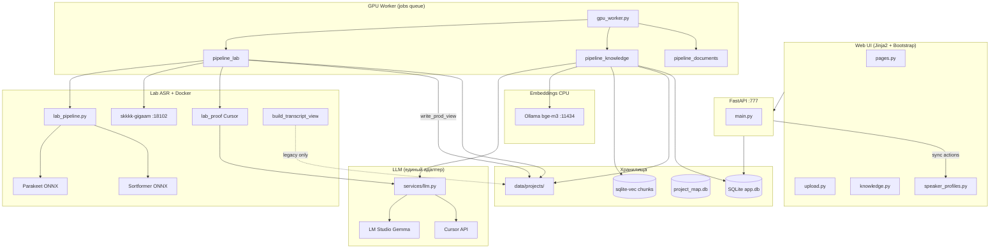

# Карта проекта SKKKK

> **Назначение:** единый ориентир «где что лежит, как связано, за что отвечает».  
> **Обновлять вместе с кодом** при добавлении модулей, пайплайнов, API, скриптов.  
> **Семантический поиск:** `py scripts/search_project_map.py "как работает merge"`  
> **Переиндексация:** `py scripts/index_project_map.py`  
> **LightRAG (граф):** `py scripts/lightrag_query.py "…"` — см. `tools/lightrag/README.md`

Связанные документы: [PLAN.md](PLAN.md) · [DECISIONS.md](DECISIONS.md) · [TESTING.md](TESTING.md) · [manifest.yaml](project-map/manifest.yaml)

**Кнопки прод-созвона (что вызывает что):** [§5.13](#513-прод-созвон-кнопка--api--функция-актуально-2026-08-27). Полный перечень UI: [§5](#5-ui-страницы-кнопки-кто-выполняет).

---

## 1. Архитектура (одним взглядом)



---

## 2. Корень и каталоги

| Путь | Назначение |
|------|------------|
| `C:\1C_NEW_SKKKK\` | Единственный корень проекта |
| `app/app/` | FastAPI: роутеры, сервисы, модели, воркер, шаблоны |
| `asr/` | Lab ASR (Parakeet/Sortformer/GigaAM-сверка), view, speaker match |
| `asr/lab/` | Канонический конвейер расшифровки (изоляция прогонов) |
| `asr/docker/` | Образ GigaAM; Whisper/T-one на диске для отката |
| `asr/tests/` | Unit-тесты ASR-модулей |
| `data/app.db` | SQLite: users, projects, artifacts, jobs, entities, links, chunks |
| `data/logs/` | api.log, worker.log, monitor_loop.log |
| `data/projects/{id}/` | Файлы проекта (см. §6) |
| `data/project_map.db` | Векторный индекс карты проекта (sqlite-vec, для агентов) |
| `docs/` | План, решения, промпты, этапы, **эта карта** |
| `docs/prompts/` | Промпты LLM (merge, entities, summary, TZ, chat, vision) |
| `docs/stages/` | STAGE-NN: критерии готовности этапов |
| `scripts/` | Утилиты, мониторинг, rerun, индекс карты |
| `tools/lightrag/` | **LightRAG** Docker (:9621) — граф знаний по docs (кнопки, API, БД) |
| `.cursor/rules/` | Правила агента Cursor |
| `.cursor/skills/` | Скилы (gpu-orchestrator, knowledge-pipeline, …) |
| `venv/` | Python 3.10+ окружение |
| `.env` | Секреты (не в git), шаблон `.env.example` |

---

## 3. Процессы runtime

| Процесс | Команда | Порт / роль |
|---------|---------|-------------|
| **API + UI** | `python -m app.app.main all` | `:777` — HTTP, JWT, страницы, **синхронные** действия (спикеры, выжимка) |
| **GPU Worker** | `python -m app.app.main worker` | Очередь `jobs` — lab ASR, knowledge, один job за раз |
| **GigaAM** | Docker `skkkk-gigaam` | `:18102` — второй слух + **embed_voice** |
| **Whisper / T-one** | Docker (не стартуют) | `:18101` / `:18103` — откат, воркер не вызывает |
| **Ollama** | вне проекта | `:11434` — `bge-m3`, CPU |
| **LightRAG** | `docker compose up` в `tools/lightrag/` | `:9621` — граф карты проекта (agents) |
| **LM Studio** | вне проекта | `:1234` — Gemma (если `LLM_PROVIDER=lmstudio`) |
| **Cursor API** | облако/local SDK | если `LLM_PROVIDER=cursor` |

**Важно:** кнопки «Пересчитать» / «Пересобрать выжимку» / «Переиндексировать» идут через **API-процесс**, не через GPU-воркер.

### 3.1. Изоляция арtefactов (не смешивать файлы)

| Зона | Путь | Изоляция |
|------|------|----------|
| **Канон арtefactа** | `data/projects/{id}/artifacts/{art_id}/` | audio, asr, reports — только этот job |
| **Parsed / structured** | `data/projects/{id}/parsed/`, `structured/` | имена с `{artifact_id}_*` |
| **Docker bridge** | `asr/work/` | **общий** mount; перед T-one/embed — `docker_stage.py` копирует WAV из арtefact |
| **Dev fallback** | `asr/work`, `asr/out` | только если `SKKKK_ASR_*` не заданы (локальный прогон) |
| **GigaAM embed job** | `data/gigaam/embed_job.json` | общий файл; один GPU-воркер — OK; параллель без staging — нет |
| **Tone sidecar txt** | `asr/out/input_raw_tone.txt` | dev-арtefact; prod пишет в `SKKKK_ASR_OUT/docker_tone.*` |

Инварианты: lab-прогон в `lab/runs/{run_id}/`; GigaAM embed — stage + hash-check; prod-код **не** читает `asr/out` как fallback. Whisper/T-one воркер не вызывает. `tone_for_align` — lex/duration guard; `finalize_audio_outputs` — всегда перезаписывает parsed raw-копии; prod-код **не** читает `asr/out` как fallback для арtefact-отчётов.

---

## 4. Конвейеры данных

### 4.1. Аудио (основной)

```
upload → job queued
  → preprocessing: FFmpeg 16 kHz WAV (атомарная запись + lock; опрос списка **не** извлекает)
  → asr_running: pipeline_lab.py
      ├── lab_pipeline.py --no-voice (venvs\lab: Parakeet + Sortformer;
      │     `--run-id` только если sha256 в run.json совпадает с текущим WAV)
      ├── lab_sense.py (Cursor)
      ├── lab_giga.py (Docker GigaAM)
      ├── lab_reconcile.py + lab_proof.py
      ├── lab_voice.py (WeSpeaker)
      ├── публикация turns/match/parsed + HTML /report
  → speakers_pending (стенограмма уже есть, speaker_0…)
  → Запомнить: имена сразу в HTML/JSON; Подтвердить: job knowledge
  → speakers_confirmed → apply_confirmed_speaker_names → transcript_ready
  → knowledge pipeline (worker):
      entities (LLM) → index (Ollama, автозапуск) → call_summary (протокол) → graph → done
```

### 4.2. Документы / изображения

```
upload → normalize (PDF/DOCX/OCR/vision) → text_extracted
  → knowledge pipeline (entities → index → graph → TZ trigger → done)
```

### 4.3. Статусы артефакта

`uploaded` → `preprocessing` → `asr_running` → `speakers_pending` → `speakers_confirmed` → `transcript_ready`  
→ `entities_extracted` → `indexed` → `graph_seeded` → `done` | `error`

(Документы: `text_extracted` вместо ASR-статусов.)

---

## 5. UI: страницы, кнопки, кто выполняет

> **Правило:** кнопки с `POST /api/artifacts/…` и `POST /projects/…/rebuild-tz` идут **синхронно через FastAPI** (`:777`).  
> **Блокировка повторного нажатия:** `SKKKK.guardButton` / `SKKKK.guardSubmit` (портал) и `guardActionButton` (стенограмма) — спиннер, фиксированная ширина, как у «Скачать».  
> **Долгие операции:** таблица `project_tasks`, `GET …/tasks/active`. Кнопка «Пересобрать» на `/projects/{id}` и `/projects/{id}/tz` опрашивает задачу каждые **3 с** (в том числе автосбор после документа) и блокируется так же, как при клике: `disabled` + spinner + `aria-busy`. Повторный POST → **409**.  
> Загрузка файлов → **job в GPU-воркер**. Авто-опрос статусов на странице проекта — каждые **3 с**.

### 5.1. Роутеры (backend)

| Файл | Prefix | Назначение |
|------|--------|------------|
| `routers/pages.py` | `/` | HTML-страницы, отчёты арtefact, audio stream |
| `routers/auth.py` | `/auth` | POST login → JWT |
| `routers/projects.py` | `/projects` | CRUD проектов |
| `routers/upload.py` | `/projects` | Resumable upload, list artifacts |
| `routers/knowledge.py` | `/projects/{id}/…`, `/chat` | search, graph, TZ, chat, deadlines, reextract-entities, conflicts, notes |
| `routers/speaker_profiles.py` | `/api` | enroll, merge, lab enroll/merge, recalculate, speakers-confirm, rebuild-summary, reindex |

### 5.2. Общая навигация

| Элемент | URL | Шаблон | Действие |
|---------|-----|--------|----------|
| Логотип **SKKKK** | `/` | `base.html` | Список проектов |
| **к проектам** | `/` | `project.html` nav | То же |
| `/login` | `/login` | `login.html` | Вход (JWT в localStorage) |
| `/admin/conflicts` | `/admin/conflicts` | `conflicts.html` | Очередь конфликтов (**admin**, только просмотр JSON) |
| `/projects/{id}/graph` | graph | `graph.html` | Cytoscape-граф (GET graph/data) |
| `/projects/{id}/tz` | tz | `tz.html` | Отдельная страница ТЗ (дублирует rebuild-tz) |
| `/projects/{id}/chat` | chat | `chat.html` | Отдельный чат (дублирует чат на project) |

### 5.3. Список проектов — `/` (`index.html`)

| Кнопка / элемент | API | Кто | Роль | Результат |
|------------------|-----|-----|------|-----------|
| **Новый проект** | — | UI | admin, manager | Открывает модалку |
| **Создать** | `POST /projects` | FastAPI | admin, manager | Проект + `data/projects/{id}/` tree |
| **Отмена** | — | UI | — | Закрыть модалку |
| Клик по проекту | — | navigate | любая | `/projects/{id}` |
| **Описание** (стрелка справа от названия) | — | UI | auth | Сворачиваемый текст `description` под названием (если задан при создании) |
| Авто-загрузка | `GET /projects` | FastAPI | auth | Список активных проектов |

### 5.4. Страница проекта — `/projects/{id}` (`project.html`)

#### Макет: выжимка и чат (строка `project-insights-row`)

На **lg+** (≥992px) левая колонка «Итоговая выжимка по проекту» и правая «Чат с ИИ» — **одинаковая высота**: `min(70vh, 720px)`, `position: sticky; top: 0.75rem`. Карточки — flex-колонки (`insights-card`, `chat-card`); контент (**`#tz-content`**, **`#chat-log`**) скроллится **внутри** панели, поле ввода чата прижато к низу (`chat-composer`, `margin-top: auto`). Страница при длинной переписке не растягивается.

На **мобильном** (<768px): `#tz-content` до `50vh`, `#chat-log` до `40vh`, отдельный внутренний скролл.

#### Загрузка материалов

| Кнопка | API | Кто | Результат |
|--------|-----|-----|-----------|
| **Загрузить** | `POST …/uploads/init` → `PUT …/chunks/{n}` → `POST …/complete` | FastAPI + **GPU worker** (job) | Файл в `raw_inputs/`, job `queued`, воркер гонит ASR/knowledge |

Тип (`source_type`): `call` | `document` | `note` | `screenshot` — влияет на пайплайн воркера.

#### Таблица артефактов (авто-обновление 3 с)

| Элемент | API | Поведение |
|---------|-----|-----------|
| Badge статуса | `GET /projects/{id}/artifacts` | `reconcile_artifact_status` подтягивает `done`, если knowledge уже есть |
| Ссылка на имя файла | — | При `status=done` → `/artifacts/{id}/report` (стенogramма или отчёт документа) |
| **match** | — | `/artifacts/{id}/report-speaker-match` — Sortformer match, enroll/merge спикеров |
| **Подтвердить спикеров** | `POST /api/artifacts/{id}/speakers-confirm` | При `speakers_pending` → `speakers_confirmed` + job **knowledge** (имена уже в proof/HTML; выжимка из подписанного `docker_gigaam_speakers.json`) |
| **Pipeline live** (раскрывашка) | тот же GET | lab checklist / knowledge из `pipeline_progress.py` |
| **Скачать** | `GET /artifacts/{id}/download` | Созвон/видео → **MP3** (`download.mp3`, 64 kbps); документ → оригинал из `raw_inputs/` |
| Toast «обработан» | — | Когда статус сменился на `done` |

Статусы в UI: В очереди → Подготовка → ASR → … → **Готово** / **Ошибка**.

#### Итоговая выжимка по проекту (левая колонка)

| Кнопка | API | Кто | На чём | Время | Роль |
|--------|-----|-----|--------|-------|------|
| *(авто load)* | `GET /projects/{id}/tz/content` | FastAPI | `project_state/current_tz.md` | — | все |
| **Пересобрать** | `POST /projects/{id}/rebuild-tz` | FastAPI → `tz.rebuild_tz()` → **LLM map/reduce** | Аудио: lab `parsed/calls/{id}_final.txt` (proof + имена), **не** Whisper/T-one и не устаревшие чанки. Документы: `chunks`. Плюс сущности, выжимки созвонов (`_call_summary.md`), заметки, конфликты; промпт `rebuild_tz.md`; фрагменты ~6000 симв. Пока `tz_rebuild` running (кнопка **или авто** после документа) — кнопка disabled/spinner, POST 409. | 2–10 мин | **admin** |

Источник — **не** обрезанный excerpt сырого текста. Если у аудио нет `_final.txt` — fallback на чанки / `transcription_text`. Роут в `knowledge.py`.

Результат: `data/projects/{id}/project_state/current_tz.md`, архив в `versions/`, запись `changelog`.

Авто-пересборка: каждые **N** готовых аудио (`TZ_REBUILD_EVERY_N`, по умолчанию 3) — при job done.

#### Чат с ИИ по проекту (правая колонка)

| Кнопка | API | Кто | На чём |
|--------|-----|-----|--------|
| **Спросить** | `POST /chat` `{project_id, question}` | FastAPI → `chat.answer_chat()` | RAG: sqlite-vec **чанки** (после knowledge по lab `_final.txt`) + **priority_weight** rerank + документы + выжимки `_call_summary.md` + **chat_guidance** + LLM; без чанков — «не найдено». Не читает Whisper/T-one напрямую. Сверка: `scripts/inspect_project_index.py --project {id}` |
| **История чата** | `GET /projects/{id}/chat/history` | FastAPI → `chat.list_chat_messages()` | Лента + `waiting`, `meta` (уточнения) |
| **Статус чата** | `GET /projects/{id}/chat/status` | FastAPI → `chat.chat_is_pending()` | `{pending, label}` |

Enter в textarea — тоже отправка. Отдельная страница `/projects/{id}/chat` — тот же endpoint. Повторный `POST /chat` при активном ответе — **409**.

#### Дедлайны (сворачиваемый блок, над MCP)

Поручения **со сроком** из сущностей `entity_type=task` (поля `description`, `assignee`, `deadline`, `status`) по всем артефактам проекта. В API и списке — **только** задачи с непустым `deadline`; дедупликация по описанию + ответственный + срок.

| Элемент | API | Поведение |
|---------|-----|-----------|
| **Список** | `GET /projects/{id}/deadlines` (`knowledge.py` → `list_project_deadlines`) | Только tasks с `deadline`; таблица: задача, ответственный, срок, статус, источник |
| **Обновить из материалов** | `POST /projects/{id}/reextract-entities` (`knowledge.py` → `reextract_project_entities`) | admin/manager — LLM по lab `_final.txt` / `transcription_text`; пишет `entities`, **не** переиндексирует; 409 если уже идёт |
| **Календарь** | тот же GET | **FullCalendar** — только задачи с распознанной датой (ISO, `DD.MM.YYYY`, «15 марта 2026») |
| Загрузка | — | При развороте блока; авто-обновление после `done` артефакта, если панель открыта |

**UI:** Bootstrap `collapse`, `#deadlines-panel`, по умолчанию **сложен**; переключатель «Список» / «Календарь».

#### Удалённый доступ MCP (низ страницы проекта)

Read-only MCP (Streamable HTTP) к знаниям **только этого проекта**. Авторизация — ключ `skkkk_mcp_…`, не JWT портала.

**UI:** блок **сворачиваемый** (Bootstrap `collapse`, `#mcp-access-panel`). По умолчанию **сложен**; клик по заголовку «Удалённый доступ (MCP)» — развернуть/свернуть, подсказка `(развернуть)` / `(свернуть)` в `#mcp-toggle-hint`. Badge «только чтение» в шапке всегда виден.

| Элемент UI | API | Кто |
|------------|-----|-----|
| **Создать ключ** | `POST /projects/{id}/mcp/tokens` | admin, manager |
| **Отозвать ключ** | `DELETE /projects/{id}/mcp/tokens/{token_id}` | admin, manager |
| **URL / JSON для Cursor** | `GET /projects/{id}/mcp/info` | любой авторизованный |
| **MCP endpoint** | `POST /mcp/projects/{id}` + `Authorization: Bearer <ключ>` | держатель ключа |

Инструменты MCP: `project_overview`, `list_artifacts`, `get_project_summary`, `search_project`, `list_entities`, `get_knowledge_graph`, `list_notes`, `list_conflicts`, `get_artifact_content`.

Публичный URL для MCP задаётся в `.env`: `WEB_PUBLIC_URL=http://203.0.113.10:777` (если портал доступен из интернета). Без него в UI подставляется адрес из текущего запроса.

### 5.5. Стенogramма созвона — `/artifacts/{id}/report` (`transcript.html` / `transcript_view.py`)

Открывается из таблицы проекта (status=done). Встроенный HTML с плеером.

#### Блок «Итоговая выжимка созвона» (верх)

Read-only markdown из `call_summary.md` (собран при knowledge или кнопкой ниже). Таблица «Кто / Что / Срок» — HTML `<table>`, не сырые `|`.

#### Скачать материалы (под плеером)

| Кнопка | API | Файл |
|--------|-----|------|
| **Выжимка Word** | `GET /artifacts/{id}/download/summary.docx` | `.docx` через **python-docx** из `call_summary.md` |
| **Стенограмма .txt** | `GET /artifacts/{id}/download/transcript.txt` | `[таймкод] имя: текст` из `docker_gigaam_speakers.json` |

#### Панель «Спикеры и инструменты» (registry)

| Кнопка | API | Кто | На чём | Время |
|--------|-----|-----|--------|-------|
| **▶** (у спикера) | — | browser | seek audio | мгновенно |
| **Запомнить** / **Сохранить** | `POST /api/artifacts/{id}/speaker-enroll` | FastAPI → GigaAM embed + DB | match JSON, `speaker_profiles`; lab: `write_prod_view` (proof + имена → speakers.json/HTML), **не** `build_transcript_view` | ~5–20 с |
| **Слить** (два ID) | `POST /api/artifacts/{id}/speaker-merge` | FastAPI | merge_map + lab `write_prod_view` | ~1 с |
| **Пересчитать** (`#recalc`) | `POST /api/artifacts/{id}/speaker-recalculate` | FastAPI | Тот же API, что «Пересчитать подсказки» на match. Lab: cosine `speaker_N` ↔ база. Legacy: Sortformer JSON **этого** артефакта | ~1–20 с |
| **Пересобрать выжимку** | `POST /api/artifacts/{id}/rebuild-summary` | FastAPI → имена в speakers.json → `summarize_call.py` → **LLM** | Lab: proof turns с именами, затем HTML из `write_prod_view` (не `SPEAKER_00`). Промпт `call_summary.md` | ~1–5 мин |
| **Обновить и переиндексировать** | `POST /api/artifacts/{id}/reindex` | FastAPI | rebuild view → `*_final.txt` → **Ollama** index chunks | ~30 с |

После POST-кнопок — `location.reload()`.

#### Legacy-режим (без registry, старые отчёты)

| Кнопка | Куда | Примечание |
|--------|------|------------|
| **Применить имена** | `localStorage` | Только клиент, **не** сервер |
| **Слить** (select) | `localStorage` | Только клиент |

#### Интерактив без API

| Элемент | Действие |
|---------|----------|
| Chip фильтр спикера | Фильтр реплик; `unknown` (бесхозные слова lab) на пилюлях нет |
| Поле поиска `#q` | Фильтр по тексту |
| Клик по времени / реплике | Seek аудио |
| `GET /artifacts/{id}/audio` | Поток WAV/M4A |

### 5.6. Match спикеров — `/artifacts/{id}/report-speaker-match` (`speaker_match_test.html`)

Страница для подписи голосов: карточки встречи + прокручиваемая **база голосов**. Таймлайна и списка сегментов нет (они в `/report`).

| Кнопка / ссылка | API | Кто | Примечание |
|-----------------|-----|-----|------------|
| **← Проект** / **Стенограмма** | GET | pages | соседние экраны |
| **Пересчитать подсказки** | `POST …/speaker-recalculate` | FastAPI | Lab: cosine `speaker_N` ↔ база, confirmed не сбрасываются |
| **Запомнить** / **Обновить** | `POST …/speaker-enroll` | FastAPI | На карточке; leftover project-копия после подъёма в global удаляется |
| **Объединить** | `POST …/speaker-merge` | FastAPI | На карточке |
| **Прослушать** | — | audio seek | эталонный клип спикера |

Пул в сайдбаре: `list_profiles` — одно имя на свёрнутый ключ (`Игорь (Пилот)` = `Игорь Пилот`), prefer global. Уборка БД: `cleanup_voice_profile_pool()` / `scripts/dedupe_speaker_profiles.py` — точные имена, варианты написания, cosine ≥ 0.95, сироты project.

### 5.7. Прочие отчёты аудио (только просмотр + seek)

| URL | Файл-генератор | Содержимое |
|-----|----------------|------------|
| `/artifacts/{id}/report-sortformer` | `build_sortformer_transcript_view.py` | Sortformer timeline |
| `/artifacts/{id}/report-diar-raw` | `build_raw_diar_view.py` | Whisper/Tone/GigaAM tracks |
| `/artifacts/{id}/report-diar-two-voice` | two-voice diar | 2-speaker view |
| `/artifacts/{id}/report-lab?run={run_id}` | `build_lab_view.py` | Лаборатория: снимок 01–07, оверлей Cursor, сверка GigaAM, карточки голосов; итоговая стенограмма как на проде (пилюли MM:SS, цветные имена) |
| `/artifacts/{id}/lab/{run_id}/file/{путь}` | — | Файлы прогона (WAV, json, npy, логи) без выхода за каталог |

Кнопка **лаб** в списке артефактов появляется, когда у аудио есть хотя бы один
лабораторный прогон (`lab_runs`). На report-lab после `asr/lab_voice.py` —
карточки **Запомнить** / **Слить** (`POST /api/artifacts/{id}/lab/{run_id}/speaker-enroll`
и `…/speaker-merge`). Они пишут в ту же `speaker_profiles`, файл —
`voice/match.json` прогона, не боевой match.

#### 5.7.1. Лаборатория расшифровки

Изолированный конвейер (`asr/lab/`) — **он же боевой** ASR. CLI ниже — отладка той же линии, что гоняет воркер (`process_lab_artifact`). UI: `/report-lab` диагностика, `/report` прод.

```powershell
venvs\lab\Scripts\python.exe asr\lab_pipeline.py --project-id 1 --artifact-id art_... --report
```

Стадии: `01_audio` копия 16 кГц без денойза → `02_asr` Parakeet-TDT v3 (окна ≤80 с) →
`03_diar` Sortformer 4spk v2.1 (ONNX, сырые вероятности) → `04_paint` покраска
слов → `05_voice` WeSpeaker в `skkkk-gigaam` → `06_transcript` реплики без LLM →
`07_verify` второй проход через Silero VAD.

Каждая стадия пишет `stage.json` с sha256 входов и выходов; повтор пропускается
по отпечатку (хеши входов + параметры). Отсутствие входа — падение, подстановки
файла из другого прогона нет.

Принятый снимок (`asr/lab/FREEZE.md`), эталон `20260826T174104Z_48a796`:

1. этап 1 — конвейер 01–07 без DeepFilterNet;
2. этап 2 — прогон Cursor (`asr/lab_sense.py`), только каталог `sense/`;
3. этап 3 — свой прогон GigaAM и сверка: `giga/`, `reconcile/`, `proof/`;
4. этап 4 — слепки WeSpeaker в `voice/` (`asr/lab_voice.py`); «Запомнить» /
   «Слить» на report-lab пишут в `speaker_profiles` с меткой `speaker_N`.
   В FREEZE не входит, пока нет явного «принимаем».

Нарезка и таймкоды GigaAM в итог не идут — только его мнение о спикере в спорных
местах и его вариант слова. Боевой `docker_gigaam_speakers.json` пишет
`write_prod_view` из **proof**, не из сырого GigaAM timeline.

```powershell
venv\Scripts\python.exe asr\lab_sense.py --project-id 1 --artifact-id art_... --run-id 20260826T174104Z_48a796
venv\Scripts\python.exe asr\lab_giga.py --project-id 1 --artifact-id art_... --run-id 20260826T174104Z_48a796
venv\Scripts\python.exe asr\lab_reconcile.py --project-id 1 --artifact-id art_... --run-id 20260826T174104Z_48a796
venv\Scripts\python.exe asr\lab_proof.py --project-id 1 --artifact-id art_... --run-id 20260826T174104Z_48a796
venv\Scripts\python.exe asr\lab_voice.py --project-id 1 --artifact-id art_... --run-id 20260826T174104Z_48a796
```

### 5.8. Отдельные страницы

| Страница | Кнопки | API |
|----------|--------|-----|
| `/projects/{id}/tz` | **Пересобрать ТЗ** | = `rebuild-tz` (admin) |
| `/projects/{id}/chat` | **Спросить** | `POST /chat` |
| `/projects/{id}/chat` | *(авто при открытии)* | `GET /projects/{id}/chat/history` |
| `/projects/{id}/chat` | *(авто при pending)* | `GET /projects/{id}/chat/status` + poll history |
| `/projects/{id}/graph` | — | `GET …/graph/data` (Cytoscape) |
| `/admin/conflicts` | — | `GET …/conflicts` (admin, read-only cards) |
| `/login` | **Войти** | `POST /auth/login` |

API без кнопок в UI (для будущего / интеграций):  
`GET …/search`, `POST …/notes`, `POST /links`, `POST /entities/{id}/review`, `POST /conflicts/{id}/resolve`.

### 5.9. Сводка: кто выполняет действие

| Исполнитель | Что |
|-------------|-----|
| **GPU worker** | lab ASR, knowledge (entities, index, summary, graph) после upload и после confirm |
| **FastAPI sync** | recalculate, enroll, merge, rebuild-summary, reindex, rebuild-tz, chat |
| **Docker GigaAM** | второй слух + voice embed |
| **LLM** (Cursor/Gemma) | sense, proof, summary, entities, TZ, chat |
| **Ollama bge-m3** | index/reindex chunks, semantic search |
| **Browser only** | фильтры, seek, legacy rename localStorage |

### 5.10. Два разных «Пересобрать» — не путать

| UI | Кнопка | Scope | Output |
|----|--------|-------|--------|
| `/projects/{id}` | **Пересобрать** (выжимка проекта) | весь проект | `current_tz.md` из **всех chunks БД** + entities + notes |
| `/artifacts/…/report` | **Пересобрать выжимку** | один созвон | `call_summary.md` из полной стенограммы |

### 5.11. Ограничения выжимок (контекст LLM)

| Выжимка | Вход | Ограничение |
|---------|------|-------------|
| **Созвон** (`call_summary.md`) | Вся стенограмма | map ~6000 симв. × N + reduce **4096 tokens** — протокол встречи |
| **Проект** (`current_tz.md`) | **Все chunks** проекта из `chunks` + entities + notes + conflicts + call_summary | map ~6000 симв. × N + reduce **8192 tokens** |
| **Чат** | top‑8 релевантных chunks (semantic search) | только к вопросу, не полная выжимка |

### 5.12. BPMN: кнопки → API → сервисы → БД/файлы

Схема зависимостей UI-кнопок (страница проекта, стенogramma, match). Исполнитель: **W** = GPU worker, **S** = FastAPI sync, **B** = browser.

```mermaid
flowchart TB
  subgraph project_ui["/projects/{id} — project.html"]
    UPL[Загрузить] -->|POST …/uploads/…/complete| UP_S[S: upload + jobs]
    CONF[Подтвердить спикеров] -->|POST /api/artifacts/{id}/speakers-confirm| CF_S[S: speakers-confirm]
    TZ[Пересобрать ТЗ] -->|POST /projects/{id}/rebuild-tz| TZ_S[S: tz rebuild LLM]
    CHAT[Спросить] -->|POST /chat| CH_S[S: RAG + LLM]
    DED[Обновить дедлайны] -->|POST /projects/{id}/reextract-entities| DE_S[S: entities LLM]
  end

  subgraph report_ui["/artifacts/{id}/report — transcript.html"]
    ENR[Запомнить / Сохранить] -->|POST …/speaker-enroll| EN_S[S: enroll + write_prod_view]
    MRG[Слить] -->|POST …/speaker-merge| MG_S[S: merge_map + write_prod_view]
    REC[Пересчитать] -->|POST …/speaker-recalculate| RC_S[S: lab cosine speaker_N]
    SUM[Пересобрать выжимку] -->|POST …/rebuild-summary| RS_S[S: summarize LLM]
    RIX[Обновить и переиндексировать] -->|POST …/reindex| RI_S[S: Ollama index]
  end

  UP_S --> J[(jobs)]
  UP_S --> A[(artifacts)]
  J --> W_ASR[W: pipeline_lab + knowledge]

  CF_S --> J2[(jobs phase=knowledge)]
  CF_S --> ASL[(artifact_speaker_links)]
  CF_S --> MJ[sortformer_speaker_match.json]
  J2 --> W_NAMES[W: apply_confirmed_speaker_names]
  W_NAMES --> W_KNOW[W: entities index summary graph]

  RC_S --> SP[(speaker_profiles pool)]
  RC_S --> MJ
  RC_S --> TH[transcript.html + docker_gigaam_speakers.json]

  EN_S --> SP
  EN_S --> MJ
  EN_S --> ASL
  EN_S --> TH
  MG_S --> MJ
  MG_S --> TH

  W_ASR --> ASR_FILES[lab proof + asr/docker_gigaam_speakers.json]
  W_KNOW --> ENT[(entities links chunks)]
  W_ASR --> TH
  RS_S --> CS[call_summary.md]
  RS_S --> TH
  RI_S --> ENT
  TZ_S --> TZMD[current_tz.md]
  CH_S --> ENT

  TH --> PARSED[parsed/calls/*_final.txt]
  MJ --> MATCH_HTML[report-speaker-match]
```

**Цепочка «Пересчитать» (критично для спикеров):**

1. UI `#recalc` → `POST /api/artifacts/{id}/speaker-recalculate`
2. Если есть lab-прогон с `voice/match.json` — пересчёт cosine `speaker_N` по базе; confirmed/merge сохраняются. **Не** вызывать `match_sortformer_speakers` и не брать эталон из `experiments/`.
3. Иначе legacy: `recalculate_speaker_match()` сохраняет **prev** `sortformer_speaker_match.json` и гоняет `match_sortformer_speakers.run()` только по JSON **этого** артефакта.
4. `_finalize_match_payload()` — `_restore_merge_map` + `_restore_confirmed_matches`
5. `sync_match_json_from_links` → `artifact_speaker_links`
6. `rebuild_match_report_html` + `rebuild_transcript_report_html` (lab: `write_prod_view` из proof + match JSON; **не** `build_transcript_view.py`)

**Таблицы БД по кнопкам:**

| Кнопка | artifacts | jobs | speaker_profiles | artifact_speaker_links | entities/chunks |
|--------|-----------|------|------------------|------------------------|-----------------|
| Загрузить | insert | insert | — | — | — |
| Подтвердить спикеров | status→phase2 | insert | read | read/write confirmed | — |
| Пересчитать | — | — | read pool | rewrite | — |
| Запомнить | — | — | insert/update | write | — |
| Запомнить (лаб) | — | — | insert/update (`speaker_N`) | write lab match JSON | — |
| Слить | — | — | — | merge_map in JSON | — |
| GPU pipeline done | status=done | done | backfill global | from match | insert index |

**Скрипт дедупликации голосов:** `scripts/dedupe_speaker_profiles.py` → `cleanup_voice_profile_pool()` (точные имена, `Игорь (Пилот)`/`Игорь Пилот`, cosine ≥ 0.95, сироты project).

### 5.13. Прод-созвон: кнопка → API → функция (актуально 2026-08-27)

Канон стенограммы — **lab proof** (`lab/runs/{run_id}/proof/transcript.json`), метки `speaker_N`. Имена — из `reports/sortformer_speaker_match.json`. HTML/JSON для `/report` пишет **`write_prod_view`**. Скрипт `asr/build_transcript_view.py` на lab-артефакте **запрещён**: он нарезает Sortformer `SPEAKER_00` поверх proof и сбрасывает имена.

#### Загрузка и воркер

| Шаг | Где | Функция | Что делает |
|-----|-----|---------|------------|
| **Загрузить** | `upload.py` complete | создаёт `jobs.kind=process_artifact` | файл в `raw_inputs/`, статус `uploaded`; джоба в **общую** очередь (FIFO), один GPU-воркер |
| job | `workers/pipeline.py` `process_artifact` | `process_lab_artifact` | если `uploaded` / `asr_running` / `error` |
| WAV | `artifact_audio.ensure_audio_wav` | ffmpeg + lock + `.partial` (`-f wav`, иначе muxer не угадывает расширение) | опрос списка **не** извлекает WAV |
| ONNX | `pipeline_lab._run_cmd` | `asr/lab_pipeline.py --no-voice` | `--run-id` только если sha256 WAV = `run.json` |
| sense/giga/proof/voice | `pipeline_lab` | `lab_sense.py` → `lab_giga.py` → `lab_reconcile.py` → `lab_proof.py` → `lab_voice.py` | Cursor + GigaAM + WeSpeaker |
| публикация | `publish_lab_to_prod` | proof + `voice/match.json` | `write_prod_view`, match HTML, `speakers_pending` |
| стоп | `process_artifact` | `return` | пока статус `speakers_pending` |

#### Имена спикеров

| Кнопка / событие | API | Функция | Результат |
|------------------|-----|---------|-----------|
| **Запомнить** / **Сохранить** (`/report` и `/report-speaker-match`) | `POST /api/artifacts/{id}/speaker-enroll` | `speaker_profiles` enroll + `_safe_rebuild_artifact_views` | БД `speaker_profiles` + links; lab: `apply_confirmed_speaker_names` → `write_prod_view` (имена сразу в turns/HTML/`_final.txt`) |
| **Слить** / **Объединить** | `POST …/speaker-merge` | merge_map + тот же rebuild | два `speaker_N` → один человек |
| **Пересчитать подсказки** (lab) | `POST …/speaker-recalculate` | cosine `voice/match.json` ↔ `speaker_profiles` | **не** `match_sortformer_speakers`, **не** эталон `experiments/`; confirmed не сбрасываются |
| **Пересчитать** (legacy, нет lab-прогона) | тот же POST | `recalculate_speaker_match` → `match_sortformer_speakers.run` | только Sortformer JSON **этого** артефакта |
| **Подтвердить спикеров** (таблица проекта) | `POST …/speakers-confirm` | `confirm_speakers_and_enqueue` | все `speaker_N` named → `speakers_confirmed` + job `phase=knowledge` (**не** Whisper/T-one) |
| воркер после confirm | `process_artifact` | `apply_confirmed_speaker_names` → `set_status(transcript_ready)` → `run_knowledge_pipeline` | имена ещё раз в файлы, затем сущности / индекс / выжимка / граф |
| GET `/report` | `pages.py` | `ensure_audio_report` → lab: `republish_named_transcript` | пересборка HTML из proof+match, без `build_transcript_view` |

Enroll **не** требует нажимать «Подтвердить», чтобы имена появились в стенограмме. Confirm — шлагбаум на **knowledge** (сущности, индекс, протокол, граф).

На `/report` кнопка `#recalc` подписана **«Пересчитать»**; на `/report-speaker-match` — **«Пересчитать подсказки»** (lab) или **«Обновить и пересчитать»** (legacy). Оба бьют в один POST.

#### Python: кнопка → функция

| UI | Роутер | Сервис |
|----|--------|--------|
| Загрузить complete | `upload.complete_resumable_upload` | создаёт `Job(kind=process_artifact)` |
| GPU job (аудио, до confirm) | `workers.pipeline.process_artifact` | `pipeline_lab.process_lab_artifact` |
| GPU job (`speakers_pending`) | тот же | **стоп**, ждёт кнопку |
| GPU job (`speakers_confirmed`) | тот же | `apply_confirmed_speaker_names` → `run_knowledge_pipeline` |
| Запомнить | `speaker_profiles.api_enroll_speaker` | `enroll_speaker` → `_safe_rebuild_artifact_views` → lab: `apply_confirmed_speaker_names` |
| Слить | `api_merge_speakers` | `merge_speakers` → тот же rebuild |
| Запомнить (лаб) | `api_lab_enroll_speaker` | enroll в `voice/match.json` прогона, не прод JSON |
| Пересчитать | `api_recalculate_speakers` | lab: `_recalculate_lab_speaker_match`; иначе `recalculate_speaker_match` |
| Подтвердить | `api_speakers_confirm` | `confirm_speakers_and_enqueue` (`phase=knowledge`) |
| Пересобрать выжимку | `api_rebuild_summary` | `rebuild_artifact_call_summary` |
| Переиндексировать | `api_reindex_artifact` | `refresh_artifact_project_index` |
| Пересобрать ТЗ | `knowledge.rebuild_tz_endpoint` | `tz.rebuild_tz` — lab `_final.txt` |
| Список дедлайнов | `knowledge.project_deadlines` | `list_project_deadlines` |
| Обновить дедлайны | `knowledge.reextract_entities_endpoint` | `reextract_project_entities` (не reindex) |
| Чат | `knowledge.chat_endpoint` | `chat.answer_chat` — чанки lab-индекса |
| GET `/report` | `pages.artifact_report_page` | `artifact_audio.ensure_audio_report` → lab: `republish_named_transcript` |
| Выжимка Word | `pages.artifact_summary_docx_download` | `transcript_export.build_summary_docx_bytes` |
| Стенограмма .txt | `pages.artifact_transcript_txt_download` | `resolve_transcript_txt` |

#### Выжимка созвона и HTML

| Кнопка | API | Функция | Результат |
|--------|-----|---------|-----------|
| **Пересобрать выжимку** | `POST …/rebuild-summary` | `rebuild_artifact_call_summary` | 1) lab: `apply_confirmed_speaker_names`; 2) `run_call_summary` → `asr/summarize_call.py` (вход: **подписанный** `docker_gigaam_speakers.json`, промпт `docs/prompts/call_summary.md`); 3) lab: снова `republish_named_transcript` (вклеить `call_summary.md` в HTML). `summarize_call` **не** вызывает `build_transcript_view`, если есть lab proof |
| **Выжимка Word** | `GET …/download/summary.docx` | `transcript_export.build_summary_docx_bytes` | GFM-таблица → Word table |
| **Стенограмма .txt** | `GET …/download/transcript.txt` | `resolve_transcript_txt` | таймкоды + имена из speakers.json |
| **Обновить и переиндексировать** | `POST …/reindex` | `refresh_artifact_project_index` | тот же lab-rebuild HTML + Ollama chunks |

Промпт выжимки требует **GFM-таблицу** «Кто / Что / Срок» (шапка + `| --- | --- | --- |` + строки), не «набросать пайпы». Рендер: `transcript_view._summary_to_html` → `<table class="summary-table">`.

Фильтр-пилюли на `/report`: имена из turns; метка lab **`unknown`** (бесхозное слово) на чипах **не** показывается (`_color_map` / `displayName`).

#### Ключевые файлы на диске (lab-прод)

| Файл | Кто пишет | Кто читает |
|------|-----------|------------|
| `lab/runs/{id}/proof/transcript.json` | `lab_proof.py` | `write_prod_view` / `republish_named_transcript` — канон реплик |
| `lab/runs/{id}/voice/match.json` | `lab_voice.py` | enroll/recalc lab |
| `reports/sortformer_speaker_match.json` | publish + enroll | имена, registry UI |
| `asr/docker_gigaam_speakers.json` | `write_prod_view` | `/report`, `summarize_call`, скачать .txt |
| `asr/call_summary.md` | `summarize_call.py` | блок выжимки, Word |
| `reports/transcript.html` | `write_prod_view` + `finalize_audio_outputs` | GET `/report` |
| `parsed/calls/{id}_final.txt` | `finalize_audio_outputs` | индекс, ТЗ |

#### Что нельзя делать на lab-артефакте

- Вызывать `build_transcript_view.py` / `match_sortformer_speakers` с чужим JSON (`experiments/…`).
- Считать WAV готовым, пока ffmpeg пишет (опрос `GET …/artifacts` не должен вызывать extract).
- Резюмировать `--run-id`, если sha256 WAV ≠ `run.json`.
- Подставлять `SPEAKER_00` вместо `speaker_N`.

---

## 6. Layout артефакта на диске

```
data/projects/{project_id}/
├── raw_inputs/{calls|documents|notes}/   # оригинал загрузки
│   # видео (.mp4/.mkv/.webm/…) удаляется после проверенного извлечения WAV
├── artifacts/{artifact_id}/
│   ├── audio/input_16k.wav               # рабочий звук (16 kHz mono)
│   ├── audio/playback.m4a              # AAC для плеера в UI
│   ├── asr/                              # рабочая зона ASR
│   │   ├── docker_whisper.json|.txt
│   │   ├── docker_tone.json|.txt
│   │   ├── docker_gigaam.txt
│   │   ├── sortformer_segments.json
│   │   ├── docker_merged_windows.json    # окна LLM-merge
│   │   ├── docker_merged_plain.txt       # plain после integrity
│   │   ├── docker_gigaam_speakers.json   # реплики для UI/summary
│   │   ├── transcript_integrity.json
│   │   ├── call_summary.md
│   │   └── transcript.html
│   ├── reports/                          # копии для UI
│   │   ├── transcript.html
│   │   ├── call_summary.md
│   │   └── sortformer_speaker_match.json
│   └── lab/                              # боевой ASR: изоляция прогонов
│       ├── latest.json                   # указатель на последний прогон
│       └── runs/{run_id}/                # run_id = 20260826T101500Z_ab12cd
│           ├── run.json                  # исходник с sha256, artifact/project
│           ├── report.html               # страница прогона
│           ├── logs/{stage}.log
│           ├── 01_audio/{stage.json,clean_16k.wav}
│           ├── 02_asr/{stage.json,words.json}
│           ├── 03_diar/{stage.json,diar.json,probs_clean.npy,heatmap.json,compare.json}
│           ├── 04_paint/{stage.json,paint.json}
│           ├── 05_voice/{stage.json,voice.json,embed_raw.json}
│           ├── 06_transcript/{stage.json,transcript.json,transcript.txt}
│           ├── 07_verify/{stage.json,verify.json}
│           ├── sense/                    # этап 2
│           ├── giga/ reconcile/ proof/   # этап 3
│           └── voice/{voice.json,match.json,embed_raw.json}  # этап 4
├── parsed/calls/
│   ├── {id}_final.txt
│   ├── {id}_transcript.html
│   └── {id}_call_summary.md
└── structured/{id}_entities.json
```

---

## 7. Сервисы (`app/app/services/`)

| Модуль | Ответственность |
|--------|-----------------|
| `llm.py` | Единый адаптер: lmstudio / cursor |
| `gpu_phase.py` | Load/unload Gemma, VRAM-фазы |
| `queue.py` | jobs: claim FIFO (`created_at`, `id`), finish, requeue; очередь **глобальная**, не per-user |
| `pipeline_lab.py` | Боевой ASR-оркестратор: `process_lab_artifact`, `publish_lab_to_prod`, `write_prod_view`, `republish_named_transcript`, `apply_confirmed_speaker_names`; повтор джобы пропускает готовые оверлеи (sense/giga/reconcile), `lab_proof` — нет `proof/transcript.json` |
| `pipeline_audio.py` | Legacy ASR; `run_call_summary` (выжимка созвона) |
| `pipeline_voice_gate.py` | Legacy voice-gate до triple ASR (воркер lab-путь не вызывает) |
| `pipeline_knowledge.py` | entities → index → summary → graph → done |
| `pipeline_documents.py` | PDF/DOCX/OCR pipeline |
| `pipeline_resume.py` | Resume ASR без повторного merge |
| `pipeline_progress.py` | UI progress: lab checklist + knowledge |
| `voice_gate_checklist.json` | в `asr/` артефакта — шаги gate до confirm спикеров |
| `transcript_export.py` | export transcript.txt + summary.doc для страницы созвона |
| `artifact_audio.py` | finalize, sync reports, rebuild HTML; атомарный extract `input_16k.wav` + lock |
| `artifact_lab.py` | Лаборатория: список прогонов, выбор прогона, отдача файлов; fallback запрещён |
| `media_cleanup.py` | удаление видео-оригинала после проверки `input_16k.wav` |
| `speaker_profiles.py` | enroll/merge/recalculate; lab enroll в `voice/match.json`; **global pool** подтверждённых голосов (все проекты) |
| `entities.py` | LLM extract + persist entities JSON |
| `indexing.py` | chunk → Ollama embed → chunks + chunk_vectors; аудио из lab `_final.txt`; `audit_project_index` |
| `vector_index.py` | sqlite-vec CRUD для artifact chunks |
| `graph.py` | seed entities/links, conflicts |
| `tz.py` | rebuild TZ (map/reduce по всем chunks проекта + entities + notes) |
| `chat.py` | RAG chat over project; history in `chat_messages` |
| `models/chat_message.py` | Per-user chat log (`project_id` + `user_id`) |
| `chunking.py` | split transcript / plain text; lab `[таймкод] Имя:` → поле `speaker` без скобок |
| `storage.py` | paths: artifact_root, parsed, structured |
| `status.py` | artifact status transitions |
| `auth.py` | JWT, role passwords |
| `upload.py` / `resumable_upload.py` | file registration |
| `normalize.py` / `image_extract.py` / `tesseract_tools.py` | document text |
| `ffmpeg_tools.py` | audio prep |
| `ollama_client.py` | bge-m3 embeddings |
| `ollama_runtime.py` | автозапуск Ollama перед embed/index |
| `notify.py` | Telegram stub |
| `plain_text.py` | clean LLM outputs |

### Модели (`app/app/models/`)

`user`, `project`, `artifact`, `job`, `entity` (+ chunks, links, speaker_profile, …)

### Workers (`app/app/workers/`)

| Файл | Роль |
|------|------|
| `gpu_worker.py` | Loop: claim job → processor |
| `processor.py` | dry_run stubs; real routing в pipeline_* |

---

## 8. ASR-модули (`asr/`)

### 8.1. Оркестрация

| Скрипт | Роль |
|--------|------|
| `pipeline_lab.py` (сервис `app/…`) | Оркестратор: lab CLI + Cursor overlay + публикация в `asr/` / `reports/` |
| `lab_pipeline.py` | CLI ONNX стадий 01–07 (`venvs\lab`) |
| `run_pipeline.py` | Legacy: prepare → 3 engines → sortformer → merge (воркер не вызывает) |
| `run_all.py` | Legacy/local all-in-one |
| `prepare_audio.py` | FFmpeg → input_16k.wav |
| `pipeline_checklist.json` | Статусы шагов для resume/progress |

### 8.2. ASR движки

| Скрипт | Docker | Выход |
|--------|--------|-------|
| `run_whisper.py` | skkkk-whisper | docker_whisper.json |
| `run_tone.py` | skkkk-tone | docker_tone.json |
| `run_gigaam.py` | skkkk-gigaam | docker_gigaam.txt |
| `client.py` | HTTP к контейнерам | — |

### 8.3. Merge + качество

| Модуль | Роль |
|--------|------|
| `merge_ensemble.py` | Legacy: окна тишины → 3 ASR → LLM merge (не прод) |
| `merge_guard.py` | Audit окна: recall, anti-Whisper-loop, Cursor vs Gemma пороги |
| `transcript_integrity.py` | Global audit/repair plain, view audit, seams |
| `hallucination_guard.py` | Петли, density, scrub текста |
| `llm_client.py` | LLM для merge/summary из subprocess |
| `silence_energy.py` | Границы окон |

### 8.4. View + спикеры

| Модуль | Роль |
|--------|------|
| `build_transcript_view.py` | **Legacy UI**: align timing + match labels → speakers.json, HTML. Lab-прод **не** вызывает — иначе `SPEAKER_00` поверх proof |
| `timing_align.py` | Whisper/Tone/GigaAM clocks; Gemma text + Whisper word alignment |
| `clock_guard.py` | Выбор clock source |
| `match_sortformer_speakers.py` | WeSpeaker embed (GigaAM docker) → match JSON |
| `voice_turn_audit.py` | Проверка голос/текст, auto-fix |
| `docker_stage.py` | Копия WAV из `SKKKK_ASR_WORK` → `asr/work` перед T-one/GigaAM embed (контейнеры не видят per-artifact каталог) |
| `transcript_view.py` | HTML renderer + JS (recalc, summary, reindex) |
| `build_speaker_match_view.py` | HTML страница match |
| `speaker_registry.py` | enroll/merge в UI |
| `summarize_call.py` | Map/reduce выжимка → call_summary.md из `docker_gigaam_speakers.json`. Lab: не вызывает `build_transcript_view`; HTML обновляет `write_prod_view` |

### 8.5. Лаборатория (`asr/lab/`) — боевой конвейер

Канон расшифровки. Изоляция прогона: `LabRun.resolve()` не выпускает путь наружу.

| Модуль | Роль |
|--------|------|
| `lab/paths.py` | Каталоги прогона; `resolve()` не выпускает путь наружу |
| `lab/run.py` | Контракт стадии: sha256, `stage.json`, отпечаток, `MissingInput` |
| `lab/pipeline.py` | Порядок стадий, `LabOptions`, `--only` / `--from` |
| `lab/stages/s01…s07` | Стадии: копия 16 кГц, Parakeet, Sortformer, покраска, реплики, VAD |
| `lab_sense.py` / `lab_giga.py` / `lab_proof.py` / `lab_voice.py` | Оверлеи Cursor + второй слух + WeSpeaker |
| `lab_pipeline.py` | CLI ONNX |
| `build_lab_view.py` | Отладка `/report-lab` |

```
lab_pipeline
  → 01_audio  (копия исходника 16 кГц, без денойза)
  → 02_asr    (onnx-asr nemo-parakeet-tdt-0.6b-v3, окна ≤80 с, весь файл)
  → 03_diar   (sortformer.py, probs_clean.npy + свои пороги)
  → 04_paint  (слово × вероятности → assigned / contested / unassigned)
  → 05_voice  (docker_stage → skkkk-gigaam embed_voice.py, БД только на чтение)
  → 06_transcript (группировка, без LLM)
  → 07_verify (Parakeet + Silero VAD: слова в тишине, расхождение проходов)
lab_sense (этап 2, Cursor) → sense/  # не стадия 01–07
lab_hint (имена с боя) → hint/      # не основа, не перенарезает
lab_giga (этап 3a, skkkk-gigaam) → giga/
  → lab_reconcile (этап 3b) → reconcile/   # спикеры: подтверждено / конфликт / открыт
  → lab_proof (этап 3в, Cursor) → proof/   # текст: выбор из двух услышанных вариантов
lab_voice (этап 4, WeSpeaker) → voice/     # не стадия 05; БД только по кнопке report-lab
  → build_lab_view
publish / Запомнить / выжимка
  → write_prod_view (proof + match names → docker_gigaam_speakers.json + transcript.html)
```

### 8.6. Граф зависимостей ASR (упрощённо)

**Прод (воркер):** см. ascii в §8.5 — `lab_pipeline` → sense/giga/proof/voice → `write_prod_view`. Не вызывать `run_pipeline` / `merge_ensemble` / `build_transcript_view`.

**Legacy** (на диске, воркер не вызывает после cutover):

```
run_pipeline
  → prepare_audio
  → run_whisper | run_tone | run_gigaam
       → run_tone: docker_stage (input_8k → asr/work, иначе stale / чужой файл)
  → dump_sortformer
  → merge_ensemble
       → merge_guard, llm_client, transcript_integrity, hallucination_guard
  → build_transcript_view
       → timing_align, clock_guard, speaker_labels
  → match_sortformer_speakers
  → build_transcript_view
  → voice_turn_audit
  → summarize_call (в knowledge phase)
```

Полный граф: [project-map/manifest.yaml](project-map/manifest.yaml)

---

## 9. Промпты LLM

| Файл | Используется в |
|------|----------------|
| `merge_transcript.md` | merge_ensemble.py |
| `call_summary.md` | summarize_call.py |
| `extract_entities.md` | entities.py |
| `normalize_document.md` | pipeline_documents |
| `extract_image_vision.md` | image_extract |
| `rebuild_tz.md` | tz.py |
| `rag_chat.md` | chat.py |
| `lab_sense_speakers.md` | lab_sense.py (этап 2 лаборатории) |
| `lab_proof_text.md` | lab_proof.py (этап 3в: выбор между lab и giga) |

---

## 10. Scripts (`scripts/`)

| Скрипт | Назначение |
|--------|------------|
| `index_project_map.py` | Векторный индекс карты → `data/project_map.db` |
| `search_project_map.py` | Семантический поиск по карте |
| `rerun_cursor_merge.py` | Merge+view без ASR (Cursor tuning) |
| `rerun_transcript_integrity.py` | Только integrity + plain + view |
| `resume_knowledge.py` | Догнать knowledge phase |
| `inspect_project_index.py` | Сверка чанков sqlite-vec с lab `_final.txt` (`--project 18`) |
| `rebuild_artifact_report.py` | Пересборка отчёта артефакта |
| `monitor_status.py` / `monitor_skkkk_loop.ps1` | Мониторинг сервера |
| `scripts/start.ps1` | Запуск API+воркер: `-Llm cursor|gemma` или из `.env` |
| `scripts/start-cursor.ps1` / `start-gemma.ps1` | Быстрый старт с выбранным LLM |
| `scripts/stop.ps1` | Остановить сервер и снять lock воркера |
| `run_all.ps1` / `run_api.ps1` / `run_worker.ps1` | Запуск служб |
| `smoke_cycle.py` | Smoke test |

---

## 11. Тесты

| Путь | Что покрывает |
|------|---------------|
| `app/app/tests/` | API routes, auth, TZ counting, artifact actions, страница лаборатории, lab enroll |
| `app/app/tests/test_pipeline_lab.py` | publish `speaker_N`, `republish_named_transcript` пишет имена |
| `app/app/tests/test_artifact_audio.py` | lab rebuild не вызывает `build_transcript_view` |
| `asr/tests/test_summarize_lab_view.py` | `lab_proof_is_canonical` |
| `asr/tests/test_summary_markdown.py` | GFM-таблица в HTML; `unknown` не чип |
| `asr/tests/test_lab_contract.py` | Изоляция прогонов, sha256, пропуск по отпечатку, падение без входа |
| `asr/tests/test_lab_stages.py` | Слова из токенов, покраска, реплики, клипы, бинаризация |
| `asr/tests/test_lab_voice.py` | Клипы из overlay-слов, lab match.json без Docker |
| `app/app/tests/test_lab_enroll.py` | Enroll/merge пишет lab match и не трогает прод JSON |
| `docs/TESTING.md` | Стратегия, команды pytest |

```powershell
py -m pytest app/app/tests asr/tests -q
```

---

## 12. Внешние зависимости

| Система | Переменные .env | Когда нужна |
|---------|-----------------|-------------|
| LM Studio | `LMSTUDIO_*`, `LLM_PROVIDER=lmstudio` | Merge, entities, summary, TZ, chat |
| Cursor API | `CURSOR_*`, `LLM_PROVIDER=cursor` | То же, без VRAM Gemma |
| Ollama bge-m3 | `OLLAMA_*` | Индекс артефактов, search |
| Docker ASR | `GIGAAM_URL` | Прод: GigaAM (второй слух + embed). Whisper/T-one URL — откат |
| Telegram | `TELEGRAM_*` | Уведомления (stub) |

---

## 13. Инварианты (не ломать)

См. `.cursor/rules/01-nonnegotiables.mdc` и `docs/DECISIONS.md`:

- Двойной слух: Parakeet-TDT + GigaAM + Sortformer 4spk; Whisper/T-one/merge окон **не** вызываются
- Очередь `jobs` + один GPU worker
- sqlite-vec + entities/links (не Qdrant/Neo4j до этапа 10)
- Секреты только в `.env`
- Lab-артефакт: HTML/JSON только через `write_prod_view`, не `build_transcript_view.py`

---

## 14. Как поддерживать карту

1. **Меняешь модуль** → обнови §7/§8 и `docs/project-map/manifest.yaml` (node + edges).
2. **Новая кнопка / страница UI** → §5 (соответствующий подраздел) и при необходимости §5.13; для нетривиального layout — node `ui_pattern` в `manifest.yaml`.
3. **Новый API** → §5.1 + §5.9.
4. **Новый файл в data/** → §6.
5. После архитектурных изменений → `py scripts/index_project_map.py`
6. Агенты: правило `.cursor/rules/07-project-map.mdc`.

---

*Последнее обновление карты: 2026-08-27 — кнопка «Пересобрать» блокируется на время автосбора ТЗ.*
