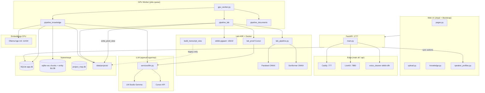

# Карта проекта SKKKK

> **Назначение:** единый ориентир «где что лежит, как связано, за что отвечает».  
> **Обновлять вместе с кодом** при добавлении модулей, пайплайнов, API, скриптов.  
> **Семантический поиск:** `py scripts/search_project_map.py "как работает merge"`  
> **Переиндексация:** `py scripts/index_project_map.py`  
> **LightRAG (граф):** `py scripts/lightrag_query.py "…"` — см. `tools/lightrag/README.md`

Связанные документы: [PLAN.md](PLAN.md) · [DECISIONS.md](DECISIONS.md) · [TESTING.md](TESTING.md) · [HOWTO-MANAGER.md](HOWTO-MANAGER.md) · [manifest.yaml](project-map/manifest.yaml)

**Снимок стека/кодеков/версий:** [§1.1](#11-снимок-стека-актуально-2026-08-27). **Кнопки прод-созвона:** [§5.13](#513-прод-созвон-кнопка--api--функция-актуально-2026-08-27). Полный перечень UI: [§5](#5-ui-страницы-кнопки-кто-выполняет).

---

## 1. Архитектура (одним взглядом)



Снимок стека, кодеков и версий — **§1.1**. Кнопки прод-созвона — [§5.13](#513-прод-созвон-кнопка--api--функция-актуально-2026-08-27).

### 1.1. Снимок стека (актуально 2026-08-27)

Зафиксировано по коду и живой машине. Менять версии моделей/кодеков только вместе с этой таблицей и `docs/DECISIONS.md`.

#### Платформа

| Что | Как сейчас |
|-----|------------|
| ОС | Windows 11 (`10.0.26200`), одна GPU **RTX 3090 24 ГБ**, драйвер **577.00** |
| CUDA (хост, lab ONNX) | Toolkit **12.8** (nvcc 12.8.61) + cuDNN **9.16.0.29** |
| Корень | только `C:\1C_NEW_SKKKK` |
| Python (портал `venv/`) | **3.10.9** |
| Python (лаборатория `venvs\lab`) | **3.10.9** (отдельный venv: `onnxruntime-gpu` vs `onnxruntime` в app) |
| Web | FastAPI **0.141.1**, Starlette **1.6.0**, Uvicorn **0.52.3**, Jinja2 **3.1.6**, Bootstrap 5 (vendored) |
| ORM | SQLAlchemy **2.0.52**, Alembic **1.19.1**, Pydantic **2.13.4** |
| Порт UI | Снаружи **Caddy `:777` HTTPS**. Портал — `WEB_HOST=127.0.0.1` `WEB_PORT=1777`. Порт **8000** занят MCP 1С |
| БД | SQLite `data/app.db`, `PRAGMA foreign_keys=ON`, WAL |
| Векторы | sqlite-vec **0.1.9** (`chunks` + `entity_vectors` BLOB) |
| Auth | JWT + cookie `skkkk_session` на **30 дней**; вход только если логин есть в `Login_up.txt` (без учёта регистра); Bearer из localStorage ещё принимается |
| Очередь | таблица `jobs`, **один** GPU-воркер |
| LLM | `LLM_PROVIDER=cursor` **или** `lmstudio` (переключатель при старте) |

#### Модели слуха и голоса (двойной слух)

| Роль | Модель / артефакт | Версия / ревизия | Как запускается |
|------|-------------------|------------------|-----------------|
| Слова + таймлайн (канон) | Parakeet-TDT | **0.6B v3**, HF `istupakov/parakeet-tdt-0.6b-v3-onnx` rev `8f23f0c` | `venvs\lab`, onnx-asr **0.12.0**, ONNX Runtime GPU **1.23.2** |
| Кто говорит | Sortformer 4spk | **v2.1** ONNX `Scrybl/diar_streaming_sortformer_4spk-v2.1` rev `3be92087` | тот же lab; **не больше 4** спикеров |
| VAD | Silero | `istupakov/silero-vad-onnx` | onnx-asr load_vad |
| Второй слух / вычитка | GigaAM-v3 e2e RNNT | HF `ai-sage/GigaAM-v3` rev **`e2e_rnnt`** | Docker `skkkk-gigaam` `:18102` |
| Голос (enroll/match) | WeSpeaker | `pipeline._embedding` внутри GigaAMGUI | lab_voice / docker exec |
| Эмбеддинги текста | bge-m3 | Ollama, **CPU** (`OLLAMA_NUM_GPU=0`) | `:11434` |
| LLM текст | Cursor SDK **1.0.28** или LM Studio `qwen/qwen3.8-27b` | `CURSOR_MODEL` (напр. composer-2.5) / `LMSTUDIO_MODEL` `:1234` | sense, proof, сущности, ТЗ, чат, vision |

Whisper `large-v3` и T-one в compose с `profiles: [legacy]` — на диске для отката, **воркер не вызывает**.

GigaAM-контейнер (`skkkk-gigaam`): образ из `vendor/GigaAMGUI`, CUDA **12.4**, torch **2.6+cu124**, `ASR_MODEL=v3_e2e_rnnt`, `MODEL_REVISION=e2e_rnnt`. Lab ONNX: onnxruntime-gpu **1.23.2**, onnx-asr **0.12.0**, cuDNN **9.16.0.29**. SHA256 весов и эталонный прогон — `asr/lab/FREEZE.md` / `asr/lab/freeze.json`.

#### Кодеки и звук (FFmpeg)

Мастер для ASR всегда один: **WAV PCM s16le, 16 кГц, моно** → `artifacts/{id}/audio/input_16k.wav`. Бинарь: PATH / WinGet **Gyan.FFmpeg 9.0-full_build** (код помечает muxer ffmpeg 9+). DeepFilterNet на прод-пути **выключен** (`01_audio` = `copy_16k`).

| Назначение | Файл | Кодек | Параметры |
|------------|------|-------|-----------|
| ASR / диаризация / WeSpeaker | `input_16k.wav` | PCM s16le | 16 kHz mono (`-vn -ac 1 -ar 16000 -c:a pcm_s16le`) |
| Плеер в HTML (`GET /artifacts/{id}/audio`) | `playback.m4a` | **AAC** | 48 kbps, mono, `+faststart`; если encode падает — отдача WAV |
| Скачать созвон | `download.mp3` | **MP3** libmp3lame | 64 kbps, mono |
| Загрузка | `.wav .mp3 .m4a .ogg .flac .webm .mp4 .mkv` | как пришло | видео: звук вынимается, оригинал может быть снесён после проверки WAV |

Документы: PDF (PyMuPDF **1.28.2**), DOCX (python-docx **1.2.0**), картинки OCR Tesseract / vision через LLM.

#### Как устроена итоговая выжимка проекта

Не «перечитать сырые файлы». `tz.rebuild_tz()` собирает **уже готовое**:

1. Артефакты `status=done`, порядок: вес ↓, дата ↓.
2. **Созвон:** канон `parsed/calls/{id}_final.txt` (proof + имена). Нет файла — чанки БД. Плюс `*_call_summary.md` (протокол **этого** созвона).
3. **Документ:** чанки `chunks`; нет индекса — `transcription_text`.
4. Плюс активные сущности только `decision`/`task` (mention / participant / fact / summary в дамп не кладутся), `user_notes`, конфликты `POTENTIAL_CONFLICT` ± `resolutions`.
5. Нарезка ~6000 симв. → если кусков >1, **последовательный** map (LLM, 1200 tok) → reduce (8192 tok) вместе с **предыдущей** `current_tz.md`. Промпт `docs/prompts/rebuild_tz.md`.
6. Результат: `project_state/current_tz.md` + архив `versions/` + `changelog`.

Кнопка **Пересобрать** — только **admin**, синхронно в FastAPI (минуты из‑за N+1 LLM). Авто: каждый готовый документ; созвоны — каждые `TZ_REBUILD_EVERY_N` (по умолчанию 3). Чат — другое: top‑12 чанков + до 12 ближайших `decision`/`task`/`fact` + хвост `current_tz.md`.

#### Удаление

| Что | Кто | Что стирается | Что остаётся |
|-----|-----|---------------|--------------|
| Проект | admin, manager | `data/projects/{id}/` + строки БД этого проекта | другие проекты, global `speaker_profiles`, пользователи |
| Артефакт | любой залогиненный | workspace, оригинал, parsed/structured `{id}_*`, jobs, chunks, entities **и их links/resolutions**, project-scoped голоса с этого файла | проект, чат, ТЗ, чужие файлы, global голоса |

Перед `DELETE FROM entities` — `graph.delete_entities_with_deps` (иначе SQLite FK). UI артефакта: иконка корзины, серый контур, модалка + чекбокс.

---

## 2. Корень и каталоги

| Путь | Назначение |
|------|------------|
| `C:\1C_NEW_SKKKK\` | Единственный корень проекта |
| `app/app/` | FastAPI: роутеры, сервисы, модели, воркер, шаблоны |
| `asr/` | Lab ASR (Parakeet/Sortformer/GigaAM-сверка), view, speaker match |
| `asr/lab/` | Канонический конвейер расшифровки (изоляция прогонов) |
| `asr/docker/` | Образ GigaAM; Whisper/T-one на диске для отката |
| `asr/tests/` | Unit-тесты ASR-модулей |
| `data/app.db` | SQLite: users, projects, artifacts, jobs, entities, links, chunks |
| `data/logs/` | api.log, worker.log, monitor_loop.log |
| `data/projects/{id}/` | Файлы проекта (см. §6) |
| `data/project_map.db` | Векторный индекс карты проекта (sqlite-vec, для агентов) |
| `docs/` | План, решения, промпты, этапы, **эта карта** |
| `docs/prompts/` | Промпты LLM (merge, entities, summary, TZ, chat, vision) |
| `docs/stages/` | STAGE-NN: критерии готовности этапов |
| `scripts/` | Утилиты, мониторинг, rerun, индекс карты |
| `tools/lightrag/` | **LightRAG** Docker (:9621) — граф знаний по docs (кнопки, API, БД) |
| `.cursor/rules/` | Правила агента Cursor |
| `.cursor/skills/` | Скилы (gpu-orchestrator, knowledge-pipeline, …) |
| `venv/` | Python **3.10.9** (портал); `venvs/lab` — тот же 3.10.9 под ONNX |
| `.env` | Секреты (не в git), шаблон `.env.example` |

### Кто что видит

Правило: **сначала сервер, потом кнопка.** Чужой проект — **404** (как неактивный), не 403. Лаб / match / «Пересобрать» на своём проекте — **403**, если роли не хватает. Охранник: `services/project_access.py` (`require_project`, `require_artifact_project`).

| | admin | manager | user |
|---|---|---|---|
| Список `GET /projects` | все активные | свои: создал / загрузил / писал в чат / **выдали доступ** | те же свои, даже если сейчас пароль `user` |
| Карточка / чат / отчёт `/report` / загрузка | любой проект | те же свои | те же свои |
| **лаб**, `report-lab`, **лаб встречи**, `report-meeting-lab`, lab enroll/merge | да | нет (кнопка скрыта, URL 403) | нет |
| **match**, «Подтвердить спикеров», enroll/merge | да | на своих, если пароль manager | нет (кнопка скрыта, URL 403). Пароль `user` — нет, даже у создателя |
| «Пересобрать» ТЗ | да | нет (уже admin) | нет |
| «Пересобрать выжимку» / reindex / «Пересчитать» | да | на своих | нет (403) |
| Удалить проект | любой | только свой | 403 (роль) |
| MCP-ключи портала | любой проект | только свой | 403 (роль). Сырой `/mcp/projects/{id}` — по ключу, не JWT |

Роль меняется паролем, список проектов — нет: «свои» считаются по логину (создал, загрузил файл, писал в чат или строка в `project_members`), не по текущей роли. Чужой проект без следа этого логина — 404. Удалить проект может admin или тот, кто его создал. Блок **Выдать доступ** — admin или менеджер проекта; роль в проекте только `manager` / `user`, не `admin`.

---

## 3. Процессы runtime

| Процесс | Команда | Порт / роль |
|---------|---------|-------------|
| **API + UI** | `python -m app.app.main` / `main all` | Preflight → `edge_runtime` (Caddy + LiveKit + `voice_cleaner`) → GPU-воркер → портал `WEB_PORT` (**1777**). Повторный `main` при живом `/health` — no-op |
| **Только портал** | `python -m app.app.main api` | То же без воркера. Воркер (`main worker`) edge **не** поднимает |
| **Caddy** | поднимает `main` (`ensure_tls_cert` → `ensure_caddy`); опц. служба `SKKKK-CADDY` | `:777` HTTPS (готовый файл, Chrome к IP часто без SNI) + `:8088` HTTP-01 + `:8443` выпуск/продление Let's Encrypt **на IP** (`shortlived`). При старте `main` проверяет файл сертификата и перевыпускает, если его нет или он недействителен. Конфиг — `tools/caddy/Caddyfile` |
| **LiveKit** | поднимает `main` (`ensure_livekit`) | Native `tools/livekit/livekit-server.exe` `:7880`. Не Docker (STUN ломается) |
| **Voice cleaner** | поднимает `main` после `:7880` | `venvs/voice` + `tools/livekit/voice_cleaner.py`, участник `skkkk-dfn`. Чистит живой звук и пишет сырые дорожки в `data/meetings/{room}/` (`MEETING_RECORD=1`). Ставит `scripts/install_meeting_voice.py`. GPU не трогает (`CUDA_VISIBLE_DEVICES=-1`). Нет venv — комната без серверной чистки и без записи |
| **GPU Worker** | `python -m app.app.main worker` | Очередь `jobs` — lab ASR, knowledge, один job за раз |
| **GigaAM** | Docker `skkkk-gigaam` | `:18102` — второй слух + **embed_voice** |
| **Whisper / T-one** | Docker (не стартуют) | `:18101` / `:18103` — откат, воркер не вызывает |
| **Ollama** | вне проекта | `:11434` — `bge-m3`, CPU |
| **LightRAG** | `docker compose up` в `tools/lightrag/` | `:9621` — граф карты проекта (agents) |
| **LM Studio** | вне проекта | `:1234` — Gemma (если `LLM_PROVIDER=lmstudio`) |
| **Cursor API** | облако/local SDK | если `LLM_PROVIDER=cursor` |

**Важно:** кнопки «Пересчитать» / «Пересобрать выжимку» / «Переиндексировать» идут через **API-процесс**, не через GPU-воркер.

### 3.1. Изоляция арtefactов (не смешивать файлы)

| Зона | Путь | Изоляция |
|------|------|----------|
| **Канон арtefactа** | `data/projects/{id}/artifacts/{art_id}/` | audio, asr, reports — только этот job |
| **Parsed / structured** | `data/projects/{id}/parsed/`, `structured/` | имена с `{artifact_id}_*` |
| **Docker bridge** | `asr/work/` | общий mount GigaAM; прод-изоляция — `lab/runs/{run_id}/`, не чужой файл |
| **Dev fallback** | `asr/work`, `asr/out` | только если `SKKKK_ASR_*` не заданы (локальный прогон) |
| **GigaAM embed job** | `data/gigaam/embed_job.json` | общий файл; один GPU-воркер — OK; параллель без staging — нет |
| **Tone sidecar txt** | `asr/out/input_raw_tone.txt` | dev-арtefact; prod пишет в `SKKKK_ASR_OUT/docker_tone.*` |

Инварианты: lab-прогон в `lab/runs/{run_id}/`; GigaAM embed — stage + hash-check; prod-код **не** читает `asr/out` как fallback. Whisper/T-one воркер не вызывает. `tone_for_align` — lex/duration guard; `finalize_audio_outputs` — всегда перезаписывает parsed raw-копии; prod-код **не** читает `asr/out` как fallback для арtefact-отчётов.

---

## 4. Конвейеры данных

### 4.1. Аудио (основной)

```
upload → job queued
  → preprocessing: FFmpeg 16 kHz WAV (атомарная запись + lock; опрос списка **не** извлекает)
  → asr_running: pipeline_lab.py
      ├── lab_pipeline.py --no-voice (venvs\lab: Parakeet + Sortformer;
      │     `--run-id` только если sha256 в run.json совпадает с текущим WAV)
      ├── lab_sense.py (Cursor)
      ├── lab_giga.py (Docker GigaAM)
      ├── lab_reconcile.py + lab_proof.py
      ├── lab_voice.py (WeSpeaker)
      ├── публикация turns/match/parsed + HTML /report
  → speakers_pending (стенограмма уже есть, speaker_0…)
  → в таблице: **match** (есть метки) → Запомнить имена → **Подтвердить** (все named) → job knowledge
  → speakers_confirmed → apply_confirmed_speaker_names → transcript_ready
  → knowledge pipeline (worker):
      entities (LLM) → index (Ollama, автозапуск) → call_summary / doc_summary → graph → done
```

### 4.2. Документы / изображения

```
upload → normalize (PDF/DOCX/OCR/vision) → text_extracted
  → knowledge pipeline (entities → index → doc_summary → graph → TZ trigger → done)
```

### 4.3. Статусы артефакта

`uploaded` → `preprocessing` → `asr_running` → `speakers_pending` → `speakers_confirmed` → `transcript_ready`  
→ `entities_extracted` → `indexed` → `graph_seeded` → `done` | `error`

(Документы: `text_extracted` вместо ASR-статусов.)

### 4.4. Итоговая выжимка проекта vs выжимка созвона

См. **§1.1**. Кратко: проектная выжимка = map/reduce по **готовым** стенограммам/чанкам + сущности `decision`/`task` + заметки + конфликты + `*_call_summary.md`. Выжимка созвона = `summarize_call.py` по подписанному `docker_gigaam_speakers.json` → `call_summary.md` одного файла.

---

## 5. UI: страницы, кнопки, кто выполняет

> **Правило:** кнопки с `POST /api/artifacts/…` и `POST /projects/…/rebuild-tz` идут **синхронно через FastAPI** (`:777`).  
> **Блокировка повторного нажатия:** `SKKKK.guardButton` / `SKKKK.guardSubmit` (портал) и `guardActionButton` (стенограмма) — спиннер, фиксированная ширина, как у «Скачать».  
> **Долгие операции:** таблица `project_tasks`, `GET …/tasks/active`. Кнопка «Пересобрать» на `/projects/{id}` и `/projects/{id}/tz` опрашивает задачу каждые **3 с** (в том числе автосбор после документа) и блокируется так же, как при клике: `disabled` + spinner + `aria-busy`. Повторный POST → **409**.  
> Загрузка файлов → **job в GPU-воркер**. Авто-опрос статусов на странице проекта — каждые **3 с**.

### 5.1. Роутеры (backend)

| Файл | Prefix | Назначение |
|------|--------|------------|
| `routers/pages.py` | `/` | HTML-страницы, отчёты арtefact, audio stream |
| `routers/auth.py` | `/auth` | POST login: логин из `Login_up.txt` (без регистра); пароль = роль (`admin`/`manager`/`user`); Telegram ID пишется; JWT **и** cookie |
| `routers/projects.py` | `/projects` | список, создание, **полное удаление** (`DELETE /{id}`) |
| `routers/upload.py` | `/projects` | Resumable upload, list artifacts (`speakers_match_available` / `speakers_confirm_ready`), **DELETE** одного артефакта |
| `routers/knowledge.py` | `/projects/{id}/…`, `/chat` | search, graph, TZ, chat, deadlines, reextract-entities, conflicts, notes |
| `routers/project_members.py` | `/projects/{id}/members` | выдача доступа: GET список, POST роль manager/user, DELETE участника |
| `routers/project_mcp.py` | `/projects/{id}/mcp`, `/mcp` | ключи MCP портала + Streamable HTTP |
| `routers/acme.py` | `/.well-known/acme-challenge` | HTTP-01 → Caddy (Let's Encrypt на IP) |
| `routers/meetings.py` | `/projects/{id}/meetings`, `/api/meetings/public` | встречи проекта + гостевой join по токену |
| `routers/speaker_profiles.py` | `/api` | enroll, merge, lab enroll/merge, recalculate, speakers-confirm, rebuild-summary, reindex |

### 5.2. Общая навигация

| Элемент | URL | Шаблон | Действие |
|---------|-----|--------|----------|
| Логотип **Primary Analytics** | `/` | `base.html` | Список проектов |
| **Выйти** (иконка у ника) | `/auth/logout` | `base.html` `#nav-logout` | `POST /auth/logout`, сброс cookie и localStorage |
| **к проектам** | `/` | `project.html` nav | То же |
| `/login` | `/login` | `login.html` | Вход только для логинов из `Login_up.txt` (регистр не важен); JWT + cookie `skkkk_session` |
| Гостевая встреча | `/m/{token}` | `meeting_public.html` | Без JWT. Нет навигации по проектам. Сырой токен не хранится — только sha256 |
| HTML-оболочки (`/`, проект, граф, ТЗ, чат, `/report*`) | те же URL | Jinja | Без сессии — **302** на `/login` (`require_html_user`) |
| `/audio`, `/download`, speaker API | те же URL | — | Без сессии — **401** |
| `/health` | `/health` | — | Публично только `{"status":"ok"}` |
| `/health/ready` | `/health/ready` | бейдж LLM в nav | Очередь/VRAM/LLM — только с сессией |
| `/admin/conflicts` | `/admin/conflicts` | `conflicts.html` | Очередь конфликтов (**admin**, HTML 302→login / 403 не-admin) |
| `/projects/{id}/graph` | graph | `graph.html` | Cytoscape-граф (GET graph/data) |
| `/projects/{id}/tz` | tz | `tz.html` | Отдельная страница ТЗ (дублирует rebuild-tz) |
| `/projects/{id}/chat` | chat | `chat.html` | Отдельный чат (дублирует чат на project) |

### 5.3. Список проектов — `/` (`index.html`)

| Кнопка / элемент | API | Кто | Роль | Результат |
|------------------|-----|-----|------|-----------|
| **Новый проект** | — | UI | admin, manager | Открывает модалку |
| **Создать** | `POST /projects` | FastAPI | admin, manager | Проект + `data/projects/{id}/` tree |
| **Отмена** | — | UI | — | Закрыть модалку |
| Клик по проекту | — | navigate | свои или admin | `/projects/{id}`; чужой URL — **404** |
| **Описание** (стрелка справа от названия) | — | UI | auth | Сворачиваемый блок: текст описания слева, **Удалить проект** справа (admin/manager). Без описания стрелка всё равно есть, чтобы открыть удаление |
| **Удалить проект** | `DELETE /projects/{id}` | FastAPI | admin любой; manager только свой | Сначала модалка «Подтверждение удаления» + чекбокс «Подтверждаю полное удаление»; без галочки кнопка «Удалить» неактивна. Затем полное удаление дерева и записей БД |
| Авто-загрузка | `GET /projects` | FastAPI | auth | admin — все активные; иначе создал / загрузил / чат / `project_members`. Пустой список: «Нет своих проектов.» Кнопка **Новый проект** только admin/manager |

### 5.4. Страница проекта — `/projects/{id}` (`project.html`)

#### Макет: выжимка и чат (строка `project-insights-row`)

На **lg+** (≥992px) левая колонка «Итоговая выжимка по проекту» и правая «Чат с ИИ» — **одинаковая высота**: `min(70vh, 720px)`, `position: sticky; top: 0.75rem`. Карточки — flex-колонки (`insights-card`, `chat-card`); контент (**`#tz-content`**, **`#chat-log`**) скроллится **внутри** панели, поле ввода чата прижато к низу (`chat-composer`, `margin-top: auto`). Страница при длинной переписке не растягивается.

На **мобильном** (<768px): `#tz-content` до `50vh`, `#chat-log` до `40vh`, отдельный внутренний скролл.

#### Загрузка материалов

| Кнопка | API | Кто | Результат |
|--------|-----|-----|-----------|
| **Загрузить** | `POST …/uploads/init` → `PUT …/chunks/{n}` → `POST …/complete` | FastAPI + **GPU worker** (job) | Файл в `raw_inputs/`, job `queued`, воркер гонит ASR/knowledge |

Тип (`source_type`): `call` | `document` | `note` | `screenshot` — влияет на пайплайн воркера.

#### Таблица артефактов (авто-обновление 3 с)

| Элемент | API | Поведение |
|---------|-----|-----------|
| Badge статуса | `GET /projects/{id}/artifacts` | `reconcile_artifact_status` подтягивает `done`, если knowledge уже есть. Для аудио те же флаги кнопок: `speakers_match_available`, `speakers_match_ready`, `speakers_confirm_ready` (`speaker_action_flags`) |
| Ссылка на имя файла | — | При `status=done` → `/artifacts/{id}/report` (стенogramма или отчёт документа) |
| **match** | — | `/artifacts/{id}/report-speaker-match`. Видна **admin/manager**, когда в `sortformer_speaker_match.json` уже есть метки `speaker_N`. У `user` кнопки нет; URL — 403. Во время ASR / подготовки не показывается. |
| **лаб** | — | `/artifacts/{id}/report-lab`. Только **admin** (кнопка и URL). Менеджеру `lab_runs` в JSON = 0. |
| **лаб встречи** | — | `/artifacts/{id}/report-meeting-lab`. Только **admin**. У созвона (`source_type=call`, `kind=meeting`) вместо обычной лаб. Дорожка за дорожкой: вход/выход стадий до итоговой расшифровки. |
| **Подтвердить спикеров** | `POST /api/artifacts/{id}/speakers-confirm` | Видна **admin/manager** при `speakers_pending`, когда все `speaker_N` уже названы (enroll на match). Тогда `speakers_confirmed` + job **knowledge**. У `user` нет. |
| **Pipeline live** (раскрывашка) | тот же GET | lab checklist / knowledge из `pipeline_progress.py` |
| **Скачать** | `GET /artifacts/{id}/download` | Созвон/видео → **MP3** (`download.mp3`, 64 kbps); документ → оригинал из `raw_inputs/` |
| **Удалить** | `DELETE /projects/{id}/artifacts/{art_id}` | Узкая колонка после «Ошибка», **иконка корзины** (`aria-label` + подсказка). Модалка «Подтверждение удаления» + чекбокс; без галочки кнопка неактивна. Стирает файл, workspace, parsed, джобы, чанки, сущности этого артефакта. Проект и остальные файлы остаются. Только владелец проекта или admin. |
| Toast «обработан» | — | Когда статус сменился на `done` |

Статусы в UI: В очереди → Подготовка → ASR → … → **Готово** / **Ошибка**.

#### Итоговая выжимка по проекту (левая колонка)

| Кнопка | API | Кто | На чём | Время | Роль |
|--------|-----|-----|--------|-------|------|
| *(авто load)* | `GET /projects/{id}/tz/content` | FastAPI | `project_state/current_tz.md` | — | все |
| **Пересобрать** | `POST /projects/{id}/rebuild-tz` | FastAPI → `tz.rebuild_tz()` → **LLM map/reduce** | Аудио: lab `parsed/calls/{id}_final.txt` (proof + имена), **не** Whisper/T-one и не устаревшие чанки. Документы: `chunks`. Плюс сущности `decision`/`task`, выжимки созвонов (`_call_summary.md`), заметки, конфликты; промпт `rebuild_tz.md`; фрагменты ~6000 симв. Пока `tz_rebuild` running (кнопка **или авто** после документа) — кнопка disabled/spinner, POST 409. | 2–10 мин | **admin** |

Источник — **не** обрезанный excerpt сырого текста. Если у аудио нет `_final.txt` — fallback на чанки / `transcription_text`. Роут в `knowledge.py`.

Результат: `data/projects/{id}/project_state/current_tz.md`, архив в `versions/`, запись `changelog`.

Авто-пересборка: каждые **N** готовых аудио (`TZ_REBUILD_EVERY_N`, по умолчанию 3) — при job done.

#### Чат с ИИ по проекту (правая колонка)

| Кнопка | API | Кто | На чём |
|--------|-----|-----|--------|
| **Спросить** | `POST /chat` `{project_id, question}` | FastAPI → `chat.answer_chat()` | RAG: sqlite-vec **чанки** + `search_entities` (`decision`/`task`/`fact` по `entity_vectors`) + документы + выжимки + хвост `current_tz.md` (если файл есть) + **chat_guidance** + **вся лента `chat_messages` этого логина в проекте** (та же, что на экране; лимит ~32k символов с хвоста) + LLM. «Не найдено» только если нет чанков, сущностей, документов, выжимки и своей ленты. |
| **История чата** | `GET /projects/{id}/chat/history` | FastAPI → `chat.list_chat_messages()` | Лента UI + `waiting`, `meta` (уточнения) |
| **Журнал действий** | `GET /projects/{id}/activity` | FastAPI → `user_activity.list_activity()` | API для аудита и памяти чата; **в UI чата не показывается** |
| **Статус чата** | `GET /projects/{id}/chat/status` | FastAPI → `chat.chat_is_pending()` | `{pending, label}` |

Enter в textarea — тоже отправка. Отдельная страница `/projects/{id}/chat` — тот же endpoint. Повторный `POST /chat` при активном ответе — **409**.

#### Дедлайны (сворачиваемый блок, над MCP)

Поручения **со сроком** из сущностей `entity_type=task` (поля `description`, `assignee`, `deadline`, `status`) по всем артефактам проекта. В API и списке — **только** задачи с непустым `deadline`; дедупликация по описанию + ответственный + срок. Оценки длительности этапа («4–6 нед.») и очередность («перед этапом 2») **не** считаются дедлайном.

| Элемент | API | Поведение |
|---------|-----|-----------|
| **Список** | `GET /projects/{id}/deadlines` (`knowledge.py` → `list_project_deadlines`) | Только tasks с `deadline`; таблица: задача, ответственный, срок, статус, источник |
| **Обновить из материалов** | `POST /projects/{id}/reextract-entities` (`knowledge.py` → `reextract_project_entities`) | admin/manager — LLM по lab `_final.txt` / `transcription_text`; пишет `entities`, **не** переиндексирует; 409 если уже идёт |
| **Календарь** | тот же GET | **FullCalendar** — только задачи с распознанной датой (ISO, `DD.MM.YYYY`, «15 марта 2026») |
| Загрузка | — | При развороте блока; авто-обновление после `done` артефакта, если панель открыта |

**UI:** Bootstrap `collapse`, `#deadlines-panel`, по умолчанию **сложен**; переключатель «Список» / «Календарь».

#### Встречи (сворачиваемый блок, над MCP)

Онлайн-встреча проекта + **отдельный гостевой портал** `/m/{token}`. Карточка **не рендерится при пароле `user`**. Создание, старт, отзыв ссылки — **admin/manager** проекта. Гость не видит `project_id` и не может открыть `/projects/{id}` (чужой — 404). Токен показывается **один раз**; в БД только `public_token_hash`. Отзыв делает `/m/{old}` 404; «Новая ссылка» выдаёт другой токен.

**UI:** тот же fold, что MCP — `#meetings-panel`, по умолчанию сложен; `#meetings-toggle-hint` `(развернуть)` / `(свернуть)`.

| Элемент UI | API | Кто |
|------------|-----|-----|
| **Создать встречу** | `POST /projects/{id}/meetings` | admin, manager |
| Список | `GET /projects/{id}/meetings` | admin, manager; `public_token` всегда `null` |
| **Начать** | `POST /projects/{id}/meetings/{mid}/start` | admin, manager |
| **Завершить** | `POST /projects/{id}/meetings/{mid}/end` | admin, manager |
| **Отозвать** | `POST /projects/{id}/meetings/{mid}/revoke-link` | admin, manager |
| **Новая ссылка** | `POST /projects/{id}/meetings/{mid}/regenerate-link` | admin, manager; сырой токен один раз |
| **Проанализировать** | `POST /projects/{id}/meetings/{mid}/analyze` | admin, manager. Один артефакт + job. Повтор `done`/`error` — **Повторить**, тот же артефакт. Воркер для встречи всегда гонит `process_meeting_artifact`, не `asr.resume` со старой стенограммы. queued/running — 409 |
| **лаб встречи** | `GET /artifacts/{id}/report-meeting-lab` | только admin. В колонке анализа, если уже есть `analyze_jobs[0].artifact_id`; и в таблице файлов у артефакта встречи |
| **Удалить созвон** | `DELETE /projects/{id}/meetings/{mid}` | admin, manager. Иконка корзины в строке (как у файлов). Стирает `meetings` / `meeting_participants`, `data/meetings/{room}/`, артефакт `встреча-{id}.wav` + дочерние lab-папки и jobs очереди |
| Гостевая страница | `GET /m/{token}` | без входа; лобби (`guest_id` в `localStorage`), затем `#meeting-stage` / `#meeting-dock`. Флаги `SKKKK_MEETING_VOICE` из `pages.meeting_voice_flags`. Канон звука — сервер `skkkk-dfn` (`MEETING_VOICE_SERVER=1`). `#meeting-denoise` — **Шумодав** у себя: выкл → все слышат сырой мик этого человека (громкость остаётся). Сигнал `publishData` topic `skkkk-denoise`; metadata — запасной. Свой `clean-*` не играется (`publication.trackName`). Чужой звук — `<audio>`, не `AudioContext.destination` (иначе Chrome AEC молчит и начинается петля). Клиентский DFN3 выкл. `#meeting-sound` — выключить входящий звук (свой мик не трогает). На узком экране (`max-width: 767.98px`) в доке мик/звук/кам/экран/`#meeting-more`/выход; сетка, участники, ссылка, динамик, fullscreen, denoise — в `#meeting-more-tray`. Динамик — иконка `#meeting-speaker-btn` + меню устройств, не текст в доке. Флаги плитки — иконки мик/кам. Список — bottom sheet + `#meeting-roster-backdrop`. На телефоне старт в сетке: все плитки в один экран (`phoneGridCols` / `--meeting-cols`); шаринг — верхняя плитка, остальные рядом. Режим спикера по кнопке. На десктопе плитки 16:9 одинакового размера, шаринг не растягивает сетку. «На весь экран» = сцена + док. Экран на телефоне — `getDisplayMedia` |
| Статус для гостя | `GET /api/meetings/public/{token}` | `project_id: null` |
| **Войти во встречу** | `POST /api/meetings/public/{token}/join` `{display_name, guest_id}` | `guest_id` из `localStorage` `skkkk-guest-{token}`; identity = `guest:` + sha256(hash токена + guest_id)[:32]; перезаход — та же identity и одна строка `meeting_participants`. Без `guest_id` — как раньше (`token_hex`). Невалидный id → 400. До start → 409; после → LiveKit JWT (`canPublish`, без `canPublishSources`) |
| **Войти в комнату** (сотрудник) | `POST /projects/{id}/meetings/{mid}/join` и страница `/projects/{id}/meetings/{mid}/room` | admin, manager; тот же LiveKit room. `#meeting-end` → `POST .../end` для всех; копия ссылки из `sessionStorage` `skkkk-meeting-invite-{id}` |
| Сигналинг LiveKit | `wss://<хост>:777/livekit` → Caddy → `:7880` | Поднимает `main` (`edge_runtime`). Native exe, не Docker. ICE = `node_ip` `SKKKK_PUBLIC_HOST` + LAN + 127.0.0.1, без STUN (иначе рекламируется чужой исходящий IP). TURN = тот же хост. Медиа: TCP 7881, UDP mux 50000, TURN 3478. Смена `livekit.yaml` перезапускает exe. Чистильщик ждёт `:7880`, затем `LIVEKIT_RTC_INTERNAL` |
| Запись дорожек | `data/meetings/{room_name}/manifest.json` | `voice_cleaner` пишет сырой звук каждого `member:`/`guest:`; связь созвона = `meetings.room_name`. Повторный `track_subscribed` той же личности переключает запись на новый трек (как DFN), не оставляет первую тихую. `MEETING_RECORD=0` выкл. Камера/экран как видео пока не пишутся |
| Анализ дорожек | `data/meetings/{room_name}/analyze.json` + `events.jsonl` | `meeting_analyze.py`: очередь GPU на каждую WAV с речью; lab `03_diar` пишет одного `speaker_0` без Sortformer |

Камера у гостя выключена. Join до `start` — 409. Удаление созвона или проекта стирает `meetings`, `meeting_participants`, очередь GPU и `data/meetings/{room_name}/`.

#### Удалённый доступ MCP (низ страницы проекта)

Read-only MCP (Streamable HTTP) к знаниям **только этого проекта**. Авторизация — ключ `skkkk_mcp_…`, не JWT портала. Карточка MCP **не рендерится при пароле `user`** (и нет «Выдать доступ»); `GET /projects/{id}/mcp/info` и выпуск ключей — **admin/manager**.

**UI:** блок **сворачиваемый** (Bootstrap `collapse`, `#mcp-access-panel`). По умолчанию **сложен**; клик по заголовку «Удалённый доступ (MCP)» — развернуть/свернуть, подсказка `(развернуть)` / `(свернуть)` в `#mcp-toggle-hint`. Badge «только чтение» в шапке всегда виден.

| Элемент UI | API | Кто |
|------------|-----|-----|
| **Создать ключ** | `POST /projects/{id}/mcp/tokens` | admin, manager |
| **Отозвать ключ** | `DELETE /projects/{id}/mcp/tokens/{token_id}` | admin, manager |
| **URL / JSON для Cursor** | `GET /projects/{id}/mcp/info` | admin, manager (свой проект) |
| **MCP endpoint** | `POST /mcp/projects/{id}` + `Authorization: Bearer <ключ>` | держатель ключа |

Инструменты MCP: `project_overview`, `list_artifacts`, `get_project_summary`, `search_project`, `list_entities`, `get_knowledge_graph`, `list_notes`, `list_conflicts`, `get_artifact_content`.

Публичный URL для MCP задаётся в `.env`: `WEB_PUBLIC_URL=https://203.0.113.10:777`. Без него в UI подставляется адрес из текущего запроса.

#### Выдать доступ (после MCP)

Таблица `project_members`: кого добавили — видит проект и работает по **роли в этом проекте** (`manager` или `user`). Портального `admin` назначить нельзя. Выпадающий список — **все логины из `Login_up.txt`** (даже если человек ещё не входил); создатель и уже добавленные скрыты. Выдавать могут portal admin, создатель и менеджер проекта (`can_grant_access`). Участник с ролью `user` блок не видит. Если учётки ещё нет — она создаётся при выдаче, вход потом подхватит тот же логин.

**UI:** тот же fold, что MCP — Bootstrap `collapse`, `#grant-access-panel`, по умолчанию **сложен**; подсказка `#grant-toggle-hint` `(развернуть)` / `(свернуть)`.

| Элемент UI | API | Кто |
|------------|-----|-----|
| Список + кандидаты | `GET /projects/{id}/members` | admin / менеджер проекта |
| **Добавить** | `POST /projects/{id}/members` `{login, role}` (или `user_id`) | те же; `role` только `manager`\|`user`; логин должен быть в `Login_up.txt` |
| **Убрать** | `DELETE /projects/{id}/members/{user_id}` | те же |

Эффективная роль: portal admin → `admin`; создатель → `manager`; иначе строка `project_members`; иначе (загрузка/чат без выдачи) — роль от пароля.

### 5.5. Стенogramма созвона — `/artifacts/{id}/report` (`transcript.html` / `transcript_view.py`)

Открывается из таблицы проекта (status=done). Встроенный HTML с плеером.

#### Блок резюме созвона (верх)

Две вкладки на одной карточке (переключение без перезагрузки; после reload — `sessionStorage`):

- **Итоговое резюме созвона** — `call_summary.md`, промпт `docs/prompts/call_summary.md` (протокол, таблица «Кто / Что / Срок»).
- **Краткое резюме созвона** — `call_brief.md`, промпт `docs/prompts/call_brief.md` (пока заготовка: «Отрази просто суть созвона»).

Кнопка **Пересобрать выжимку** пишет **оба** файла (если brief падает — итоговый всё равно сохраняется). ТЗ/чат берут только полный протокол. Word: полная выжимка и краткое резюме — отдельные кнопки.

#### Скачать материалы (под плеером)

| Кнопка | API | Файл |
|--------|-----|------|
| **Выжимка Word** | `GET /artifacts/{id}/download/summary.docx` | `.docx` из `call_summary.md` |
| **Краткое резюме созвона** | `GET /artifacts/{id}/download/brief.docx` | `.docx` из `call_brief.md` |
| **Стенограмма .txt** | `GET /artifacts/{id}/download/transcript.txt` | `[таймкод] имя: текст` из `docker_gigaam_speakers.json` |

#### Панель «Спикеры и инструменты» (registry)

| Кнопка | API | Кто | На чём | Время |
|--------|-----|-----|--------|-------|
| **▶** (у спикера) | — | browser | seek audio | мгновенно |
| **Запомнить** / **Сохранить** | `POST /api/artifacts/{id}/speaker-enroll` | FastAPI → DB + `write_prod_view` | match JSON, `speaker_profiles`; lab: proof + имена → speakers.json/HTML, **не** `build_transcript_view`, **не** `voice_turn_audit` / GigaAM по всем репликам | ~1–5 с |
| **Слить** (два ID) | `POST /api/artifacts/{id}/speaker-merge` | FastAPI | merge_map + lab `write_prod_view` | ~1 с |
| **Пересчитать** (`#recalc`) | `POST /api/artifacts/{id}/speaker-recalculate` | FastAPI, **admin/manager** | Тот же API, что «Пересчитать подсказки» на match. Lab: cosine `speaker_N` ↔ база. Legacy: Sortformer JSON **этого** артефакта. У `user` кнопка скрыта, POST 403 | ~1–20 с |
| **Пересобрать выжимку** | `POST /api/artifacts/{id}/rebuild-summary` | FastAPI, **admin/manager** | имена в speakers.json → `summarize_call.py` → **LLM**. Lab: proof turns с именами, затем HTML из `write_prod_view`. Промпты `call_summary.md` **и** `call_brief.md` → `call_summary.md` + `call_brief.md`. У `user` скрыто, POST 403 | ~1–5 мин |
| **Обновить и переиндексировать** | `POST /api/artifacts/{id}/reindex` | FastAPI, **admin/manager** | rebuild view → `*_final.txt` → **Ollama** index chunks. У `user` скрыто, POST 403 | ~30 с |

После POST-кнопок — `location.reload()`.

#### Legacy-режим (без registry, старые отчёты)

| Кнопка | Куда | Примечание |
|--------|------|------------|
| **Применить имена** | `localStorage` | Только клиент, **не** сервер |
| **Слить** (select) | `localStorage` | Только клиент |

#### Интерактив без API

| Элемент | Действие |
|---------|----------|
| Chip фильтр спикера | Фильтр реплик; `unknown` (бесхозные слова lab) на пилюлях нет |
| Поле поиска `#q` | Фильтр по тексту |
| Клик по времени / реплике | Seek аудио |
| `GET /artifacts/{id}/audio` | Поток WAV/M4A **этого** артефакта; query `clip` игнорируется (не общий `asr/work`) |

#### Отчёт документа — тот же `/artifacts/{id}/report` (`artifact_reports.py`)

Открывается из таблицы проекта по клику на документ / заметку / скриншот (`status=done`). Полный нормализованный текст (`*_clean.txt`) остаётся каноном индекса, чата и ТЗ. На странице человеку показывается протокол.

- **Итоговое резюме** — `{id}_doc_summary.md`, промпт `docs/prompts/doc_summary.md` (map/reduce, ~6000 символов). Карточка как у созвона (Segoe UI, `#f8fafc`, `--accent #5b7fa6`).
- Полный текст — свёрнутый блок «Полный текст», не основной экран. На странице нет `artifact_id` и внутренних терминов.
- Пока файла выжимки нет — «Итоговое резюме ещё не собрано»; открытие страницы пересобирает HTML (`doc-summary-v2`) без вызова LLM.

| Кнопка | API | Кто | На чём | Время |
|--------|-----|-----|--------|-------|
| **Пересобрать выжимку** | `POST /api/artifacts/{id}/rebuild-summary` | FastAPI → `summarize_document.run_document_summary` | только `*_clean.txt` / `transcription_text`; HTML переписывается; **без** reindex | ~1–5 мин |
| **Выжимка Word** | `GET /artifacts/{id}/download/summary.docx` | FastAPI | `{id}_doc_summary.md` | мгновенно |
| **Полный текст** | `GET /artifacts/{id}/download/transcript.txt` | FastAPI | `*_clean.txt` | мгновенно |

Падение выжимки в knowledge **не** откатывает index/entities: артефакт всё равно `done`. Тот же POST `rebuild-summary`, что у созвона: audio → call summary, иначе → document summary.

### 5.6. Match спикеров — `/artifacts/{id}/report-speaker-match` (`speaker_match_test.html`)

Страница для подписи голосов: карточки встречи + прокручиваемая **база голосов**. Таймлайна и списка сегментов нет (они в `/report`). Ссылка **match** в таблице проекта ведёт сюда и видна только после публикации меток; **Подтвердить** на проекте появляется, когда все карточки названы.

| Кнопка / ссылка | API | Кто | Примечание |
|-----------------|-----|-----|------------|
| **← Проект** / **Стенограмма** | GET | pages | соседние экраны |
| **Пересчитать подсказки** | `POST …/speaker-recalculate` | FastAPI, admin/manager | Lab: cosine `speaker_N` ↔ база, confirmed не сбрасываются. Страница match — не для `user` |
| **Запомнить** / **Обновить** | `POST …/speaker-enroll` | FastAPI | На карточке; leftover project-копия после подъёма в global удаляется |
| **Объединить** | `POST …/speaker-merge` | FastAPI | На карточке |
| **Прослушать** | — | audio seek | эталонный клип спикера |

Пул в сайдбаре: `list_profiles` — одно имя на свёрнутый ключ (`Игорь (Пилот)` = `Игорь Пилот`), prefer global. Уборка БД: `cleanup_voice_profile_pool()` / `scripts/dedupe_speaker_profiles.py` — точные имена, варианты написания, cosine ≥ 0.95, сироты project.

### 5.7. Прочие отчёты аудио (только просмотр + seek)

| URL | Файл-генератор | Содержимое |
|-----|----------------|------------|
| `/artifacts/{id}/report-sortformer` | `build_sortformer_transcript_view.py` | Sortformer timeline |
| `/artifacts/{id}/report-diar-raw` | `build_raw_diar_view.py` | Whisper/Tone/GigaAM tracks |
| `/artifacts/{id}/report-diar-two-voice` | two-voice diar | 2-speaker view |
| `/artifacts/{id}/report-lab?run={run_id}` | `build_lab_view.py` | **Только admin.** Лаборатория: снимок 01–07, оверлей Cursor, сверка GigaAM, карточки голосов; итоговая стенограмма как на проде (пилюли MM:SS, цветные имена). Менеджер/user — 403 |
| `/artifacts/{id}/report-meeting-lab` | `meeting_lab.py` + `meeting_lab.html` | **Только admin.** Дорожки по очереди, I/O стадий, итог на шкале встречи: время / кто (LiveKit) / текст. Пока нет ленты — reload 4 с. Менеджер/user — 403 |
| `/artifacts/{id}/meeting-lab/{child}/lab/{run}/file/{путь}` | — | **Только admin.** Файлы дочернего прогона `{parent}__{identity}`. Чужой child — 404 |
| `/artifacts/{id}/lab/{run_id}/file/{путь}` | — | **Только admin.** Файлы прогона (WAV, json, npy, логи) без выхода за каталог |

Кнопка **лаб** в списке артефактов — **только admin**, и только когда у аудио есть хотя бы один
лабораторный прогон (`lab_runs`). На report-lab после `asr/lab_voice.py` —
карточки **Запомнить** / **Слить** (`POST /api/artifacts/{id}/lab/{run_id}/speaker-enroll`
и `…/speaker-merge`, тоже только admin). Они пишут в ту же `speaker_profiles`, файл —
`voice/match.json` прогона, не боевой match.

#### 5.7.1. Лаборатория расшифровки

Изолированный конвейер (`asr/lab/`) — **он же боевой** ASR. CLI ниже — отладка той же линии, что гоняет воркер (`process_lab_artifact`). UI: `/report-lab` диагностика, `/report` прод.

```powershell
venvs\lab\Scripts\python.exe asr\lab_pipeline.py --project-id 1 --artifact-id art_... --report
```

Стадии: `01_audio` копия 16 кГц без денойза → `02_asr` Parakeet-TDT v3 (окна ≤80 с) →
`03_diar` Sortformer 4spk v2.1 (ONNX, сырые вероятности) → `04_paint` покраска
слов → `05_voice` WeSpeaker в `skkkk-gigaam` → `06_transcript` реплики без LLM →
`07_verify` второй проход через Silero VAD.

Каждая стадия пишет `stage.json` с sha256 входов и выходов; повтор пропускается
по отпечатку (хеши входов + параметры). Отсутствие входа — падение, подстановки
файла из другого прогона нет.

Принятый снимок (`asr/lab/FREEZE.md`), эталон `20260826T174104Z_48a796`:

1. этап 1 — конвейер 01–07 без DeepFilterNet;
2. этап 2 — прогон Cursor (`asr/lab_sense.py`), только каталог `sense/`;
3. этап 3 — свой прогон GigaAM и сверка: `giga/`, `reconcile/`, `proof/`;
4. этап 4 — слепки WeSpeaker в `voice/` (`asr/lab_voice.py`); «Запомнить» /
   «Слить» на report-lab пишут в `speaker_profiles` с меткой `speaker_N`.
   В FREEZE не входит, пока нет явного «принимаем».

Нарезка и таймкоды GigaAM в итог не идут — только его мнение о спикере в спорных
местах и его вариант слова. Боевой `docker_gigaam_speakers.json` пишет
`write_prod_view` из **proof**, не из сырого GigaAM timeline.

```powershell
venv\Scripts\python.exe asr\lab_sense.py --project-id 1 --artifact-id art_... --run-id 20260826T174104Z_48a796
venv\Scripts\python.exe asr\lab_giga.py --project-id 1 --artifact-id art_... --run-id 20260826T174104Z_48a796
venv\Scripts\python.exe asr\lab_reconcile.py --project-id 1 --artifact-id art_... --run-id 20260826T174104Z_48a796
venv\Scripts\python.exe asr\lab_proof.py --project-id 1 --artifact-id art_... --run-id 20260826T174104Z_48a796
venv\Scripts\python.exe asr\lab_voice.py --project-id 1 --artifact-id art_... --run-id 20260826T174104Z_48a796
```

### 5.8. Отдельные страницы

| Страница | Кнопки | API |
|----------|--------|-----|
| `/projects/{id}/tz` | **Пересобрать ТЗ** | = `rebuild-tz` (admin) |
| `/projects/{id}/chat` | **Спросить** | `POST /chat` |
| `/projects/{id}/chat` | *(авто при открытии)* | `GET /projects/{id}/chat/history` |
| `/projects/{id}/chat` | *(авто при pending)* | `GET /projects/{id}/chat/status` + poll history |
| `/projects/{id}/graph` | — | `GET …/graph/data` (Cytoscape) |
| `/admin/conflicts` | — | `GET …/conflicts` (admin, read-only cards) |
| `/m/{token}` | лобби + `#meeting-dock` / `#meeting-more`; слушает `skkkk-dfn` | `GET /m/{token}`, `POST /api/meetings/public/{token}/join` |
| `/projects/{id}/meetings/{mid}/room` | тот же док + `#meeting-end`; тот же cleaner | `POST /projects/{id}/meetings/{mid}/join` |
| `/login` | **Войти** | `POST /auth/login` (JSON token + Set-Cookie `skkkk_session`) |
| все HTML-оболочки | **Выйти** (иконка у ника в шапке) | `POST /auth/logout` — сброс cookie + localStorage |
| `/auth/logout` | *(JS `clearSession` / `#nav-logout`)* | `POST /auth/logout` — сброс cookie |

API без кнопок в UI (для будущего / интеграций):  
`GET …/search`, `GET …/activity`, `POST …/notes`, `POST /links`, `POST /entities/{id}/review`, `POST /conflicts/{id}/resolve`.

### 5.9. Сводка: кто выполняет действие

| Исполнитель | Что |
|-------------|-----|
| **GPU worker** | lab ASR, knowledge (entities, index, summary, graph) после upload и после confirm |
| **`main` edge** | Caddy, LiveKit, `voice_cleaner` (`skkkk-dfn`) — только `all`/`api`, не worker |
| **FastAPI sync** | recalculate, enroll, merge, rebuild-summary, reindex, rebuild-tz, chat |
| **Docker GigaAM** | второй слух + voice embed |
| **LLM** (Cursor/Gemma) | sense, proof, summary, entities, TZ, chat |
| **Ollama bge-m3** | index/reindex chunks, semantic search |
| **Browser only** | фильтры, seek, legacy rename localStorage |

### 5.10. Два разных «Пересобрать» — не путать

| UI | Кнопка | Scope | Output |
|----|--------|-------|--------|
| `/projects/{id}` | **Пересобрать** (выжимка проекта) | весь проект | `current_tz.md`: аудио из lab `_final.txt`, документы из `chunks`, плюс `decision`/`task` / notes / conflicts / call_summary |
| `/artifacts/…/report` (созвон) | **Пересобрать выжимку** | один созвон | `call_summary.md` из полной стенограммы |
| `/artifacts/…/report` (документ) | **Пересобрать выжимку** | один документ | `{id}_doc_summary.md` из `*_clean.txt`; чанки не трогает |

### 5.11. Ограничения выжимок (контекст LLM)

| Выжимка | Вход | Ограничение |
|---------|------|-------------|
| **Созвон** (`call_summary.md` + `call_brief.md`) | Вся стенограмма | итог: map ~6000 × N + reduce **4096**; кратко: тот же map + reduce **1024** |
| **Документ** (`{id}_doc_summary.md`) | Нормализованный `*_clean.txt` | map ~6000 × N **последовательно** + reduce **4096**; индекс по-прежнему из полного текста |
| **Проект** (`current_tz.md`) | Аудио: lab `_final.txt` (нет файла → чанки); документы: `chunks`; плюс `decision`/`task` / notes / conflicts / `_call_summary.md` | map ~6000 симв. × N **последовательно** + reduce **8192 tokens**; минуты из‑за N+1 LLM |
| **Чат** | top‑12 чанков + до 12 `decision`/`task`/`fact` по `entity_vectors` + хвост `current_tz.md` (~2500) | только к вопросу; выжимка — обзор, не замена фрагментов |

### 5.12. BPMN: кнопки → API → сервисы → БД/файлы

Схема зависимостей UI-кнопок (страница проекта, стенogramma, match). Исполнитель: **W** = GPU worker, **S** = FastAPI sync, **B** = browser.

```mermaid
flowchart TB
  subgraph project_ui["/projects/{id} — project.html"]
    UPL[Загрузить] -->|POST …/uploads/…/complete| UP_S[S: upload + jobs]
    CONF[Подтвердить спикеров] -->|POST /api/artifacts/{id}/speakers-confirm| CF_S[S: speakers-confirm]
    TZ[Пересобрать ТЗ] -->|POST /projects/{id}/rebuild-tz| TZ_S[S: tz rebuild LLM]
    CHAT[Спросить] -->|POST /chat| CH_S[S: RAG + LLM]
    DED[Обновить дедлайны] -->|POST /projects/{id}/reextract-entities| DE_S[S: entities LLM]
  end

  subgraph report_ui["/artifacts/{id}/report — transcript.html"]
    ENR[Запомнить / Сохранить] -->|POST …/speaker-enroll| EN_S[S: enroll + write_prod_view]
    MRG[Слить] -->|POST …/speaker-merge| MG_S[S: merge_map + write_prod_view]
    REC[Пересчитать] -->|POST …/speaker-recalculate| RC_S[S: lab cosine speaker_N]
    SUM[Пересобрать выжимку] -->|POST …/rebuild-summary| RS_S[S: summarize LLM]
    RIX[Обновить и переиндексировать] -->|POST …/reindex| RI_S[S: Ollama index]
  end

  UP_S --> J[(jobs)]
  UP_S --> A[(artifacts)]
  J --> W_ASR[W: pipeline_lab + knowledge]

  CF_S --> J2[(jobs phase=knowledge)]
  CF_S --> ASL[(artifact_speaker_links)]
  CF_S --> MJ[sortformer_speaker_match.json]
  J2 --> W_NAMES[W: apply_confirmed_speaker_names]
  W_NAMES --> W_KNOW[W: entities index summary graph]

  RC_S --> SP[(speaker_profiles pool)]
  RC_S --> MJ
  RC_S --> TH[transcript.html + docker_gigaam_speakers.json]

  EN_S --> SP
  EN_S --> MJ
  EN_S --> ASL
  EN_S --> TH
  MG_S --> MJ
  MG_S --> TH

  W_ASR --> ASR_FILES[lab proof + asr/docker_gigaam_speakers.json]
  W_KNOW --> ENT[(entities links chunks)]
  W_ASR --> TH
  RS_S --> CS[call_summary.md]
  RS_S --> TH
  RI_S --> ENT
  TZ_S --> TZMD[current_tz.md]
  CH_S --> ENT

  TH --> PARSED[parsed/calls/*_final.txt]
  MJ --> MATCH_HTML[report-speaker-match]
```

**Цепочка «Пересчитать» (критично для спикеров):**

1. UI `#recalc` → `POST /api/artifacts/{id}/speaker-recalculate`
2. Если есть lab-прогон с `voice/match.json` — пересчёт cosine `speaker_N` по базе; confirmed/merge сохраняются. **Не** вызывать `match_sortformer_speakers` и не брать эталон из `experiments/`.
3. Иначе legacy: `recalculate_speaker_match()` сохраняет **prev** `sortformer_speaker_match.json` и гоняет `match_sortformer_speakers.run()` только по JSON **этого** артефакта.
4. `_finalize_match_payload()` — `_restore_merge_map` + `_restore_confirmed_matches`
5. `sync_match_json_from_links` → `artifact_speaker_links`
6. `rebuild_match_report_html` + `rebuild_transcript_report_html` (lab: `write_prod_view` из proof + match JSON; **не** `build_transcript_view.py`)

**Таблицы БД по кнопкам:**

| Кнопка | artifacts | jobs | speaker_profiles | artifact_speaker_links | entities/chunks |
|--------|-----------|------|------------------|------------------------|-----------------|
| Загрузить | insert | insert | — | — | — |
| Подтвердить спикеров | status→phase2 | insert | read | read/write confirmed | — |
| Пересчитать | — | — | read pool | rewrite | — |
| Запомнить | — | — | insert/update | write | — |
| Запомнить (лаб) | — | — | insert/update (`speaker_N`) | write lab match JSON | — |
| Слить | — | — | — | merge_map in JSON | — |
| GPU pipeline done | status=done | done | backfill global | from match | insert index |

**Скрипт дедупликации голосов:** `scripts/dedupe_speaker_profiles.py` → `cleanup_voice_profile_pool()` (точные имена, `Игорь (Пилот)`/`Игорь Пилот`, cosine ≥ 0.95, сироты project).

### 5.13. Прод-созвон: кнопка → API → функция (актуально 2026-08-27)

Канон стенограммы — **lab proof** (`lab/runs/{run_id}/proof/transcript.json`), метки `speaker_N`. Имена — из `reports/sortformer_speaker_match.json`. HTML/JSON для `/report` пишет **`write_prod_view`**. Скрипт `asr/build_transcript_view.py` на lab-артефакте **запрещён**: он нарезает Sortformer `SPEAKER_00` поверх proof и сбрасывает имена.

#### Загрузка и воркер

| Шаг | Где | Функция | Что делает |
|-----|-----|---------|------------|
| **Загрузить** | `upload.py` complete | создаёт `jobs.kind=process_artifact` | файл в `raw_inputs/`, статус `uploaded`; джоба в **общую** очередь (FIFO), один GPU-воркер |
| job | `workers/pipeline.py` `process_artifact` | `process_lab_artifact` | если `uploaded` / `asr_running` / `error` |
| WAV | `artifact_audio.ensure_audio_wav` | ffmpeg + lock + `.partial` (`-f wav`, иначе muxer не угадывает расширение) | опрос списка **не** извлекает WAV |
| ONNX | `pipeline_lab._run_cmd` | `asr/lab_pipeline.py --no-voice` | `--run-id` только если sha256 WAV = `run.json` |
| sense/giga/proof/voice | `pipeline_lab` | `lab_sense.py` → `lab_giga.py` → `lab_reconcile.py` → `lab_proof.py` → `lab_voice.py` | Cursor + GigaAM + WeSpeaker |
| публикация | `publish_lab_to_prod` | proof + `voice/match.json` | `write_prod_view`, match HTML, `speakers_pending` |
| стоп | `process_artifact` | `return` | пока статус `speakers_pending` |
| knowledge retry (`transcript_ready` / индекс) | `process_artifact` else | lab: `_final.txt` / `apply_confirmed_speaker_names`; **не** `process_audio_artifact` (Whisper/T-one) | иначе старый `pipeline_checklist.json` не находится и срабатывает тройной ASR |

#### Имена спикеров

| Кнопка / событие | API | Функция | Результат |
|------------------|-----|---------|-----------|
| **Запомнить** / **Сохранить** (`/report` и `/report-speaker-match`) | `POST /api/artifacts/{id}/speaker-enroll` | `speaker_profiles` enroll + `_safe_rebuild_artifact_views` | БД `speaker_profiles` + links; lab: `apply_confirmed_speaker_names` → `write_prod_view` (имена сразу в turns/HTML/`_final.txt`). Lab **не** вызывает `voice_turn_audit` (GigaAM по всем репликам) — иначе «Запомнить» висит и блокирует следующих спикеров |
| **Слить** / **Объединить** | `POST …/speaker-merge` | merge_map + тот же rebuild | два `speaker_N` → один человек |
| **Пересчитать подсказки** (lab) | `POST …/speaker-recalculate` | cosine `voice/match.json` ↔ `speaker_profiles` | **не** `match_sortformer_speakers`, **не** эталон `experiments/`; confirmed не сбрасываются |
| **Пересчитать** (legacy, нет lab-прогона) | тот же POST | `recalculate_speaker_match` → `match_sortformer_speakers.run` | только Sortformer JSON **этого** артефакта |
| **Подтвердить спикеров** (таблица проекта) | `POST …/speakers-confirm` | `confirm_speakers_and_enqueue` | кнопка только когда все `speaker_N` named; затем `speakers_confirmed` + job `phase=knowledge` (**не** Whisper/T-one) |
| воркер после confirm | `process_artifact` | `apply_confirmed_speaker_names` → `set_status(transcript_ready)` → `run_knowledge_pipeline` | имена ещё раз в файлы, затем сущности / индекс / выжимка / граф |
| GET `/report` | `pages.py` | `ensure_audio_report` → lab: `republish_named_transcript` | пересборка HTML из proof+match, без `build_transcript_view` |

Enroll **не** требует нажимать «Подтвердить», чтобы имена появились в стенограмме. Confirm — шлагбаум на **knowledge** (сущности, индекс, протокол, граф).

На `/report` кнопка `#recalc` подписана **«Пересчитать»**; на `/report-speaker-match` — **«Пересчитать подсказки»** (lab) или **«Обновить и пересчитать»** (legacy). Оба бьют в один POST.

#### Python: кнопка → функция

| UI | Роутер | Сервис |
|----|--------|--------|
| Загрузить complete | `upload.complete_resumable_upload` | создаёт `Job(kind=process_artifact)` |
| GPU job (аудио, до confirm) | `workers.pipeline.process_artifact` | `pipeline_lab.process_lab_artifact` |
| GPU job (`speakers_pending`) | тот же | **стоп**, ждёт **Подтвердить** (кнопка только после всех имён на match) |
| GPU job (`speakers_confirmed`) | тот же | `apply_confirmed_speaker_names` → `run_knowledge_pipeline` |
| Запомнить | `speaker_profiles.api_enroll_speaker` | `enroll_speaker` → `_safe_rebuild_artifact_views` → lab: `apply_confirmed_speaker_names` |
| Слить | `api_merge_speakers` | `merge_speakers` → тот же rebuild |
| Запомнить (лаб) | `api_lab_enroll_speaker` | enroll в `voice/match.json` прогона, не прод JSON |
| Пересчитать | `api_recalculate_speakers` | lab: `_recalculate_lab_speaker_match`; иначе `recalculate_speaker_match` |
| Подтвердить | `api_speakers_confirm` | `confirm_speakers_and_enqueue` (`phase=knowledge`) |
| Пересобрать выжимку | `api_rebuild_summary` | `rebuild_artifact_call_summary` |
| Переиндексировать | `api_reindex_artifact` | `refresh_artifact_project_index` |
| Пересобрать ТЗ | `knowledge.rebuild_tz_endpoint` | `tz.rebuild_tz` — lab `_final.txt` |
| Список дедлайнов | `knowledge.project_deadlines` | `list_project_deadlines` |
| Обновить дедлайны | `knowledge.reextract_entities_endpoint` | `reextract_project_entities` (не reindex) |
| Чат | `knowledge.chat_endpoint` | `chat.answer_chat` — чанки + `entity_vectors` + хвост `current_tz.md` |
| GET `/report` | `pages.artifact_report_page` | `artifact_audio.ensure_audio_report` → lab: `republish_named_transcript` |
| Выжимка Word | `pages.artifact_summary_docx_download` | `transcript_export.build_summary_docx_bytes` |
| Краткое резюме Word | `pages.artifact_brief_docx_download` | `transcript_export.resolve_brief_docx` |
| Стенограмма .txt | `pages.artifact_transcript_txt_download` | `resolve_transcript_txt` |

#### Выжимка созвона и HTML

| Кнопка | API | Функция | Результат |
|--------|-----|---------|-----------|
| **Пересобрать выжимку** | `POST …/rebuild-summary` | `rebuild_artifact_call_summary` | **Аудио:** lab имена → `summarize_call.py` → `call_summary.md` + `call_brief.md` + `write_prod_view`. **Документ:** `run_document_summary` → `{id}_doc_summary.md` из `*_clean.txt` + `{id}_report.html`; без reindex. Падение LLM не откатывает чанки |
| **Выжимка Word** | `GET …/download/summary.docx` | `transcript_export.build_summary_docx_bytes` | Calibri (в т.ч. кириллица), поля A4, шапка таблицы `#5B7FA6`, zebra, списки с выступом, `**`/`*`/`` ` `` |
| **Краткое резюме созвона** | `GET …/download/brief.docx` | `transcript_export.resolve_brief_docx` | тот же рендер, заголовок «Краткое резюме созвона», файл `{имя}_краткое_резюме.docx` |
| **Стенограмма .txt** | `GET …/download/transcript.txt` | `resolve_transcript_txt` | таймкоды + имена из speakers.json |
| **Обновить и переиндексировать** | `POST …/reindex` | `refresh_artifact_project_index` | тот же lab-rebuild HTML + Ollama chunks |

Промпт выжимки требует **GFM-таблицу** «Кто / Что / Срок» (шапка + `| --- | --- | --- |` + строки), не «набросать пайпы». Рендер: `transcript_view._summary_to_html` → `<table class="summary-table">`.

Фильтр-пилюли на `/report`: имена из turns; метка lab **`unknown`** (бесхозное слово) на чипах **не** показывается (`_color_map` / `displayName`).

#### Ключевые файлы на диске (lab-прод)

| Файл | Кто пишет | Кто читает |
|------|-----------|------------|
| `lab/runs/{id}/proof/transcript.json` | `lab_proof.py` | `write_prod_view` / `republish_named_transcript` — канон реплик |
| `lab/runs/{id}/voice/match.json` | `lab_voice.py` | enroll/recalc lab |
| `reports/sortformer_speaker_match.json` | publish + enroll | имена, registry UI |
| `asr/docker_gigaam_speakers.json` | `write_prod_view` | `/report`, `summarize_call`, скачать .txt |
| `asr/call_summary.md` | summarize_call.py | вкладка «Итоговое резюме», Word |
| `asr/call_brief.md` | summarize_call.py | вкладка «Краткое резюме» |
| `reports/transcript.html` | `write_prod_view` + `finalize_audio_outputs` | GET `/report` |
| `parsed/calls/{id}_final.txt` | `finalize_audio_outputs` | индекс, ТЗ |

#### Что нельзя делать на lab-артефакте

- Вызывать `build_transcript_view.py` / `match_sortformer_speakers` с чужим JSON (`experiments/…`).
- Считать WAV готовым, пока ffmpeg пишет (опрос `GET …/artifacts` не должен вызывать extract).
- Резюмировать `--run-id`, если sha256 WAV ≠ `run.json`.
- Подставлять `SPEAKER_00` вместо `speaker_N`.

---

## 6. Layout артефакта на диске

```
data/projects/{project_id}/
├── raw_inputs/{calls|documents|notes}/   # оригинал загрузки
│   # видео (.mp4/.mkv/.webm/…) удаляется после проверенного извлечения WAV
├── artifacts/{artifact_id}/
│   ├── audio/input_16k.wav               # рабочий звук (16 kHz mono)
│   ├── audio/playback.m4a              # AAC для плеера в UI
│   ├── asr/                              # рабочая зона ASR
│   │   ├── docker_whisper.json|.txt
│   │   ├── docker_tone.json|.txt
│   │   ├── docker_gigaam.txt
│   │   ├── sortformer_segments.json
│   │   ├── docker_merged_windows.json    # окна LLM-merge
│   │   ├── docker_merged_plain.txt       # plain после integrity
│   │   ├── docker_gigaam_speakers.json   # реплики для UI/summary
│   │   ├── transcript_integrity.json
│   │   ├── call_summary.md
│   │   ├── call_brief.md
│   │   └── transcript.html
│   ├── reports/                          # копии для UI
│   │   ├── transcript.html
│   │   ├── call_summary.md
│   │   ├── call_brief.md
│   │   └── sortformer_speaker_match.json
│   └── lab/                              # боевой ASR: изоляция прогонов
│       ├── latest.json                   # указатель на последний прогон
│       └── runs/{run_id}/                # run_id = 20260826T101500Z_ab12cd
│           ├── run.json                  # исходник с sha256, artifact/project
│           ├── report.html               # страница прогона
│           ├── logs/{stage}.log
│           ├── 01_audio/{stage.json,clean_16k.wav}
│           ├── 02_asr/{stage.json,words.json}
│           ├── 03_diar/{stage.json,diar.json,probs_clean.npy,heatmap.json,compare.json}
│           ├── 04_paint/{stage.json,paint.json}
│           ├── 05_voice/{stage.json,voice.json,embed_raw.json}
│           ├── 06_transcript/{stage.json,transcript.json,transcript.txt}
│           ├── 07_verify/{stage.json,verify.json}
│           ├── sense/                    # этап 2
│           ├── giga/ reconcile/ proof/   # этап 3
│           └── voice/{voice.json,match.json,embed_raw.json}  # этап 4
├── parsed/calls/
│   ├── {id}_final.txt
│   ├── {id}_transcript.html
│   ├── {id}_call_summary.md
│   └── {id}_call_brief.md
├── parsed/documents/  (и notes)
│   ├── {id}_raw.txt
│   ├── {id}_clean.txt              # канон индекса / чата / ТЗ
│   ├── {id}_doc_summary.md         # протокол для UI
│   └── {id}_report.html
└── structured/{id}_entities.json
```

---

## 7. Сервисы (`app/app/services/`)

| Модуль | Ответственность |
|--------|-----------------|
| `llm.py` | Единый адаптер: lmstudio / cursor |
| `gpu_phase.py` | Load/unload Gemma, VRAM-фазы |
| `queue.py` | jobs: claim FIFO (`created_at`, `id`), finish, requeue; очередь **глобальная**, не per-user |
| `pipeline_lab.py` | Боевой ASR-оркестратор: `process_lab_artifact`, `publish_lab_to_prod`, `write_prod_view`, `republish_named_transcript`, `apply_confirmed_speaker_names`; повтор джобы пропускает готовые оверлеи (sense/giga/reconcile), `lab_proof` — нет `proof/transcript.json` |
| `pipeline_audio.py` | Legacy ASR; `run_call_summary` (выжимка созвона) |
| `pipeline_voice_gate.py` | Legacy voice-gate до triple ASR (воркер lab-путь не вызывает) |
| `pipeline_knowledge.py` | entities → index → call_summary / doc_summary → graph → done |
| `pipeline_documents.py` | PDF/DOCX/OCR pipeline; нормализация, не резюме |
| `summarize_document.py` | Map/reduce `{id}_doc_summary.md` из `*_clean.txt`; fail-open |
| `artifact_reports.py` | HTML отчёта документа: протокол сверху, полный текст в `<details>` |
| `pipeline_resume.py` | Resume ASR без повторного merge |
| `pipeline_progress.py` | UI progress: lab checklist + knowledge |
| `voice_gate_checklist.json` | в `asr/` артефакта — шаги gate до confirm спикеров |
| `transcript_export.py` | export transcript.txt / document `*_текст.txt` + summary.docx |
| `artifact_audio.py` | finalize, sync reports, rebuild HTML; атомарный extract `input_16k.wav` + lock |
| `artifact_lab.py` | Лаборатория: список прогонов, выбор прогона, отдача файлов; fallback запрещён |
| `media_cleanup.py` | удаление видео-оригинала после проверки `input_16k.wav` |
| `speaker_profiles.py` | enroll/merge/recalculate; lab enroll в `voice/match.json`; **global pool**; `speaker_action_flags` для кнопок match/confirm в таблице |
| `entities.py` | LLM extract + persist; для встреч — привязка к `source_span_id`, перефраз через `_text_overlap`, без источника → `needs_review`; leak-текст не пишется в БД и `*_entities.json` |
| `indexing.py` | chunk → Ollama embed → chunks + chunk_vectors; аудио из lab `_final.txt`; `audit_project_index` |
| `vector_index.py` | sqlite-vec CRUD чанков (vec0 kNN) и кэш сущностей (`entity_vectors` BLOB по id) |
| `retrieval.py` | rerank чанков по `priority_weight`; `search_entities` (cosine по `entity_vectors`, типы `decision`/`task`/`fact`) |
| `graph.py` | seed/rebuild links, conflicts; `delete_entities_with_deps`; `purge_orphan_links` при старте; payload графа без рёбер к несуществующим узлам; читает `entity_vectors` |
| `tz.py` | rebuild TZ: аудио из lab `_final.txt`, документы из chunks; map/reduce + `decision`/`task` + notes + conflicts |
| `chat.py` | RAG: чанки + `search_entities` + хвост `current_tz.md`; лента и память — `chat_messages` этого логина |
| `user_activity.py` | Журнал действий логина (`user_activity_log`) для аудита; чат в промпт берёт `chat_messages`, не этот журнал |
| `models/chat_message.py` | Per-user chat UI log (`project_id` + `user_id`) |
| `models/user_activity_log.py` | Append-only журнал: auth, upload, chat, tz, speakers, knowledge |
| `chunking.py` | split transcript / plain text; lab `[таймкод] Имя:` → поле `speaker` без скобок |
| `storage.py` | paths: artifact_root, parsed, structured |
| `project_purge.py` | полное удаление проекта, артефакта или **созвона**: БД + файлы; `purge_meeting` снимает jobs, артефакт встречи, `meeting_participants` и `data/meetings/{room_name}/` |
| `meetings.py` / `meeting_tokens.py` | встречи проекта: статусы `created`/`live`/`ended`; публичный токен sha256; guest identity `guest:…`; JWT LiveKit (`canPublish`, без `canPublishSources`) |
| `meeting_recordings.py` | сырые WAV + `manifest.json` + `events.jsonl` на комнату; gap-pad; `MeetingEventLog`; `has_speech` / `window_rms`; пишет `voice_cleaner` |
| `meeting_analyze.py` | кнопка **Проанализировать**: полный `meeting.json` (epoch, frames, silent, screen); длительность = max(offset+duration) |
| `meeting_checks.py` | проверки шкалы: track_span/frames/gaps/leaks/giga_share/head_loss/speaker_sync/clock_integrity |
| `pipeline_meeting.py` | дорожка → Parakeet/GigaAM/proof → `refine_leaks` (rank/RMS окна/CONFLICT) → одна стенограмма |
| `meeting_lab.py` | снимок лаборатории созвона: дорожки, I/O стадий, итоговая расшифровка |
| `meeting_merge.py` | сдвиг слов, `word_text` (пустой `final` не оживает), реплики по дорожке, `find_leaks`/`leaks.json`, `source_span_id` |
| `meeting_overlap.py` | same-room (rank→RMS→окно diar / CONFLICT), one-mic (`unknown`, не carry-forward) |
| `lab_errors.py` | вычищает ANSI/ONNX warning из ошибки в таблице файлов |
| `edge_runtime.py` | `main all`/`api`: сертификат → Caddy → LiveKit → `voice_cleaner`; LiveKit fail не валит портал |
| `tls_cert.py` | при старте: файл `:777` есть и живой (не staging, не истекает раньше `SKKKK_TLS_RENEW_HOURS`); иначе перевыпуск Caddy `:8443` |
| `livekit_env.py` | `livekit.yaml` + ключи; ICE LAN + `127.0.0.1`; TURN = `SKKKK_PUBLIC_HOST` |
| `acme_challenge.py` | HTTP-01 для Let's Encrypt на IP |
| `project_access.py` | `user_project_ids` (создал / загрузил / чат / `project_members`); `can_access_project` / `require_project` / `require_artifact_project`: admin — все; иначе свои; чужой/неактивный → 404. `project_role` / `can_grant_access` / `require_project_staff`. `require_admin` — лаб |
| `project_members.py` | выдача доступа: роли `manager`/`user`, без `admin`; кандидаты из `Login_up.txt`; upsert по login, revoke |
| `status.py` | artifact status transitions |
| `auth.py` | JWT, role passwords |
| `user_identity.py` | Логин по имени; склейка дублей; Telegram ID только хранится |
| `login_allowlist.py` | Допуск: `Login_up.txt`, без учёта регистра, файл читается на каждый вход |
| `upload.py` / `resumable_upload.py` | file registration |
| `normalize.py` / `image_extract.py` / `tesseract_tools.py` | document text |
| `ffmpeg_tools.py` | audio prep |
| `ollama_client.py` | bge-m3 embeddings |
| `ollama_runtime.py` | автозапуск Ollama перед embed/index |
| `notify.py` | Telegram stub |
| `plain_text.py` | clean LLM outputs |

### Модели (`app/app/models/`)

`user`, `project`, `project_member`, `artifact`, `job`, `meeting`, `meeting_participant`, `entity` (+ chunks, links, speaker_profile, `chat_message`, `user_activity_log`, …)

### Точка входа (`app/app/`)

| Файл | Роль |
|------|------|
| `main.py` | `all` / `api` / `worker` / `check`; `_ensure_edge` только `all`/`api` |
| `preflight.py` | проверки до serve; в `all`/`api` — `meeting_voice` (WARN без `venvs/voice`) |
| `startup_llm.py` | выбор LLM при старте (`can_prompt` в PyCharm / консоли Windows) |

### Workers (`app/app/workers/`)

| Файл | Роль |
|------|------|
| `gpu_worker.py` | Loop: claim job → processor |
| `processor.py` | dry_run stubs; real routing в pipeline_* |

---

## 8. ASR-модули (`asr/`)

### 8.1. Оркестрация

| Скрипт | Роль |
|--------|------|
| `pipeline_lab.py` (сервис `app/…`) | Оркестратор: lab CLI + Cursor overlay + публикация в `asr/` / `reports/` |
| `lab_pipeline.py` | CLI ONNX стадий 01–07 (`venvs\lab`) |
| `run_pipeline.py` | Legacy: prepare → 3 engines → sortformer → merge (воркер не вызывает) |
| `run_all.py` | Legacy/local all-in-one |
| `prepare_audio.py` | FFmpeg → input_16k.wav |
| `pipeline_checklist.json` | Статусы шагов для resume/progress |

### 8.2. ASR движки

| Скрипт | Docker | Выход |
|--------|--------|-------|
| `run_whisper.py` | skkkk-whisper | docker_whisper.json |
| `run_tone.py` | skkkk-tone | docker_tone.json |
| `run_gigaam.py` | skkkk-gigaam | docker_gigaam.txt |
| `client.py` | HTTP к контейнерам | — |

### 8.3. Merge + качество

| Модуль | Роль |
|--------|------|
| `merge_ensemble.py` | Legacy: окна тишины → 3 ASR → LLM merge (не прод) |
| `merge_guard.py` | Audit окна: recall, anti-Whisper-loop, Cursor vs Gemma пороги |
| `transcript_integrity.py` | Global audit/repair plain, view audit, seams |
| `hallucination_guard.py` | Петли, density, scrub текста |
| `llm_client.py` | LLM для merge/summary из subprocess |
| `silence_energy.py` | Границы окон |

### 8.4. View + спикеры

| Модуль | Роль |
|--------|------|
| `build_transcript_view.py` | **Legacy UI**: align timing + match labels → speakers.json, HTML. Lab-прод **не** вызывает — иначе `SPEAKER_00` поверх proof |
| `timing_align.py` | Whisper/Tone/GigaAM clocks; Gemma text + Whisper word alignment |
| `clock_guard.py` | Выбор clock source |
| `match_sortformer_speakers.py` | WeSpeaker embed (GigaAM docker) → match JSON |
| `voice_turn_audit.py` | Проверка голос/текст, auto-fix |
| `docker_stage.py` | Копия WAV из `SKKKK_ASR_WORK` → `asr/work` перед T-one/GigaAM embed (контейнеры не видят per-artifact каталог) |
| `transcript_view.py` | HTML renderer + JS (recalc, summary, reindex) |
| `build_speaker_match_view.py` | HTML страница match |
| `speaker_registry.py` | enroll/merge в UI |
| `summarize_call.py` | Map/reduce: `call_summary.md` (протокол) + `call_brief.md` (кратко) из `docker_gigaam_speakers.json`. Lab: HTML через `write_prod_view` |

### 8.5. Лаборатория (`asr/lab/`) — боевой конвейер

Канон расшифровки. Изоляция прогона: `LabRun.resolve()` не выпускает путь наружу.

| Модуль | Роль |
|--------|------|
| `lab/paths.py` | Каталоги прогона; `resolve()` не выпускает путь наружу |
| `lab/run.py` | Контракт стадии: sha256, `stage.json`, отпечаток, `MissingInput` |
| `lab/pipeline.py` | Порядок стадий, `LabOptions`, `--only` / `--from` |
| `lab/stages/s01…s07` | Стадии: копия 16 кГц, Parakeet, Sortformer, покраска, реплики, VAD |
| `lab_sense.py` / `lab_giga.py` / `lab_proof.py` / `lab_voice.py` | Оверлеи Cursor + второй слух + WeSpeaker |
| `lab_pipeline.py` | CLI ONNX |
| `build_lab_view.py` | Отладка `/report-lab` |

```
lab_pipeline
  → 01_audio  (копия исходника 16 кГц, без денойза)
  → 02_asr    (onnx-asr nemo-parakeet-tdt-0.6b-v3, окна ≤80 с, весь файл)
  → 03_diar   (sortformer.py, probs_clean.npy + свои пороги)
  → 04_paint  (слово × вероятности → assigned / contested / unassigned)
  → 05_voice  (docker_stage → skkkk-gigaam embed_voice.py, БД только на чтение)
  → 06_transcript (группировка, без LLM)
  → 07_verify (Parakeet + Silero VAD: слова в тишине, расхождение проходов)
lab_sense (этап 2, Cursor) → sense/  # не стадия 01–07
lab_hint (имена с боя) → hint/      # не основа, не перенарезает
lab_giga (этап 3a, skkkk-gigaam) → giga/
  → lab_reconcile (этап 3b) → reconcile/   # спикеры: подтверждено / конфликт / открыт
  → lab_proof (этап 3в, Cursor) → proof/   # текст: выбор из двух услышанных вариантов
lab_voice (этап 4, WeSpeaker) → voice/     # не стадия 05; БД только по кнопке report-lab
  → build_lab_view
publish / Запомнить / выжимка
  → write_prod_view (proof + match names → docker_gigaam_speakers.json + transcript.html)
```

### 8.6. Граф зависимостей ASR (упрощённо)

**Прод (воркер):** см. ascii в §8.5 — `lab_pipeline` → sense/giga/proof/voice → `write_prod_view`. Не вызывать `run_pipeline` / `merge_ensemble` / `build_transcript_view`.

**Legacy** (на диске, воркер не вызывает после cutover):

```
run_pipeline
  → prepare_audio
  → run_whisper | run_tone | run_gigaam
       → run_tone: docker_stage (input_8k → asr/work, иначе stale / чужой файл)
  → dump_sortformer
  → merge_ensemble
       → merge_guard, llm_client, transcript_integrity, hallucination_guard
  → build_transcript_view
       → timing_align, clock_guard, speaker_labels
  → match_sortformer_speakers
  → build_transcript_view
  → voice_turn_audit
  → summarize_call (в knowledge phase)
```

Полный граф: [project-map/manifest.yaml](project-map/manifest.yaml)

---

## 9. Промпты LLM

| Файл | Используется в |
|------|----------------|
| `merge_transcript.md` | merge_ensemble.py |
| `call_summary.md` | summarize_call.py (итоговое резюме) |
| `call_brief.md` | summarize_call.py (краткое резюме) |
| `doc_summary.md` | summarize_document.py (протокол документа) |
| `extract_entities.md` | entities.py |
| `normalize_document.md` | pipeline_documents |
| `extract_image_vision.md` | image_extract |
| `rebuild_tz.md` | tz.py |
| `rag_chat.md` | chat.py (чанки + сущности по вопросу + хвост `current_tz.md` как обзор) |
| `lab_sense_speakers.md` | lab_sense.py (этап 2 лаборатории) |
| `lab_proof_text.md` | lab_proof.py (этап 3в: выбор между lab и giga) |

---

## 10. Scripts (`scripts/`)

| Скрипт | Назначение |
|--------|------------|
| `index_project_map.py` | Векторный индекс карты → `data/project_map.db` |
| `search_project_map.py` | Семантический поиск по карте |
| `rerun_cursor_merge.py` | Merge+view без ASR (Cursor tuning) |
| `rerun_transcript_integrity.py` | Только integrity + plain + view |
| `resume_knowledge.py` | Догнать knowledge phase |
| `inspect_project_index.py` | Сверка чанков sqlite-vec с lab `_final.txt` (`--project 18`) |
| `refresh_portal_knowledge.py` | Пересборка выжимок созвонов + индекс + сущности + ТЗ (`--project 19` / `--all`) |
| `rebuild_artifact_report.py` | Пересборка отчёта артефакта |
| `monitor_status.py` / `monitor_skkkk_loop.ps1` | Мониторинг сервера |
| `install_caddy.ps1` | бинарь Caddy + опциональная служба `SKKKK-CADDY` |
| `install_meeting_voice.py` | изолированный `venvs/voice` + DeepFilterNet CPU (не app venv) |
| `fetch_meeting_dfn3.py` | WASM DFN3 в `static/vendor/dfn3/` — клиент выключен, канон сервер |
| `scripts/start.ps1` | Запуск API+воркер: `-Llm cursor|gemma` или из `.env` |
| `scripts/start-cursor.ps1` / `start-gemma.ps1` | Быстрый старт с выбранным LLM |
| `scripts/stop.ps1` | Остановить сервер и снять lock воркера |
| `run_all.ps1` / `run_api.ps1` / `run_worker.ps1` | Запуск служб |
| `smoke_cycle.py` | Smoke test |

---

## 11. Тесты

| Путь | Что покрывает |
|------|---------------|
| `app/app/tests/` | API routes, auth, cookie, TZ, artifact actions/purge, user scenarios, страница лаборатории, lab enroll |
| `app/app/tests/test_startup.py` | `all` → edge→worker→api; `api` → edge→portal; повторный старт no-op |
| `app/app/tests/test_edge_runtime.py` | TLS → Caddy → LiveKit → voice; портал жив если LiveKit упал |
| `app/app/tests/test_tls_cert.py` | проверка файла сертификата и перевыпуск при старте |
| `app/app/tests/test_preflight.py` | `meeting_voice` в plan `all`/`api`, не `worker` |
| `app/app/tests/test_meetings.py` / `test_livekit_env.py` | комнаты, JWT, yaml ICE, кнопка Проанализировать |
| `app/app/tests/test_meeting_recordings.py` | сырые дорожки одной комнаты в одном `manifest.json` |
| `app/app/tests/test_pipeline_lab.py` | publish `speaker_N`, `republish_named_transcript` пишет имена |
| `app/app/tests/test_artifact_audio.py` | lab rebuild не вызывает `build_transcript_view` |
| `asr/tests/test_summarize_lab_view.py` | `lab_proof_is_canonical` |
| `asr/tests/test_summary_markdown.py` | GFM-таблица в HTML; `unknown` не чип |
| `asr/tests/test_lab_contract.py` | Изоляция прогонов, sha256, пропуск по отпечатку, падение без входа |
| `asr/tests/test_lab_stages.py` | Слова из токенов, покраска, реплики, клипы, бинаризация |
| `asr/tests/test_lab_voice.py` | Клипы из overlay-слов, lab match.json без Docker |
| `app/app/tests/test_lab_enroll.py` | Enroll/merge пишет lab match и не трогает прод JSON |
| `app/app/tests/test_projects.py` | создание проекта, `DELETE /projects/{id}` |
| `app/app/tests/test_artifact_purge.py` | `DELETE` артефакта, FK entities/links, HTML иконки |
| `app/app/tests/test_user_scenarios.py` | сквозные сценарии портала (в т.ч. s31 purge) |
| `docs/TESTING.md` | Стратегия, команды pytest |

```powershell
venv\Scripts\python.exe -m pytest app/app/tests asr/tests -q
```

---

## 12. Внешние зависимости

| Система | Переменные .env | Когда нужна |
|---------|-----------------|-------------|
| LM Studio | `LMSTUDIO_*`, `LLM_PROVIDER=lmstudio` | Sense, proof, entities, summary, TZ, chat (`LMSTUDIO_MODEL` в VRAM; ASR в этот момент выгружен) |
| Cursor API | `CURSOR_*`, `LLM_PROVIDER=cursor` | То же, без VRAM Gemma |
| Ollama bge-m3 | `OLLAMA_*` | Индекс артефактов, search |
| Docker ASR | `GIGAAM_URL` | Прод: GigaAM (второй слух + embed). Whisper/T-one URL — откат |
| LiveKit | `LIVEKIT_*`, `LIVEKIT_RTC_INTERNAL` | комнаты; native server поднимает `main` |
| Meeting voice | `MEETING_VOICE_SERVER`, `MEETING_VOICE_DFN3`, `MEETING_VOICE_LOUDNESS`, `MEETING_VOICE_ATTEN_LIM`, `MEETING_VOICE_POST_FILTER`, `MEETING_RECORD` | серверная чистка (канон); клиентский DFN3 выкл; лимит подавления DFN в дБ |
| Telegram | `TELEGRAM_*` | Уведомления (stub) |

---

## 13. Инварианты (не ломать)

См. `.cursor/rules/01-nonnegotiables.mdc` и `docs/DECISIONS.md`:

- Двойной слух: Parakeet-TDT + GigaAM + Sortformer 4spk; Whisper/T-one/merge окон **не** вызываются
- DeepFilterNet в **комнате** (`skkkk-dfn`, CPU) ≠ lab `01_audio` (`copy_16k`). На ASR DFN не возвращать
- Очередь `jobs` + один GPU worker
- sqlite-vec + entities/links (не Qdrant/Neo4j до этапа 10)
- Секреты только в `.env`
- Lab-артефакт: HTML/JSON только через `write_prod_view`, не `build_transcript_view.py`

---

## 14. Как поддерживать карту

1. **Меняешь модуль** → обнови §7/§8 и `docs/project-map/manifest.yaml` (node + edges).
2. **Новая кнопка / страница UI** → §5 (соответствующий подраздел) и при необходимости §5.13; для нетривиального layout — node `ui_pattern` в `manifest.yaml`.
3. **Новый API** → §5.1 + §5.9.
4. **Новый файл в data/** → §6.
5. **Версии моделей, кодеков, пакетов** → §1.1; SHA256 лаборатории → `asr/lab/FREEZE.md`. Не менять молча.
6. После архитектурных изменений → `venv\Scripts\python.exe scripts\index_project_map.py` (нужен Ollama bge-m3). Граф агентов: `lightrag_sync_docs.py` + `lightrag_index.py --wait`.
7. Агенты: правило `.cursor/rules/07-project-map.mdc`.

---

*Последнее обновление карты: 2026-08-29 — выжимка документа (`doc_summary.md`), UI `/report` для файлов.*
