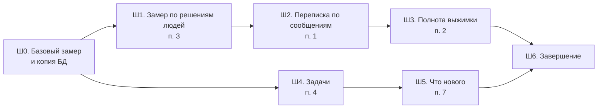

# План: точность контекста, задачи и «что нового» для менеджера

Дата: 2026-10-12. Статус: **выполнен 15.10.2026** (решения Р1–Р5 — 12.10; итоги — §5 «Где стоим»; запуск портала — Д4).
Основание: разбор портала 12.10.2026, находки 17 и 40 в [FINDINGS-2026-09.md](../FINDINGS-2026-09.md), фазы 6–7 [PLAN-AGENT-EXCHANGE-V2.md](../PLAN-AGENT-EXCHANGE-V2.md).
Карта: [PROJECT-MAP.md](../PROJECT-MAP.md) §4.4, §5.1, §5.4, §7 (модели), §12.2.

## 0. Что закрываем

| № | Пункт | Сейчас | После плана |
|---|---|---|---|
| 1 | Переписка в поиске и чате | Переписка индексируется как обычный документ (`indexing.index_artifact` → `chunking.chunk_document`): во фрагменте десятки сообщений, без автора и номера сообщения. Ссылка из чата открывает переписку на цитате, а не на сообщении | Фрагмент — несколько соседних сообщений одного дня с автором и временем; у фрагмента есть номера сообщений `M…`, ссылка из чата открывает нужное сообщение |
| 2 | Полнота итоговой выжимки | `tz.build_tz_fast_body` подбирает материал 7 общими запросами (`FAST_QUERIES`); на проекте 18 теряется 4 из 12 эталонных фактов: 3 не подбираются, 1 выпадает при сжатии | Каждое согласованное решение из памяти решений попадает в выжимку или в явный список «не вошло»; 12 из 12 фактов на проекте 18 |
| 3 | Замер точности требований и задач | Точность контракта не измеряется. Решения людей лежат в `entities.value_json` (`human_review`, `human_status`), решения модели — там же (`model_review`), но их никто не сводит | Скрипт и строка в карточке: «модель права в N из M пунктов, проверенных людьми», по видам пунктов и полям, с размером выборки |
| 4 | Управление задачами | Карточка «Дедлайны» только для чтения (`GET …/deadlines`), показывает лишь задачи со сроком и не скрывает устаревшие и склеенные пункты (фильтр только `is_active`) | Карточка «Задачи»: все задачи, фильтры, правка статуса, ответственного и срока, ручные задачи; правки переживают «Обновить из материалов» и «Переизвлечь требования» |
| 7 | «Что нового с прошлого захода» | Посещения не учитываются; всё спрятано в свёрнутых карточках | Полоска наверху проекта: новые материалы и что из них извлечено, сменившиеся решения, вопросы агентов; плюс «ждут вас», конфликты, просроченные задачи |

Нумерация пунктов — как в списке, который одобрил владелец (1, 2, 3, 4, 7).

## 1. Что выяснили при разборе кода

- **Переписка.** Разметка сообщений уже есть: `chat_export.py` пишет `parsed/documents/<artifact_id>_messages.json` (номер, автор, время, «в ответ на»). Контракт и память решений её используют, а индекс — нет. Ссылку на сообщение строит `source_links.source_url(message_id=…)`. В `chunks` нет поля для номера сообщения: есть только `speaker`, `start_sec`, `end_sec`.
- **Повторы переписки.** Пересекающиеся выгрузки одной переписки: источник сообщения — самая ранняя выгрузка (`chat_export.owned_elsewhere`, правило Я1). Индекс сейчас этого не учитывает, одно сообщение попадает в поиск дважды.
- **Выжимка.** Быстрая сборка не смотрит в память решений (`subjects`, `decision_events`), хотя в проектах 18 и 34 она в режиме live. Решения в выжимку попадают, только если их нашёл векторный поиск.
- **Задачи.** Задача — это сущность `entity_type=task`, та же, что пункт контракта. Ручные решения по таким сущностям при переизвлечении уже переносятся на новые пункты (`entities._human_snapshot` / `_transfer_human`, `HUMAN_TYPES` включает `task`). Этот механизм подходит и для правок задач. Ручную задачу как сущность не создать: `entities.artifact_id` обязателен, а переизвлечение идёт по материалам.
- **Решений людей мало.** На 12.10 во всех проектах около 30 ручных решений: 24 подтверждения, 2 отклонения, 2 смены статуса, 1 возврат решения модели. Решений модели — около 2 700. Для замера по одному проекту этого не хватает (§2, Р1).
- **Учёт посещений.** Таблицы посещений нет; `user_activity_log` пишет действия, а не просмотры. У `entities` и `links` нет времени создания. Есть время у задач очереди (`jobs.finished_at`), событий памяти решений (`decision_events.recorded_at`), вопросов агентов (`agent_questions.created_at`).

## 2. Решения владельца

Все пять приняты 12.10.2026 по рекомендации: Р1-б, Р2-а, Р3-а, Р4-а, Р5-а.

| # | Вопрос | Варианты | Рекомендация (принята) |
|---|---|---|---|
| Р1 | Где взять разметку для замера (п. 3) | а) только то, что люди и так делают (сейчас около 30 решений, копится медленно); б) плюс выборочная проверка: в карточке требований раз в неделю 10 случайных пунктов с кнопками «Верно» / «Неверно», по минуте на пункт | **б**, необязательная: замер работает и без неё, но с пометкой «мало данных», пока выборка меньше 20 |
| Р2 | Кто правит задачи (п. 4) | а) admin и manager проекта; б) только admin, как подтверждение требований | **а**: задачи — оперативная работа менеджера. Подтверждение требований остаётся за admin |
| Р3 | Где хранить ручные задачи (п. 4) | а) новая таблица `manual_tasks`; б) служебный материал проекта «Ручные задачи» | **а**: служебный материал пришлось бы исключать из конвейера, переизвлечения, списка материалов и MCP. Ручные задачи пока не уходят в контракт агента (связка с агентом отложена 12.10) |
| Р4 | Когда «новое» становится просмотренным (п. 7) | а) автоматически: точка отсчёта сдвигается, если человек не заходил в проект дольше 30 минут; б) только по кнопке «Просмотрено» | **а** плюс кнопка «Скрыть» до следующих изменений |
| Р5 | Выжимка из памяти решений (п. 2) | а) только в проектах, где память в режиме live; б) и в shadow | **а**: в shadow память видна только администратору (`memory_mode.py`) |

## 3. Порядок

- Ш1 — первым из «точности»: без него улучшения Ш2 и Ш3 не с чем сравнить. Он только читает базу, модель не вызывает.
- Ш2 раньше Ш3: выжимка берёт фрагменты переписки из того же индекса.
- Ш4 и Ш5 независимы от Ш1–Ш3 и могут идти параллельно. Ш5 после Ш4: в полоске «Что нового» показываются просроченные задачи.
- Каждый шаг — отдельный коммит со своей темой (раздел «Коммиты» в каждом шаге).

**Рабочая копия.** В ней чужие незакоммиченные правки в `decision_log.py`, `doc_memory.py`, `doc_units.py`, `speech_acts.py`, `subject_windows.py` и связанных тестах. Шаги этого плана их не трогают. Если шаг всё же их заденет, сначала снять копию файла и коммитить только свои фрагменты (`AGENTS.md`, память «не откатывать грязные файлы»).

---

## Ш0. Базовый замер

1. Копия БД: `scripts\backup_db.ps1`, проверка `scripts\verify_backup.py`.
2. Чат: `scripts\eval_chat.py` по всем наборам `docs\eval\chat_questions_*.json`. Записать факты, ловушки и время ответа.
3. Выжимка: `scripts\eval_tz.py --project 18 --runs 3 --facts docs\eval\tz_facts_project18.json`. Записать найденные факты по прогонам и время сборки.
4. Индекс: доля фрагментов переписки с автором (`index.stored.with_speaker` в логе) по проектам с перепиской.
5. Результат — `data\eval\baseline_2026-10-XX.json`. Каталог `data\` вне git: в ответах чата бывают имена.

**Готово, когда** базовые числа записаны, копия БД проверена.

---

## Ш1. Замер точности по решениям людей (п. 3)

**Что делаем.**
1. `scripts\eval_contract_labels.py` — только чтение, без модели. По каждому проекту и виду пункта (`decision`, `task`, `open_question`) считает:
   - **точность извлечения**: доля пунктов, которые человек не отклонил, среди тех, что он проверил (`human_review.action` = confirm / reject, плюс `spot_check` из п. 3);
   - **согласие модели с человеком**: решение `model_review` против `human_review` на одних пунктах; отдельно — сколько раз человек нажал «Вернуть решение модели»;
   - **точность статуса**: извлечённый `status` против `human_status`;
   - **актуальность**: сколько пунктов, скрытых как устаревшие или склеенные, человек вернул кнопкой «Это актуально»;
   - **конфликты**: решения людей по конфликтам (`resolutions.resolved_by`) против вердикта модели (`links.model_review`);
   - после Ш4 — **поля задач**: как часто человек правит ответственного, срок и статус.
   - У каждого числа — размер выборки. Меньше 20 — пометка «мало данных», число не выводится как процент.
2. Логику счёта вынести в `services/contract_quality.py`: её использует скрипт и карточка (п. 4 этого шага).
3. Выборочная проверка (Р1-б). В карточке «Подтверждение требований» вкладка «Выборочная проверка»: раз в неделю 10 случайных пунктов, которые человек ещё не проверял, кнопки «Верно» / «Неверно» и необязательная причина.
   - Ответ пишется в отдельное поле `value_json.spot_check` `{verdict, reason, by, user_id, at}`, а не в `human_review`. Так отметка не считается подтверждением: пункт остаётся в «Ждут вас», не переносится при переизвлечении как решение человека и не меняет контракт.
   - Отвечать могут admin и manager проекта: состояние пункта отметка не меняет, а разметки нужно больше.
   - Роут `POST /projects/{id}/spot-check/{entity_id}` (не `requirements/{rid}/…`: тот путь перехватывает общий `/{rid}/{action}`).
4. В шапке карточки «Подтверждение требований» строка: «Модель права в N из M проверенных вами пунктов» или «мало данных для оценки».

**Карта.** §5.4 (карточка: строка точности, вкладка «Выборочная проверка», роут `…/spot-check/{entity_id}`), §7 (новый сервис), §10 (скрипт), §5.1 роутеры.
**Тесты.** `app/app/tests/test_contract_quality.py`: синтетические сущности с `human_review` / `model_review` / `spot_check` → ожидаемые числа; порог «мало данных»; вид пунктов не смешивается. Выборочная проверка: `user` получает 403; отметка не меняет `needs_review`, `is_active` и `human_review`; в выборку не попадают уже проверенные пункты и пункты, отмеченные на этой неделе.
**Проверка на живых данных.** Скрипт по всем проектам, результат — в `data\eval\contract_labels_<дата>.json`, сводка без имён — в `docs\TESTING.md`.
**«Исправлено».** Только если сделана видимая строка в карточке: «Добавлена возможность видеть, насколько часто модель верно разбирает требования: по пунктам, которые проверили вы».
**Коммит.** «Требования: замер точности по решениям людей».

**Готово, когда** скрипт и строка в карточке работают, числа записаны как база для Ш2–Ш3.

---

## Ш2. Переписка в поиске по сообщениям (п. 1)

**Что делаем.**
1. `chunking.chunk_messages(export, skip_ids)`:
   - соседние сообщения одного дня собираются во фрагмент, пока он не больше `CHUNK_TOKENS` (512) и между сообщениями не больше 30 минут;
   - первая строка фрагмента — «Переписка «название» · 25 августа 2026», дальше строки в формате, который понимает `contract_text.parse_chat`: «**15:58 Имя:** текст», ответ — «(в ответ на M105, Имя: начало)»;
   - `speaker` — автор, если он во фрагменте один, иначе пусто;
   - длинное сообщение режется по предложениям, номер сообщения сохраняется у каждой части;
   - для копии чата Битрикс24 (`at_precision="day"`) время не пишется (решение А9).
2. Две колонки в `chunks`: `unit_first`, `unit_last` (`VARCHAR(24)`, адреса вида `M101`). Добавить через `db._MIGRATIONS`. Колонки общие: позже в них можно класть `T…` и `P…`.
3. `indexing.index_artifact`: если у материала есть разметка (`chat_export.load_artifact_export`), то нарезка через `chunk_messages`. Сообщения, источник которых — более ранняя выгрузка (`owned_elsewhere`), в индекс не идут. После удаления ранней выгрузки поздние выгрузки той же переписки нужно переиндексировать. Проверить, кто удаляет материал (`DELETE /projects/{id}/artifacts/{art_id}`), и поставить там переиндексацию.
4. Ссылки:
   - `chat.py` (сбор источников, около строк 950–967): у фрагмента с `unit_first` = `M…` ссылка `source_url(message_id=…)`;
   - `project_mcp_data.mcp_search_project`: в ответе поля `unit_first` и `unit_last`;
   - `tz.py`: подпись источника — «переписка, сообщения M101–M108».
5. `scripts\reindex_messages.py`. По умолчанию только отчёт: сколько материалов и фрагментов изменится. С `--apply`: копия БД (`backup_db.ps1`, `verify_backup.py`), переиндексация только переписок, затем `audit_integrity.py`. Эмбеддинги считает Ollama `bge-m3` на CPU, очередь GPU не нужна.
6. Набор вопросов по переписке: 6–8 вопросов вида «когда и кто написал про …», «что ответили на …», плюс 2 ловушки. В ожидаемых ответах бывают имена, поэтому набор лежит в `data\eval\`, вне git: хук приватности не пустит имена в коммит.

**Карта.** §4.2 (документы: переписка), §6 (если меняется что-то на диске), §7 «Модели» (`chunks.unit_first`, `unit_last`), §7 сервисы (`chunking`, `indexing`), §10 (скрипт), находка 40 → «исправлено».
**Тесты.** Новый `test_chunk_messages.py`: фрагмент не смешивает дни; разрыв больше 30 минут режет фрагмент; один автор → `speaker`; номера `M…` на месте; длинное сообщение; Битрикс24 без времени. `test_index.py` (новые случаи): повторное сообщение из поздней выгрузки не индексируется; документ без разметки идёт старым путём. Чат: источник фрагмента переписки ведёт на `?m=`.
**Проверка на живых данных.** Отчёт `reindex_messages.py` → `--apply` на копии БД → `eval_chat.py`: набор по переписке и все прежние наборы.
**Критерий.** Набор по переписке лучше базы Ш0. Ни один прежний набор не хуже. У 100 % фрагментов переписки есть `unit_first`. Повторов сообщений в индексе нет.
**«Исправлено».** «Повышена точность ответов чата по переписке: ответ ссылается на конкретное сообщение, видно, кто и когда его написал».
**Коммит.** «Поиск: переписка по сообщениям с автором и временем».

---

## Ш3. Полнота итоговой выжимки (п. 2)

**Что делаем.**
1. **Сначала понять, где теряется.** `eval_tz.py --trace`: для каждого пропущенного факта показать, на каком этапе он потерялся:
   - нет в материалах проекта (извлечение);
   - есть, но не подобран (`build_tz_fast_body`: не попал в `chunk_seen` / `ent_seen`);
   - подобран, но выпал при сжатии.

   Для этого `build_tz_fast_body` возвращает подобранный материал в статистике, только в режиме проверки.
2. **Решения из памяти** (проекты с памятью live, Р5): блок «Решения по предметам» в материале выжимки — все активные предметы с состоянием «согласовано», «в документе», «заменено», одной строкой: предмет, итог (`subjects.summary`), дата, сторона. Это детерминированный список, а не поиск. По объёму: на проекте 18 около 320 пунктов, одна строка — около 30 токенов, всего около 10 тыс. токенов. Сейчас весь запрос занимает около 8,9 тыс. токенов из 32 тыс., запас есть. Если предметов больше заданного порога (`TZ_MEMORY_MAX_SUBJECTS`), брать только согласованные и заменённые за последние 60 дней, остальные — счётчиком.
3. **Запросы под проект.** К 7 общим запросам добавить запросы из карточки проекта (цель, системы, термины) и названий тем (`topics.label`), до 10 штук. Подбор MMR тот же.
4. **Проверка после сжатия.** После ответа модели сверить, что каждый согласованный предмет из п. 2 упомянут в тексте: совпадение основ слов, как в `contract_text.coverage`. Не упомянутые — отдельным разделом в конце: «Не вошло в выжимку: …», со ссылкой на память решений. Молча ничего не теряется.
5. Правило в промпте `docs/prompts/rebuild_tz.md`: числа, сроки, названия объектов и реквизитов не обобщать. Версию промпта поднять.

**Карта.** §4.4 (итоговая выжимка), §5.4 (что в выжимке), §5.11 (ограничения контекста), §9 (промпт), §12.2 (`TZ_MEMORY_MAX_SUBJECTS`, если вводится), находка 17 → «исправлено».
**Тесты.** `test_tz*.py`: блок памяти есть только в live; порог предметов; проверка после сжатия добавляет раздел «Не вошло»; запросы из карточки не дублируют общие. Модель в тестах — заглушка.
**Проверка на живых данных.** `eval_tz.py --project 18 --runs 3` и `--trace`. Если владелец даст: второй набор фактов по проекту 34 (память live) — в `data\eval\`, вне git.
**Критерий.** 12 из 12 фактов хотя бы в 2 из 3 прогонов, нет факта, пропавшего во всех прогонах. Время сборки — не больше базового (Ш0) плюс 30 %. Чат и наборы `eval_chat` не хуже Ш0: выжимка входит в контекст чата.
**«Исправлено».** «Повышена полнота итоговой выжимки проекта: в неё входят все согласованные решения, а то, что не поместилось, перечислено отдельно».
**Коммит.** «Выжимка: решения из памяти и проверка полноты».

---

## Ш4. Задачи: менеджер управляет сам (п. 4)

**Данные.**
1. **Правка извлечённой задачи** хранится в `entities.value_json.human_edit`: `{assignee, deadline, deadline_at, status, reason, by, user_id, at, fields: [...]}`. Действующее значение — правка поверх извлечённого. Извлечённое остаётся, видно «было → стало». Это отдельное поле, а не `human_review`: правка задачи не означает «требование подтверждено» и не меняет очередь «Ждут вас».
2. **Перенос при переизвлечении:** `entities._human_snapshot` и `_transfer_human` переносят и `human_edit`, по тем же правилам совпадения (основы слов и близость по времени, `HUMAN_TRANSFER_MIN_COVERAGE`). Правка, для которой не нашлось пары, попадает в список «не нашлось» — тот же путь, что у подтверждений.
3. **Ручные задачи** (Р3-а): таблица `manual_tasks` (`id`, `project_id`, `description`, `assignee`, `assignee_person_id`, `deadline`, `deadline_at`, `status`, `created_by`, `created_at`, `updated_at`, `is_active`). Переизвлечение их не трогает.
4. **Статусы задачи:** «открыта», «в работе», «сделано», «отменена». Извлечённые статусы сводятся к этим четырём; `unknown` — «открыта».
5. **Ответственный** — человек из списка проекта (`people`, карточка «Люди и стороны»). Свободный текст допустим для тех, кого в списке нет.

**API** (`routers/knowledge.py` или новый `routers/project_tasks_ui.py`, права — admin и manager проекта, Р2):
- `GET /projects/{id}/tasks` — все задачи: извлечённые и ручные, со сроком и без. Устаревшие и склеенные пункты скрываются тем же правилом, что в очереди требований (`requirement_review.hidden_state`). Фильтры: `view=all|overdue|week|no_deadline|done`, `assignee`. `GET …/deadlines` остаётся для календаря и использует ту же выборку.
- `PATCH /projects/{id}/tasks/{entity_id}` — `{status?, assignee?, deadline?, reason?}`.
- `POST /projects/{id}/tasks` — ручная задача. `PATCH` / `DELETE /projects/{id}/manual-tasks/{task_id}` — правка и мягкое удаление.
- Каждое действие — в `user_activity_log` (`BLOCK_KNOWLEDGE`, новое действие `ACTION_TASK_EDIT`).

**UI** (`project.html`, блок `deadlines-card`; логику вынести в `static/px_tasks.js` — фаза 0 плана обмена: не раздувать `project.html`, в нём уже 3 170 строк):
- карточка «Дедлайны» → «Задачи»; вкладки «Все», «Просрочено», «На этой неделе», «Без срока», «Сделано»; фильтр по ответственному; переключатель «Список / Календарь» остаётся;
- в строке задачи — выбор статуса, ответственного и срока прямо в строке; метка «изменено вручную: кто, когда» с подсказкой «было»;
- кнопка «+ Задача»;
- на телефоне — карточки (`#deadlines-cards`), без горизонтальной прокрутки.

**Карта.** §5.4 (карточка «Задачи» вместо «Дедлайны»: элементы, API, роли), §5.1 (роуты), §7 «Модели» (`manual_tasks`), §7 сервисы, `docs/UI-COPY.md` (подписи), `docs/HOWTO-MANAGER.md` (раздел про задачи).
**Тесты.**
- Сервис: правка поверх извлечённого; перенос `human_edit` при переизвлечении (синтетическое переизвлечение); устаревшая задача скрыта; задача без срока видна во «Все» и «Без срока»; «Просрочено» и «На этой неделе» считаются по дате материала (`artifact_reference_date`).
- Роуты: `user` получает 403 на правку; чужой проект — 404; некорректный статус — 422.
- Браузер: правка статуса и ответственного, ручная задача, вкладки; телефон 375 px.

**Проверка на живых данных** (копия БД): задачи проекта 34 → правка → «Обновить из материалов» → правка на месте.
**Критерий.** Менеджер меняет статус, ответственного и срок и добавляет задачу. После «Обновить из материалов» и «Переизвлечь требования» правки на месте. Устаревшие и склеенные задачи не видны. Задачи без срока видны.
**«Исправлено».**
- «Добавлена возможность вести задачи проекта: менять статус, ответственного и срок, добавлять задачи вручную; ваши правки сохраняются при повторном разборе материалов».
- «Исправлена проблема с задачами без срока и с устаревшими задачами: первые теперь видны, вторые больше не показываются».

**Коммит.** «Задачи: статус, ответственный и срок правит менеджер».

---

## Ш5. «Что нового с прошлого захода» (п. 7)

**Данные.** Таблица `project_visits` (`user_id`, `project_id`, `seen_at`, `prev_seen_at`, `dismissed_at`), ключ — пара пользователь + проект.
**Правило отсчёта (Р4-а).** При открытии страницы проекта: если с `seen_at` прошло больше 30 минут, то `prev_seen_at = seen_at`, `seen_at = сейчас`. «Новое» считается от `prev_seen_at`, поэтому перезагрузка страницы в течение одного захода его не сбрасывает. Первый заход — полоски нет. «Скрыть» записывает `dismissed_at`: полоска не видна, пока не появится что-то новее.

**Что показывает** (`services/project_digest.py`):

| Строка | Откуда | Ведёт |
|---|---|---|
| Обработано N материалов | `jobs.finished_at` > отсчёта, задача обработки материала завершена | таблица материалов |
| Из них: требований, задач, вопросов к заказчику | активные сущности этих материалов, без скрытых | карточка требований с фильтром |
| Сменилось решений: N | `decision_events.recorded_at` > отсчёта, виды «согласовано», «заменено», «отклонено»; только память live | карточка «Память решений» |
| Вопросов от агентов: N | `agent_questions.created_at` > отсчёта, без ответа | карточка обмена |
| Ждут вас: N | текущее значение очереди `needs_human` | карточка требований |
| Конфликтов не решено: N | текущее значение | страница конфликтов |
| Задачи: просрочено N, на этой неделе M | Ш4 | карточка «Задачи», вкладка |

Пустые строки не показываются. Если нового нет и текущих дел нет, полоски нет.

**Где и как.**
- Полоска под заголовком проекта, над «Добавить материалы», в одном стиле с полоской «Идёт созвон».
- Рисуется сервером в `pages.project_page`, как `live_meetings`: появись она после загрузки, страница «прыгнула» бы.
- Обновляется без нового опроса: после тоста «файл обработан» один запрос `GET /projects/{id}/digest`.
- `POST /projects/{id}/digest/dismiss` — «Скрыть».
- Роли: admin и manager — все строки; `user` — только материалы и задачи.

**Карта.** §5.4 (полоска: элементы, API, роли), §5.1 (роуты), §7 «Модели» (`project_visits`), §7 сервисы, `docs/UI-COPY.md`, `docs/HOWTO-MANAGER.md`.
**Тесты.** Сервис: отсчёт сдвигается только после 30 минут; первый заход — пусто; «Скрыть» до следующего события; каждая строка по своему источнику; строки памяти — только live; права `user`. Роуты: чужой проект 404. Браузер: полоска с переходами к карточкам, телефон 375 px.
**Критерий.** Менеджер видит, что изменилось с прошлого захода, без раскрытия карточек. Каждая строка открывает нужную карточку с фильтром. Перезагрузка страницы не сбрасывает «новое».
**«Исправлено».** «Добавлена возможность сразу видеть, что изменилось в проекте с прошлого захода: новые материалы, требования, задачи, сменившиеся решения и что ждёт вас».
**Коммит.** «Портал: что нового в проекте с прошлого захода».

---

## Ш6. Завершение

1. Полный прогон тестов (`docs\TESTING.md`, раздел «Запуск»), перезапуск `restart.ps1` — только если нет идущих встреч.
2. Повторный замер Ш0. Сравнение «до / после» — в `docs\TESTING.md`, без имён.
3. Находки 17 и 40 → «исправлено» с тестом; фазы 6 и 7 в `PLAN-AGENT-EXCHANGE-V2.md` — отметить, что сделано (замер точности, переписка по сообщениям).
4. `DECISIONS.md`: решения Р1–Р5 в общих словах.
5. `check_map_drift.py --fix`, затем без `--fix` (код 0); `index_project_map.py`; `export_project_graph.py`.
6. Записи в `app/app/changelog.json` — формулировки из шагов, дата — день выполнения.

## 5. Доработка после замеров (15.10.2026)

### Где стоим

| Шаг | Код | Замер | Коммит |
|---|---|---|---|
| Ш0 | — | база записана: `data/eval/baseline_2026-10-14/` | — |
| Ш1 | готов | разметки мало (0 пунктов для сверки модели) — ждёт выборочной проверки | `ffd5b20` |
| Ш2 | готов, индекс переписок пересчитан (GPU, 8,7 с) | переписка 6/7 → 7/7, ловушки 1/2 → 2/2; ссылка на сообщение в 8 ответах из 9 | `8fb84f2` |
| Ш3 → Д2 | выжимка по разделам | проект 18: 7/12 → 10/12, ~31 с, текст стабилен; первая попытка (всё в один запрос) — 6/12, отброшена | `5e423a6` |
| Ш4, Ш5 | готовы, проверены в браузере на копии БД | — | `16e8c10` |
| Д3 | документы | `docs/TESTING.md`, находки 17 и 40, DECISIONS | этот коммит |

**Критерий Д2 выполнен не полностью:** 10 из 12 вместо 11. Не хватает «облачного Битрикс24» (факта нет ни в памяти решений, ни в карточке — только во фрагментах переписки) и дословных «статусов оплаты» (смысл передан как «контроль оплат и отгрузок»). Время и стабильность — в норме; выжимка проекта 34 прочитана: суть верна, решения сгруппированы, хроники и мелочей нет.

**Почему Ш3 не прошёл** (`eval_tz.py --trace`): материал вырос с ~9 до ~51 тыс. токенов (281 предмет памяти), 5 из 6 потерянных фактов были в материале и «выпали при сжатии»; 26 согласованных решений модель не упомянула. Одному вызову нельзя отдавать весь проект и просить сжать: чем полнее вход, тем больше потерь. Итоги предметов к тому же написаны хроникой («исполнитель предложил…, заказчик согласился…») и включают организационные мелочи (время созвона).

### Д1. Закоммитить готовое (Ш2, Ш4 + Ш5)

1. Ш2: `check_map_drift.py --fix`, в коммит — реестр модулей (§15) по файлам Ш2 и кусок `tz.py` с подписью «сообщения M…». Куски Ш3 в `tz.py`, промпте и `eval_tz.py` остаются в рабочей копии.
2. Ш4 + Ш5 — один коммит «Портал: задачи менеджера и «Что нового» в проекте»: правки переплетены в одних файлах (`knowledge.py`, `project.html`, `models/__init__.py`, `user_identity.py`, `project_purge.py`). Строки карты и манифеста — только свои куски (снимки в scratchpad, `stage_hunks.py` / `stage_pieces.py`), чужие правки рабочей копии не трогаются.
3. `docs/UI-COPY.md` (пересобран, отставал на 13 файлов) — отдельно: «Тексты интерфейса: реестр пересобран».

**Готово, когда** три коммита прошли хуки без `--no-verify`, `git status` показывает только чужие правки и незакоммиченный Ш3.

### Д2. Ш3 заново: выжимка по разделам (проекты с памятью решений в live)

Каждый раздел берётся из своего готового источника; модель только переписывает формулировки и отбирает мелочи — и обязана отчитаться по каждому предмету.

| Раздел | Источник | Как собирается |
|---|---|---|
| Суть проекта | карточка проекта + до 10 фрагментов поиска «цель, периметр, системы» | вызов модели (общий с решениями, см. ниже) |
| Ключевые решения | предметы памяти «согласовано» и «в документе», по темам (`subjects.topic_id` → `topics.label`) | модель переписывает итог в одну строку решения или помечает «организационное» |
| Что сделано | предметы «сделано» | так же |
| Актуальные задачи | `task_board.all_tasks`: открытые с ответственным и сроком, сначала просроченные и ближайшие, до 20 строк; дальше — «ещё N — в блоке «Задачи»» | без модели: таблица собирается кодом (совпадает с карточкой «Задачи», с правками менеджера) |
| Открытые вопросы и риски | вопросы к заказчику (`open_question_lines`) + нерешённые противоречия (`conflict_lines`) | без модели |

**Один вызов модели** (столько же, сколько сейчас): на входе карточка, фрагменты для сути и пронумерованный список предметов (`id`, состояние, дата, название, итог; ~180 строк ≈ 7–8 тыс. токенов). На выходе JSON: `{"essence": "…", "items": {"<id>": {"text": "…"} | {"skip": "org"}}}`. Разбор — `strip_json_fence` + проверка, как у судьи памяти (`subject_judge.parse_verdict`).

**Ничего не теряется молча:** у каждого предмета из списка есть строка в разделе или пометка «организационное». Предмет без ответа модели идёт строкой из своего названия и итога. Сломанный JSON → разделы собираются из названий и итогов без модели, событие в журнал. Раздел «Не вошло в резюме» больше не нужен.

**Порядок внутри раздела:** по теме, внутри — по дате. «В документе», противоречащее более позднему решению, уже снято памятью (состояние «заменено» в список не попадает).

Файлы: новый `services/tz_sections.py`, промпт `docs/prompts/tz_sections.md` (правила: формулировки из итога, числа и названия дословно, без «исполнитель предложил», организационное — `skip`), `tz.build_tz_fast_body` → для live-проектов зовёт `tz_sections`, для остальных — прежний путь. Из Ш3 v1 убрать: блок памяти в общем материале, `missing_decisions` / `append_missing`; оставить карточку проекта и запросы по темам в прежнем пути, `eval_tz --trace`.

Тесты (`test_tz_sections.py`, модель — заглушка): каждый предмет либо в разделе, либо `skip`; пропущенный моделью — строкой из итога; сломанный JSON — сборка без модели; задачи и вопросы — из своих источников, совпадают с `task_board`; не-live проект — прежний путь.

**Критерий:** проект 18 — не меньше 11 из 12 эталонных фактов во всех трёх прогонах (факт «облачный Битрикс24» есть только во фрагментах, его даст поиск для сути), ни одного факта «выпал при сжатии» среди тех, что есть в памяти; время — не дольше базы (~30 с) плюс 30 %; повторная сборка без новых материалов даёт тот же текст разделов «Решения», «Сделано», «Задачи». Проект 34 (тоже live) — выжимку читает человек: суть верна, нет хроники и организационных мелочей. Чат и наборы `eval_chat` — не хуже базы.

Коммит: «Выжимка: собирается по разделам из памяти и задач».

### Д3. Ш6 — документы и уборка

1. `docs/TESTING.md` — сводка «до / после» по всем наборам (без имён).
2. Находки 17 (выжимка — после Д2) и 40 (переписка) → «исправлено»; фазы 6 и 7 в `PLAN-AGENT-EXCHANGE-V2.md` — что сделано.
3. `docs/DECISIONS.md` — Р1–Р5 и «выжимка из разделов, один вызов модели» — только свои куски (в файле чужие правки).
4. Этот план — статус «выполнен», таблица «Где стоим» — итог.
5. Убрать конфигурацию `portal-ui-check` из `.claude/launch.json`.
6. `check_map_drift.py`, `index_project_map.py`, `export_project_graph.py`; коммит «План: точность и задачи — итоги и документы».

### Д4. Запуск портала

Перезапуск `restart.ps1`, когда нет идущих встреч (он сам откажется при живой встрече): при старте создаются таблицы `manual_tasks` и `project_visits`. Колонки `chunks.unit_first` / `unit_last` в боевой базе уже есть. После запуска — смоук: страница проекта 18, карточка «Задачи», полоска «Что нового», чат по переписке. Выполняется по команде владельца.

### Вне плана

Набор `chat_questions_tables_p34`: 2 из 5 фактов и до, и после наших правок (25.09 было 5 из 5). **Разобрано 15.10: не регрессия.** Смету «Вариант 2», по которой составлен набор, 25.09 удалили из проекта и заменили на «Вариант 3» (сниженная ставка ×0,85); чат верно отвечает по текущей смете. Набор обновлён (5/5), в наборах появилось поле `sources` — `eval_chat.py` предупреждает, если файла-источника в проекте нет. Заодно: шаблон отказа не засчитывал «**нет** информации» — сверка теперь без `**`.

## 4. Риски

| Риск | Что делаем |
|---|---|
| Переиндексация переписок затрагивает поиск и чат всех проектов | копия БД, отчёт до применения, `eval_chat` до и после по всем наборам, откат — восстановление копии |
| Мало разметки для замера (Ш1) | порог «мало данных»; Р1-б; правки задач после Ш4 дают новую разметку сами |
| Блок памяти раздувает запрос выжимки | порог предметов, замер токенов в `tz.rebuild_fast.coverage` |
| Перенос правок задач ошибается при переизвлечении | тот же порог совпадения, что у подтверждений; не нашлось пары — правка в списке «не нашлось», а не на чужой задаче |
| `project.html` перегружен | новая логика задач и полоски — в отдельных `static/px_*.js` и `partials/*.html` |
| Чужие незакоммиченные правки в рабочей копии | этот план их не трогает; общие файлы карты — коммитить только свои фрагменты |
| Время модели: выжимка и проверки идут в одной фоновой полосе | Ш3 замеряет время; Ш1 и Ш5 модель не вызывают |
