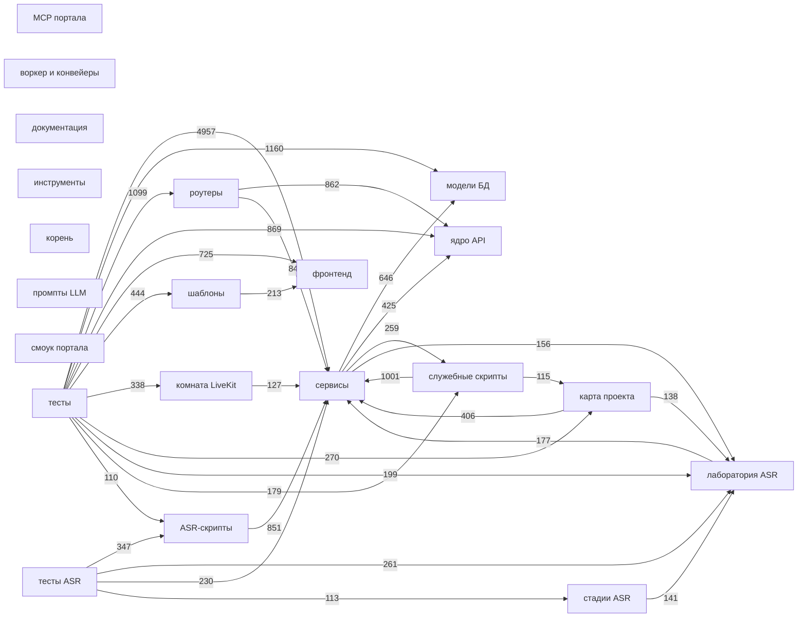

# Атлас зависимостей SKKKK

Сгенерированная карта проекта: все сущности и все связи между ними. Источник — индекс `data/project_map.db`
и семантический манифест `docs/project-map/manifest.yaml`; полный граф — `data/project_map_graph.json`,
свод по модулям — `docs/project-map/graph-modules.json`.

**Обновить после правок кода:**

```powershell
venv\Scripts\python.exe scripts\export_project_graph.py
```

Что где искать: `venv\Scripts\python.exe scripts\search_project_map.py --graph ИМЯ --depth 2` — окрестность функции,
`--deps ФАЙЛ` — зависимости модуля, `--orphans` — кого никто не вызывает, `--import-cycles` — циклы импортов.
Страница для человека — `/admin/map/graph`.

<!-- generated:begin atlas -->

_Собрано: 2026-10-05 00:42 · индекс от 2026-10-05 00:41 · коммит `c71cef55` · узлов 8274, рёбер 33679_

## 1. Из чего состоит граф

| Узлы | Штук |
|---|---|
| символ | 6711 |
| файл | 683 |
| элемент интерфейса | 377 |
| роут | 160 |
| коммит | 157 |
| окружение | 132 |
| таблица БД | 33 |
| узел карты | 21 |

| Связь | Смысл | Штук |
|---|---|---|
| `calls` | вызывает | 13772 |
| `defines` | определяет | 6711 |
| `covers` | покрывает тестом | 5862 |
| `changed` | изменил | 2119 |
| `calls_ref` | передаёт как значение | 1434 |
| `imports` | импортирует | 1124 |
| `handled_by` | обрабатывается в JS | 428 |
| `reads` | читает | 421 |
| `declares` | объявляет | 407 |
| `depends_on` | зависит от | 339 |
| `writes` | пишет | 215 |
| `reads_env` | читает переменную | 181 |
| `handles` | обрабатывает | 161 |
| `guarded_by` | защищён | 157 |
| `calls_api` | вызывает API | 37 |
| `m:imports` | imports | 17 |
| `m:mounts` | mounts | 12 |
| `m:reads` | reads | 12 |
| `m:subprocess` | subprocess | 11 |
| `m:calls` | calls | 8 |
| `m:runs_stage` | runs_stage | 7 |
| `m:persists` | persists | 6 |
| `m:does_not_mutate` | does_not_mutate | 6 |
| `m:api` | api | 5 |
| `m:require_project` | require_project | 4 |

Всего связей: **33679**; видов: 211.

## 2. Подсистемы и их связи

| Подсистема | Файлов | Узлов | Связей наружу | Связей внутрь |
|---|---|---|---|---|
| сервисы | 113 | 2423 | 1362 | 6452 |
| тесты | 146 | 1668 | 9073 | 4 |
| ASR-скрипты | 45 | 608 | 574 | 497 |
| шаблоны | 18 | 545 | 294 | 546 |
| служебные скрипты | 82 | 527 | 841 | 591 |
| роутеры | 17 | 430 | 1805 | 1158 |
| фронтенд | 13 | 304 | 42 | 899 |
| лаборатория ASR | 16 | 279 | 127 | 777 |
| тесты ASR | 34 | 266 | 861 | 1 |
| ядро API | 16 | 253 | 122 | 2111 |
| карта проекта | 11 | 245 | 222 | 419 |
| комната LiveKit | 4 | 134 | 103 | 313 |
| стадии ASR | 8 | 87 | 133 | 137 |
| модели БД | 20 | 71 | 19 | 1809 |
| смоук портала | 19 | 52 | 114 | 1 |
| .cursor | 29 | 29 | 0 | 0 |
| промпты LLM | 25 | 25 | 0 | 9 |
| .env.example | 1 | 21 | 0 | 0 |
| планы | 20 | 20 | 0 | 0 |
| воркер и конвейеры | 4 | 19 | 96 | 61 |
| документация | 18 | 18 | 1 | 0 |
| MCP портала | 2 | 12 | 29 | 33 |
| этапы | 12 | 12 | 0 | 0 |
| инструменты | 3 | 12 | 21 | 12 |
| {artifact} | 0 | 3 | 0 | 6 |
| корень | 0 | 3 | 3 | 3 |
| app | 2 | 2 | 0 | 0 |
| LightRAG | 2 | 2 | 0 | 0 |
| AGENTS.md | 1 | 1 | 0 | 0 |
| README.md | 1 | 1 | 0 | 0 |
| pytest.ini | 1 | 1 | 0 | 0 |
| parsed | 0 | 1 | 0 | 2 |
| {project} | 0 | 1 | 0 | 0 |
| Login_up.txt | 0 | 1 | 0 | 1 |

Связи между подсистемами (толщина — число связей):



## 3. База данных: кто пишет и кто читает

| Таблица | Столбцов | Пишущих файлов | Читающих файлов | Кто пишет (топ-4) |
|---|---|---|---|---|
| `artifacts` | 27 | 15 | 47 | `app/app/db.py`, `app/app/routers/knowledge.py`, `app/app/routers/upload.py`, `app/app/services/agent_gateway.py` |
| `entities` | 9 | 12 | 25 | `app/app/routers/knowledge.py`, `app/app/services/agent_gateway.py`, `app/app/services/agent_verdicts.py`, `app/app/services/entities.py` |
| `projects` | 7 | 2 | 31 | `app/app/routers/projects.py`, `scripts/qa_meeting_lifecycle.py` |
| `chunks` | 11 | 6 | 13 | `app/app/services/indexing.py`, `app/app/services/pipeline_progress.py`, `app/app/services/project_index/analyzers.py`, `app/app/services/project_index/chunkers.py` |
| `speaker_profiles` | 15 | 6 | 8 | `app/app/services/people.py`, `app/app/services/people_seed.py`, `app/app/services/project_purge.py`, `app/app/services/speaker_profiles.py` |
| `users` | 7 | 4 | 16 | `app/app/main.py`, `app/app/routers/auth.py`, `app/app/services/project_members.py`, `app/app/services/user_identity.py` |
| `jobs` | 11 | 4 | 13 | `app/app/services/project_purge.py`, `app/app/services/queue.py`, `app/app/services/speaker_profiles.py`, `app/app/services/upload.py` |
| `links` | 11 | 5 | 7 | `app/app/routers/knowledge.py`, `app/app/services/graph.py`, `app/app/services/project_purge.py`, `app/app/services/review_relevance.py` |
| `artifact_speaker_links` | 11 | 4 | 2 | `app/app/services/people.py`, `app/app/services/project_purge.py`, `app/app/services/speaker_profiles.py`, `asr/match_sortformer_speakers.py` |
| `meeting_participants` | 12 | 4 | 4 | `app/app/services/meetings.py`, `app/app/services/people.py`, `app/app/services/people_seed.py`, `app/app/services/project_purge.py` |
| `meetings` | 11 | 3 | 12 | `app/app/services/meetings.py`, `app/app/services/people.py`, `app/app/services/project_purge.py` |
| `resolutions` | 7 | 6 | 7 | `app/app/routers/knowledge.py`, `app/app/services/graph.py`, `app/app/services/project_purge.py`, `app/app/services/review_conflicts.py` |
| `people` | 16 | 3 | 3 | `app/app/services/people.py`, `app/app/services/people_seed.py`, `app/app/services/project_purge.py` |
| `user_profiles` | 12 | 1 | 6 | `app/app/services/user_profile.py` |
| `companies` | 7 | 2 | 11 | `app/app/services/companies.py`, `app/app/services/user_profile.py` |
| `chat_messages` | 11 | 2 | 4 | `app/app/services/chat.py`, `app/app/services/project_purge.py` |
| `project_members` | 6 | 2 | 5 | `app/app/services/project_members.py`, `app/app/services/project_purge.py` |
| `topics` | 6 | 3 | 6 | `app/app/services/project_purge.py`, `app/app/services/topics.py`, `scripts/eval_auto_review.py` |
| `user_activity_log` | 11 | 2 | 4 | `app/app/services/project_purge.py`, `app/app/services/user_activity.py` |
| `person_aliases` | 7 | 3 | 2 | `app/app/services/people.py`, `app/app/services/people_seed.py`, `app/app/services/project_purge.py` |
| `project_mcp_tokens` | 17 | 3 | 2 | `app/app/db.py`, `app/app/services/project_mcp_tokens.py`, `app/app/services/project_purge.py` |
| `project_tasks` | 11 | 2 | 2 | `app/app/services/project_purge.py`, `app/app/services/project_tasks.py` |
| `unknown_actors` | 13 | 3 | 1 | `app/app/services/people.py`, `app/app/services/people_seed.py`, `app/app/services/project_purge.py` |
| `user_notes` | 5 | 2 | 5 | `app/app/routers/knowledge.py`, `app/app/services/project_purge.py` |
| `agent_exchange_log` | 15 | 2 | 2 | `app/app/services/agent_gateway.py`, `app/app/services/project_purge.py` |
| `changelog` | 6 | 3 | 1 | `app/app/services/project_purge.py`, `app/app/services/tz.py`, `scripts/fast_summarize_tz.py` |
| `people_log` | 8 | 3 | 1 | `app/app/services/people.py`, `app/app/services/people_seed.py`, `app/app/services/project_purge.py` |
| `agent_questions` | 15 | 2 | 1 | `app/app/services/agent_inbox.py`, `app/app/services/project_purge.py` |
| `contract_items` | 9 | 2 | 1 | `app/app/services/contract.py`, `app/app/services/project_purge.py` |
| `note_refs` | 4 | 3 | 0 | `app/app/routers/knowledge.py`, `app/app/services/graph.py`, `app/app/services/project_purge.py` |
| `project_parties` | 7 | 2 | 2 | `app/app/services/people.py`, `app/app/services/project_purge.py` |
| `asr_runs` | 6 | 2 | 0 | `app/app/services/pipeline_audio.py`, `app/app/services/project_purge.py` |
| `chat_guidance` | 7 | 2 | 1 | `app/app/services/chat.py`, `app/app/services/project_purge.py` |

## 4. Роуты: права, зависимости, таблицы

| Роут | Файл | Обработчик | Права | Зависимости | Таблицы |
|---|---|---|---|---|---|
| `DELETE /projects/{project_id}` | `app/app/routers/projects.py` | delete_project | require_project, require_role, require_role('admin', 'manager') | get_db, get_settings, require_role('admin', 'manager') | — |
| `DELETE /projects/{project_id}/artifacts/{artifact_id}` | `app/app/routers/upload.py` | delete_artifact | require_project | get_db, get_settings, get_current_user | artifacts |
| `DELETE /projects/{project_id}/mcp/tokens/{token_id}` | `app/app/routers/project_mcp.py` | revoke_token | require_role, require_role('admin', 'manager') | get_db, require_role('admin', 'manager') | — |
| `DELETE /projects/{project_id}/meetings/{meeting_id}` | `app/app/routers/meetings.py` | delete_project_meeting | — | get_db, get_settings, get_current_user | — |
| `DELETE /projects/{project_id}/members/{user_id}` | `app/app/routers/project_members.py` | delete_member | require_grant_access | get_db, get_current_user | — |
| `DELETE /projects/{project_id}/people/{person_id}` | `app/app/routers/project_people.py` | forget_person | require_project_staff, user.role != 'admin' | get_db, get_settings, get_current_user | — |
| `GET /` | `app/app/routers/pages.py` | index_page | require_html_user | require_html_user | — |
| `GET /.well-known/acme-challenge/{token}` | `app/app/routers/acme.py` | acme_challenge | — | get_settings | — |
| `GET /admin/companies` | `app/app/routers/companies_admin.py` | companies_page | require_html_user | require_html_user | — |
| `GET /admin/conflicts` | `app/app/routers/pages.py` | conflicts_page | user.role != 'admin', require_html_user | require_html_user | — |
| `GET /admin/map` | `app/app/routers/admin_map.py` | admin_map_page | require_html_user | require_html_user | — |
| `GET /admin/map/graph` | `app/app/routers/admin_map_graph.py` | admin_map_graph_page | require_html_user | require_html_user | — |
| `GET /admin/map/graph/data` | `app/app/routers/admin_map_graph.py` | admin_map_graph_data | — | get_current_user | — |
| `GET /admin/map/graph/summary` | `app/app/routers/admin_map_graph.py` | admin_map_graph_summary | — | get_current_user | — |
| `GET /admin/map/search` | `app/app/routers/admin_map.py` | admin_map_search | — | get_current_user | — |
| `GET /admin/users` | `app/app/routers/admin_users.py` | users_page | require_html_user | require_html_user | — |
| `GET /admin/users/activity` | `app/app/routers/admin_users.py` | users_activity | — | get_db, get_current_user | — |
| `GET /admin/users/data` | `app/app/routers/admin_users.py` | users_data | — | get_db, get_current_user | — |
| `GET /api/artifacts/{artifact_id}/speakers-status` | `app/app/routers/speaker_profiles.py` | api_speakers_status | require_project_staff | get_db, get_current_user | — |
| `GET /api/artifacts/{artifact_id}/tasks/active` | `app/app/routers/speaker_profiles.py` | artifact_active_tasks | — | get_db, get_current_user | — |
| `GET /api/meetings/public/{token}` | `app/app/routers/meetings.py` | public_meeting_info | — | get_db | — |
| `GET /api/meetings/public/{token}/avatars/{user_id}` | `app/app/routers/meetings.py` | public_meeting_avatar | — | get_db | meeting_participants |
| `GET /api/projects/{project_id}/speaker-profiles` | `app/app/routers/speaker_profiles.py` | api_list_profiles | require_project_staff | get_db, get_current_user | — |
| `GET /artifacts/{artifact_id}/audio` | `app/app/routers/pages.py` | artifact_audio_file | require_artifact_project, ensure_audio_playback, ensure_audio_wav | get_db, get_settings, get_current_user | — |
| `GET /artifacts/{artifact_id}/download` | `app/app/routers/pages.py` | artifact_download_file | require_artifact_project | get_db, get_settings, get_current_user | — |
| `GET /artifacts/{artifact_id}/download/brief.docx` | `app/app/routers/pages.py` | artifact_brief_docx_download | require_artifact_project | get_db, get_settings, get_current_user | — |
| `GET /artifacts/{artifact_id}/download/summary.doc` | `app/app/routers/pages.py` | artifact_summary_doc_legacy | — | get_db, get_settings, get_current_user | — |
| `GET /artifacts/{artifact_id}/download/summary.docx` | `app/app/routers/pages.py` | artifact_summary_docx_download | require_artifact_project | get_db, get_settings, get_current_user | — |
| `GET /artifacts/{artifact_id}/download/transcript.txt` | `app/app/routers/pages.py` | artifact_transcript_txt_download | require_artifact_project | get_db, get_settings, get_current_user | — |
| `GET /artifacts/{artifact_id}/lab/{run_id}/file/{relative:path}` | `app/app/routers/pages.py` | artifact_lab_file | require_admin | get_db, get_settings, get_current_user | — |
| `GET /artifacts/{artifact_id}/lab/{run_id}/frame/{relative:path}` | `app/app/routers/pages.py` | artifact_lab_frame | require_artifact_project, require_html_user | get_db, get_settings, require_html_user | — |
| `GET /artifacts/{artifact_id}/meeting-lab/{child_id}/lab/{run_id}/file/{relative:path}` | `app/app/routers/pages.py` | meeting_lab_file | require_admin | get_db, get_settings, get_current_user | — |
| `GET /artifacts/{artifact_id}/report` | `app/app/routers/pages.py` | artifact_report_page | require_artifact_project, ensure_document_report, ensure_audio_report, _artifact_role(db, user, artifact) in ('admin', 'manager'), require_html_user | get_db, get_settings, require_html_user | — |
| `GET /artifacts/{artifact_id}/report-diar-raw` | `app/app/routers/pages.py` | artifact_raw_diar_report_page | require_artifact_project, ensure_raw_diar_report, _artifact_role(db, user, artifact) in ('admin', 'manager'), require_html_user | get_db, get_settings, require_html_user | — |
| `GET /artifacts/{artifact_id}/report-diar-two-voice` | `app/app/routers/pages.py` | artifact_two_voice_diar_page | require_artifact_project, ensure_two_voice_diar_report, _artifact_role(db, user, artifact) in ('admin', 'manager'), require_html_user | get_db, get_settings, require_html_user | — |
| `GET /artifacts/{artifact_id}/report-lab` | `app/app/routers/pages.py` | artifact_lab_report_page | require_admin, ensure_lab_report, _artifact_role(db, user, artifact) in ('admin', 'manager'), require_html_user | get_db, get_settings, require_html_user | — |
| `GET /artifacts/{artifact_id}/report-meeting-lab` | `app/app/routers/pages.py` | meeting_lab_report_page | require_admin, require_html_user | get_db, get_settings, require_html_user | — |
| `GET /artifacts/{artifact_id}/report-sortformer` | `app/app/routers/pages.py` | artifact_sortformer_report_page | require_artifact_project, ensure_sortformer_report, _artifact_role(db, user, artifact) in ('admin', 'manager'), require_html_user | get_db, get_settings, require_html_user | — |
| `GET /artifacts/{artifact_id}/report-speaker-match` | `app/app/routers/pages.py` | artifact_speaker_match_page | require_artifact_project, require_project_staff, ensure_speaker_match_report, _artifact_role(db, user, artifact) in ('admin', 'manager'), require_html_user | get_db, get_settings, require_html_user | — |
| `GET /auth/password/state` | `app/app/routers/auth.py` | password_state | — | get_current_user | — |
| `GET /companies` | `app/app/routers/companies_admin.py` | list_companies | user.role not in ('admin', 'manager') | get_db, get_current_user | — |
| `GET /health` | `app/app/main.py` | health | — | — | — |
| `GET /health/ready` | `app/app/main.py` | health_ready | check_llm_provider | get_db, get_settings, get_current_user | jobs |
| `GET /login` | `app/app/routers/pages.py` | login_page | — | — | — |
| `GET /m/{token}` | `app/app/routers/pages.py` | public_meeting_page | — | get_db | — |
| `GET /mcp/projects/{project_id}` | `app/app/routers/project_mcp.py` | mcp_project_endpoint | — | get_db, get_settings | — |
| `GET /me/profile` | `app/app/routers/people.py` | my_profile | — | get_current_user, get_db | — |
| `GET /meeting.webmanifest` | `app/app/routers/pages.py` | meeting_webmanifest | — | — | — |
| `GET /people/{user_id}/avatar` | `app/app/routers/people.py` | get_avatar | — | get_current_user, get_db | — |
| `GET /projects` | `app/app/routers/projects.py` | list_projects | user.role != 'admin' | get_db, get_current_user | projects |
| `GET /projects/{project_id}` | `app/app/routers/pages.py` | get_project | require_project | get_db, get_current_user | — |
| `GET /projects/{project_id}/activity` | `app/app/routers/knowledge.py` | project_activity | require_project, user.role == 'admin' | get_db, get_current_user | — |
| `GET /projects/{project_id}/agent-exchange` | `app/app/routers/project_mcp.py` | agent_exchange_log | require_role, require_role('admin', 'manager') | get_db, require_role('admin', 'manager') | agent_exchange_log, project_mcp_tokens |
| `GET /projects/{project_id}/agent-exchange/summary` | `app/app/routers/project_mcp.py` | agent_exchange_summary | require_role, require_role('admin', 'manager') | get_db, require_role('admin', 'manager') | agent_exchange_log |
| `GET /projects/{project_id}/agent-inbox` | `app/app/routers/project_mcp.py` | agent_inbox_list | require_role, require_role('admin', 'manager') | get_db, require_role('admin', 'manager') | — |
| `GET /projects/{project_id}/agent-settings` | `app/app/routers/project_mcp.py` | get_agent_settings | user.role == 'admin', require_role, require_role('admin', 'manager') | get_db, require_role('admin', 'manager') | — |
| `GET /projects/{project_id}/agent-verdicts` | `app/app/routers/project_mcp.py` | agent_verdicts_list | user.role == 'admin', require_role, require_role('admin', 'manager') | get_db, require_role('admin', 'manager') | — |
| `GET /projects/{project_id}/artifacts` | `app/app/routers/upload.py` | list_artifacts | require_project, user.role == 'admin' | get_db, get_settings, get_current_user | artifacts |
| `GET /projects/{project_id}/artifacts/{artifact_db_id}/entities` | `app/app/routers/knowledge.py` | list_entities | require_project | get_db, get_current_user | artifacts, entities |
| `GET /projects/{project_id}/card` | `app/app/routers/knowledge.py` | get_project_card | require_project, user.role == 'admin' | get_db, get_settings, get_current_user | — |
| `GET /projects/{project_id}/chat` | `app/app/routers/pages.py` | chat_page | require_project, require_html_user | get_db, require_html_user | — |
| `GET /projects/{project_id}/chat/history` | `app/app/routers/knowledge.py` | chat_history | require_project | get_db, get_current_user | — |
| `GET /projects/{project_id}/chat/status` | `app/app/routers/knowledge.py` | chat_status | require_project | get_db, get_current_user | — |
| `GET /projects/{project_id}/conflicts` | `app/app/routers/knowledge.py` | list_conflicts | require_project, require_role, require_role('admin') | get_db, require_role('admin') | — |
| `GET /projects/{project_id}/deadlines` | `app/app/routers/knowledge.py` | project_deadlines | require_project | get_db, get_current_user | — |
| `GET /projects/{project_id}/delete-preview` | `app/app/routers/projects.py` | delete_project_preview | require_project, require_role, require_role('admin', 'manager') | get_db, require_role('admin', 'manager') | artifacts, meetings, user_notes |
| `GET /projects/{project_id}/graph` | `app/app/routers/pages.py` | graph_page | require_project, require_html_user | get_db, require_html_user | — |
| `GET /projects/{project_id}/graph/data` | `app/app/routers/knowledge.py` | project_graph | require_project | get_db, get_current_user | — |
| `GET /projects/{project_id}/mcp/info` | `app/app/routers/project_mcp.py` | mcp_connection_info | require_role, require_role('admin', 'manager') | get_db, get_settings, require_role('admin', 'manager') | — |
| `GET /projects/{project_id}/mcp/tokens` | `app/app/routers/project_mcp.py` | list_tokens | require_role, require_role('admin', 'manager') | get_db, require_role('admin', 'manager') | — |
| `GET /projects/{project_id}/meetings` | `app/app/routers/meetings.py` | list_project_meetings | require_meeting_staff | get_db, get_settings, get_current_user | — |
| `GET /projects/{project_id}/meetings/live` | `app/app/routers/meetings.py` | live_project_meetings | require_meeting_staff | get_db, get_current_user | — |
| `GET /projects/{project_id}/meetings/{meeting_id}` | `app/app/routers/meetings.py` | get_project_meeting | — | get_db, get_settings, get_current_user | — |
| `GET /projects/{project_id}/meetings/{meeting_id}/room` | `app/app/routers/pages.py` | meeting_room_page | require_meeting_staff, require_html_user | get_db, require_html_user | — |
| `GET /projects/{project_id}/members` | `app/app/routers/project_members.py` | list_members | require_grant_access | get_db, get_settings, get_current_user | — |
| `GET /projects/{project_id}/open-questions` | `app/app/routers/knowledge.py` | project_open_questions | require_project | get_db, get_settings, get_current_user | — |
| `GET /projects/{project_id}/people` | `app/app/routers/project_people.py` | list_people | require_project_staff | get_db, get_settings, get_current_user | — |
| `GET /projects/{project_id}/people/directory` | `app/app/routers/project_people.py` | people_directory | require_project | get_db, get_current_user | — |
| `GET /projects/{project_id}/people/log` | `app/app/routers/project_people.py` | people_log | require_project_staff | get_db, get_current_user | people_log, users |
| `GET /projects/{project_id}/people/unknown` | `app/app/routers/project_people.py` | list_unknown | require_project_staff | get_db, get_current_user | — |
| `GET /projects/{project_id}/requirements/review` | `app/app/routers/requirement_review.py` | review_list | require_project, user.role == 'admin', require_role, require_role('admin', 'manager') | get_db, get_settings, require_role('admin', 'manager') | — |
| `GET /projects/{project_id}/search` | `app/app/routers/knowledge.py` | semantic_search | require_project | get_db, get_settings, get_current_user | — |
| `GET /projects/{project_id}/tasks/active` | `app/app/routers/knowledge.py` | project_active_tasks | require_project | get_db, get_current_user | — |
| `GET /projects/{project_id}/tz` | `app/app/routers/pages.py` | tz_page | require_project, require_html_user | get_db, require_html_user | — |
| `GET /projects/{project_id}/tz/content` | `app/app/routers/knowledge.py` | get_tz | require_project | get_db, get_settings, get_current_user | — |
| `GET /projects/{project_id}/tz/versions` | `app/app/routers/knowledge.py` | tz_versions | require_project | get_db, get_settings, get_current_user | changelog |
| `GET /projects/{project_id}/uploads/{upload_id}` | `app/app/routers/upload.py` | get_resumable_upload | require_project | get_db, get_settings, get_current_user | — |
| `PATCH /projects/{project_id}/artifacts/{artifact_id}/recorded-at` | `app/app/routers/upload.py` | set_artifact_recorded_at | require_project, user.role != 'admin' | get_db, get_current_user | artifacts |
| `POST /api/artifacts/{artifact_id}/lab/{run_id}/speaker-enroll` | `app/app/routers/speaker_profiles.py` | api_lab_enroll_speaker | require_admin | get_db, get_settings, get_current_user | — |
| `POST /api/artifacts/{artifact_id}/lab/{run_id}/speaker-merge` | `app/app/routers/speaker_profiles.py` | api_lab_merge_speakers | require_admin | get_db, get_settings, get_current_user | — |
| `POST /api/artifacts/{artifact_id}/rebuild-summary` | `app/app/routers/speaker_profiles.py` | api_rebuild_summary | require_project_staff | get_db, get_current_user | — |
| `POST /api/artifacts/{artifact_id}/reindex` | `app/app/routers/speaker_profiles.py` | api_reindex_artifact | require_project_staff | get_db, get_current_user | — |
| `POST /api/artifacts/{artifact_id}/speaker-enroll` | `app/app/routers/speaker_profiles.py` | api_enroll_speaker | require_project_staff | get_db, get_current_user | — |
| `POST /api/artifacts/{artifact_id}/speaker-merge` | `app/app/routers/speaker_profiles.py` | api_merge_speakers | require_project_staff | get_db, get_current_user | — |
| `POST /api/artifacts/{artifact_id}/speaker-recalculate` | `app/app/routers/speaker_profiles.py` | api_recalculate_speakers | require_project_staff, ensure_audio_wav | get_db, get_current_user | — |
| `POST /api/artifacts/{artifact_id}/speakers-confirm` | `app/app/routers/speaker_profiles.py` | api_speakers_confirm | require_project_staff | get_db, get_current_user | — |
| `POST /api/meetings/public/{token}/heartbeat` | `app/app/routers/meetings.py` | public_meeting_heartbeat | — | get_db | — |
| `POST /api/meetings/public/{token}/join` | `app/app/routers/meetings.py` | public_meeting_join | — | get_db, get_settings | — |
| `POST /api/meetings/public/{token}/leave` | `app/app/routers/meetings.py` | public_meeting_leave | — | get_db | — |
| `POST /auth/login` | `app/app/routers/auth.py` | login | user.role != role | get_db, get_settings | users |
| `POST /auth/login/personal` | `app/app/routers/auth.py` | login_personal | verify | get_db, get_settings | — |
| `POST /auth/login/profile` | `app/app/routers/auth.py` | login_profile | — | get_db, get_settings | — |
| `POST /auth/login/profile/options` | `app/app/routers/auth.py` | login_profile_options | — | get_db, get_settings | — |
| `POST /auth/login/setup` | `app/app/routers/auth.py` | login_setup | — | get_db, get_settings | — |
| `POST /auth/logout` | `app/app/routers/auth.py` | logout | — | get_db, get_settings | — |
| `POST /auth/password/change` | `app/app/routers/auth.py` | password_change | — | get_current_user, get_db, get_settings | — |
| `POST /chat` | `app/app/routers/knowledge.py` | chat_endpoint | require_project | get_db, get_settings, get_current_user | jobs |
| `POST /client-log` | `app/app/main.py` | client_log | — | — | — |
| `POST /conflicts/{link_id}/resolve` | `app/app/routers/knowledge.py` | resolve_conflict | require_role, require_role('admin') | get_db, require_role('admin') | entities, links, resolutions |
| `POST /conflicts/{link_id}/undo-model` | `app/app/routers/knowledge.py` | undo_conflict_model | require_project, require_role, require_role('admin') | get_db, require_role('admin') | links |
| `POST /entities/{entity_id}/review` | `app/app/routers/knowledge.py` | review_entity | require_project | get_db, get_settings, get_current_user | artifacts, entities |
| `POST /links` | `app/app/routers/knowledge.py` | create_link | require_project | get_db, get_current_user | artifacts, entities, links |
| `POST /mcp/projects/{project_id}` | `app/app/routers/project_mcp.py` | mcp_project_endpoint | — | get_db, get_settings | — |
| `POST /projects` | `app/app/routers/projects.py` | create_project | require_role, require_role('admin', 'manager') | get_db, get_settings, require_role('admin', 'manager') | projects |
| `POST /projects/{project_id}/agent-inbox/{question_id}/answer` | `app/app/routers/project_mcp.py` | agent_inbox_answer | require_role, require_role('admin') | get_db, require_role('admin') | — |
| `POST /projects/{project_id}/agent-inbox/{question_id}/draft` | `app/app/routers/project_mcp.py` | agent_inbox_draft | require_role, require_role('admin') | get_db, require_role('admin') | — |
| `POST /projects/{project_id}/agent-verdicts/{entity_id}/{action}` | `app/app/routers/project_mcp.py` | agent_verdict_action | require_role, require_role('admin') | get_db, require_role('admin') | — |
| `POST /projects/{project_id}/auto-review/backlog` | `app/app/routers/requirement_review.py` | auto_review_backlog | require_project, require_role, require_role('admin') | get_db, get_settings, require_role('admin') | — |
| `POST /projects/{project_id}/card/rebuild` | `app/app/routers/knowledge.py` | rebuild_project_card | require_project, require_role, require_role('admin') | get_db, get_settings, require_role('admin') | — |
| `POST /projects/{project_id}/mcp/tokens` | `app/app/routers/project_mcp.py` | create_token | require_role, require_role('admin', 'manager') | get_db, require_role('admin', 'manager') | — |
| `POST /projects/{project_id}/mcp/tokens/{token_id}/scope` | `app/app/routers/project_mcp.py` | set_token_scope | require_role, require_role('admin', 'manager') | get_db, require_role('admin', 'manager') | — |
| `POST /projects/{project_id}/mcp/tokens/{token_id}/submit` | `app/app/routers/project_mcp.py` | set_token_submit | require_role, require_role('admin', 'manager') | get_db, require_role('admin', 'manager') | — |
| `POST /projects/{project_id}/meetings` | `app/app/routers/meetings.py` | create_project_meeting | require_meeting_staff | get_db, get_settings, get_current_user | — |
| `POST /projects/{project_id}/meetings/{meeting_id}/analyze` | `app/app/routers/meetings.py` | analyze_project_meeting | — | get_db, get_settings, get_current_user | — |
| `POST /projects/{project_id}/meetings/{meeting_id}/end` | `app/app/routers/meetings.py` | end_project_meeting | — | get_db, get_settings, get_current_user | — |
| `POST /projects/{project_id}/meetings/{meeting_id}/heartbeat` | `app/app/routers/meetings.py` | staff_meeting_heartbeat | — | get_db, get_current_user | — |
| `POST /projects/{project_id}/meetings/{meeting_id}/join` | `app/app/routers/meetings.py` | join_project_meeting | — | get_db, get_settings, get_current_user | — |
| `POST /projects/{project_id}/meetings/{meeting_id}/leave` | `app/app/routers/meetings.py` | staff_meeting_leave | — | get_db, get_current_user | — |
| `POST /projects/{project_id}/meetings/{meeting_id}/regenerate-link` | `app/app/routers/meetings.py` | regenerate_project_meeting_link | — | get_db, get_settings, get_current_user | — |
| `POST /projects/{project_id}/meetings/{meeting_id}/revoke-link` | `app/app/routers/meetings.py` | revoke_project_meeting_link | — | get_db, get_settings, get_current_user | — |
| `POST /projects/{project_id}/meetings/{meeting_id}/start` | `app/app/routers/meetings.py` | start_project_meeting | — | get_db, get_settings, get_current_user | — |
| `POST /projects/{project_id}/members` | `app/app/routers/project_members.py` | add_member | require_grant_access | get_db, get_settings, get_current_user | — |
| `POST /projects/{project_id}/notes` | `app/app/routers/knowledge.py` | create_note | require_project | get_db, get_settings, get_current_user | note_refs, user_notes |
| `POST /projects/{project_id}/people` | `app/app/routers/project_people.py` | create_person | require_project_staff | get_db, get_settings, get_current_user | — |
| `POST /projects/{project_id}/people/from-user` | `app/app/routers/project_people.py` | person_from_user | require_project_staff | get_db, get_settings, get_current_user | project_members |
| `POST /projects/{project_id}/people/seed` | `app/app/routers/project_people.py` | seed_people | require_project_staff | get_db, get_settings, get_current_user | — |
| `POST /projects/{project_id}/people/unknown/{actor_id}/resolve` | `app/app/routers/project_people.py` | resolve_unknown | require_project_staff | get_db, get_settings, get_current_user | — |
| `POST /projects/{project_id}/people/{person_id}/aliases` | `app/app/routers/project_people.py` | add_alias | require_project_staff | get_db, get_settings, get_current_user | — |
| `POST /projects/{project_id}/people/{person_id}/merge` | `app/app/routers/project_people.py` | merge_people | require_project_staff | get_db, get_settings, get_current_user | — |
| `POST /projects/{project_id}/people/{person_id}/voices/{profile_id}/link` | `app/app/routers/project_people.py` | link_voice | require_project_staff | get_db, get_settings, get_current_user | — |
| `POST /projects/{project_id}/rebuild-tz` | `app/app/routers/knowledge.py` | rebuild_tz_endpoint | require_project, require_role, require_role('admin') | get_db, get_settings, require_role('admin') | — |
| `POST /projects/{project_id}/reextract-entities` | `app/app/routers/knowledge.py` | reextract_entities_endpoint | require_project_staff | get_db, get_settings, get_current_user | — |
| `POST /projects/{project_id}/requirements/confirm` | `app/app/routers/requirement_review.py` | confirm_batch | require_project, require_role, require_role('admin') | get_db, get_settings, require_role('admin') | — |
| `POST /projects/{project_id}/requirements/entity/{entity_id}/mark-current` | `app/app/routers/requirement_review.py` | mark_current | require_project, require_role, require_role('admin') | get_db, require_role('admin') | — |
| `POST /projects/{project_id}/requirements/entity/{entity_id}/undo-model` | `app/app/routers/requirement_review.py` | undo_model | require_project, require_role, require_role('admin') | get_db, get_settings, require_role('admin') | — |
| `POST /projects/{project_id}/requirements/reextract` | `app/app/routers/requirement_review.py` | reextract_requirements | require_project, require_role, require_role('admin') | get_db, get_settings, require_role('admin') | — |
| `POST /projects/{project_id}/requirements/{requirement_id}/{action}` | `app/app/routers/requirement_review.py` | review_one | require_project, require_role, require_role('admin') | get_db, get_settings, require_role('admin') | — |
| `POST /projects/{project_id}/upload` | `app/app/routers/upload.py` | upload_files | require_project, ensure_inside | get_db, get_settings, get_current_user | — |
| `POST /projects/{project_id}/uploads/init` | `app/app/routers/upload.py` | init_resumable_upload | require_project | get_db, get_settings, get_current_user | — |
| `POST /projects/{project_id}/uploads/{upload_id}/complete` | `app/app/routers/upload.py` | complete_resumable_upload | require_project, ensure_inside | get_db, get_settings, get_current_user | — |
| `PUT /companies` | `app/app/routers/companies_admin.py` | save_company | — | get_db, get_current_user | — |
| `PUT /me/avatar` | `app/app/routers/people.py` | update_my_avatar | — | get_current_user, get_db | — |
| `PUT /me/profile` | `app/app/routers/people.py` | update_my_profile | — | get_current_user, get_db | — |
| `PUT /projects/{project_id}/agent-settings` | `app/app/routers/project_mcp.py` | put_agent_settings | require_role, require_role('admin') | get_db, require_role('admin') | — |
| `PUT /projects/{project_id}/card` | `app/app/routers/knowledge.py` | put_project_card | require_project, require_role, require_role('admin') | get_db, get_settings, require_role('admin') | — |
| `PUT /projects/{project_id}/parties` | `app/app/routers/project_people.py` | set_party | require_project_staff | get_db, get_settings, get_current_user | — |
| `PUT /projects/{project_id}/people-platform` | `app/app/routers/project_people.py` | set_platform | require_project_staff, user.role != 'admin' | get_db, get_settings, get_current_user | — |
| `PUT /projects/{project_id}/people/{person_id}` | `app/app/routers/project_people.py` | update_person | require_project_staff | get_db, get_settings, get_current_user | — |
| `PUT /projects/{project_id}/people/{person_id}/voice-consent` | `app/app/routers/project_people.py` | voice_consent | require_project_staff | get_db, get_settings, get_current_user | — |
| `PUT /projects/{project_id}/uploads/{upload_id}/chunks/{index}` | `app/app/routers/upload.py` | put_resumable_chunk | require_project | get_db, get_settings, get_current_user | — |

## 5. Кнопки и элементы интерфейса → API

| Элемент | Подпись | Шаблон | API | JS |
|---|---|---|---|---|
| `#amg-canvas` | Граф зависимостей проекта | `app/app/templates/admin_map_graph.html` | — | `collectDom` |
| `#amg-counters` | Загружаю… | `app/app/templates/admin_map_graph.html` | — | `collectDom` |
| `#amg-depth` | Глубина связей | `app/app/templates/admin_map_graph.html` | — | `collectDom` |
| `#amg-direction` | Направление связей | `app/app/templates/admin_map_graph.html` | — | `collectDom` |
| `#amg-group` | Подсистема | `app/app/templates/admin_map_graph.html` | — | `collectDom` |
| `#amg-kinds` | amg-kinds | `app/app/templates/admin_map_graph.html` | — | `collectDom` |
| `#amg-kinds-hint` | Снятая галочка скрывает вид. | `app/app/templates/admin_map_graph.html` | — | `collectDom` |
| `#amg-labels` | {{ {"kinds": node_kinds or {}, "relations": relation_labels  | `app/app/templates/admin_map_graph.html` | — | `readLabels` |
| `#amg-limit-more` | Показать больше узлов | `app/app/templates/admin_map_graph.html` | — | `collectDom` |
| `#amg-node` | amg-node | `app/app/templates/admin_map_graph.html` | — | `collectDom` |
| `#amg-node-close` | Закрыть | `app/app/templates/admin_map_graph.html` | — | `collectDom` |
| `#amg-node-in` | amg-node-in | `app/app/templates/admin_map_graph.html` | — | `collectDom` |
| `#amg-node-kind` | amg-node-kind | `app/app/templates/admin_map_graph.html` | — | `collectDom` |
| `#amg-node-out` | amg-node-out | `app/app/templates/admin_map_graph.html` | — | `collectDom` |
| `#amg-node-props` | amg-node-props | `app/app/templates/admin_map_graph.html` | — | `collectDom` |
| `#amg-node-title` | amg-node-title | `app/app/templates/admin_map_graph.html` | — | `collectDom` |
| `#amg-node-where` | amg-node-where | `app/app/templates/admin_map_graph.html` | — | `collectDom` |
| `#amg-notes` | amg-notes | `app/app/templates/admin_map_graph.html` | — | `collectDom` |
| `#amg-q` | Узел для поиска | `app/app/templates/admin_map_graph.html` | — | `collectDom` |
| `#amg-relations` | amg-relations | `app/app/templates/admin_map_graph.html` | — | `collectDom` |
| `#amg-relations-hint` | Снятая галочка скрывает вид связи. | `app/app/templates/admin_map_graph.html` | — | `collectDom` |
| `#amg-reset` | Сбросить | `app/app/templates/admin_map_graph.html` | — | `collectDom` |
| `#amg-search` | Найти | `app/app/templates/admin_map_graph.html` | — | `collectDom` |
| `#amg-search-form` | amg-search-form | `app/app/templates/admin_map_graph.html` | — | `collectDom` |
| `#amg-source` | amg-source | `app/app/templates/admin_map_graph.html` | — | `collectDom` |
| `#amg-stale` | amg-stale | `app/app/templates/admin_map_graph.html` | — | `collectDom` |
| `#amg-truncated` | amg-truncated | `app/app/templates/admin_map_graph.html` | — | `collectDom` |
| `#amg-view-entities` | amg-view-entities | `app/app/templates/admin_map_graph.html` | — | `collectDom` |
| `#amg-view-hint` | Свод по файлам: показаны самые связанные файлы (по связям),  | `app/app/templates/admin_map_graph.html` | — | `collectDom` |
| `#amg-view-modules` | amg-view-modules | `app/app/templates/admin_map_graph.html` | — | `collectDom` |
| `#artifacts-body` | artifacts-body | `app/app/templates/project.html` | `GET /projects/{project_id}/artifacts` | `project.html`, `refreshArtifacts` |
| `#artifacts-cards` | Загружаю материалы… | `app/app/templates/project.html` | `GET /projects/{project_id}/artifacts` | `refreshArtifacts` |
| `#artifacts-empty` | В этом проекте пока нет загруженных файлов. | `app/app/templates/project.html` | — | `project.html` |
| `#artifacts-hidden-note` | artifacts-hidden-note | `app/app/templates/project.html` | `GET /projects/{project_id}/artifacts` | `refreshArtifacts` |
| `#artifacts-nodate-note` | artifacts-nodate-note | `app/app/templates/project.html` | `GET /projects/{project_id}/artifacts` | `refreshArtifacts` |
| `#artifacts-status` | artifacts-status | `app/app/templates/project.html` | — | `project.html` |
| `#artifacts-table` | artifacts-table | `app/app/templates/project.html` | `GET /projects/{project_id}/artifacts` | `refreshArtifacts` |
| `#au-feed-body` | au-feed-body | `app/app/templates/admin_users.html` | `GET /admin/users/activity` | `loadFeed` |
| `#au-feed-note` | au-feed-note | `app/app/templates/admin_users.html` | `GET /admin/users/activity` | `loadFeed` |
| `#au-filters` | au-filters | `app/app/templates/admin_users.html` | — | `admin_users.html` |
| `#au-more` | Показать ещё | `app/app/templates/admin_users.html` | `GET /admin/users/activity` | `admin_users.html`, `loadFeed` |
| `#au-status` | au-status | `app/app/templates/admin_users.html` | — | `say` |
| `#au-summary` | Загрузка… | `app/app/templates/admin_users.html` | — | `admin_users.html` |
| `#au-users-body` | au-users-body | `app/app/templates/admin_users.html` | — | `admin_users.html`, `renderUsers` |
| `#btn-new-project` | Новый проект | `app/app/templates/index.html` | — | `index.html` |
| `#chat-log` | chat-log | `app/app/templates/project.html` | — | `project.html` |
| `#chat-send` | Спросить | `app/app/templates/project.html` | — | `project.html` |
| `#chat-status` | chat-status | `app/app/templates/chat.html` | — | `chat.html`, `project.html` |
| `#co-body` | co-body | `app/app/templates/companies.html` | — | `companies.html`, `render` |
| `#co-form` | co-form | `app/app/templates/companies.html` | — | `companies.html` |
| `#co-name` | Название компании | `app/app/templates/companies.html` | — | `companies.html` |
| `#co-side` | Сторона по умолчанию | `app/app/templates/companies.html` | — | `companies.html` |
| `#co-status` | co-status | `app/app/templates/companies.html` | — | `esc` |
| `#deadline-detail-assignee` | — | `app/app/templates/project.html` | — | `openDeadlineDetail` |
| `#deadline-detail-dates` | — | `app/app/templates/project.html` | — | `openDeadlineDetail` |
| `#deadline-detail-deadline` | — | `app/app/templates/project.html` | — | `openDeadlineDetail` |
| `#deadline-detail-description` | — | `app/app/templates/project.html` | — | `openDeadlineDetail` |
| `#deadline-detail-modal` | deadline-detail-modal | `app/app/templates/project.html` | — | `project.html` |
| `#deadline-detail-source` | — | `app/app/templates/project.html` | — | `openDeadlineDetail` |
| `#deadline-detail-status` | — | `app/app/templates/project.html` | — | `openDeadlineDetail` |
| `#deadline-detail-title` | Задача | `app/app/templates/project.html` | — | `openDeadlineDetail` |
| `#deadlines-calendar` | Календарь дедлайнов | `app/app/templates/project.html` | — | `ensureDeadlinesCalendar` |
| `#deadlines-calendar-empty` | deadlines-calendar-empty | `app/app/templates/project.html` | — | `project.html` |
| `#deadlines-calendar-view` | deadlines-calendar-view | `app/app/templates/project.html` | — | `project.html` |
| `#deadlines-cards` | deadlines-cards | `app/app/templates/project.html` | — | `renderDeadlinesTable` |
| `#deadlines-count-badge` | … | `app/app/templates/project.html` | — | `project.html` |
| `#deadlines-list-view` | deadlines-list-view | `app/app/templates/project.html` | — | `project.html` |
| `#deadlines-panel` | deadlines-panel | `app/app/templates/project.html` | — | `project.html` |
| `#deadlines-reextract` | Обновить из материалов | `app/app/templates/project.html` | — | `project.html` |
| `#deadlines-status` | Загрузка… | `app/app/templates/project.html` | — | `project.html` |
| `#deadlines-table-body` | deadlines-table-body | `app/app/templates/project.html` | — | `project.html` |
| `#deadlines-toggle-hint` | (развернуть) | `app/app/templates/project.html` | — | `project.html` |
| `#deadlines-view-calendar` | Календарь | `app/app/templates/project.html` | — | `project.html` |
| `#deadlines-view-list` | Список | `app/app/templates/project.html` | — | `project.html` |
| `#delete-artifact-ack` | delete-artifact-ack | `app/app/templates/project.html` | — | `project.html` |
| `#delete-artifact-confirm` | Удалить | `app/app/templates/project.html` | — | `project.html` |
| `#delete-artifact-name` | »? | `app/app/templates/project.html` | — | `project.html` |
| `#delete-meeting-ack` | delete-meeting-ack | `app/app/templates/project.html` | — | `project.html` |
| `#delete-meeting-confirm` | Удалить | `app/app/templates/project.html` | — | `project.html` |
| `#delete-meeting-name` | »? | `app/app/templates/project.html` | — | `project.html` |
| `#delete-project-ack` | delete-project-ack | `app/app/templates/index.html` | — | `index.html` |
| `#delete-project-confirm` | Удалить | `app/app/templates/index.html` | — | `index.html` |
| `#delete-project-counts` | delete-project-counts | `app/app/templates/index.html` | `GET /projects/{project_id}/delete-preview` | `showDeleteCounts` |
| `#delete-project-name` | »? | `app/app/templates/index.html` | — | `index.html` |
| `#deleteArtifactModal` | deleteArtifactModal | `app/app/templates/project.html` | — | `deleteCell`, `project.html` |
| `#deleteMeetingModal` | deleteMeetingModal | `app/app/templates/project.html` | `GET /projects/{project_id}/meetings`, `GET /projects/{project_id}/meetings/{meeting_id}/room`, `POST /projects/{project_id}/meetings` | `loadMeetings`, `project.html` |
| `#deleteProjectModal` | deleteProjectModal | `app/app/templates/index.html` | `DELETE /projects/{project_id}`, `GET /projects`, `GET /projects/{project_id}`, `POST /projects` | `index.html`, `loadProjects` |
| `#done-toast` | done-toast | `app/app/templates/project.html` | — | `project.html` |
| `#done-toast-body` | Файл обработан | `app/app/templates/project.html` | — | `project.html` |
| `#download-banner` | download-banner | `app/app/templates/project.html` | — | `project.html` |
| `#download-banner-progress` | download-banner-progress | `app/app/templates/project.html` | — | `project.html` |
| `#download-banner-progress-wrap` | download-banner-progress-wrap | `app/app/templates/project.html` | — | `project.html` |
| `#download-banner-spinner` | download-banner-spinner | `app/app/templates/project.html` | — | `project.html` |
| `#download-banner-text` | Скачивание… | `app/app/templates/project.html` | — | `project.html` |
| `#f-action` | Действие | `app/app/templates/admin_users.html` | — | `fillFilters`, `query` |
| `#f-block` | Раздел | `app/app/templates/admin_users.html` | — | `fillFilters`, `query` |
| `#f-from` | С даты | `app/app/templates/admin_users.html` | — | `query` |
| `#f-project` | Проект | `app/app/templates/admin_users.html` | — | `fillFilters`, `query` |
| `#f-reset` | Сбросить | `app/app/templates/admin_users.html` | — | `admin_users.html` |
| `#f-to` | По дату | `app/app/templates/admin_users.html` | — | `query` |
| `#f-user` | Пользователь | `app/app/templates/admin_users.html` | — | `admin_users.html`, `fillFilters`, `query` |
| `#grant-access-panel` | grant-access-panel | `app/app/templates/project.html` | — | `project.html` |
| `#grant-add` | Добавить | `app/app/templates/project.html` | — | `project.html` |
| `#grant-members-body` | grant-members-body | `app/app/templates/project.html` | — | `project.html` |
| `#grant-role` | Роль в проекте | `app/app/templates/project.html` | — | `project.html` |
| `#grant-status` | grant-status | `app/app/templates/project.html` | — | `project.html` |
| `#grant-toggle-hint` | (развернуть) | `app/app/templates/project.html` | — | `project.html` |
| `#grant-user` | Пользователь для доступа | `app/app/templates/project.html` | — | `project.html` |
| `#guest-cam` | guest-cam | `app/app/templates/meeting_public.html` | — | `previewEls` |
| `#guest-cam-preview` | guest-cam-preview | `app/app/templates/meeting_public.html` | — | `previewEls` |
| `#guest-cam-status` | guest-cam-status | `app/app/templates/meeting_public.html` | — | `previewEls` |
| `#guest-devices-check` | Проверить микрофон и камеру | `app/app/templates/meeting_public.html` | — | `meeting_public.html` |
| `#guest-devices-status` | Нажмите проверку и выберите микрофон и камеру. | `app/app/templates/meeting_public.html` | — | `previewEls` |
| `#guest-error` | guest-error | `app/app/templates/meeting_public.html` | — | `meeting_public.html` |
| `#guest-join` | Войти во встречу | `app/app/templates/meeting_public.html` | — | `meeting_public.html` |
| `#guest-join-form` | guest-join-form | `app/app/templates/meeting_public.html` | — | `meeting_public.html` |
| `#guest-mic` | guest-mic | `app/app/templates/meeting_public.html` | — | `previewEls` |
| `#guest-mic-meter` | guest-mic-meter | `app/app/templates/meeting_public.html` | — | `previewEls` |
| `#guest-mic-meter-wrap` | Уровень микрофона | `app/app/templates/meeting_public.html` | — | `previewEls` |
| `#guest-mic-status` | guest-mic-status | `app/app/templates/meeting_public.html` | — | `previewEls` |
| `#guest-name` | guest-name | `app/app/templates/meeting_public.html` | — | `meeting_public.html` |
| `#kpi-calls` | — | `app/app/templates/project.html` | — | `project.html` |
| `#kpi-docs` | — | `app/app/templates/project.html` | — | `project.html` |
| `#kpi-done` | — | `app/app/templates/project.html` | — | `project.html` |
| `#list` | list | `app/app/templates/conflicts.html` | — | `conflicts.html`, `project.html`, `setDeadlinesView` |
| `#live-meetings` | live-meetings | `app/app/templates/project.html` | — | `project.html` |
| `#login-error` | login-error | `app/app/templates/login.html` | — | `backToStart`, `login.html` |
| `#login-form` | login-form | `app/app/templates/login.html` | — | `login.html` |
| `#login-password` | login-password | `app/app/templates/login.html` | — | `backToStart` |
| `#map-form` | map-form | `app/app/templates/admin_map.html` | — | `admin_map.html` |
| `#map-mode` | Режим | `app/app/templates/admin_map.html` | — | `admin_map.html` |
| `#map-q` | Запрос | `app/app/templates/admin_map.html` | — | `admin_map.html` |
| `#map-results` | map-results | `app/app/templates/admin_map.html` | — | `admin_map.html` |
| `#map-status` | map-status | `app/app/templates/admin_map.html` | — | `admin_map.html` |
| `#mcp-access-panel` | mcp-access-panel | `app/app/templates/project.html` | — | `project.html` |
| `#mcp-agent-name` | Имя агента | `app/app/templates/project.html` | — | `project.html` |
| `#mcp-config` | Пример конфигурации MCP | `app/app/templates/project.html` | — | `project.html` |
| `#mcp-copy-config` | Копировать JSON | `app/app/templates/project.html` | — | `project.html` |
| `#mcp-copy-url` | Копировать | `app/app/templates/project.html` | — | `project.html` |
| `#mcp-create-token` | Создать ключ | `app/app/templates/project.html` | `GET /projects/{project_id}/mcp/tokens`, `POST /projects/{project_id}/mcp/tokens` | `loadMcpTokens`, `project.html` |
| `#mcp-new-token` | mcp-new-token | `app/app/templates/project.html` | — | `project.html` |
| `#mcp-new-token-value` | mcp-new-token-value | `app/app/templates/project.html` | — | `project.html` |
| `#mcp-rate-limit` | Лимит обращений за 10 минут | `app/app/templates/project.html` | — | `project.html` |
| `#mcp-rights` | mcp-rights | `app/app/templates/project.html` | — | `project.html` |
| `#mcp-rights-questions` | mcp-rights-questions | `app/app/templates/project.html` | — | `project.html` |
| `#mcp-rights-read` | mcp-rights-read | `app/app/templates/project.html` | — | `project.html` |
| `#mcp-rights-submit` | mcp-rights-submit | `app/app/templates/project.html` | — | `project.html` |
| `#mcp-status` | mcp-status | `app/app/templates/project.html` | — | `project.html` |
| `#mcp-toggle-hint` | (развернуть) | `app/app/templates/project.html` | — | `project.html` |
| `#mcp-tokens-body` | mcp-tokens-body | `app/app/templates/project.html` | — | `project.html` |
| `#mcp-url` | MCP URL | `app/app/templates/project.html` | — | `project.html` |
| `#me-camera-btn` | Сделать снимок | `app/app/templates/base.html` | — | `app.js` |
| `#me-camera-input` | me-camera-input | `app/app/templates/base.html` | — | `app.js` |
| `#me-company` | me-company | `app/app/templates/base.html` | — | `app.js` |
| `#me-consent` | me-consent | `app/app/templates/base.html` | — | `app.js` |
| `#me-error` | me-error | `app/app/templates/base.html` | — | `app.js`, `pickPhoto` |
| `#me-first` | me-first | `app/app/templates/base.html` | — | `app.js` |
| `#me-form` | me-form | `app/app/templates/base.html` | — | `app.js` |
| `#me-job` | me-job | `app/app/templates/base.html` | — | `app.js` |
| `#me-last` | me-last | `app/app/templates/base.html` | — | `app.js` |
| `#me-photo` | me-photo | `app/app/templates/base.html` | — | `setPhotoPreview` |
| `#me-photo-input` | me-photo-input | `app/app/templates/base.html` | — | `app.js` |
| `#meeting-cam` | Включить камеру | `app/app/templates/meeting_public.html` | — | `doJoin`, `meeting_public.html`, `meeting_room.html` |
| `#meeting-cam-switch` | Сменить камеру | `app/app/templates/meeting_public.html` | — | `doJoin`, `meeting_public.html`, `meeting_room.html` |
| `#meeting-copy` | Скопировать ссылку | `app/app/templates/meeting_public.html` | — | `doJoin`, `meeting_room.html` |
| `#meeting-denoise` | Выключить шумодав | `app/app/templates/meeting_public.html` | — | `doJoin`, `meeting_room.html` |
| `#meeting-duplicate-return` | meeting-duplicate-return | `app/app/static/meeting_room.js` | — | `_showDuplicateSession` |
| `#meeting-end` | Завершить для всех | `app/app/templates/meeting_room.html` | — | `meeting_room.html` |
| `#meeting-fs` | На весь экран | `app/app/templates/meeting_public.html` | — | `doJoin`, `meeting_public.html`, `meeting_room.html` |
| `#meeting-layout` | Спикер | `app/app/templates/meeting_public.html` | — | `doJoin`, `meeting_room.html` |
| `#meeting-leave` | Выйти из комнаты | `app/app/templates/meeting_public.html` | — | `meeting_public.html`, `meeting_room.html` |
| `#meeting-mic` | Выключить микрофон | `app/app/templates/meeting_public.html` | — | `doJoin`, `meeting_public.html`, `meeting_room.html` |
| `#meeting-mic-pick-btn` | meeting-mic-pick-btn | `app/app/static/meeting_room.js` | — | `_ensureMicPicker` |
| `#meeting-mic-pick-menu` | meeting-mic-pick-menu | `app/app/static/meeting_room.js` | — | `_ensureMicPicker` |
| `#meeting-mic-pick-wrap` | meeting-mic-pick-wrap | `app/app/static/meeting_room.js` | — | `_ensureMicPicker` |
| `#meeting-more` | Ещё | `app/app/templates/meeting_public.html` | — | `doJoin`, `meeting_room.html` |
| `#meeting-more-tray` | meeting-more-tray | `app/app/templates/meeting_public.html` | — | `doJoin`, `meeting_room.html` |
| `#meeting-people` | meeting-people | `app/app/templates/meeting_public.html` | — | `doJoin`, `meeting_room.html` |
| `#meeting-rejoin-reload` | meeting-rejoin-reload | `app/app/static/meeting_room.js` | — | `_rejoinLoop` |
| `#meeting-room-status` | Подключаюсь… | `app/app/templates/meeting_public.html` | — | `doJoin`, `meeting_room.html` |
| `#meeting-roster` | Участники | `app/app/templates/meeting_public.html` | — | `doJoin`, `meeting_room.html` |
| `#meeting-roster-backdrop` | meeting-roster-backdrop | `app/app/templates/meeting_public.html` | — | `doJoin`, `meeting_room.html` |
| `#meeting-roster-close` | Закрыть список | `app/app/templates/meeting_public.html` | — | `doJoin`, `meeting_room.html` |
| `#meeting-roster-list` | meeting-roster-list | `app/app/templates/meeting_public.html` | — | `doJoin`, `meeting_room.html` |
| `#meeting-roster-panel` | meeting-roster-panel | `app/app/templates/meeting_public.html` | — | `doJoin`, `meeting_room.html` |
| `#meeting-screen` | Включить экран | `app/app/templates/meeting_public.html` | — | `doJoin`, `meeting_public.html`, `meeting_room.html` |
| `#meeting-screen-lead` | Экран сверху | `app/app/templates/meeting_public.html` | — | `doJoin`, `meeting_room.html` |
| `#meeting-signal` | meeting-signal | `app/app/static/meeting_room.js` | — | `_ensureSignal`, `_resetLinkQuality`, `signalBars` |
| `#meeting-sound` | Выключить звук | `app/app/templates/meeting_public.html` | — | `doJoin`, `meeting_room.html` |
| `#meeting-speaker` | meeting-speaker | `app/app/templates/meeting_public.html` | — | `doJoin`, `meeting_room.html` |
| `#meeting-speaker-btn` | Динамик | `app/app/templates/meeting_public.html` | — | `doJoin`, `meeting_room.html` |
| `#meeting-speaker-menu` | Динамик | `app/app/templates/meeting_public.html` | — | `_ensureMicPicker`, `doJoin`, `meeting_room.html` |
| `#meeting-speaker-wrap` | meeting-speaker-wrap | `app/app/templates/meeting_public.html` | — | `doJoin`, `meeting_room.html` |
| `#meeting-stage` | meeting-stage | `app/app/templates/meeting_public.html` | — | `meeting_public.html`, `meeting_room.html` |
| `#meeting-status` | Проверяю статус… | `app/app/templates/meeting_public.html` | — | `meeting_public.html` |
| `#meeting-tiles` | Участники комнаты | `app/app/templates/meeting_public.html` | — | `doJoin`, `meeting_room.html` |
| `#meeting-toast` | meeting-toast | `app/app/templates/meeting_public.html` | — | `doJoin`, `meeting_room.html` |
| `#meetings-body` | meetings-body | `app/app/templates/project.html` | — | `project.html` |
| `#meetings-cards` | meetings-cards | `app/app/templates/project.html` | `GET /projects/{project_id}/meetings`, `GET /projects/{project_id}/meetings/{meeting_id}/room`, `POST /projects/{project_id}/meetings` | `loadMeetings` |
| `#meetings-copy-link` | Копировать ссылку | `app/app/templates/project.html` | — | `project.html` |
| `#meetings-create` | Создать встречу | `app/app/templates/project.html` | — | `project.html` |
| `#meetings-new-link` | meetings-new-link | `app/app/templates/project.html` | — | `project.html` |
| `#meetings-new-link-value` | meetings-new-link-value | `app/app/templates/project.html` | — | `project.html` |
| `#meetings-panel` | meetings-panel | `app/app/templates/project.html` | — | `project.html` |
| `#meetings-status` | meetings-status | `app/app/templates/project.html` | — | `project.html` |
| `#meetings-toggle-hint` | (развернуть) | `app/app/templates/project.html` | — | `project.html` |
| `#nav-avatar` | nav-avatar | `app/app/templates/base.html` | — | `updateNav` |
| `#nav-llm` | LLM-провайдер | `app/app/templates/base.html` | `GET /health/ready` | `updateLlmBadge` |
| `#nav-logout` | Выйти | `app/app/templates/base.html` | — | `app.js` |
| `#nav-me` | Меню пользователя | `app/app/templates/base.html` | — | `syncMenu` |
| `#nav-password` | Личный пароль | `app/app/templates/base.html` | — | `app.js` |
| `#nav-profile` | Моя карточка | `app/app/templates/base.html` | — | `app.js` |
| `#nav-session` | nav-session | `app/app/templates/base.html` | — | `updateNav` |
| `#nav-stale` | Нужен перезапуск | `app/app/templates/base.html` | `GET /health/ready` | `updateLlmBadge` |
| `#nav-user` | nav-user | `app/app/templates/base.html` | — | `updateNav` |
| `#new-project-form` | new-project-form | `app/app/templates/index.html` | — | `index.html` |
| `#newProjectModal` | newProjectModal | `app/app/templates/index.html` | — | `index.html` |
| `#password-confirm` | password-confirm | `app/app/templates/base.html` | — | `app.js` |
| `#password-current` | password-current | `app/app/templates/base.html` | — | `app.js` |
| `#password-current-group` | password-current-group | `app/app/templates/base.html` | — | `app.js` |
| `#password-error` | password-error | `app/app/templates/base.html` | — | `app.js` |
| `#password-form` | password-form | `app/app/templates/base.html` | — | `app.js` |
| `#password-new` | password-new | `app/app/templates/base.html` | — | `app.js` |
| `#password-new-help` | password-new-help | `app/app/templates/base.html` | — | `app.js` |
| `#password-title` | Личный пароль | `app/app/templates/base.html` | — | `app.js` |
| `#password-username` | password-username | `app/app/templates/base.html` | — | `app.js` |
| `#passwordModal` | passwordModal | `app/app/templates/base.html` | — | `app.js` |
| `#pipeline-live` | pipeline-live | `app/app/templates/project.html` | — | `project.html` |
| `#pp-add-form` | pp-add-form | `app/app/templates/partials/people_card.html` | — | `people.js` |
| `#pp-badge` | pp-badge | `app/app/templates/partials/people_card.html` | — | `renderUnknown` |
| `#pp-card` | pp-card | `app/app/templates/partials/people_card.html` | — | `people.js` |
| `#pp-list` | pp-list | `app/app/templates/partials/people_card.html` | — | `opts`, `people.js` |
| `#pp-log` | pp-log | `app/app/templates/partials/people_card.html` | — | `people.js` |
| `#pp-log-box` | pp-log-box | `app/app/templates/partials/people_card.html` | — | `people.js` |
| `#pp-member-add` | Добавить сотрудника | `app/app/templates/partials/people_card.html` | — | `people.js` |
| `#pp-member-select` | Сотрудник проекта без записи в списке | `app/app/templates/partials/people_card.html` | — | `people.js`, `renderMembers` |
| `#pp-members-row` | pp-members-row | `app/app/templates/partials/people_card.html` | — | `renderMembers` |
| `#pp-new-company` | Компания | `app/app/templates/partials/people_card.html` | — | `people.js` |
| `#pp-new-name` | Имя и фамилия | `app/app/templates/partials/people_card.html` | — | `people.js` |
| `#pp-new-side` | Сторона | `app/app/templates/partials/people_card.html` | — | `people.js` |
| `#pp-parties` | pp-parties | `app/app/templates/partials/people_card.html` | — | `renderParties` |
| `#pp-party-form` | pp-party-form | `app/app/templates/partials/people_card.html` | — | `people.js` |
| `#pp-party-name` | Название компании | `app/app/templates/partials/people_card.html` | — | `people.js` |
| `#pp-party-side` | Сторона компании | `app/app/templates/partials/people_card.html` | — | `people.js` |
| `#pp-platform` | pp-platform | `app/app/templates/partials/people_card.html` | — | `people.js`, `renderPlatform` |
| `#pp-platform-hint` | Пока выключено, стороны определяются по ролям из текста, как | `app/app/templates/partials/people_card.html` | — | `renderPlatform` |
| `#pp-seed` | Найти людей в материалах | `app/app/templates/partials/people_card.html` | — | `people.js` |
| `#pp-status` | pp-status | `app/app/templates/partials/people_card.html` | — | `say` |
| `#pp-toggle-add` | Добавить человека | `app/app/templates/partials/people_card.html` | — | `people.js` |
| `#pp-unknown` | pp-unknown | `app/app/templates/partials/people_card.html` | — | `people.js`, `renderUnknown` |
| `#pp-unknown-count` | pp-unknown-count | `app/app/templates/partials/people_card.html` | — | `renderUnknown` |
| `#profile-back` | Назад | `app/app/templates/login.html` | — | `login.html` |
| `#profile-camera` | profile-camera | `app/app/templates/login.html` | — | `login.html` |
| `#profile-camera-btn` | Сделать снимок | `app/app/templates/login.html` | `POST /auth/login/profile/options` | `openProfile` |
| `#profile-company` | profile-company | `app/app/templates/login.html` | `POST /auth/login/profile/options` | `login.html`, `openProfile` |
| `#profile-company-locked` | Компанию назначил администратор. | `app/app/templates/login.html` | `POST /auth/login/profile/options` | `openProfile` |
| `#profile-consent-details` | profile-consent-details | `app/app/templates/login.html` | `POST /auth/login/profile/options` | `openProfile` |
| `#profile-consent-text` | profile-consent-text | `app/app/templates/login.html` | `POST /auth/login/profile/options` | `openProfile` |
| `#profile-error` | profile-error | `app/app/templates/login.html` | — | `clearProfileErrors`, `login.html` |
| `#profile-first` | profile-first | `app/app/templates/login.html` | — | `login.html` |
| `#profile-form` | profile-form | `app/app/templates/login.html` | — | `login.html` |
| `#profile-hint` | profile-hint | `app/app/templates/login.html` | `POST /auth/login/profile/options` | `openProfile` |
| `#profile-job` | profile-job | `app/app/templates/login.html` | — | `login.html` |
| `#profile-last` | profile-last | `app/app/templates/login.html` | `POST /auth/login/profile/options` | `login.html`, `openProfile` |
| `#profile-photo` | profile-photo | `app/app/templates/login.html` | — | `login.html` |
| `#profile-photo-empty` | Фото | `app/app/templates/login.html` | — | `setPhoto` |
| `#profile-photo-img` | profile-photo-img | `app/app/templates/login.html` | — | `setPhoto` |
| `#profile-photo-preview` | profile-photo-preview | `app/app/templates/login.html` | — | `fieldError`, `setPhoto` |
| `#profileModal` | profileModal | `app/app/templates/base.html` | — | `app.js` |
| `#project-company-list` | project-company-list | `app/app/templates/index.html` | `GET /companies`, `PUT /companies` | `fillCompanyList` |
| `#project-customer-people` | Люди заказчика, по одному на строку: Имя Фамилия, должность | `app/app/templates/index.html` | — | `index.html` |
| `#project-error` | project-error | `app/app/templates/index.html` | — | `index.html` |
| `#projects-list` | projects-list | `app/app/templates/index.html` | `DELETE /projects/{project_id}`, `GET /projects`, `GET /projects/{project_id}`, `POST /projects` | `loadProjects` |
| `#px-card-actions` | px-card-actions | `app/app/templates/partials/px_agent_cards.html` | — | `loadCard` |
| `#px-card-meta` | px-card-meta | `app/app/templates/partials/px_agent_cards.html` | — | `loadCard` |
| `#px-card-rebuild` | Пересобрать черновик моделью | `app/app/templates/partials/px_agent_cards.html` | — | `px_agent.js` |
| `#px-card-save` | Сохранить правку | `app/app/templates/partials/px_agent_cards.html` | — | `px_agent.js` |
| `#px-card-text` | Текст карточки проекта | `app/app/templates/partials/px_agent_cards.html` | — | `loadCard`, `px_agent.js` |
| `#px-j-body` | px-j-body | `app/app/templates/partials/px_agent_cards.html` | — | `loadJournal` |
| `#px-j-decision` | Решение шлюза | `app/app/templates/partials/px_agent_cards.html` | — | `loadJournal`, `px_agent.js` |
| `#px-j-source` | Источник | `app/app/templates/partials/px_agent_cards.html` | — | `loadJournal`, `px_agent.js` |
| `#px-oq-list` | px-oq-list | `app/app/templates/partials/px_agent_cards.html` | — | `loadOpenQuestions` |
| `#px-q-list` | px-q-list | `app/app/templates/partials/px_agent_cards.html` | — | `loadQuestions`, `px_agent.js` |
| `#px-rv-backlog` | Фоновая проверка локальной моделью всех накопленных требован | `app/app/templates/partials/px_agent_cards.html` | — | `loadReview`, `px_agent.js` |
| `#px-rv-batch` | px-rv-batch | `app/app/templates/partials/px_agent_cards.html` | — | `updateBatch` |
| `#px-rv-confirm-selected` | Подтвердить выбранные | `app/app/templates/partials/px_agent_cards.html` | — | `px_agent.js` |
| `#px-rv-list` | px-rv-list | `app/app/templates/partials/px_agent_cards.html` | — | `loadReview`, `px_agent.js` |
| `#px-rv-more` | Показать ещё | `app/app/templates/partials/px_agent_cards.html` | — | `loadReview`, `px_agent.js` |
| `#px-rv-q` | Поиск | `app/app/templates/partials/px_agent_cards.html` | — | `loadReview` |
| `#px-rv-reextract` | Заново разобрать все материалы проекта по новой схеме: с кон | `app/app/templates/partials/px_agent_cards.html` | — | `loadReview`, `px_agent.js` |
| `#px-rv-selected` | px-rv-selected | `app/app/templates/partials/px_agent_cards.html` | — | `updateBatch` |
| `#px-rv-side` | Сторона | `app/app/templates/partials/px_agent_cards.html` | — | `loadReview` |
| `#px-rv-status` | Статус | `app/app/templates/partials/px_agent_cards.html` | — | `loadReview` |
| `#px-rv-verification` | Подтверждение | `app/app/templates/partials/px_agent_cards.html` | — | `loadReview` |
| `#px-s-enabled` | px-s-enabled | `app/app/templates/partials/px_agent_cards.html` | — | `loadSettings`, `px_agent.js` |
| `#px-s-hint-customer` | название компании заказчика | `app/app/templates/partials/px_agent_cards.html` | — | `loadSettings`, `px_agent.js` |
| `#px-s-hint-vendor` | название вашей компании | `app/app/templates/partials/px_agent_cards.html` | — | `loadSettings`, `px_agent.js` |
| `#px-s-key-scope` | px-s-key-scope | `app/app/templates/partials/px_agent_cards.html` | — | `loadSettings`, `px_agent.js` |
| `#px-s-pack` | px-s-pack | `app/app/templates/partials/px_agent_cards.html` | — | `loadSettings`, `px_agent.js` |
| `#px-s-pack-desc` | px-s-pack-desc | `app/app/templates/partials/px_agent_cards.html` | — | `loadSettings` |
| `#px-s-participants` | Иван Петров = заказчик&#10;Елена = исполнитель | `app/app/templates/partials/px_agent_cards.html` | — | `loadSettings`, `px_agent.js` |
| `#px-s-save` | Сохранить | `app/app/templates/partials/px_agent_cards.html` | — | `loadSettings`, `px_agent.js` |
| `#px-s-tz` | +03:00 | `app/app/templates/partials/px_agent_cards.html` | — | `loadSettings`, `px_agent.js` |
| `#px-settings-form` | px-settings-form | `app/app/templates/partials/px_agent_cards.html` | — | `loadSettings`, `px_agent.js` |
| `#px-tabcount-questions` | px-tabcount-questions | `app/app/templates/partials/px_agent_cards.html` | — | `loadSummary` |
| `#px-tabcount-verdicts` | px-tabcount-verdicts | `app/app/templates/partials/px_agent_cards.html` | — | `loadSummary` |
| `#px-v-list` | px-v-list | `app/app/templates/partials/px_agent_cards.html` | — | `loadVerdicts`, `px_agent.js` |
| `#rebuild` | Пересобрать ТЗ | `app/app/templates/tz.html` | `POST /projects/{project_id}/rebuild-tz` | `rebuildTz`, `tz.html` |
| `#send` | Спросить | `app/app/templates/chat.html` | — | `chat.html` |
| `#status` | status | `app/app/templates/conflicts.html` | — | `app.js`, `conflicts.html`, `downloadCell`, `loadReview`, `px_agent.js`, `reqHtml` |
| `#step-back` | Назад | `app/app/templates/login.html` | — | `login.html` |
| `#step-confirm` | step-confirm | `app/app/templates/login.html` | — | `backToStart`, `login.html` |
| `#step-error` | step-error | `app/app/templates/login.html` | — | `backToStart`, `login.html`, `openStep`, `stepFailed` |
| `#step-form` | step-form | `app/app/templates/login.html` | — | `login.html` |
| `#step-hint` | step-hint | `app/app/templates/login.html` | — | `openStep` |
| `#step-new` | step-new | `app/app/templates/login.html` | — | `backToStart`, `login.html`, `openStep` |
| `#step-new-help` | step-new-help | `app/app/templates/login.html` | — | `openStep` |
| `#step-personal` | step-personal | `app/app/templates/login.html` | — | `backToStart`, `login.html`, `openStep` |
| `#step-personal-group` | step-personal-group | `app/app/templates/login.html` | — | `openStep` |
| `#step-setup-group` | step-setup-group | `app/app/templates/login.html` | — | `openStep` |
| `#step-submit` | Войти | `app/app/templates/login.html` | — | `openStep` |
| `#step-username` | step-username | `app/app/templates/login.html` | — | `openStep` |
| `#tz-content` | tz-content | `app/app/templates/project.html` | — | `project.html` |
| `#tz-refresh` | Пересобрать | `app/app/templates/project.html` | — | `project.html` |
| `#tz-status` | tz-status | `app/app/templates/tz.html` | — | `project.html`, `tz.html` |
| `#upload-form` | upload-form | `app/app/templates/project.html` | — | `project.html` |
| `#upload-progress-bar` | upload-progress-bar | `app/app/templates/project.html` | — | `project.html` |
| `#upload-progress-detail` | upload-progress-detail | `app/app/templates/project.html` | — | `project.html` |
| `#upload-progress-label` | Загрузка… | `app/app/templates/project.html` | — | `project.html` |
| `#upload-progress-pct` | 0% | `app/app/templates/project.html` | — | `project.html` |
| `#upload-progress-wrap` | upload-progress-wrap | `app/app/templates/project.html` | — | `project.html` |
| `#upload-progressbar` | upload-progressbar | `app/app/templates/project.html` | — | `project.html` |
| `#upload-source-type` | upload-source-type | `app/app/templates/project.html` | — | `project.html` |
| `#upload-type-hint` | upload-type-hint | `app/app/templates/project.html` | — | `project.html` |

## 6. Переменные окружения и константы

| Имя | Вид | Значение | В .env.example | Где читается |
|---|---|---|---|---|
| `ADMIN_PASSWORD_HASH` | переменная | '' | да | app/app/config.py:13, app/app/tests/conftest.py: |
| `ALLOW_LEGACY_ASR` | переменная |  | нет | asr/run_pipeline.py:182, asr/run_pipeline.py:300 |
| `APP_DIR` | переменная | '/app' | нет | asr/serve.py:15 |
| `ASR_ENGINE` | переменная | 'whisper' | нет | asr/serve.py:13 |
| `AUTO_REVIEW_AUDIT_EVERY` | переменная | 20 | да | app/app/config.py:13 |
| `AUTO_REVIEW_BATCH` | переменная | 5 | да | app/app/config.py:13 |
| `AUTO_REVIEW_MODE` | переменная | 'shadow' | да | app/app/config.py:13 |
| `COMPANIES_PATH` | переменная | ROOT / 'Companies.txt' | да | app/app/config.py:13 |
| `CREDENTIALS_DB_PATH` | переменная | None | нет | app/app/config.py:13 |
| `CURSOR_API_KEY` | переменная | '' | да | app/app/config.py:13 |
| `CURSOR_CLOUD_REPO` | переменная | '' | да | app/app/config.py:13 |
| `CURSOR_MODEL` | переменная | 'composer-2.5' | да | app/app/config.py:13 |
| `CURSOR_RUNTIME` | переменная | 'local' | да | app/app/config.py:13 |
| `DATABASE_URL` | переменная | f"sqlite:///{ROOT / 'data' / 'app.db'}" | да | app/app/config.py:13, scripts/eval_auto_review.py:210, scripts/eval_auto_review.py:66 |
| `DATA_DIR` | переменная | ROOT / 'data' | да | app/app/config.py:13, asr/lab_giga.py:118, asr/lab_hint.py:28 |
| `DIAR_MODEL` | переменная | 'nemotron3' | да | app/app/config.py:13, asr/lab/diar_models.py:79 |
| `DRY_RUN` | переменная | False | да | app/app/config.py:13, app/app/tests/conftest.py: |
| `EXECUTOR_ALIASES` | переменная | '' | да | app/app/config.py:13 |
| `FFMPEG_BIN` | переменная |  | нет | app/app/services/ffmpeg_tools.py:15 |
| `FFMPEG_DIR` | переменная |  | да | app/app/services/ffmpeg_tools.py:15, asr/lab/audio.py:25 |
| `GIGAAM_API_KEY` | переменная | '' | да | app/app/config.py:13, asr/client.py:15, asr/lab_giga.py:37 |
| `GIGAAM_URL` | переменная | 'http://127.0.0.1:18102' | да | app/app/config.py:13, asr/client.py:13, asr/lab_giga.py:30 |
| `HF_HUB_DOWNLOAD_TIMEOUT` | переменная |  | нет | asr/lab/onnx_env.py: |
| `HF_HUB_OFFLINE` | переменная | '0' | нет | asr/lab/onnx_env.py:95 |
| `HF_TOKEN` | переменная |  | да | .env.example: |
| `JOB_MAX_ATTEMPTS` | переменная | 3 | нет | app/app/config.py:13 |
| `JWT_EXPIRE_MINUTES` | переменная | 43200 | да | app/app/config.py:13 |
| `LIGHTRAG_API_KEY` | переменная | '' | нет | scripts/lightrag_index.py:100, scripts/lightrag_query.py:35 |
| `LIGHTRAG_URL` | переменная | DEFAULT_URL | нет | scripts/lightrag_index.py:100, scripts/lightrag_query.py:35 |
| `LIVEKIT_API_KEY` | переменная | '' | да | app/app/config.py:13 |
| `LIVEKIT_API_SECRET` | переменная | '' | да | app/app/config.py:13 |
| `LIVEKIT_HTTP_INTERNAL` | переменная | 'http://127.0.0.1:7880' | нет | tools/livekit/screen_recorder.py:25, tools/livekit/voice_cleaner.py:47 |
| `LIVEKIT_LAN_IP` | переменная |  | да | .env.example: |
| `LIVEKIT_NODE_IP` | переменная |  | да | .env.example: |
| `LIVEKIT_RTC_INTERNAL` | переменная | 'ws://127.0.0.1:7880' | да | app/app/config.py:13, scripts/qa_publish_wav.py:15, tools/livekit/screen_recorder.py:24 |
| `LIVEKIT_URL` | переменная | '' | да | app/app/config.py:13 |
| `LLM_PROVIDER` | переменная | 'lmstudio' | да | app/app/config.py:13, app/app/llm_settings.py:29, app/app/tests/test_llm_settings.py:27 |
| `LMSTUDIO_API_KEY` | переменная | 'lm-studio' | да | app/app/config.py:13 |
| `LMSTUDIO_BASE_URL` | переменная | 'http://127.0.0.1:1234/v1' | да | app/app/config.py:13, asr/run_pipeline.py:53 |
| `LMSTUDIO_ENABLE_THINKING` | переменная | False | нет | app/app/config.py:13 |
| `LMSTUDIO_MODEL` | переменная | 'qwen/qwen3.8-27b' | да | app/app/config.py:13, asr/run_pipeline.py:54 |
| `LMSTUDIO_REASONING_EFFORT` | переменная | 'medium' | нет | app/app/config.py:13 |
| `LOGIN_ALLOWLIST_PATH` | переменная | ROOT / 'Login_up.txt' | да | app/app/config.py:13 |
| `LocalAppData` | переменная |  | нет | app/app/services/docker_runtime.py:40, app/app/services/ollama_runtime.py:22, app/app/services/ollama_runtime.py:34 |
| `MANAGER_PASSWORD_HASH` | переменная | '' | да | app/app/config.py:13, app/app/tests/conftest.py: |
| `MAX_AUDIO_DURATION_SEC` | переменная | 14400 | нет | app/app/config.py:13 |
| `MAX_UPLOAD_BYTES` | переменная | 2147483648 | да | app/app/config.py:13 |
| `MEETING_CHECK_OK_SEC` | переменная |  | да | .env.example: |
| `MEETING_CHECK_WARN_SEC` | переменная |  | да | .env.example: |
| `MEETING_FRAMES_MAX` | переменная |  | да | .env.example: |
| `MEETING_GAP_MUTE_WINDOW_SEC` | переменная |  | да | .env.example: |
| `MEETING_HEAD_LOSS_WARN_SEC` | переменная |  | да | .env.example: |
| `MEETING_RECORD` | переменная |  | да | .env.example: |
| `MEETING_RMS_TIE_RATIO` | переменная |  | да | .env.example: |
| `MEETING_SCREEN_BITRATE` | переменная |  | да | .env.example: |
| `MEETING_SCREEN_FPS` | переменная |  | да | .env.example: |
| `MEETING_SCREEN_HEIGHT` | переменная |  | да | .env.example: |
| `MEETING_SCREEN_MAX_W` | переменная |  | да | .env.example: |
| `MEETING_SCREEN_RECORD` | переменная |  | да | .env.example: |
| `MEETING_SCREEN_VISION` | переменная |  | да | .env.example: |
| `MEETING_SPEECH_MIN_SEC` | переменная |  | да | .env.example: |
| `MEETING_SPEECH_RMS_MIN` | переменная |  | да | .env.example: |
| `MEETING_VOICE_ATTEN_LIM` | переменная |  | да | .env.example: |
| `MEETING_VOICE_DFN3` | переменная | False | да | app/app/config.py:13 |
| `MEETING_VOICE_LOUDNESS` | переменная | True | да | app/app/config.py:13 |
| `MEETING_VOICE_POST_FILTER` | переменная |  | да | .env.example: |
| `MEETING_VOICE_SERVER` | переменная | '1' | да | app/app/config.py:13, tools/livekit/voice_cleaner.py:1055 |
| `MEMORY_PLATFORM` | переменная | False | нет | app/app/config.py:13 |
| `NEMOTRON_DIAR_MODEL` | переменная |  | нет | asr/lab/diar_models.py:94 |
| `OLLAMA_BASE_URL` | переменная | 'http://127.0.0.1:11434' | да | app/app/config.py:13 |
| `OLLAMA_EMBED_MODEL` | переменная | 'bge-m3' | да | app/app/config.py:13 |
| `OLLAMA_NUM_GPU` | переменная | 0 | да | app/app/config.py:13 |
| `OUT_DIR` | переменная | '/out' | нет | asr/serve.py:14 |
| `PANEL_USERS_PATH` | переменная | ROOT / 'Panel_users.txt' | нет | app/app/config.py:13 |
| `PATH` | переменная | '' | нет | asr/lab/onnx_env.py:32 |
| `PERSONAL_PASSWORD` | переменная | 'required' | да | app/app/config.py:13, app/app/tests/conftest.py: |
| `PERSONAL_PASSWORD_MIN_LEN` | переменная | 10 | да | app/app/config.py:13 |
| `PROJECT_INDEX_DB` | переменная |  | нет | app/app/services/project_index/config.py:16 |
| `PYCHARM_HOSTED` | переменная |  | нет | app/app/startup_llm.py:129, app/app/startup_llm.py:20 |
| `PYTEST_CURRENT_TEST` | переменная |  | нет | app/app/services/edge_runtime.py:374 |
| `ProgramFiles` | переменная |  | нет | app/app/services/office_convert.py:11 |
| `ProgramFiles(x86)` | переменная |  | нет | app/app/services/office_convert.py:11 |
| `SEARCH_MIN_SCORE` | переменная | 0.35 | да | app/app/config.py:13 |
| `SECRET_KEY` | переменная | Field(min_length=8) | да | app/app/config.py:13 |
| `SESSIONNAME` | переменная | '' | нет | app/app/startup_llm.py:20 |
| `SIMILARITY_THRESHOLD` | переменная | 0.82 | да | app/app/config.py:13 |
| `SKKKK_ACME_CA` | переменная | '' | да | app/app/config.py:13 |
| `SKKKK_ACME_EMAIL` | переменная | '' | да | app/app/config.py:13 |
| `SKKKK_ACME_HTTP_PORT` | переменная | 8088 | да | app/app/config.py:13 |
| `SKKKK_ACME_TLS_PORT` | переменная | 8443 | да | app/app/config.py:13 |
| `SKKKK_ARTIFACT_ID` | переменная | '' | нет | asr/build_transcript_view.py:77, asr/run_pipeline.py:300, asr/voice_turn_audit.py:202 |
| `SKKKK_AUDIO_URL` | переменная | '' | нет | asr/paths.py:21 |
| `SKKKK_DISABLE_EDGE` | переменная |  | нет | app/app/services/edge_runtime.py:374 |
| `SKKKK_DISABLE_LLM_SELFCHECK` | переменная |  | нет | app/app/services/llm.py:260 |
| `SKKKK_HTTPS_PORT` | переменная | 777 | да | app/app/config.py:13 |
| `SKKKK_MATCH_JSON` | переменная | '' | нет | asr/build_transcript_view.py:67, asr/voice_turn_audit.py:202 |
| `SKKKK_PROJECT_ID` | переменная | '' | нет | asr/build_transcript_view.py:77, asr/voice_turn_audit.py:202 |
| `SKKKK_PUBLIC_HOST` | переменная | '' | да | app/app/config.py:13 |
| `SKKKK_STRICT_DB_HOLD` | переменная |  | нет | app/app/services/llm.py:25 |
| `SKKKK_TLS_CERT` | переменная | '' | да | app/app/config.py:13 |
| `SKKKK_TLS_ISSUE_TIMEOUT_SEC` | переменная | 120 | да | app/app/config.py:13 |
| `SKKKK_TLS_KEY` | переменная | '' | да | app/app/config.py:13 |
| `SKKKK_TLS_RENEW_HOURS` | переменная | 48 | да | app/app/config.py:13 |
| `SMOKE_BASE` | переменная | 'https://127.0.0.1:777' | нет | scripts/smoke/common.py:18 |
| `SMOKE_DATA_DIR` | переменная | 'C:\\1C_NEW_SKKKK\\data' | нет | scripts/smoke/smoke_delete_live_guest.py:9 |
| `SMOKE_LOGIN` | переменная |  | нет | scripts/smoke/common.py:33 |
| `SMOKE_PASSWORD` | переменная |  | нет | scripts/smoke_cycle.py:158 |
| `SMOKE_PERSONAL_PW` | переменная | '' | нет | scripts/smoke/common.py:50, scripts/smoke_cycle.py:25 |
| `SMOKE_PROJECT_ID` | переменная | '29' | нет | scripts/qa_analysis.py:29, scripts/qa_meeting_lifecycle.py:73, scripts/qa_room.py:47 |
| `SMOKE_STRICT_CLEANUP` | переменная |  | нет | scripts/smoke/smoke_delete_live_guest.py: |
| `SMOKE_TG` | переменная | 'smoke' | нет | scripts/smoke/common.py: |
| `SMOKE_TILES` | переменная | '6' | нет | scripts/smoke/smoke_tiles.py: |
| `SMOKE_{}_PW` | переменная | '' | нет | scripts/smoke/common.py:42 |
| `SOFFICE_PATH` | переменная |  | нет | app/app/services/office_convert.py:11 |
| `TELEGRAM_BOT_TOKEN` | переменная | '' | да | app/app/config.py:13 |
| `TESSDATA_DIR` | переменная |  | да | app/app/services/tesseract_tools.py:44 |
| `TESSDATA_PREFIX` | переменная |  | нет | app/app/services/tesseract_tools.py:65 |
| `TESSERACT_BIN` | переменная |  | нет | app/app/services/tesseract_tools.py:20 |
| `TESSERACT_CMD` | переменная |  | да | app/app/services/tesseract_tools.py:20 |
| `TONE_URL` | переменная | 'http://127.0.0.1:18103' | да | app/app/config.py:13, asr/client.py:14 |
| `TZ_REBUILD_EVERY_N` | переменная | 3 | да | app/app/config.py:13 |
| `UPLOAD_CHUNK_SIZE` | переменная | 4194304 | да | app/app/config.py:13 |
| `USER_PASSWORD_HASH` | переменная | '' | да | app/app/config.py:13, app/app/tests/conftest.py: |
| `VOICE_AUTO_ACCEPT_MARGIN` | переменная | 0.1 | да | app/app/config.py:13 |
| `VOICE_AUTO_ACCEPT_MIN` | переменная | 0.85 | да | app/app/config.py:13 |
| `VOICE_GATE_BEFORE_ASR` | переменная | True | да | app/app/config.py:13 |
| `VOICE_GATE_MODE` | переменная | 'soft' | да | app/app/config.py:13 |
| `WEB_HOST` | переменная | '127.0.0.1' | да | app/app/config.py:13 |
| `WEB_PORT` | переменная | 1111 | да | app/app/config.py:13 |
| `WEB_PUBLIC_URL` | переменная | '' | да | app/app/config.py:13 |
| `WHISPER_URL` | переменная | 'http://127.0.0.1:18101' | да | app/app/config.py:13, asr/client.py:12 |
| `{}_BIN` | переменная |  | нет | app/app/services/ffmpeg_tools.py:15 |

## 7. Промпты и кто их использует

| Промпт | Использует |
|---|---|
| `docs/prompts/assign_topics.md` | `` |
| `docs/prompts/call_brief.md` | ``, `asr/summarize_call.py` |
| `docs/prompts/call_outline.md` | `` |
| `docs/prompts/call_summary.md` | ``, `asr/summarize_call.py` |
| `docs/prompts/doc_summary.md` | ``, `app/app/services/summarize_document.py` |
| `docs/prompts/extract_entities.md` | ``, `app/app/services/entities.py` |
| `docs/prompts/extract_entities_v2.md` | `` |
| `docs/prompts/extract_entities_v3.md` | `` |
| `docs/prompts/extract_entities_v4.md` | `` |
| `docs/prompts/extract_image_vision.md` | `` |
| `docs/prompts/lab_proof_text.md` | ``, `asr/lab_proof.py` |
| `docs/prompts/lab_sense_speakers.md` | ``, `asr/lab_sense.py` |
| `docs/prompts/merge_topics.md` | `` |
| `docs/prompts/merge_transcript.md` | ``, `asr/merge_ensemble.py` |
| `docs/prompts/normalize_document.md` | `` |
| `docs/prompts/project_card.md` | `` |
| `docs/prompts/rag_chat.md` | ``, `app/app/services/chat.py` |
| `docs/prompts/rebuild_tz.md` | ``, `app/app/services/tz.py` |
| `docs/prompts/review_conflict.md` | `` |
| `docs/prompts/review_conflict_v3.md` | `` |
| `docs/prompts/review_relevance.md` | `` |
| `docs/prompts/review_relevance_v2.md` | `` |
| `docs/prompts/review_requirement.md` | `` |
| `docs/prompts/screen_frame.md` | `` |
| `docs/prompts/suggest_speaker_names.md` | `` |

## 8. Покрытие тестами

| Подсистема | Файл | Тестовых файлов |
|---|---|---|
| сервисы | app/app/services/meeting_recordings.py | 83 |
| сервисы | app/app/services/people.py | 79 |
| ядро API | app/app/config.py | 67 |
| комната LiveKit | tools/livekit/screen_recorder.py | 62 |
| фронтенд | app/app/static/px_agent.js | 50 |
| шаблоны | app/app/templates/login.html | 50 |
| модели БД | app/app/models/user.py | 46 |
| роутеры | app/app/routers/projects.py | 43 |
| модели БД | app/app/models/artifact.py | 40 |
| модели БД | app/app/models/project.py | 39 |
| шаблоны | app/app/templates/admin_users.html | 35 |
| служебные скрипты | scripts/qa_room.py | 30 |
| фронтенд | app/app/static/app.js | 27 |
| сервисы | app/app/services/user_profile_console.py | 27 |
| сервисы | app/app/services/storage.py | 26 |
| лаборатория ASR | asr/lab/paths.py | 25 |
| сервисы | app/app/services/personal_password_console.py | 24 |
| роутеры | app/app/routers/pages.py | 23 |
| модели БД | app/app/models/entity.py | 20 |
| ядро API | app/app/db.py | 19 |
| роутеры | app/app/routers/auth.py | 17 |
| сервисы | app/app/services/transcript_turns.py | 16 |
| ASR-скрипты | asr/speakers.py | 15 |
| карта проекта | app/app/services/project_index/store.py | 14 |
| лаборатория ASR | asr/lab/pipeline.py | 14 |

Файлов Python без тестов: **44** из 515. Первые 25:

- `app/app/__init__.py`
- `app/app/cursor_compat.py`
- `app/app/mcp/__init__.py`
- `app/app/models/__init__.py`
- `app/app/models/project_mcp_token.py`
- `app/app/models/project_member.py`
- `app/app/routers/acme.py`
- `app/app/schemas/artifact.py`
- `app/app/schemas/auth.py`
- `app/app/schemas/project.py`
- `app/app/services/acme_challenge.py`
- `app/app/services/agent_verdicts.py`
- `app/app/services/auth.py`
- `app/app/services/html_extract.py`
- `app/app/services/meeting_tokens.py`
- `app/app/services/notify.py`
- `app/app/services/pipeline_voice_gate.py`
- `app/app/services/project_index/__init__.py`
- `app/app/services/project_index/analyzers.py`
- `app/app/services/project_members.py`
- `app/app/services/resumable_upload.py`
- `app/app/services/tesseract_tools.py`
- `app/app/workers/processor.py`
- `asr/build_sortformer_transcript_view.py`
- `asr/client.py`

## 9. Пересечения: самые связанные узлы

| Узел | Вид | Адрес | Исходящих | Входящих |
|---|---|---|---|---|
| `get` | символ | `app/app/services/people.py:116` | 3 | 3715 |
| `append` | символ | `app/app/services/meeting_recordings.py:397` | 1 | 1215 |
| `join` | символ | `scripts/qa_room.py:72` | 1 | 733 |
| `post` | символ | `app/app/static/px_agent.js:24` | 1 | 710 |
| `get_settings` | символ | `app/app/config.py:161` | 1 | 663 |
| `meeting_recordings.py` | файл | `app/app/services/meeting_recordings.py:` | 107 | 381 |
| `close` | символ | `app/app/services/meeting_recordings.py:759` | 1 | 467 |
| `execute` | символ | `asr/lab/pipeline.py:108` | 6 | 369 |
| `Снимок проекта для приватного репозитория SKKKK` | коммит | `:` | 349 | 0 |
| `resolve` | символ | `app/app/services/people.py:181` | 13 | 336 |
| `Artifact` | символ | `app/app/models/artifact.py:13` | 0 | 328 |
| `project.html` | файл | `app/app/templates/project.html:` | 225 | 99 |
| `screen_recorder.py` | файл | `tools/livekit/screen_recorder.py:` | 57 | 255 |
| `query` | символ | `app/app/templates/admin_users.html:93` | 0 | 300 |
| `get_db` | символ | `app/app/db.py:161` | 1 | 294 |
| `Entity` | символ | `app/app/models/entity.py:11` | 0 | 276 |
| `log_event` | символ | `app/app/logging_setup.py:71` | 3 | 267 |
| `Первое сохранение Primary Analytics` | коммит | `:` | 263 | 0 |
| `User` | символ | `app/app/models/user.py:13` | 0 | 248 |
| `Project` | символ | `app/app/models/project.py:14` | 0 | 217 |
| `check` | символ | `scripts/check_stand_inventory.py:142` | 15 | 202 |
| `Turn` | символ | `app/app/services/transcript_turns.py:32` | 0 | 216 |
| `create_project` | символ | `app/app/routers/projects.py:36` | 15 | 199 |
| `count` | символ | `app/app/static/app.js:47` | 1 | 211 |
| `Settings` | символ | `app/app/config.py:13` | 69 | 142 |

## 10. Никто не вызывает (проверить: мёртвый код или точка входа)

_Строгий список: у функции нет ни вызовов, ни тестов, ни роута, ни декоратора и её имя не упоминается в коде других файлов (упоминания в документации находку не отменяют). Динамическая регистрация (`getattr`, списки) статикой не видна — проверяйте глазами._

| Функция | Адрес | Вид |
|---|---|---|
| `artifact_speakers_match_ready` | `app/app/services/speaker_profiles.py:1767` | function |
| `findPerson` | `app/app/static/meeting_room.js:270` | function |
| `_ensurePlayback` | `app/app/static/meeting_room.js:1958` | function |
| `sideOf` | `app/app/static/px_agent.js:88` | function |
| `hideDownloadBanner` | `app/app/templates/project.html:1203` | function |
| `toggleMcpSubmit` | `app/app/templates/project.html:2379` | function |
| `Confirm-Step` | `scripts/bootstrap.ps1:45` | function |

Всего: 7.

## 11. Циклы импортов

_циклов нет_

## 12. Как обновлять

1. После правок кода — `venv\Scripts\python.exe scripts\index_project_map.py` (обновляет индекс).
2. Затем — `venv\Scripts\python.exe scripts\export_project_graph.py` (пересобирает граф и этот атлас).
3. Расхождения ловит тест `app/app/tests/test_project_graph.py` (у каждого файла и роута есть узел, висячих рёбер нет).

<!-- generated:end atlas -->
